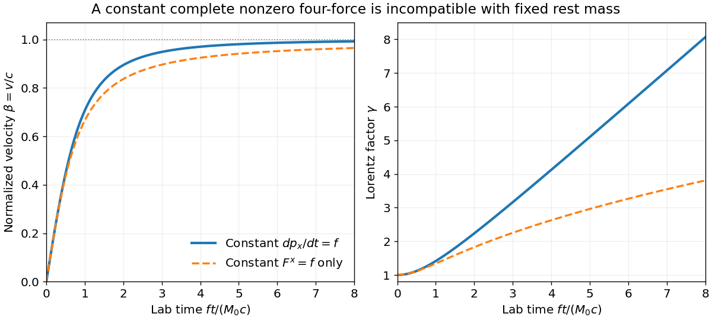

<h1 id="1/c/solution">Solution</h1>

↑ **Parent:** [C](../c.md)

There is no nonzero, literally constant [four-force](../../../../four-force.md) that is a [pure force](../../../../pure-force.md) throughout this motion. Initially $U=(c,0,0,0)$, so purity forces $F^0=0$. If the full four-vector were constant, $U(\tau)=U(0)+F\tau/M_0$; its square would be $c^2+F^2\tau^2/M_0^2$, which cannot remain $c^2$ for a nonzero initially spatial $F$. This is a genuine ambiguity in the source wording.

The usual consistent interpretation is constant laboratory [relativistic force](../../../../relativistic-force.md) $f=dp_x/dt$, equivalently constant one-dimensional [proper acceleration](../../../../proper-acceleration.md) $f/M_0$. Take $f>0$ and let $s=ft/(M_0c)$. Integrating [momentum conservation](../../../../momentum-conservation.md) with the applied impulse gives $p_x=ft$, so

$$
\boxed{U^\mu(t)=c\left(\sqrt{1+s^2},s,0,0\right),\qquad
\beta(t)=\frac{s}{\sqrt{1+s^2}},\qquad\gamma(t)=\sqrt{1+s^2}.}
$$

The corresponding [four-force](../../../../four-force.md) has components $F^\mu=\gamma f(\beta,1,0,0)$, which are not constant, although its invariant magnitude is $F^2=-f^2$. Its temporal component is indeed $F^0=(\gamma/c)dE/dt$. The speed rises from zero and approaches $c$ asymptotically; $\gamma$ starts at one, initially rises quadratically and becomes linear in $t$ at late times.

If instead only the spatial [four-force](../../../../four-force.md) component $F^x=f_x$ is held constant, the distinct consistent answer is most simply parametrized by $u=f_x\tau/(M_0c)$:

$$
\boxed{U^\mu=c(\sqrt{1+u^2},u,0,0),\qquad
\frac{f_xt}{M_0c}=\frac12\left[u\sqrt{1+u^2}+\operatorname{arsinh}u\right],\qquad
F^0=\frac{f_xu}{\sqrt{1+u^2}}.}
$$

This follows by integrating $dU^x/d\tau=f_x/M_0$ and $dt/d\tau=U^0/c$. The temporal component must still vary. These two interpretations must not be conflated with a constant four-vector.

**[Figure 1](#1/c/image-velocity-and-lorentz-factor-for-two-consistent-constant-force-interpretations). Velocity and Lorentz factor for two consistent constant-force interpretations**. Solid curves hold laboratory three-force constant; dashed curves hold only the spatial component of four-force constant. Both use the same force scale and start from rest. A nonzero constant complete four-force cannot preserve rest mass throughout the motion.

## ↑ Ancestors (12)

1. [C](../c.md)
2. [1](../../1.md)
3. [2017](../../../2017-split.md)
4. [Past exam of the symmetry and relativity course of the University of Oxford](../../../split.md)
5. [Symmetry and relativity course of the University of Oxford](../../../../symmetry-and-relativity-course-of-the-university-of-oxford.md)
6. [Year 3 of the physics course of the University of Oxford](../../../../year-3-of-the-physics-course-of-the-university-of-oxford.md)
7. [Physics course of the University of Oxford](../../../../physics-course-of-the-university-of-oxford.md)
8. [Undergraduate course of the University of Oxford](../../../../undergraduate-course-of-the-university-of-oxford.md)
9. [Course of the University of Oxford](../../../../course-of-the-university-of-oxford.md)
10. [University of Oxford](../../../../university-of-oxford-split.md)
11. [List of universities](../../../../list-of-universities.md)
12. [Codex Wiki](../../../../split.md)
