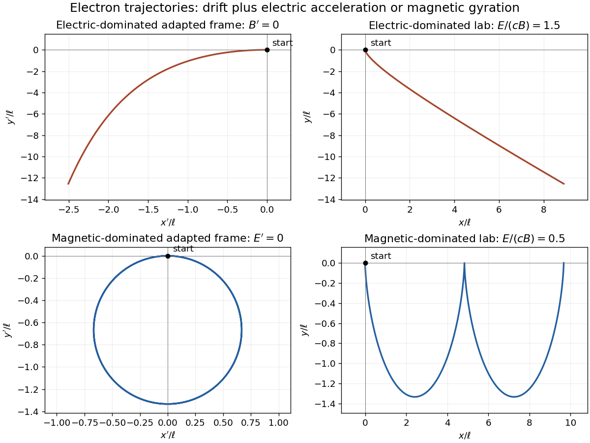

<h1 id="2/d/b/solution">Solution</h1>

↑ **Parent:** [B](../b.md)

For the [magnetic-dominated crossed-field orbit](../../../../../magnetic-dominated-crossed-field-orbit.md), choose $V=E/B$ along $x$, which is subluminal when $|E|<c|B|$. Then $E'_y=0$ and $B'_z=B/\Gamma$. The initial [velocity](../../../../../velocity.md) in this frame is $(-V,0,0)$, and the constant particle [Lorentz factor](../../../../../lorentz-factor.md) is $\gamma'=\Gamma$ because a [magnetic field](../../../../../magnetic-field-split.md) does no work.

Define the signed relativistic [cyclotron frequency](../../../../../cyclotron-frequency.md) $\Omega=qB'_z/(\Gamma m_e)$, retaining $q=-e$. With $t'$ as parameter, the exact primed trajectory is

$$
\boxed{x'=-\frac V\Omega\sin(\Omega t'),\qquad
y'=\frac V\Omega[1-\cos(\Omega t')],\qquad z'=0.}
$$

It is a circle of radius $|V/\Omega|$ with centre $(0,V/\Omega)$; its initial [velocity](../../../../../velocity.md) is $(-V,0,0)$ as required. Transforming back gives

$$
\boxed{x=\Gamma V\left[t'-\frac{\sin(\Omega t')}{\Omega}\right],\qquad
y=\frac V\Omega[1-\cos(\Omega t')],\qquad
t=\Gamma\left[t'-\frac{V^2}{c^2\Omega}\sin(\Omega t')\right].}
$$

In the laboratory this is a stretched cycloidal trajectory with cusps where the [electron](../../../../../electron.md) is instantaneously at rest. Its average drift is $\langle v_x\rangle=V=E/B$, along $\mathbf E\times\mathbf B$ for the positive field orientation. Its [energy](../../../../../energy-split.md) oscillates as the [electric field](../../../../../electric-field-split.md) exchanges [energy](../../../../../energy-split.md) with it; it does not accelerate without bound. If $E=0$, the initially stationary [electron](../../../../../electron.md) remains stationary. At $|E|=c|B|$, neither of these finite boosts exists; that separate null-field limit is not one of the two strict cases requested.

**[Figure 2](#2/d/b/image-exact-electron-trajectories-in-electric-dominated-and-magnetic-dominated-crossed-fields). Exact electron trajectories in electric-dominated and magnetic-dominated crossed fields**. Original curves use $q=-e$ and an [electron](../../../../../electron.md) released from rest in the laboratory. Adapted inertial frames eliminate the [magnetic field](../../../../../magnetic-field-split.md) or [electric field](../../../../../electric-field-split.md), respectively. The lab magnetic-dominated curve has cycloidal cusps; the electric-dominated curve has an oblique relativistic asymptote.

## ↑ Ancestors (13)

1. [B](../b.md)
2. [D](../../d.md)
3. [2](../../../2.md)
4. [2017](../../../../2017-split.md)
5. [Past exam of the symmetry and relativity course of the University of Oxford](../../../../split.md)
6. [Symmetry and relativity course of the University of Oxford](../../../../../symmetry-and-relativity-course-of-the-university-of-oxford.md)
7. [Year 3 of the physics course of the University of Oxford](../../../../../year-3-of-the-physics-course-of-the-university-of-oxford.md)
8. [Physics course of the University of Oxford](../../../../../physics-course-of-the-university-of-oxford.md)
9. [Undergraduate course of the University of Oxford](../../../../../undergraduate-course-of-the-university-of-oxford.md)
10. [Course of the University of Oxford](../../../../../course-of-the-university-of-oxford.md)
11. [University of Oxford](../../../../../university-of-oxford-split.md)
12. [List of universities](../../../../../list-of-universities.md)
13. [Codex Wiki](../../../../../split.md)
