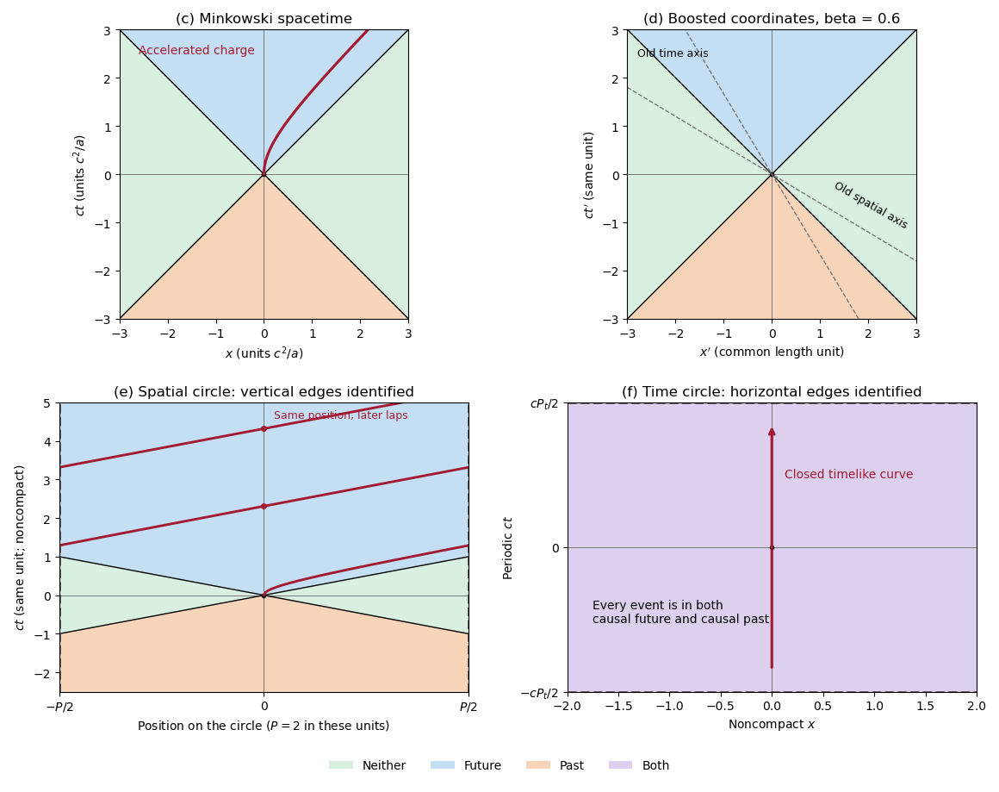
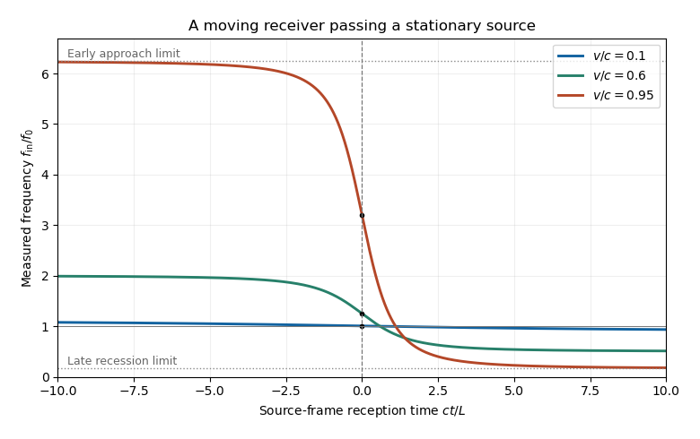
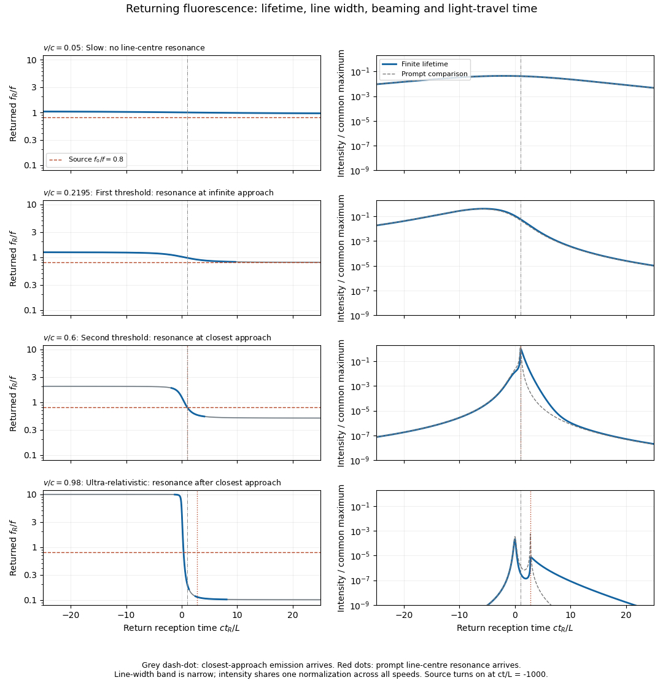

# 2019

↑ **Parent:** [Past exam of the symmetry and relativity course of the University of Oxford](../past-exam-of-the-symmetry-and-relativity-course-of-the-university-of-oxford.md)

Source paper: [https://www.whatdotheyknow.com/request/oxford_physics_past_papers_2/response/2340696/attach/7/Physics%20Papers%202018.pdf?cookie_passthrough=1](https://www.whatdotheyknow.com/request/oxford_physics_past_papers_2/response/2340696/attach/7/Physics%20Papers%202018.pdf?cookie_passthrough=1)

**Table of contents**

- [1](#1)
  - [a](#1/a)
    - [Solution](#1/a/solution)
  - [b](#1/b)
    - [Solution](#1/b/solution)
  - [c](#1/c)
    - [Solution](#1/c/solution)
    - [i](#1/c/i)
      - [Solution](#1/c/i/solution)
    - [ii](#1/c/ii)
      - [Solution](#1/c/ii/solution)
    - [iii](#1/c/iii)
      - [Solution](#1/c/iii/solution)
  - [d](#1/d)
    - [i](#1/d/i)
      - [Solution](#1/d/i/solution)
    - [ii](#1/d/ii)
      - [Solution](#1/d/ii/solution)
    - [iii](#1/d/iii)
      - [Solution](#1/d/iii/solution)
  - [e](#1/e)
    - [Solution](#1/e/solution)
    - [i](#1/e/i)
      - [Solution](#1/e/i/solution)
    - [ii](#1/e/ii)
      - [Solution](#1/e/ii/solution)
    - [iii](#1/e/iii)
      - [Solution](#1/e/iii/solution)
  - [f](#1/f)
    - [Solution](#1/f/solution)
    - [i](#1/f/i)
      - [Solution](#1/f/i/solution)
    - [ii](#1/f/ii)
      - [Solution](#1/f/ii/solution)
    - [iii](#1/f/iii)
      - [Solution](#1/f/iii/solution)
- [2](#2)
  - [a](#2/a)
    - [Solution](#2/a/solution)
  - [b](#2/b)
    - [Solution](#2/b/solution)
  - [c](#2/c)
    - [i](#2/c/i)
      - [Solution](#2/c/i/solution)
    - [ii](#2/c/ii)
      - [Solution](#2/c/ii/solution)
    - [iii](#2/c/iii)
      - [Solution](#2/c/iii/solution)
- [3](#3)
  - [a](#3/a)
    - [Solution](#3/a/solution)
  - [b](#3/b)
    - [Solution](#3/b/solution)
  - [c](#3/c)
    - [Solution](#3/c/solution)
  - [d](#3/d)
    - [Solution](#3/d/solution)
- [4](#4)
  - [a](#4/a)
    - [Solution](#4/a/solution)
  - [b](#4/b)
    - [Solution](#4/b/solution)
    - [i](#4/b/i)
      - [Solution](#4/b/i/solution)
    - [ii](#4/b/ii)
      - [Solution](#4/b/ii/solution)
  - [c](#4/c)
    - [Solution](#4/c/solution)
  - [d](#4/d)
    - [Solution](#4/d/solution)
  - [e](#4/e)
    - [Solution](#4/e/solution)

## 1

↑ **Parent:** [2019](2019.md)

<h3 id="1/a">a</h3>

↑ **Parent:** [1](#1)

<h4 id="1/a/solution">Solution</h4>

↑ **Parent:** [A](#1/a)

Use coordinates $X^\mu=(ct,\mathbf x)$ and the mostly-plus [Minkowski metric](../special-relativity.md#minkowski-metric) $\eta_{\mu\nu}=\operatorname{diag}(-1,1,1,1)$. Along a future-directed timelike [world line](../special-relativity.md#world-line), [proper time](../special-relativity.md#proper-time) satisfies

$$
c^2d\tau^2=-\eta_{\mu\nu}dX^\mu dX^\nu=c^2dt^2-d\mathbf x^2,
\qquad d\tau=dt\sqrt{1-v^2/c^2}.
$$

The [four-velocity](../special-relativity.md#four-velocity) and [four-acceleration](../special-relativity.md#four-acceleration) are

$$
\boxed{U^\mu=\frac{dX^\mu}{d\tau}=\gamma(c,\mathbf v),\qquad
A^\mu=\frac{dU^\mu}{d\tau},\qquad\gamma=(1-v^2/c^2)^{-1/2}.}
$$

The [Minkowski norm](../special-relativity.md#minkowski-norm) is fixed: $U^\mu U_\mu=-c^2$. Differentiating with respect to [proper time](../special-relativity.md#proper-time), using the constant [Minkowski metric](../special-relativity.md#minkowski-metric), gives

$$
0=\frac{d}{d\tau}(U^\mu U_\mu)=2U_\mu A^\mu,
\qquad \boxed{\mathbf U\cdot\mathbf A=0.}
$$

In the instantaneous rest [reference frame](../mathematical-physics.md#reference-frame), $U^\mu=(c,0,0,0)$, so the orthogonality says $A^0=0$ there. This construction uses a timelike [world line](../special-relativity.md#world-line); a [massless particle](../physics.md#massless-particle) has no rest-frame [proper time](../special-relativity.md#proper-time) parameter.

<h3 id="1/b">b</h3>

↑ **Parent:** [1](#1)

<h4 id="1/b/solution">Solution</h4>

↑ **Parent:** [B](#1/b)

Let $m$ denote the constant [rest mass](../special-relativity.md#invariant-mass), set $x(0)=0$, and put $a=f_x/m$. The relativistic three-[force](../force.md) is $f_x=dp_x/dt$, so

$$
p_x=f_xt,\qquad p_x=\gamma m\dot x,\qquad
\gamma=\sqrt{1+\frac{f_x^2t^2}{m^2c^2}}.
$$

It follows that

$$
\boxed{\dot x(t)=\frac{at}{\sqrt{1+(at/c)^2}},\qquad
\ddot x(t)=\frac{a}{[1+(at/c)^2]^{3/2}}.}
$$

Integrating the [velocity](../classical-mechanics.md#velocity) with the initial position fixed gives

$$
\boxed{x(t)=\frac{c^2}{a}\left[\sqrt{1+(at/c)^2}-1\right].}
$$

These formulas allow either sign of $a$; their $a\to0$ limit is rest at the origin. For $a\ne0$, the trajectory obeys

$$
\left(x+\frac{c^2}{a}\right)^2-c^2t^2=\frac{c^4}{a^2}.
$$

This is [hyperbolic motion](../special-relativity.md#hyperbolic-motion). Its coordinate [acceleration](../classical-mechanics.md#acceleration) decreases while its [proper acceleration](../special-relativity.md#proper-acceleration) has constant magnitude $|a|$. In particular, a constant three-[force](../force.md) does not give constant coordinate [acceleration](../classical-mechanics.md#acceleration) at relativistic [speed](../classical-mechanics.md#speed).

<h3 id="1/c">c</h3>

↑ **Parent:** [1](#1)

<h4 id="1/c/solution">Solution</h4>

↑ **Parent:** [C](#1/c)

The upper-left panel shows the three [causal structure](../general-relativity.md#causal-structure) regions, with null boundaries included in the appropriate [causal future](../general-relativity.md#causal-future) and [causal past](../general-relativity.md#causal-past). For the charged trajectory, use part [b](#1/b) with $a=qE_x/m$, choosing the $x$ direction so that $a>0$. The [electric field](../electric-field.md) gives the constant three-[force](../force.md) $qE_x$ and hence the shifted hyperbola

$$
\boxed{\left(x+\frac{c^2}{a}\right)^2-c^2t^2=\frac{c^4}{a^2},\qquad t\ge0.}
$$

It starts with a vertical tangent at the origin, stays strictly inside the future [light cone](../special-relativity.md#light-cone), and asymptotes to $x=ct-c^2/a$. The other panels implement the coordinate and topology changes used below; they are original [spacetime diagrams](../mathematical-physics.md#spacetime-diagram), not copies of source artwork.

**[Figure 1](#1/c/image-causal-regions-in-minkowski-spacetime-and-in-spatially-or-temporally-periodic-flat-spacetimes). Causal regions in Minkowski spacetime and in spatially or temporally periodic flat spacetimes**. Blue denotes the causal future, orange the causal past, green events in neither, and purple membership in both. The top panels use ordinary and boosted inertial coordinates. The spatial quotient identifies vertical edges and shows the accelerated worldline wrapping across them. The temporal quotient identifies horizontal edges; every event belongs to both causal sets.

<h4 id="1/c/i">i</h4>

↑ **Parent:** [C](#1/c)

<h5 id="1/c/i/solution">Solution</h5>

↑ **Parent:** [I](#1/c/i)

A future-directed [causal curve](../general-relativity.md#causal-curve) from the origin has $|dx/dt|\le c$. Integrating this inequality gives the [causal future](../general-relativity.md#causal-future)

$$
\boxed{J^+(0)=\{(t,x):ct\ge|x|\}.}
$$

The straight timelike or null segment proves sufficiency. This is the blue region above the two null rays in the upper-left [spacetime diagram](../mathematical-physics.md#spacetime-diagram) of part [c](#1/c).

<h4 id="1/c/ii">ii</h4>

↑ **Parent:** [C](#1/c)

<h5 id="1/c/ii/solution">Solution</h5>

↑ **Parent:** [Ii](#1/c/ii)

Reverse the endpoints of the future-directed [causal curve](../general-relativity.md#causal-curve). The origin can be reached precisely from its [causal past](../general-relativity.md#causal-past),

$$
\boxed{J^-(0)=\{(t,x):ct\le-|x|\}.}
$$

This is the orange region below the two null rays in part [c](#1/c). The origin itself belongs to both the [causal future](../general-relativity.md#causal-future) and [causal past](../general-relativity.md#causal-past) by the usual zero-length-curve convention.

<h4 id="1/c/iii">iii</h4>

↑ **Parent:** [C](#1/c)

<h5 id="1/c/iii/solution">Solution</h5>

↑ **Parent:** [Iii](#1/c/iii)

Outside both [light cones](../special-relativity.md#light-cone), the separation from the origin is spacelike. Thus the events in neither the [causal past](../general-relativity.md#causal-past) nor the [causal future](../general-relativity.md#causal-future) are

$$
\boxed{\{(t,x):|x|>c|t|\}.}
$$

No [causal curve](../general-relativity.md#causal-curve) can connect either endpoint to the other. These are the two green side regions in part [c](#1/c); the strict inequality excludes the causally reachable null boundaries.

<h3 id="1/d">d</h3>

↑ **Parent:** [1](#1)

<h4 id="1/d/i">i</h4>

↑ **Parent:** [D](#1/d)

<h5 id="1/d/i/solution">Solution</h5>

↑ **Parent:** [I](#1/d/i)

For the standard passive [Lorentz boost](../special-relativity.md#lorentz-boost), write $\beta=v/c$ and

$$
ct'=\gamma(ct-\beta x),\qquad x'=\gamma(x-\beta ct).
$$

A [proper orthochronous Lorentz transformation](../special-relativity.md#proper-orthochronous-lorentz-transformation) preserves the sign of the time component of a nonzero future [causal vector](../general-relativity.md#causal-vector) and preserves its [Minkowski norm](../special-relativity.md#minkowski-norm). Therefore

$$
\boxed{J^+(0)=\{(t',x'):ct'\ge|x'|\}.}
$$

The upper-right panel of part [c](#1/c) uses $x'$ horizontally and $ct'$ vertically. Its null rays still have slopes $\pm1$. The grey dashed old axes satisfy $x'=-\beta ct'$ for the old time axis and $ct'=-\beta x'$ for the old spatial axis; changing the coordinate grid has not changed which events are reachable.

<h4 id="1/d/ii">ii</h4>

↑ **Parent:** [D](#1/d)

<h5 id="1/d/ii/solution">Solution</h5>

↑ **Parent:** [Ii](#1/d/ii)

The same [Lorentz transformation](../special-relativity.md#lorentz-transformation) maps the past [light cone](../special-relativity.md#light-cone) to itself. In the primed axes the [causal past](../general-relativity.md#causal-past) is

$$
\boxed{J^-(0)=\{(t',x'):ct'\le-|x'|\},}
$$

the orange region in the upper-right [spacetime diagram](../mathematical-physics.md#spacetime-diagram) of part [c](#1/c). Future and past are not interchanged by the standard boost.

<h4 id="1/d/iii">iii</h4>

↑ **Parent:** [D](#1/d)

<h5 id="1/d/iii/solution">Solution</h5>

↑ **Parent:** [Iii](#1/d/iii)

The invariant spacelike condition is $x'^2-c^2t'^2>0$. Hence the primed-coordinate events in neither the [causal future](../general-relativity.md#causal-future) nor the [causal past](../general-relativity.md#causal-past) obey

$$
\boxed{|x'|>c|t'|.}
$$

The green regions in part [c](#1/c) retain their shape in primed coordinates. A particular spacelike event's coordinate [time](../classical-mechanics.md#time-in-physics) may change sign, but it never enters either [light cone](../special-relativity.md#light-cone).

<h3 id="1/e">e</h3>

↑ **Parent:** [1](#1)

<h4 id="1/e/solution">Solution</h4>

↑ **Parent:** [E](#1/e)

For [causal reachability on a spatial circle](../general-relativity.md#causal-reachability-on-a-spatial-circle), put $P=2\pi R$ and use a representative $\bar x\in[-P/2,P/2)$ of the spatial circle. The lower-left panel of part [c](#1/c) is a fundamental strip with its vertical edges identified. On the covering space the charged [world line](../special-relativity.md#world-line) is still the solution of part [b](#1/b); on the quotient it is

$$
\bar x(t)=x(t)\pmod P.
$$

A jump between opposite strip edges is a coordinate seam, not a discontinuity of the physical [world line](../special-relativity.md#world-line). At its $n$th complete lap, $x=nP$, so

$$
\boxed{\gamma_n=1+\frac{anP}{c^2},\qquad
t_n=\frac ca\sqrt{\left(1+\frac{anP}{c^2}\right)^2-1},\qquad
v_n=c\sqrt{1-\gamma_n^{-2}}.}
$$

For $a=qE_x/m>0$, the [speed](../classical-mechanics.md#speed) increases on each return while remaining below $c$. Its [kinetic energy](../energy.md#kinetic-energy) increases by

$$
\boxed{K_{n+1}-K_n=qE_xP.}
$$

There is no single-valued electrostatic [potential energy](../energy.md#potential-energy) $-qE_x\bar x$ on a circle: the nonzero [electromotive force](../electric-charge.md#electromotive-force) is $\oint\mathbf E\cdot d\mathbf l=E_xP$. A globally defined [magnetic vector potential](../electromagnetism.md#magnetic-vector-potential) one-form $A_x=-E_xt$ instead makes the driving explicit. In an embedded circuit, [Faraday's law](../maxwell-equations.md#faraday-s-law-of-induction) realizes this [electromotive force](../electric-charge.md#electromotive-force) through changing magnetic flux. More generally an external apparatus maintaining the field supplies the increasing particle [energy](../energy.md). In an isolated dynamical field-plus-particle system, backreaction would change the field. Thus this is not a cyclic machine extracting work from a conservative potential, and it does not violate [conservation of energy](../mathematical-physics.md#conservation-of-energy).

<h4 id="1/e/i">i</h4>

↑ **Parent:** [E](#1/e)

<h5 id="1/e/i/solution">Solution</h5>

↑ **Parent:** [I](#1/e/i)

A [causal curve](../general-relativity.md#causal-curve) can wind around the spatial circle. Lift its endpoint to $x+nP$ on the covering space. A lift is reachable from the origin if $ct\ge|x+nP|$ for at least one integer $n$. With shortest circular distance

$$
d(x,0)=\min_{n\in\mathbb Z}|x+nP|\le\frac P2,
$$

the [causal future](../general-relativity.md#causal-future) is

$$
\boxed{J^+(0)=\{(t,\bar x):ct\ge d(\bar x,0)\}.}
$$

In the centred fundamental strip, $d=|\bar x|$. For $t\ge P/(2c)=\pi R/c$, every spatial point is in the [causal future](../general-relativity.md#causal-future). This produces the fully blue upper part of the lower-left panel in part [c](#1/c).

<h4 id="1/e/ii">ii</h4>

↑ **Parent:** [E](#1/e)

<h5 id="1/e/ii/solution">Solution</h5>

↑ **Parent:** [Ii](#1/e/ii)

The [causal past](../general-relativity.md#causal-past) follows from the same covering-space argument with reversed endpoints:

$$
\boxed{J^-(0)=\{(t,\bar x):-ct\ge d(\bar x,0)\}.}
$$

For $t\le-\pi R/c$, the whole spatial circle can send a causal signal to the origin. The lower-left [spacetime diagram](../mathematical-physics.md#spacetime-diagram) in part [c](#1/c) is therefore completely orange sufficiently far below the origin.

<h4 id="1/e/iii">iii</h4>

↑ **Parent:** [E](#1/e)

<h5 id="1/e/iii/solution">Solution</h5>

↑ **Parent:** [Iii](#1/e/iii)

The complement of the [causal future](../general-relativity.md#causal-future) and [causal past](../general-relativity.md#causal-past) is

$$
\boxed{c|t|<d(\bar x,0).}
$$

This green region is confined to $|t|<\pi R/c$ and meets the identified strip edges. Spatial periodicity creates alternative signal paths, but time remains noncompact and no [closed timelike curve](../general-relativity.md#closed-timelike-curve) follows from this spatial identification.

<h3 id="1/f">f</h3>

↑ **Parent:** [1](#1)

<h4 id="1/f/solution">Solution</h4>

↑ **Parent:** [F](#1/f)

For [causal reachability with periodic time](../general-relativity.md#causal-reachability-with-periodic-time), let $P_t=2\pi T$. The lower-right panel of part [c](#1/c) identifies its top and bottom edges. The vertical curve at fixed $x$ is a [closed timelike curve](../general-relativity.md#closed-timelike-curve): after a positive proper duration $P_t$, it returns to the same [spacetime event](../special-relativity.md#event-relativity). The quotient is a mathematically well-defined flat [Lorentzian manifold](../topological-manifold.md#lorentzian-manifold), but it violates chronology and admits no usual global causal ordering or ordinary global initial-value evolution.

These are physical causality problems, rather than an algebraic contradiction in the metric. Fields and particle histories must satisfy periodic consistency conditions; an arbitrary initial state followed by irreversible evolution will generally fail to return to itself after a temporal lap. The fact that the [causal past](../general-relativity.md#causal-past) and [causal future](../general-relativity.md#causal-future) overlap everywhere, established below, explains why the ordinary three-way causal partition degenerates.

<h4 id="1/f/i">i</h4>

↑ **Parent:** [F](#1/f)

<h5 id="1/f/i/solution">Solution</h5>

↑ **Parent:** [I](#1/f/i)

For any representative event $(t,x)$, choose an integer $n$ large enough that $c(t+nP_t)>|x|$. A future-directed timelike segment from the origin to that lift projects to a [causal curve](../general-relativity.md#causal-curve) on the quotient. Therefore

$$
\boxed{J^+(0)=\text{the entire spacetime}.}
$$

Even points with large $|x|$ can be reached by allowing sufficiently many temporal windings. The purple lower-right panel in part [c](#1/c) denotes simultaneous membership in both the [causal future](../general-relativity.md#causal-future) and [causal past](../general-relativity.md#causal-past).

<h4 id="1/f/ii">ii</h4>

↑ **Parent:** [F](#1/f)

<h5 id="1/f/ii/solution">Solution</h5>

↑ **Parent:** [Ii](#1/f/ii)

Choose an integer $n$ sufficiently negative that $c(t+nP_t)<-|x|$. That lift lies in the ordinary [causal past](../general-relativity.md#causal-past) of the origin, and its projected [causal curve](../general-relativity.md#causal-curve) reaches the origin. Hence

$$
\boxed{J^-(0)=\text{the entire spacetime}.}
$$

Future-directed curves can connect the origin and an arbitrary event in either order. This property includes the origin's nontrivial [closed timelike curves](../general-relativity.md#closed-timelike-curve).

<h4 id="1/f/iii">iii</h4>

↑ **Parent:** [F](#1/f)

<h5 id="1/f/iii/solution">Solution</h5>

↑ **Parent:** [Iii](#1/f/iii)

Every event is in both the [causal future](../general-relativity.md#causal-future) and [causal past](../general-relativity.md#causal-past), so

$$
\boxed{\text{events in neither causal set}=\varnothing.}
$$

Drawing just the nearest two null rays on a temporally identified strip would miss winding [causal curves](../general-relativity.md#causal-curve) and give an incorrect nonempty exterior region.

## 2

↑ **Parent:** [2019](2019.md)

<h3 id="2/a">a</h3>

↑ **Parent:** [2](#2)

<h4 id="2/a/solution">Solution</h4>

↑ **Parent:** [A](#2/a)

Use the inverse standard [Lorentz boost](../special-relativity.md#lorentz-boost), $t=\gamma_v(t'+vx'/c^2)$ and $x=\gamma_v(x'+vt')$. Label two rod endpoints by a separation $\Delta x'=L$; their world lines satisfy $y'=ut'$. A rod's orientation in $S$ must compare endpoint events simultaneous in $S$, not in $S'$. Consequently

$$
0=\Delta t=\gamma_v\left(\Delta t'+\frac{vL}{c^2}\right),\qquad
\Delta t'=-\frac{vL}{c^2}.
$$

Then

$$
\Delta x=\gamma_v(L+v\Delta t')=\frac L{\gamma_v},\qquad
\Delta y=u\Delta t'=-\frac{uvL}{c^2}.
$$

The signed counterclockwise angle therefore satisfies

$$
\boxed{\tan\theta=-\gamma_v\frac{uv}{c^2}.}
$$

For positive $u,v$, the rod slopes downward to the right, so the acute clockwise angle is $\arctan(\gamma_vuv/c^2)$. This is a [relativity of simultaneity](../special-relativity.md#relativity-of-simultaneity) effect in addition to the longitudinal [length contraction](../special-relativity.md#length-contraction); the rod is not being mechanically bent by the coordinate change.

<h3 id="2/b">b</h3>

↑ **Parent:** [2](#2)

<h4 id="2/b/solution">Solution</h4>

↑ **Parent:** [B](#2/b)

Let $t$ label the reception event in the source [reference frame](../mathematical-physics.md#reference-frame). Its distance from the source and the relevant [retarded time](../relativistic-electromagnetism.md#retarded-time) are

$$
r(t)=\sqrt{L^2+v^2t^2},\qquad t_e=t-\frac{r(t)}c.
$$

The received phase is $2\pi f_0t_e$. Because the observer's [proper time](../special-relativity.md#proper-time) obeys $d\tau=dt/\gamma$, its measured [frequency](../wave.md#frequency) is

$$
\boxed{f_{\rm in}(t)=f_0\frac{dt_e}{d\tau}
=\gamma f_0\left(1-\frac{v^2t}{c\sqrt{L^2+v^2t^2}}\right).}
$$

Equivalently, write $\beta=v/c$ and $s(t)=vt/r(t)$. The incoming [Doppler factor](../special-relativity.md#doppler-factor) is $D_{\rm in}=\gamma(1-\beta s)$, obtained also by contracting the [photon](../quantum-mechanics.md#photon) [four-momentum](../special-relativity.md#four-momentum) with the observer's [four-velocity](../special-relativity.md#four-velocity). The [frequency](../wave.md#frequency) decreases monotonically, with

$$
\boxed{f_{\rm in}(-\infty)=\gamma(1+\beta)f_0,\quad
f_{\rm in}(0)=\gamma f_0,\quad
f_{\rm in}(+\infty)=\gamma(1-\beta)f_0.}
$$

In particular, the instant of closest approach is not the zero-shift point: a moving receiver looking perpendicular to its motion sees a factor $\gamma$, not $1/\gamma$. The latter factor applies to a different moving-emitter geometry. The graph uses source-frame reception time, with observer [proper time](../special-relativity.md#proper-time) $\tau=t/\gamma$.

**[Figure 2](#2/b/image-frequency-measured-by-an-observer-passing-a-stationary-monochromatic-source). Frequency measured by an observer passing a stationary monochromatic source**. Each curve gives the received frequency divided by the emitted frequency against source-frame time ct/L. The vertical line marks closest approach; the black points have height gamma. Approaching and receding asymptotes are labelled for the fastest observer.

<h3 id="2/c">c</h3>

↑ **Parent:** [2](#2)

<h4 id="2/c/i">i</h4>

↑ **Parent:** [C](#2/c)

<h5 id="2/c/i/solution">Solution</h5>

↑ **Parent:** [I](#2/c/i)

A useful plot must keep three different times separate: source emission $t_e$, atomic absorption or re-emission $t$, and return reception $t_R$. For the cloud centroid,

$$
t_e=t-r(t)/c,\qquad \boxed{t_R=t+r(t)/c,\quad\frac{dt_R}{dt}=1+\beta s(t)>0.}
$$

Let $q=f_0/f<1$. Resonant excitation requires $qD_{\rm in}(t)=1$. Since $D_{\rm in}$ decreases from $\gamma(1+\beta)$ to $\gamma(1-\beta)$, its zero-width resonance first becomes possible at

$$
\boxed{\beta_{\min}=\frac{1-q^2}{1+q^2}.}
$$

At equality the line centre is reached only at infinite approach distance, where illumination vanishes. A finite source start time further limits how closely that ideal threshold is approached. For $\beta>\beta_{\min}$ the line-centre event satisfies

$$
s_* =\frac{1-1/(\gamma q)}{\beta},\qquad
t_* =\frac Lv\frac{s_*}{\sqrt{1-s_*^2}}.
$$

There is a second useful critical speed,

$$
\boxed{\beta_\perp=\sqrt{1-q^2},}
$$

for which excitation is centred on closest approach, $t_*=0$. For $\beta_{\min}<\beta<\beta_\perp$ it occurs on approach; for $\beta>\beta_\perp$ it occurs after closest approach. Even a receding ultra-relativistic atom can see the incident light blueshifted because $\gamma$ is large.

A [photon](../quantum-mechanics.md#photon) emitted toward the origin near the atomic rest-frame [frequency](../wave.md#frequency) $f$ has return [Doppler factor](../special-relativity.md#doppler-factor)

$$
\boxed{D_{\rm out}(t)=\frac1{\gamma[1+\beta s(t)]},\qquad
f_R(t_R(t))=D_{\rm out}(t)f.}
$$

The sign differs from that in $D_{\rm in}$ because the returning ray travels in the opposite direction. The returning line centre decreases from $\gamma(1+\beta)f$ on early approach to $\gamma(1-\beta)f$ on late recession, and is $f/\gamma$ at closest-approach emission. The origin receives that closest-approach radiation at $t_R=L/c$, not at zero. Prompt re-emission at exact resonance would give

$$
\boxed{\frac{f_R(t_R(t_*))}{f_0}=\frac1{2\gamma q-1}.}
$$

It is above $f_0$ below $\beta_\perp$, equal at $\beta_\perp$, and below $f_0$ above it. A finite [fluorescence lifetime](../fluorescence.md#fluorescence-lifetime) shifts emission later along the orbit and therefore usually toward a lower return [frequency](../wave.md#frequency).

The following plots adopt a compact, optically thin cloud, weak excitation, isotropic incoherent [spontaneous emission](../atomic-physics.md#spontaneous-emission) in the atomic rest frame, and negligible velocity dispersion. They show an intensity envelope as the observable amplitude; its rms electric-field amplitude is proportional to the square root of this intensity. An incoherent [fluorescence](../fluorescence.md) signal has no fixed optical phase. The four rows include a nonrelativistic speed, both critical speeds, and an ultra-relativistic speed. All rows share one intensity normalization, so off-resonant signals remain visibly weak.

**[Figure 3](#2/c/i/image-illustrative-returning-fluorescence-for-slow-motion-both-resonance-thresholds-and-ultra-relativistic-motion). Illustrative returning fluorescence for slow motion, both resonance thresholds, and ultra-relativistic motion**. Left panels show the returned atomic line centre and its finite-width band; a dashed line marks the source frequency. Right panels show received intensity on a common logarithmic scale, with a thin curve for the zero-lifetime comparison. The model uses f0/f equal to 0.8, proper lifetime c tau/L equal to 0.4, fractional natural full width 0.02, and a finite source turn-on. Solid curves include the population decay, retarded reception and beaming.

A model for [fluorescence from a uniformly moving cloud](../fluorescence.md#fluorescence-from-a-uniformly-moving-cloud) generating the plotted envelopes is

$$
\frac{dN_*}{dt}=P_{\rm abs}(t)-\frac{N_*}{\gamma\tau},\qquad
P_{\rm abs}(t)\propto\frac{1-\beta s(t)}{r(t)^2}\,
\mathcal L\bigl(D_{\rm in}(t)f_0-f\bigr)\,H(t_e+T),
$$

where $\mathcal L(\Delta)=[1+4\Delta^2/\Gamma^2]^{-1}$ is a [Lorentz line shape](../atomic-physics.md#lorentz-line-shape) of full width $\Gamma$. The factor $1-\beta s$ is the incident photon-flux correction per source-frame time. The population is an exponential memory of earlier absorption events, not an instantaneous resonance indicator. For a detector of fixed small area at the origin, its received bolometric intensity scales as

$$
\boxed{I_R(t_R(t))\propto\frac{D_{\rm out}(t)^4}{r(t)^2}\frac{N_*(t)}\tau.}
$$

Two powers of $D_{\rm out}$ come from [aberration of light](../mathematical-physics.md#relativistic-aberration), one from photon [energy](../energy.md), and one from arrival-rate compression. Finite lifetime is dilated to $\gamma\tau$ in the source frame; over an interval with slowly changing geometry its observed decay time is $\tau/D_{\rm out}$. Thus approach can compress and amplify a pulse, while recession stretches and redshifts it. Illumination and collection each supply an inverse-square geometric factor in the prompt weak-excitation limit. Strong forward beaming can even make a detuned approaching precursor brighter than the later line-centre feature, as in the ultra-relativistic row; the intensity maximum need not occur at exact resonance.

Absolute amplitude and a unique detailed [spectral line profile](../atomic-physics.md#spectral-line-profile) cannot be inferred from $f,\tau,v$ alone: cloud size, atom number, source power, optical depth, angular emission pattern and saturation were not specified. Finite cloud size convolves these point-centroid curves with additional delays. The plots describe incoherent, frequency-redistributed emission near $f$; a coherent [Rayleigh scattering](../electromagnetic-radiation.md#rayleigh-scattering) component would instead retain the driving frequency in the atom frame and add a different spectral component. These qualifications do not change the kinematic resonance thresholds or return-time relations.

<h4 id="2/c/ii">ii</h4>

↑ **Parent:** [C](#2/c)

<h5 id="2/c/ii/solution">Solution</h5>

↑ **Parent:** [Ii](#2/c/ii)

Decreasing $q=f_0/f$ increases the blueshift required for excitation. Both characteristic speeds move toward $c$:

$$
\beta_{\min}=\frac{1-q^2}{1+q^2},\qquad
\beta_\perp=\sqrt{1-q^2}.
$$

If $q$ is near one, modest approach speeds can excite the line. If $q\ll1$, only strongly relativistic motion reaches the line centre. At a fixed qualifying speed, decreasing $q$ moves the resonance toward earlier approach, since a larger $D_{\rm in}$ is required. It can also move the event outside the illumination window set by $t_e\ge-T$.

At fixed $q$, increasing $\beta$ moves the resonance from the far approaching tail, through closest approach at $\beta_\perp$, and eventually to the receding side. The received pulse [frequency](../wave.md#frequency) cannot be estimated simply by applying the same blueshift twice: the inward and outward [Doppler factors](../special-relativity.md#doppler-factor) are different, and decay may occur well after excitation. The critical-speed rows of part [i](#2/c/i) make these changes explicit.

<h4 id="2/c/iii">iii</h4>

↑ **Parent:** [C](#2/c)

<h5 id="2/c/iii/solution">Solution</h5>

↑ **Parent:** [Iii](#2/c/iii)

An excited-state population lifetime $\tau$ gives a [natural linewidth](../atomic-physics.md#natural-linewidth) whose Lorentzian full width in ordinary [frequency](../wave.md#frequency) is

$$
\boxed{\Gamma=\frac1{2\pi\tau},}
$$

when no extra dephasing broadens it. Additional thermal motion, collisions or inhomogeneity may increase the effective width. Therefore excitation is appreciable over $|D_{\rm in}f_0-f|\lesssim\Gamma/2$, rather than only at one event. A [Lorentz line shape](../atomic-physics.md#lorentz-line-shape) has nonzero wings, so $\beta_{\min}$ is a line-centre threshold, not a mathematically sharp cutoff of all signal. Below it, only a weak detuned wing may be excited; at it, finite-width illumination produces a broad weak precursor rather than a delta-function burst at infinity.

For a narrow line with a finite resonance time, a useful local excitation duration is

$$
\Delta t_{\rm exc}\sim\frac{\Gamma}{f_0|\dot D_{\rm in}(t_*)|},\qquad
\dot D_{\rm in}=-\frac{\gamma\beta vL^2}{r^3}.
$$

Near the far-approach threshold this linear estimate becomes large and the full line shape and inverse-square illumination must be retained. After re-emission, the received full width is approximately $D_{\rm out}\Gamma$ at a fixed emission event. Lifetime memory and the changing return [Doppler factor](../special-relativity.md#doppler-factor) additionally produce a chirp and a redder tail.

The plots in part [i](#2/c/i) use $\Gamma/f=0.02$ and $c\tau/L=0.4$, consistently corresponding to $fL/c=1/[2\pi(0.4)(0.02)]$ if the width is entirely natural. They are illustrative dimensionless parameters, not an asserted measurement for a specified atomic species.

## 3

↑ **Parent:** [2019](2019.md)

<h3 id="3/a">a</h3>

↑ **Parent:** [3](#3)

<h4 id="3/a/solution">Solution</h4>

↑ **Parent:** [A](#3/a)

An invariant has the same value when the same physical event or state is described in different [inertial frames](../mathematical-physics.md#inertial-frame). A conserved quantity has the same value as the physical system evolves, subject to its equations and isolation conditions. These are different comparisons. The [invariant mass](../special-relativity.md#invariant-mass) of a heated object can change with [time](../classical-mechanics.md#time-in-physics), while an isolated system's conserved [energy](../energy.md) has different numerical values in boosted frames.

Under a [Lorentz transformation](../special-relativity.md#lorentz-transformation) $x'^\mu=\Lambda^\mu{}_{\nu}x^\nu$, a [Lorentz four-vector](../special-relativity.md#four-vector) transforms as

$$
\boxed{V'^\mu(x')=\Lambda^\mu{}_{\nu}V^\nu(x).}
$$

A [covector](../dual-space.md#covector) transforms by the inverse matrix, $W'_\mu=(\Lambda^{-1})^\nu{}_{\mu}W_\nu$. A general [tensor](../multilinear-algebra.md#tensor) has one corresponding factor for each index; for example,

$$
\boxed{T'^{\mu\nu}{}_{\rho}(x')=
\Lambda^\mu{}_{\alpha}\Lambda^\nu{}_{\beta}
(\Lambda^{-1})^\gamma{}_{\rho}T^{\alpha\beta}{}_{\gamma}(x).}
$$

Contraction with the [Minkowski metric](../special-relativity.md#minkowski-metric) produces [Lorentz scalars](../special-relativity.md#lorentz-scalar); it does not by itself make those scalars conserved.

<h3 id="3/b">b</h3>

↑ **Parent:** [3](#3)

<h4 id="3/b/solution">Solution</h4>

↑ **Parent:** [B](#3/b)

To prove the [vanishing component theorem for a Lorentz four-vector](../special-relativity.md#vanishing-component-theorem-for-a-lorentz-four-vector), first suppose $Y^0=0$ in every [inertial frame](../mathematical-physics.md#inertial-frame). An infinitesimal boost along spatial direction $i$ gives $Y'^0=Y^0-\beta Y^i+O(\beta^2)$. It too vanishes for every $\beta$, so each $Y^i=0$. If instead a specified spatial component vanishes in every frame, spatial rotations first imply that all three spatial components vanish in a chosen frame, and a boost in the specified direction then forces $Y^0=0$. Therefore

$$
\boxed{\text{one specified component zero in every Lorentz frame}\ \Longrightarrow\ Y^\mu=0.}
$$

A physical consequence is that [conservation of energy](../mathematical-physics.md#conservation-of-energy) in every [inertial frame](../mathematical-physics.md#inertial-frame) implies full [four-momentum conservation](../special-relativity.md#four-momentum-conservation): apply the result to the difference between outgoing and incoming total [four-momenta](../special-relativity.md#four-momentum).

The statement fails for general [tensors](../multilinear-algebra.md#tensor). A nonzero antisymmetric rank-two [tensor](../multilinear-algebra.md#tensor) has $F^{00}=0$ in every frame, because antisymmetry is preserved. For an off-diagonal component, the nonzero [Minkowski metric](../special-relativity.md#minkowski-metric) is another counterexample: $\eta^{01}=0$ in all orthonormal [Lorentz frames](../general-relativity.md#lorentz-frame), while $\eta$ is certainly not zero. The transformation law can preserve structural zero components without forcing the entire [tensor](../multilinear-algebra.md#tensor) to vanish.

<h3 id="3/c">c</h3>

↑ **Parent:** [3](#3)

<h4 id="3/c/solution">Solution</h4>

↑ **Parent:** [C](#3/c)

Use $c=1$ and the mostly-plus [Minkowski metric](../special-relativity.md#minkowski-metric) fixed in part [a](#1/a). The [electromagnetic four-potential](../relativistic-electromagnetism.md#electromagnetic-four-potential) and its covariant form are

$$
A^\mu=(\phi,A_x,A_y,A_z),\qquad A_\mu=(-\phi,A_x,A_y,A_z).
$$

Define the [electromagnetic field tensor](../relativistic-electromagnetism.md#electromagnetic-field-tensor) by $F_{\mu\nu}=\partial_\mu A_\nu-\partial_\nu A_\mu$. Since $\mathbf E=-\nabla\phi-\partial_t\mathbf A$ and $\mathbf B=\nabla\times\mathbf A$,

$$
\boxed{F_{\mu\nu}=\begin{pmatrix}
0&-E_x&-E_y&-E_z\\
E_x&0&B_z&-B_y\\
E_y&-B_z&0&B_x\\
E_z&B_y&-B_x&0
\end{pmatrix}.}
$$

Raising both indices changes the signs of its time-space entries. The lower-index signs agree with [Section 2.4.2, equation (2.87), the explicit electromagnetic two-form](../physics-bibliography.md#general-relativity-by-david-tong); the signature and index placement must be kept consistent.

For a passive boost to a frame moving with $v\widehat{\mathbf x}$, transform the [tensor](../multilinear-algebra.md#tensor) as

$$
F'^{\mu\nu}=\Lambda^\mu{}_{\rho}\Lambda^\nu{}_{\sigma}F^{\rho\sigma},\qquad
\Lambda=\begin{pmatrix}\gamma&-\gamma v&0&0\\-\gamma v&\gamma&0&0\\0&0&1&0\\0&0&0&1\end{pmatrix}.
$$

For example, $F'^{02}=\gamma F^{02}-\gamma vF^{12}=\gamma(E_y-vB_z)$ and $F'^{12}=\gamma(B_z-vE_y)$. Reading off all entries gives

$$
\boxed{\begin{aligned}
E'_x&=E_x,& E'_y&=\gamma(E_y-vB_z),&E'_z&=\gamma(E_z+vB_y),\\
B'_x&=B_x,& B'_y&=\gamma(B_y+vE_z),&B'_z&=\gamma(B_z-vE_y).
\end{aligned}}
$$

For an arbitrary boost [velocity](../classical-mechanics.md#velocity) $\mathbf v$, rotational covariance gives the [Lorentz transformation of electromagnetic fields](../relativistic-electromagnetism.md#lorentz-transformation-of-electromagnetic-fields)

$$
\boxed{\begin{aligned}
\mathbf E'&=\gamma(\mathbf E+\mathbf v\times\mathbf B)
-\frac{\gamma^2}{\gamma+1}\mathbf v(\mathbf v\cdot\mathbf E),\\
\mathbf B'&=\gamma(\mathbf B-\mathbf v\times\mathbf E)
-\frac{\gamma^2}{\gamma+1}\mathbf v(\mathbf v\cdot\mathbf B).
\end{aligned}}
$$

Here all velocities are in $c=1$ units. Equivalently the parallel components are unchanged and the perpendicular components have the cross-product expressions multiplied by $\gamma$.

<h3 id="3/d">d</h3>

↑ **Parent:** [3](#3)

<h4 id="3/d/solution">Solution</h4>

↑ **Parent:** [D](#3/d)

The scalar contraction of the [electromagnetic field tensor](../relativistic-electromagnetism.md#electromagnetic-field-tensor) is

$$
F_{\mu\nu}F^{\mu\nu}=2(B^2-E^2).
$$

With orientation $\epsilon^{0123}=+1$, define the [dual electromagnetic field tensor](../relativistic-electromagnetism.md#dual-electromagnetic-field-tensor) by $\widetilde F^{\mu\nu}=\tfrac12\epsilon^{\mu\nu\rho\sigma}F_{\rho\sigma}$. Direct substitution gives

$$
\boxed{E^2-B^2=-\frac12F_{\mu\nu}F^{\mu\nu},\qquad
\mathbf E\cdot\mathbf B=-\frac14F_{\mu\nu}\widetilde F^{\mu\nu}.}
$$

The first is a [Lorentz scalar](../special-relativity.md#lorentz-scalar); the second is a [pseudoscalar](../quantum-mechanics.md#pseudoscalar), invariant under proper [Lorentz transformations](../special-relativity.md#lorentz-transformation) such as boosts and rotations. Under spatial inversion $\mathbf E$ changes sign while $\mathbf B$ does not, so $\mathbf E\cdot\mathbf B$ reverses sign. For example, $\mathbf E=\mathbf B=\widehat{\mathbf z}$ has product $+1$ before inversion and $-1$ afterwards. Thus the unrestricted statement including improper transformations needs this qualification.

For the spacetime integral, assume a globally regular [electromagnetic four-potential](../relativistic-electromagnetism.md#electromagnetic-four-potential) on ordinary Minkowski space and sufficient boundary decay. Using $\nabla\cdot\mathbf B=0$ and $\partial_t\mathbf B=-\nabla\times\mathbf E$,

$$
\begin{aligned}
\partial_t(\mathbf A\cdot\mathbf B)
&=(-\mathbf E-\nabla\phi)\cdot\mathbf B-\mathbf A\cdot(\nabla\times\mathbf E)\\
&=-2\mathbf E\cdot\mathbf B-\nabla\cdot(\phi\mathbf B+\mathbf E\times\mathbf A).
\end{aligned}
$$

Consequently

$$
\boxed{\mathbf E\cdot\mathbf B=-\frac12\partial_t(\mathbf A\cdot\mathbf B)
-\frac12\nabla\cdot(\phi\mathbf B+\mathbf E\times\mathbf A).}
$$

The [magnetic helicity boundary term](../electromagnetism.md#magnetic-helicity-boundary-term) controls the integral. If its surface flux vanishes and the [magnetic helicity](../electromagnetism.md#magnetic-helicity) $H_B(t)=\int\mathbf A\cdot\mathbf B\,d^3x$ vanishes at both temporal ends, then

$$
\boxed{\int_{\mathbb R^4}\mathbf E\cdot\mathbf B\,d^4x
=-\frac12[H_B(+\infty)-H_B(-\infty)]=0.}
$$

Compactly supported smooth potentials are one sufficient version of the intended falloff assumption. The local identity is exact, but **vanishing fields at spatial infinity alone is insufficient**. For a concrete counterexample, take $\phi=0$ and, in dimensionless coordinates,

$$
\mathbf A=a(t)e^{-(x^2+y^2+z^2)}(-y,x,\lambda),\qquad \lambda\ne0,
$$

where $a$ changes smoothly from zero to one and $\dot a$ has compact temporal support. Both [electric fields](../electric-field.md) and [magnetic fields](../magnetic-field.md) vanish rapidly at spatial infinity, but

$$
H_B(t)=2\lambda\left(\frac\pi2\right)^{3/2}a(t)^2,
\qquad
\int\mathbf E\cdot\mathbf B\,d^4x
=-\lambda\left(\frac\pi2\right)^{3/2}\ne0.
$$

The counterexample leaves a final magnetic field and therefore fails the extra temporal boundary condition. It shows exactly why the printed integral cannot follow from a merely spatial reading of “at infinity”; vanishing of the full boundary term is the needed hypothesis.

## 4

↑ **Parent:** [2019](2019.md)

<h3 id="4/a">a</h3>

↑ **Parent:** [4](#4)

<h4 id="4/a/solution">Solution</h4>

↑ **Parent:** [A](#4/a)

Use $\hbar=c=1$ and the mostly-plus [Minkowski metric](../special-relativity.md#minkowski-metric). Then the source's [Klein-Gordon equation](../wave-equation.md#klein-gordon-equation) is $(\partial_t^2-\nabla^2+m^2)\phi=0$. For a [plane wave](../wave-function.md#plane-wave) $\phi=C e^{-i\omega t+i\mathbf k\cdot\mathbf x}$, substitution gives

$$
\boxed{\omega^2=|\mathbf k|^2+m^2.}
$$

Thus a real propagating [wave vector](../elasticity-physics.md#wavevector) requires $|\omega|\ge m$, or $|E|\ge mc^2$ on restoring units. The positive-[energy](../energy.md) branch has a rest-energy threshold $mc^2$. At $|\omega|=m$, $\mathbf k=0$; frequencies below the mass threshold give evanescent spatial dependence rather than real-wave-vector propagation. Both signs of $\omega$ occur in the classical equation; a real [scalar field](../classical-field-theory.md#scalar-field) combines complex-conjugate modes. Its [group velocity](../dispersion-relation.md#group-velocity) is $\mathbf k/\omega$ and is subluminal, though the positive-branch phase [speed](../classical-mechanics.md#speed) exceeds one when $m>0$.

For a static spherically symmetric [scalar field](../classical-field-theory.md#scalar-field), the equation outside the source is

$$
\frac1{r^2}\frac d{dr}\left(r^2\frac{d\phi}{dr}\right)-m^2\phi=0.
$$

Setting $\psi=r\phi$ gives $\psi''-m^2\psi=0$, so

$$
\boxed{\phi(r)=\frac{A e^{-mr}+B e^{mr}}r\quad(r>0).}
$$

Decay at infinity selects $B=0$, the [Yukawa potential](../electromagnetism.md#yukawa-potential). It is singular at the origin and describes a point source distributionally; a source-free solution regular at the origin and decaying at infinity must be zero. For $m=0$, $\phi=A/r+B$, and decay sets the constant $B$ to zero.

<h3 id="4/b">b</h3>

↑ **Parent:** [4](#4)

<h4 id="4/b/solution">Solution</h4>

↑ **Parent:** [B](#4/b)

Restoring units, the decaying [Yukawa potential](../electromagnetism.md#yukawa-potential) is $V(r)=C e^{-r/\lambda_m}/r$ with range $\lambda_m=\hbar/(mc)$. For $r_*=10^{-18}\,\mathrm m$,

$$
\boxed{\frac{V(r)}{V(r_*)}=\frac{r_*}{r}\exp\left[-\frac{r-r_*}{\lambda_m}\right].}
$$

The geometric $1/r$ factor belongs in the potential ratio; the exponential alone is the additional suppression relative to massless exchange. Using $\hbar c=197.32698\,\mathrm{MeV\,fm}$ gives

$$
\lambda_\pi=1.46168\times10^{-15}\,\mathrm m,\qquad
\lambda_H=1.57862\times10^{-18}\,\mathrm m.
$$

The following are ratios of potential magnitudes to the magnitude at $r_*$, with the same coupling held fixed:

| Mediator | $r=10^{-15}\,\mathrm m$ | $r=10^{-10}\,\mathrm m$ |
| --- | --- | --- |
| $m_\pi=135\,\mathrm{MeV}/c^2$ | $5.05\times10^{-4}$ | $10^{-29719.98}$ |
| $m_H=125\,\mathrm{GeV}/c^2$ | $10^{-277.836}$ | $10^{-27511101.31}$ |
| Massless scalar | $10^{-3}$ | $10^{-8}$ |

For example, the pion's nuclear exponential factor is $e^{-0.68346}=0.505$, whereas the Higgs nuclear exponent is about $-632.83$. The huge atomic suppressions are most reliably reported through logarithms, not through floating-point exponentiation that silently underflows to zero. These are [potential energy](../energy.md#potential-energy) ratios, not force ratios or absolute comparisons of different interaction strengths.

<h4 id="4/b/i">i</h4>

↑ **Parent:** [B](#4/b)

<h5 id="4/b/i/solution">Solution</h5>

↑ **Parent:** [I](#4/b/i)

A [pion](../standard-model.md#pion) mass gives a [Yukawa potential](../electromagnetism.md#yukawa-potential) range of order a femtometre, so meson exchange can describe the short range of the residual [nuclear force](../nuclear-force.md). The nuclear suppression relative to a massless potential of the same coupling is only about a factor of two at one femtometre. A Higgs-mass mediator instead has a range around $10^{-18}\,\mathrm m$ and a further factor $e^{-633}$ by nuclear separations; direct Higgs exchange cannot supply an appreciable long-range nuclear binding interaction at those separations. The range comparison does not replace the spin, coupling and many-body physics of actual nuclear forces.

<h4 id="4/b/ii">ii</h4>

↑ **Parent:** [B](#4/b)

<h5 id="4/b/ii/solution">Solution</h5>

↑ **Parent:** [Ii](#4/b/ii)

At atomic separations both massive exchange potentials are exponentially negligible. Molecular binding needs an interaction that survives at atomic distances; actual [chemical bonds](../chemical-bond.md) is governed principally by [electromagnetism](../electromagnetism.md) and [quantum mechanics](../quantum-mechanics.md), with a massless [photon](../quantum-mechanics.md#photon) rather than a scalar mediator. A hypothetical massless scalar would also have an unscreened $1/r$ potential, but its coupling and spin-dependent phenomenology would be different. The [Higgs mechanism](../standard-model.md#higgs-mechanism) affects particle [masses](../classical-mechanics.md#mass); that does not imply an appreciable direct Higgs-exchange force between atoms separated by $10^{-10}\,\mathrm m$.

<h3 id="4/c">c</h3>

↑ **Parent:** [4](#4)

<h4 id="4/c/solution">Solution</h4>

↑ **Parent:** [C](#4/c)

A relativistic two-component [spinor](../algebra-over-a-field.md#spinor) is an element of a two-dimensional complex representation of the [special linear group](../group-theory.md#special-linear-group) $SL(2,\mathbb C)$, the double cover of the proper orthochronous [Lorentz group](../special-relativity.md#lorentz-group). A [Weyl spinor](../relativistic-quantum-field.md#weyl-spinor) transforms in either $(1/2,0)$ or $(0,1/2)$; parity interchanges the two chiralities. It describes a chiral spin-$1/2$ degree of freedom. A free massless [Weyl field](../relativistic-quantum-field.md#weyl-field) has one particle [helicity](../special-relativity.md#helicity) and the opposite antiparticle [helicity](../special-relativity.md#helicity).

The number of components alone does not prove zero [mass](../classical-mechanics.md#mass). A massive [Dirac field](../relativistic-quantum-field.md#dirac-field) has two coupled two-component chiral fields, and a nonrelativistic [Pauli spinor](../mathematical-physics.md#pauli-spinor) describes the two spin states of a massive spin-$1/2$ particle. A [Majorana mass term](../relativistic-quantum-field.md#majorana-mass-term) can also be written using a two-component field and its complex conjugate. Thus a single independent free massless Weyl equation is a dynamical assumption, not part of the bare algebraic definition of a two-component spinor.

<h3 id="4/d">d</h3>

↑ **Parent:** [4](#4)

<h4 id="4/d/solution">Solution</h4>

↑ **Parent:** [D](#4/d)

Write $u=(a,b)^T$. The [Pauli matrices](../algebra.md#pauli-matrices) give

$$
U^0=\frac{|a|^2+|b|^2}{2},\quad
U^1=\operatorname{Re}(a^*b),\quad
U^2=\operatorname{Im}(a^*b),\quad
U^3=\frac{|a|^2-|b|^2}{2}.
$$

Hence

$$
(U^1)^2+(U^2)^2+(U^3)^2
=|a|^2|b|^2+\frac{(|a|^2-|b|^2)^2}{4}
=\frac{(|a|^2+|b|^2)^2}{4}=(U^0)^2.
$$

Therefore $\boxed{U_\mu U^\mu=0}$, with $U^0>0$ for $u\ne0$: the bilinear is a future null [Lorentz four-vector](../special-relativity.md#four-vector), and $u=0$ gives the zero vector.

For $S=e^{\rho\sigma_z/2}=\operatorname{diag}(e^{\rho/2},e^{-\rho/2})$, the transformed components are $a'=e^{\rho/2}a$ and $b'=e^{-\rho/2}b$. Thus $a'^*b'=a^*b$, while the two squared magnitudes acquire factors $e^{\rho}$ and $e^{-\rho}$. Substitution gives

$$
\boxed{\begin{pmatrix}U'^0\\U'^1\\U'^2\\U'^3\end{pmatrix}
=\begin{pmatrix}
\cosh\rho&0&0&\sinh\rho\\
0&1&0&0\\0&0&1&0\\
\sinh\rho&0&0&\cosh\rho
\end{pmatrix}
\begin{pmatrix}U^0\\U^1\\U^2\\U^3\end{pmatrix}.}
$$

The matrix preserves the [Minkowski metric](../special-relativity.md#minkowski-metric) and is an active boost along $+z$ of [rapidity](../special-relativity.md#rapidity) $\rho$, with velocity $c\tanh\rho$. Relative to the passive standard-boost convention of part [i](#1/d/i), its velocity parameter has the opposite sign.

For $S=e^{i\theta\sigma_z}$, $a'=e^{i\theta}a$ and $b'=e^{-i\theta}b$, so $a'^*b'=e^{-2i\theta}a^*b$. Consequently

$$
\boxed{U'^0=U^0,\quad U'^3=U^3,\quad
\begin{pmatrix}U'^1\\U'^2\end{pmatrix}
=\begin{pmatrix}\cos2\theta&\sin2\theta\\-\sin2\theta&\cos2\theta\end{pmatrix}
\begin{pmatrix}U^1\\U^2\end{pmatrix}.}
$$

This is an active right-handed spatial rotation through $-2\theta$ about $z$. The minus sign follows from the specified positive $i\theta\sigma_z$ exponent; the familiar positive-angle spin rotation uses $e^{-i\varphi\sigma_z/2}$. The doubled angle exhibits the [Lorentz spinor double cover](../special-relativity.md#lorentz-spinor-double-cover): $u$ and $-u$ give the same four-vector.

<h3 id="4/e">e</h3>

↑ **Parent:** [4](#4)

<h4 id="4/e/solution">Solution</h4>

↑ **Parent:** [E](#4/e)

For a free massless [Weyl spinor](../relativistic-quantum-field.md#weyl-spinor), yes: each component obeys the massless [Klein-Gordon equation](../wave-equation.md#klein-gordon-equation). In $c=\hbar=1$ units, take either chiral [Weyl equation](../relativistic-quantum-field.md#weyl-equation), for example

$$
(\partial_t-\boldsymbol\sigma\cdot\nabla)u=0.
$$

Apply its opposite-sign partner. The [Pauli matrix multiplication identity](../algebra.md#pauli-multiplication-identity) makes the antisymmetric part vanish against the symmetric pair of spatial derivatives, so

$$
(\partial_t+\boldsymbol\sigma\cdot\nabla)
(\partial_t-\boldsymbol\sigma\cdot\nabla)u
=(\partial_t^2-\nabla^2)u=0.
$$

Thus $\boxed{\partial_\mu\partial^\mu u=0}$ componentwise. This does not turn the field into a scalar: its components still mix under a [Spinor representation of the Lorentz group](../relativistic-quantum-field.md#spinor-representation-of-the-lorentz-group). The second-order equation is a necessary consequence of the first-order equation, but does not by itself impose the chiral helicity relation.

There is no unconditional massless-wave conclusion from merely being a two-component spinor, or from the null bilinear of part [d](#4/d). For example, $u(t,\mathbf x)=e^{-i\omega t}(1,0)^T$ has a null bilinear at every point, yet $(\partial_t^2-\nabla^2)u=-\omega^2u\ne0$ for $\omega\ne0$. Massive free two-component chiral fields coupled through a mass term instead obey the massive [Klein-Gordon equation](../wave-equation.md#klein-gordon-equation); interacting fields can have additional terms. The affirmative result therefore uses the free, massless dynamics.

## ↑ Ancestors (9)

1. [Past exam of the symmetry and relativity course of the University of Oxford](../past-exam-of-the-symmetry-and-relativity-course-of-the-university-of-oxford.md)
2. [Symmetry and relativity course of the University of Oxford](../university-of-oxford.md#symmetry-and-relativity-course-of-the-university-of-oxford)
3. [Year 3 of the physics course of the University of Oxford](../university-of-oxford.md#year-3-of-the-physics-course-of-the-university-of-oxford)
4. [Physics course of the University of Oxford](../university-of-oxford.md#physics-course-of-the-university-of-oxford)
5. [Undergraduate course of the University of Oxford](../university-of-oxford.md#undergraduate-course-of-the-university-of-oxford)
6. [Course of the University of Oxford](../university-of-oxford.md#course-of-the-university-of-oxford)
7. [University of Oxford](../university-of-oxford.md)
8. [List of universities](../README.md#list-of-universities)
9. [Codex Wiki](../README.md)
