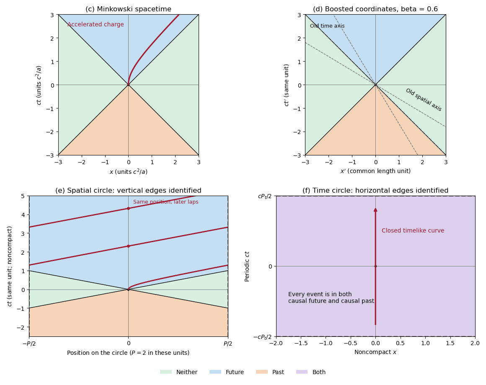

<h1 id="1/c/solution">Solution</h1>

↑ **Parent:** [C](../c.md)

The upper-left panel shows the three [causal structure](../../../../causal-structure.md) regions, with null boundaries included in the appropriate [causal future](../../../../causal-future.md) and [causal past](../../../../causal-past.md). For the charged trajectory, use part [b](../b.md) with $a=qE_x/m$, choosing the $x$ direction so that $a>0$. The [electric field](../../../../electric-field-split.md) gives the constant three-[force](../../../../force-split.md) $qE_x$ and hence the shifted hyperbola

$$
\boxed{\left(x+\frac{c^2}{a}\right)^2-c^2t^2=\frac{c^4}{a^2},\qquad t\ge0.}
$$

It starts with a vertical tangent at the origin, stays strictly inside the future [light cone](../../../../light-cone.md), and asymptotes to $x=ct-c^2/a$. The other panels implement the coordinate and topology changes used below; they are original [spacetime diagrams](../../../../spacetime-diagram.md), not copies of source artwork.

**[Figure 1](#1/c/image-causal-regions-in-minkowski-spacetime-and-in-spatially-or-temporally-periodic-flat-spacetimes). Causal regions in Minkowski spacetime and in spatially or temporally periodic flat spacetimes**. Blue denotes the causal future, orange the causal past, green events in neither, and purple membership in both. The top panels use ordinary and boosted inertial coordinates. The spatial quotient identifies vertical edges and shows the accelerated worldline wrapping across them. The temporal quotient identifies horizontal edges; every event belongs to both causal sets.

## ↑ Ancestors (12)

1. [C](../c.md)
2. [1](../../1.md)
3. [2019](../../../2019-split.md)
4. [Past exam of the symmetry and relativity course of the University of Oxford](../../../split.md)
5. [Symmetry and relativity course of the University of Oxford](../../../../symmetry-and-relativity-course-of-the-university-of-oxford.md)
6. [Year 3 of the physics course of the University of Oxford](../../../../year-3-of-the-physics-course-of-the-university-of-oxford.md)
7. [Physics course of the University of Oxford](../../../../physics-course-of-the-university-of-oxford.md)
8. [Undergraduate course of the University of Oxford](../../../../undergraduate-course-of-the-university-of-oxford.md)
9. [Course of the University of Oxford](../../../../course-of-the-university-of-oxford.md)
10. [University of Oxford](../../../../university-of-oxford-split.md)
11. [List of universities](../../../../list-of-universities.md)
12. [Codex Wiki](../../../../split.md)
