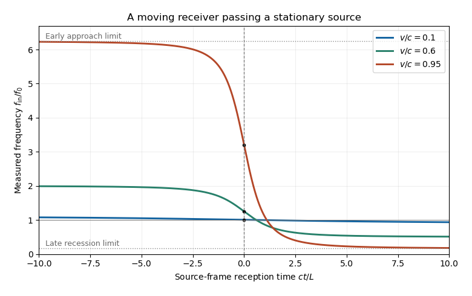

<h1 id="2/b/solution">Solution</h1>

↑ **Parent:** [B](../b.md)

Let $t$ label the reception event in the source [reference frame](../../../../reference-frame.md). Its distance from the source and the relevant [retarded time](../../../../retarded-time.md) are

$$
r(t)=\sqrt{L^2+v^2t^2},\qquad t_e=t-\frac{r(t)}c.
$$

The received phase is $2\pi f_0t_e$. Because the observer's [proper time](../../../../proper-time.md) obeys $d\tau=dt/\gamma$, its measured [frequency](../../../../frequency.md) is

$$
\boxed{f_{\rm in}(t)=f_0\frac{dt_e}{d\tau}
=\gamma f_0\left(1-\frac{v^2t}{c\sqrt{L^2+v^2t^2}}\right).}
$$

Equivalently, write $\beta=v/c$ and $s(t)=vt/r(t)$. The incoming [Doppler factor](../../../../doppler-factor.md) is $D_{\rm in}=\gamma(1-\beta s)$, obtained also by contracting the [photon](../../../../photon.md) [four-momentum](../../../../four-momentum.md) with the observer's [four-velocity](../../../../four-velocity.md). The [frequency](../../../../frequency.md) decreases monotonically, with

$$
\boxed{f_{\rm in}(-\infty)=\gamma(1+\beta)f_0,\quad
f_{\rm in}(0)=\gamma f_0,\quad
f_{\rm in}(+\infty)=\gamma(1-\beta)f_0.}
$$

In particular, the instant of closest approach is not the zero-shift point: a moving receiver looking perpendicular to its motion sees a factor $\gamma$, not $1/\gamma$. The latter factor applies to a different moving-emitter geometry. The graph uses source-frame reception time, with observer [proper time](../../../../proper-time.md) $\tau=t/\gamma$.

**[Figure 2](#2/b/image-frequency-measured-by-an-observer-passing-a-stationary-monochromatic-source). Frequency measured by an observer passing a stationary monochromatic source**. Each curve gives the received frequency divided by the emitted frequency against source-frame time ct/L. The vertical line marks closest approach; the black points have height gamma. Approaching and receding asymptotes are labelled for the fastest observer.

## ↑ Ancestors (12)

1. [B](../b.md)
2. [2](../../2.md)
3. [2019](../../../2019-split.md)
4. [Past exam of the symmetry and relativity course of the University of Oxford](../../../split.md)
5. [Symmetry and relativity course of the University of Oxford](../../../../symmetry-and-relativity-course-of-the-university-of-oxford.md)
6. [Year 3 of the physics course of the University of Oxford](../../../../year-3-of-the-physics-course-of-the-university-of-oxford.md)
7. [Physics course of the University of Oxford](../../../../physics-course-of-the-university-of-oxford.md)
8. [Undergraduate course of the University of Oxford](../../../../undergraduate-course-of-the-university-of-oxford.md)
9. [Course of the University of Oxford](../../../../course-of-the-university-of-oxford.md)
10. [University of Oxford](../../../../university-of-oxford-split.md)
11. [List of universities](../../../../list-of-universities.md)
12. [Codex Wiki](../../../../split.md)
