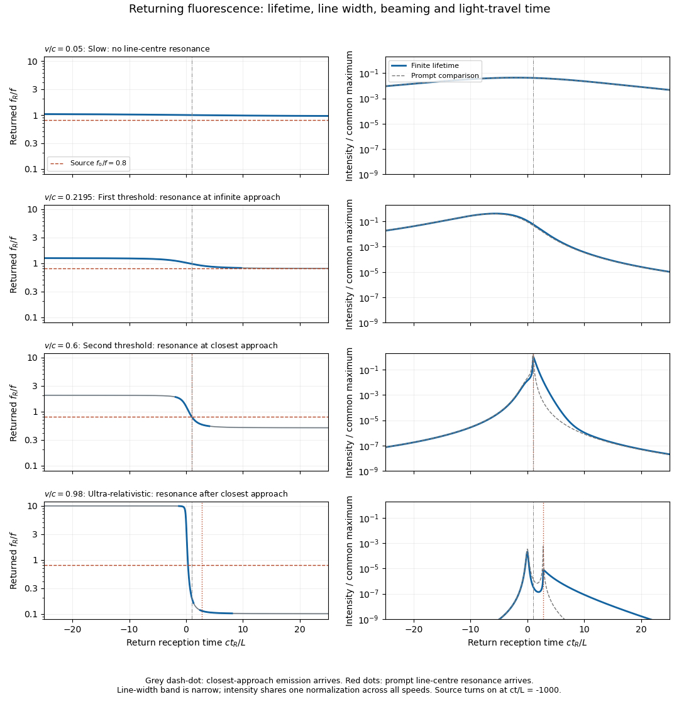

<h1 id="2/c/i/solution">Solution</h1>

↑ **Parent:** [I](../i.md)

A useful plot must keep three different times separate: source emission $t_e$, atomic absorption or re-emission $t$, and return reception $t_R$. For the cloud centroid,

$$
t_e=t-r(t)/c,\qquad \boxed{t_R=t+r(t)/c,\quad\frac{dt_R}{dt}=1+\beta s(t)>0.}
$$

Let $q=f_0/f<1$. Resonant excitation requires $qD_{\rm in}(t)=1$. Since $D_{\rm in}$ decreases from $\gamma(1+\beta)$ to $\gamma(1-\beta)$, its zero-width resonance first becomes possible at

$$
\boxed{\beta_{\min}=\frac{1-q^2}{1+q^2}.}
$$

At equality the line centre is reached only at infinite approach distance, where illumination vanishes. A finite source start time further limits how closely that ideal threshold is approached. For $\beta>\beta_{\min}$ the line-centre event satisfies

$$
s_* =\frac{1-1/(\gamma q)}{\beta},\qquad
t_* =\frac Lv\frac{s_*}{\sqrt{1-s_*^2}}.
$$

There is a second useful critical speed,

$$
\boxed{\beta_\perp=\sqrt{1-q^2},}
$$

for which excitation is centred on closest approach, $t_*=0$. For $\beta_{\min}<\beta<\beta_\perp$ it occurs on approach; for $\beta>\beta_\perp$ it occurs after closest approach. Even a receding ultra-relativistic atom can see the incident light blueshifted because $\gamma$ is large.

A [photon](../../../../../photon.md) emitted toward the origin near the atomic rest-frame [frequency](../../../../../frequency.md) $f$ has return [Doppler factor](../../../../../doppler-factor.md)

$$
\boxed{D_{\rm out}(t)=\frac1{\gamma[1+\beta s(t)]},\qquad
f_R(t_R(t))=D_{\rm out}(t)f.}
$$

The sign differs from that in $D_{\rm in}$ because the returning ray travels in the opposite direction. The returning line centre decreases from $\gamma(1+\beta)f$ on early approach to $\gamma(1-\beta)f$ on late recession, and is $f/\gamma$ at closest-approach emission. The origin receives that closest-approach radiation at $t_R=L/c$, not at zero. Prompt re-emission at exact resonance would give

$$
\boxed{\frac{f_R(t_R(t_*))}{f_0}=\frac1{2\gamma q-1}.}
$$

It is above $f_0$ below $\beta_\perp$, equal at $\beta_\perp$, and below $f_0$ above it. A finite [fluorescence lifetime](../../../../../fluorescence-lifetime.md) shifts emission later along the orbit and therefore usually toward a lower return [frequency](../../../../../frequency.md).

The following plots adopt a compact, optically thin cloud, weak excitation, isotropic incoherent [spontaneous emission](../../../../../spontaneous-emission.md) in the atomic rest frame, and negligible velocity dispersion. They show an intensity envelope as the observable amplitude; its rms electric-field amplitude is proportional to the square root of this intensity. An incoherent [fluorescence](../../../../../fluorescence-split.md) signal has no fixed optical phase. The four rows include a nonrelativistic speed, both critical speeds, and an ultra-relativistic speed. All rows share one intensity normalization, so off-resonant signals remain visibly weak.

**[Figure 3](#2/c/i/image-illustrative-returning-fluorescence-for-slow-motion-both-resonance-thresholds-and-ultra-relativistic-motion). Illustrative returning fluorescence for slow motion, both resonance thresholds, and ultra-relativistic motion**. Left panels show the returned atomic line centre and its finite-width band; a dashed line marks the source frequency. Right panels show received intensity on a common logarithmic scale, with a thin curve for the zero-lifetime comparison. The model uses f0/f equal to 0.8, proper lifetime c tau/L equal to 0.4, fractional natural full width 0.02, and a finite source turn-on. Solid curves include the population decay, retarded reception and beaming.

A model for [fluorescence from a uniformly moving cloud](../../../../../fluorescence-from-a-uniformly-moving-cloud.md) generating the plotted envelopes is

$$
\frac{dN_*}{dt}=P_{\rm abs}(t)-\frac{N_*}{\gamma\tau},\qquad
P_{\rm abs}(t)\propto\frac{1-\beta s(t)}{r(t)^2}\,
\mathcal L\bigl(D_{\rm in}(t)f_0-f\bigr)\,H(t_e+T),
$$

where $\mathcal L(\Delta)=[1+4\Delta^2/\Gamma^2]^{-1}$ is a [Lorentz line shape](../../../../../lorentz-line-shape.md) of full width $\Gamma$. The factor $1-\beta s$ is the incident photon-flux correction per source-frame time. The population is an exponential memory of earlier absorption events, not an instantaneous resonance indicator. For a detector of fixed small area at the origin, its received bolometric intensity scales as

$$
\boxed{I_R(t_R(t))\propto\frac{D_{\rm out}(t)^4}{r(t)^2}\frac{N_*(t)}\tau.}
$$

Two powers of $D_{\rm out}$ come from [aberration of light](../../../../../relativistic-aberration.md), one from photon [energy](../../../../../energy-split.md), and one from arrival-rate compression. Finite lifetime is dilated to $\gamma\tau$ in the source frame; over an interval with slowly changing geometry its observed decay time is $\tau/D_{\rm out}$. Thus approach can compress and amplify a pulse, while recession stretches and redshifts it. Illumination and collection each supply an inverse-square geometric factor in the prompt weak-excitation limit. Strong forward beaming can even make a detuned approaching precursor brighter than the later line-centre feature, as in the ultra-relativistic row; the intensity maximum need not occur at exact resonance.

Absolute amplitude and a unique detailed [spectral line profile](../../../../../spectral-line-profile.md) cannot be inferred from $f,\tau,v$ alone: cloud size, atom number, source power, optical depth, angular emission pattern and saturation were not specified. Finite cloud size convolves these point-centroid curves with additional delays. The plots describe incoherent, frequency-redistributed emission near $f$; a coherent [Rayleigh scattering](../../../../../rayleigh-scattering.md) component would instead retain the driving frequency in the atom frame and add a different spectral component. These qualifications do not change the kinematic resonance thresholds or return-time relations.

## ↑ Ancestors (13)

1. [I](../i.md)
2. [C](../../c.md)
3. [2](../../../2.md)
4. [2019](../../../../2019-split.md)
5. [Past exam of the symmetry and relativity course of the University of Oxford](../../../../split.md)
6. [Symmetry and relativity course of the University of Oxford](../../../../../symmetry-and-relativity-course-of-the-university-of-oxford.md)
7. [Year 3 of the physics course of the University of Oxford](../../../../../year-3-of-the-physics-course-of-the-university-of-oxford.md)
8. [Physics course of the University of Oxford](../../../../../physics-course-of-the-university-of-oxford.md)
9. [Undergraduate course of the University of Oxford](../../../../../undergraduate-course-of-the-university-of-oxford.md)
10. [Course of the University of Oxford](../../../../../course-of-the-university-of-oxford.md)
11. [University of Oxford](../../../../../university-of-oxford-split.md)
12. [List of universities](../../../../../list-of-universities.md)
13. [Codex Wiki](../../../../../split.md)
