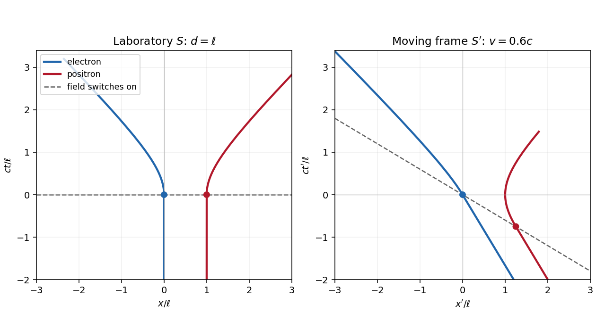
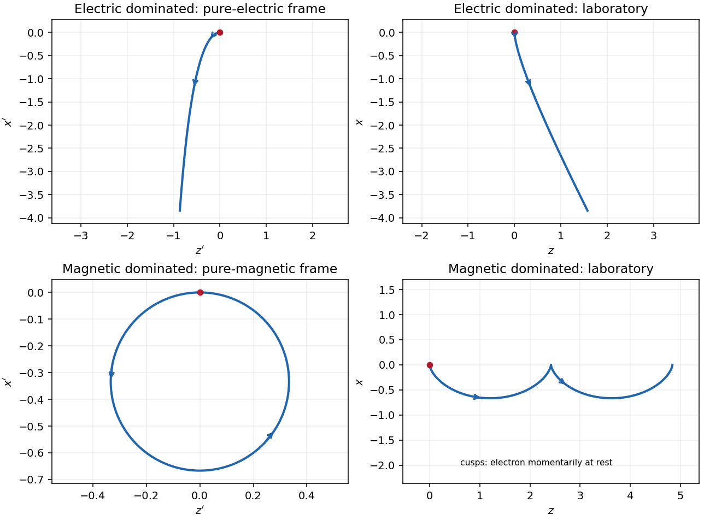

# 2021

↑ **Parent:** [Past exam of the symmetry and relativity course of the University of Oxford](../past-exam-of-the-symmetry-and-relativity-course-of-the-university-of-oxford.md)

Source: [https://www.whatdotheyknow.com/request/oxford_physics_past_papers_2/response/2340696/attach/9/Physics%20Papers%202020.pdf?cookie_passthrough=1](https://www.whatdotheyknow.com/request/oxford_physics_past_papers_2/response/2340696/attach/9/Physics%20Papers%202020.pdf?cookie_passthrough=1)

Source bundle pages 70–73; the cover identifies Trinity Term 2021 despite the attachment filename. Use coordinates $x^\mu=(ct,x,y,z)$, [metric signature](../topological-manifold.md#metric-signature) $(-,+,+,+)$, and $A^\mu=(\phi/c,\mathbf A)$. For the [electromagnetic field tensor](../relativistic-electromagnetism.md#electromagnetic-field-tensor) use $F^{0i}=E_i/c$ and $F^{ij}=\epsilon_{ijk}B_k$. Prescribed external fields are treated classically, neglecting [radiation reaction](../electromagnetic-radiation.md#radiation-reaction) in the trajectories; [radiation](../physics.md#radiation) losses are computed separately where requested.

**Table of contents**

- [1](#1)
  - [a](#1/a)
    - [Solution](#1/a/solution)
  - [b](#1/b)
    - [Solution](#1/b/solution)
  - [c](#1/c)
    - [Solution](#1/c/solution)
  - [d](#1/d)
    - [Solution](#1/d/solution)
- [2](#2)
  - [a](#2/a)
    - [Solution](#2/a/solution)
  - [b](#2/b)
    - [Solution](#2/b/solution)
  - [c](#2/c)
    - [Solution](#2/c/solution)
- [3](#3)
  - [a](#3/a)
    - [i](#3/a/i)
      - [Solution](#3/a/i/solution)
    - [ii](#3/a/ii)
      - [Solution](#3/a/ii/solution)
  - [b](#3/b)
    - [Solution](#3/b/solution)
  - [c](#3/c)
    - [Solution](#3/c/solution)
- [4](#4)
  - [a](#4/a)
    - [Solution](#4/a/solution)
  - [b](#4/b)
    - [Solution](#4/b/solution)
  - [c](#4/c)
    - [Solution](#4/c/solution)
  - [d](#4/d)
    - [Solution](#4/d/solution)

## 1

↑ **Parent:** [2021](2021.md)

<h3 id="1/a">a</h3>

↑ **Parent:** [1](#1)

<h4 id="1/a/solution">Solution</h4>

↑ **Parent:** [A](#1/a)

Let $e>0$ be the magnitude of the [electron](../physics.md#electron)'s [electric charge](../electric-charge.md), $m=m_e$, $F=eE>0$, and $\ell=mc^2/F$. The [Lorentz force](../relativistic-electromagnetism.md#lorentz-force) is $dp_x/dt=qE$, so the [electron](../physics.md#electron) and [Positron](../physics.md#positron) acquire opposite [momenta](../momentum.md):

$$
p_{e,x}=-Ft,\qquad p_{p,x}=Ft,\qquad
\mathcal E_e=\mathcal E_p=\sqrt{m^2c^4+F^2c^2t^2}.
$$

Using the [relativistic energy-momentum relation](../special-relativity.md#energy-momentum-relation), $u_x=pc^2/\mathcal E$, and integrating from rest gives the [world lines](../special-relativity.md#world-line)

$$
\boxed{x_e(t)=-\ell\left[\sqrt{1+(ct/\ell)^2}-1\right],\qquad
x_p(t)=d+\ell\left[\sqrt{1+(ct/\ell)^2}-1\right]\quad(t\geq0).}
$$

For $t<0$, the [world lines](../special-relativity.md#world-line) are vertical at $x=0,d$ on a [spacetime diagram](../mathematical-physics.md#spacetime-diagram). They join smoothly to the accelerated branches with zero initial [velocity](../classical-mechanics.md#velocity). At small $t$, $x_e\simeq-Ft^2/(2m)$ and $x_p-d\simeq Ft^2/(2m)$; at large $t$, their [velocities](../classical-mechanics.md#velocity) approach $-c,+c$, respectively. Each accelerated [world line](../special-relativity.md#world-line) is a branch of a [hyperbola](../euclidean-geometry.md#hyperbola), since $(x_e-\ell)^2-c^2t^2=\ell^2$ and $(x_p-d+\ell)^2-c^2t^2=\ell^2$. The [electric field](../electric-field.md) separates the opposite [electric charges](../electric-charge.md) in this orientation. The asymptotes are lightlike, while every finite-time tangent is timelike.

**[Figure 1](#1/a/image-accelerated-pair-in-the-laboratory-and-a-moving-frame). Accelerated pair in the laboratory and a moving frame**. Original [spacetime diagrams](../mathematical-physics.md#spacetime-diagram) for $d=\ell$ and $v=0.6c$. Dots mark the two switching events. The dashed line is the laboratory's simultaneous switching surface, which is tilted in the moving [inertial frame](../mathematical-physics.md#inertial-frame).

<h3 id="1/b">b</h3>

↑ **Parent:** [1](#1)

<h4 id="1/b/solution">Solution</h4>

↑ **Parent:** [B](#1/b)

Write $\Gamma=(1-v^2/c^2)^{-1/2}$ for the [Lorentz factor](../special-relativity.md#lorentz-factor) of the [inertial frame](../mathematical-physics.md#inertial-frame) $S'$, distinguishing it from the particles' changing [Lorentz factors](../special-relativity.md#lorentz-factor). Apply the [Lorentz transformation](../special-relativity.md#lorentz-transformation)

$$
x'=\Gamma(x-vt),\qquad t'=\Gamma(t-vx/c^2)
$$

to each [world line](../special-relativity.md#world-line) in [a](#1/a). Both particles initially have [velocity](../classical-mechanics.md#velocity) $-v$ in $S'$. The switching events have coordinates

$$
(t'_e,x'_e)=(0,0),\qquad
(t'_p,x'_p)=(-\Gamma vd/c^2,\Gamma d).
$$

Thus the [Positron](../physics.md#positron) starts accelerating earlier in $S'$. Its [velocity](../classical-mechanics.md#velocity) first becomes less negative, vanishes when its laboratory [velocity](../classical-mechanics.md#velocity) reaches $v$, and then becomes positive. The [electron](../physics.md#electron) continues at $-v$ until $t'=0$, then accelerates toward $-c$. The [relativistic velocity-addition formula](../special-relativity.md#velocity-addition-formula) makes this precise:

$$
u'_e=\frac{u_e-v}{1-vu_e/c^2},\qquad
u'_p=\frac{u_p-v}{1-vu_p/c^2}.
$$

The [electric field](../electric-field.md) parallel to the [Lorentz boost](../special-relativity.md#lorentz-boost) has unchanged magnitude, but its switching surface is $t'+vx'/c^2=0$, rather than $t'=0$ everywhere.

In the laboratory, the total [three-momentum](../special-relativity.md#three-momentum) is zero for all $t$: the two [Lorentz forces](../relativistic-electromagnetism.md#lorentz-force) cancel at equal laboratory times. In $S'$, each active force is still $qE$, since this is one-dimensional motion with a parallel [electric field](../electric-field.md). Define $t'_p=-\Gamma vd/c^2$. For $v>0$ the total [three-momentum](../special-relativity.md#three-momentum), evaluated at **equal $t'$**, is

$$
\boxed{P'_x(t')=
\begin{cases}
-2\Gamma mv,&t'<t'_p,\\
-2\Gamma mv+F(t'-t'_p),&t'_p\leq t'<0,\\
-2\Gamma mv+\Gamma Fvd/c^2,&t'\geq0.
\end{cases}}
$$

This follows by integrating $dp'_p/dt'=F$ from its switching event and $dp'_e/dt'=-F$ from its later switching event. During the interval between them only the [Positron](../physics.md#positron) feels the prescribed [electric field](../electric-field.md), so [momentum conservation](../momentum.md#momentum-conservation) for the particle pair fails. Once both forces act, the total [three-momentum](../special-relativity.md#three-momentum) is constant again.

The [equal-time momentum of an externally driven particle pair](../special-relativity.md#equal-time-momentum-of-an-externally-driven-particle-pair) illustrates a distinction. The sum of particle [four-momenta](../special-relativity.md#four-momentum) **at a fixed pair of events** is always a [four-vector](../special-relativity.md#four-vector). However, a fresh sum at equal time in each [inertial frame](../mathematical-physics.md#inertial-frame) generally uses different events. Here transforming an equal-$t$ laboratory sum would give $-2\Gamma v\sqrt{m^2c^4+F^2c^2t^2}/c^2$, which varies with $t$; this differs from the equal-$t'$ answer above. For example, with $c=m=F=d=1$ and $v=0.6$, the late-time equal-$t'$ sum is $-0.75$, whereas transforming the equal-$t=0$ sum gives $-1.5$. This is a concrete failure of treating the pair's equal-time sums as components of a single frame-independent [four-vector](../special-relativity.md#four-vector).

A closed system's total [four-momentum](../special-relativity.md#four-momentum), including the [electromagnetic field](../electromagnetism.md#electromagnetic-field) and the apparatus supplying it, is conserved and independent of the choice of spacelike integration surface under the usual isolated-system boundary conditions. The particles alone exchange [energy](../energy.md) and [momentum](../momentum.md) with an external system, so neither that independence nor universal particle-only [momentum conservation](../momentum.md#momentum-conservation) is guaranteed.

<h3 id="1/c">c</h3>

↑ **Parent:** [1](#1)

<h4 id="1/c/solution">Solution</h4>

↑ **Parent:** [C](#1/c)

With the reversed [electric field](../electric-field.md), reflection about $x=d/2$ exchanges the [electron](../physics.md#electron) and [Positron](../physics.md#positron). They therefore meet there with equal and opposite [momenta](../momentum.md). Each travels $d/2$, and the [work-energy theorem](../energy.md#work-energy-theorem) gives its [kinetic energy](../energy.md#kinetic-energy):

$$
K=eE\frac d2=e(5.0\times10^6\,\mathrm{V\,m^{-1}})(0.100\,\mathrm m),\qquad
\boxed{K_e=K_p=0.500\,\mathrm{MeV}.}
$$

Their combined [kinetic energy](../energy.md#kinetic-energy) is $1.000\,\mathrm{MeV}$, while each total [relativistic energy](../special-relativity.md#relativistic-energy) is $\mathcal E=0.511+0.500=1.011\,\mathrm{MeV}$. The laboratory is the [center-of-momentum frame](../special-relativity.md#center-of-momentum-frame) of the colliding pair.

Local [four-momentum conservation](../special-relativity.md#four-momentum-conservation) in the [electron-positron annihilation](../relativistic-quantum-field.md#electron-positron-annihilation) excludes one real [photon](../quantum-mechanics.md#photon): the incoming total [four-momentum](../special-relativity.md#four-momentum) is timelike, with zero spatial component and positive [energy](../energy.md), while a single [photon](../quantum-mechanics.md#photon)'s [four-momentum](../special-relativity.md#four-momentum) is null and has $|\mathbf p|=\mathcal E/c>0$. Two [photons](../quantum-mechanics.md#photon) can balance their [momenta](../momentum.md) by travelling in opposite directions, so

$$
\boxed{N_{\min}=2,\qquad \mathcal E_\gamma=1.011\,\mathrm{MeV},\qquad
\lambda=\frac{hc}{\mathcal E_\gamma}\simeq1.226\times10^{-12}\,\mathrm m.}
$$

The equal [photon](../quantum-mechanics.md#photon) [energies](../energy.md) follow from opposite equal [momenta](../momentum.md), not merely from sharing the incoming [energy](../energy.md) arbitrarily. Here $hc\simeq1.23984\,\mathrm{MeV\,pm}$. This is the free local annihilation idealization implicit in the question; significant [momentum](../momentum.md) transfer to the external apparatus would change the kinematic system being considered.

<h3 id="1/d">d</h3>

↑ **Parent:** [1](#1)

<h4 id="1/d/solution">Solution</h4>

↑ **Parent:** [D](#1/d)

The laboratory remains the [center-of-momentum frame](../special-relativity.md#center-of-momentum-frame). At the [relativistic collision mass threshold](../special-relativity.md#relativistic-collision-mass-threshold), the two final [W bosons](../standard-model.md#w-boson) can have arbitrarily small opposite [momenta](../momentum.md). The available [relativistic energy](../special-relativity.md#relativistic-energy) is $2m_ec^2+eEd$, so

$$
2m_ec^2+eEd\geq2m_{\mathrm W}c^2,\qquad
\boxed{d_{\min}=\frac{2(m_{\mathrm W}-m_e)c^2}{eE}
=\frac{160.756978\times10^9\,\mathrm{eV}}{5.0\times10^6\,\mathrm{eV\,m^{-1}}}
\simeq3.21514\times10^4\,\mathrm m=32.15\,\mathrm{km}.}
$$

Each incoming particle must acquire about $80.378489\,\mathrm{GeV}$ of [kinetic energy](../energy.md#kinetic-energy), travelling about $16.08\,\mathrm{km}$. Equality is the ideal kinematic threshold; a nonzero production rate needs [energy](../energy.md) above it. This estimate neglects acceleration losses and treats the [W bosons](../standard-model.md#w-boson) with the supplied nominal [rest mass](../special-relativity.md#invariant-mass).

A [linear particle accelerator](../particle-accelerator.md#linear-particle-accelerator) avoids repeatedly bending high-[energy](../energy.md) [electrons](../physics.md#electron) and [Positrons](../physics.md#positron). This greatly reduces the bending [synchrotron radiation](../electromagnetic-radiation.md#synchrotron-radiation) loss, which at fixed bending radius grows approximately as the fourth power of the [relativistic energy](../special-relativity.md#relativistic-energy) for a given particle species. Its useful collision [energy](../energy.md) can therefore be increased without the severe circular [electron](../physics.md#electron) collider radiation penalty. The price is long structures or high accelerating gradients: each bunch normally passes once, requiring substantial beam power, fresh bunches, and very tight focusing for high [luminosity](../astrophysics.md#luminosity). A circular [particle accelerator](../particle-accelerator.md) reuses its accelerating structures and circulates bunches through many collisions, but needs a large ring and substantial radiofrequency power to replace [synchrotron radiation](../electromagnetic-radiation.md#synchrotron-radiation) losses. Heavier particles such as [protons](../physics.md#proton) radiate far less at a given [energy](../energy.md) and radius, although a [proton](../physics.md#proton)'s constituent structure makes the hard-collision [energy](../energy.md) less sharply specified than in an [electron-positron annihilation](../relativistic-quantum-field.md#electron-positron-annihilation) experiment.

## 2

↑ **Parent:** [2021](2021.md)

<h3 id="2/a">a</h3>

↑ **Parent:** [2](#2)

<h4 id="2/a/solution">Solution</h4>

↑ **Parent:** [A](#2/a)

Let $z^\mu(\tau)$ be the point [electric charge](../electric-charge.md)'s [world line](../special-relativity.md#world-line), with [proper time](../special-relativity.md#proper-time) $\tau$ and [four-velocity](../special-relativity.md#four-velocity) $U^\mu=dz^\mu/d\tau=\gamma(c,\mathbf u)$. For the field event $x^\mu$, choose the **retarded** source event: $R^\mu=x^\mu-z^\mu(\tau_{\rm ret})$ is future-directed and null. Write $R^\mu=(R,R\mathbf n)$, where $R=|\mathbf x-\mathbf z(t_{\rm ret})|=c(t-t_{\rm ret})$. In the instantaneous rest [inertial frame](../mathematical-physics.md#inertial-frame) of that source event,

$$
U'^\mu=(c,\mathbf0),\qquad -R'_\mu U'^\mu=cR',\qquad
A'^\mu=\left(\frac{q}{4\pi\epsilon_0cR'},\mathbf0\right).
$$

Consequently the covariant expression matching this [Coulomb potential](../electrostatics.md#coulomb-potential-energy) is

$$
\boxed{A^\mu(x)=\frac{q}{4\pi\epsilon_0}\frac{U^\mu/c}{-R_\nu U^\nu}\bigg|_{\rm ret}.}
$$

The denominator is a [Lorentz scalar](../special-relativity.md#lorentz-scalar), so the right-hand side is a [four-vector](../special-relativity.md#four-vector) with the required instantaneous-rest components. This describes the [retarded potential](../relativistic-electromagnetism.md#retarded-potential) in [Lorenz gauge](../relativistic-electromagnetism.md#lorenz-gauge-condition), with no added free [electromagnetic wave](../electromagnetic-wave.md). [Lorentz covariance](../special-relativity.md#lorentz-covariance) alone does not establish the boundary conditions or exclude additional terms depending on [four-acceleration](../special-relativity.md#four-acceleration). The physical input is the retarded point-source solution of [Maxwell equations](../maxwell-equations.md): the potential at the retarded event depends on the instantaneous [four-current](../electric-charge.md#four-current), while its [derivatives](../calculus.md#derivative) generate the acceleration field. Equivalently, evaluating the retarded source integral gives a Jacobian $1/(1-\mathbf n\cdot\boldsymbol\beta)$ from the light-cone constraint; this fixes that input for arbitrary smooth subluminal motion.[§1.7, equations (71)–(76): causal source integrals, with source quantities evaluated at retarded time](../physics-bibliography.md#retarded-potentials-by-richard-fitzpatrick)

In any [inertial frame](../mathematical-physics.md#inertial-frame), put $\boldsymbol\beta=\mathbf u/c$ and $\kappa=1-\mathbf n\cdot\boldsymbol\beta$. Then $-R\cdot U=\gamma cR\kappa$, and the [Liénard–Wiechert potential](../relativistic-electromagnetism.md#lienard-wiechert-potential) is

$$
\phi=\frac{q}{4\pi\epsilon_0R\kappa},\qquad \mathbf A=\frac{\mathbf u}{c^2}\phi.
$$

Differentiate using $\mathbf E=-\nabla\phi-\partial_t\mathbf A$ and $\mathbf B=\nabla\times\mathbf A$, including the position and time dependence of the [retarded time](../relativistic-electromagnetism.md#retarded-time). For example, $\partial t_{\rm ret}/\partial t=1/\kappa$ and $\nabla t_{\rm ret}=-\mathbf n/(c\kappa)$. The resulting [Liénard-Wiechert field](../relativistic-electromagnetism.md#lienard-wiechert-field) is

$$
\boxed{\mathbf E=\frac{q}{4\pi\epsilon_0}\left[
\frac{(1-\beta^2)(\mathbf n-\boldsymbol\beta)}{\kappa^3R^2}
+\frac{\mathbf n\times[(\mathbf n-\boldsymbol\beta)\times\dot{\boldsymbol\beta}]}{c\kappa^3R}
\right]_{\rm ret},\qquad
\mathbf B=\frac1c[\mathbf n\times\mathbf E]_{\rm ret}.}
$$

Here the dot denotes a [derivative](../calculus.md#derivative) with respect to source coordinate time. The first term is the velocity or non-radiative field: it falls as $R^{-2}$ and exists even without [acceleration](../classical-mechanics.md#acceleration). The second is the acceleration or [radiation field](../wave-equation.md#radiation-field), falling as $R^{-1}$ and transverse to $\mathbf n$. Its [Poynting flux](../electromagnetic-wave.md#poynting-flux) falls as $R^{-2}$, so its outward [power](../energy.md#power) integrated over a large sphere stays finite as its radius tends to infinity. The first term's squared-field flux instead vanishes in that limit. This large-distance distinction defines [radiation](../physics.md#radiation); a moving near field can carry local [energy](../energy.md) without constituting radiation escaping to infinity.

<h3 id="2/b">b</h3>

↑ **Parent:** [2](#2)

<h4 id="2/b/solution">Solution</h4>

↑ **Parent:** [B](#2/b)

For uniform [circular motion](../classical-mechanics.md#circular-motion), the transverse [Lorentz force](../relativistic-electromagnetism.md#lorentz-force) supplies the change in direction of [three-momentum](../special-relativity.md#three-momentum):

$$
e uB=\frac{pu}{r},\qquad p=eBr,\qquad
\gamma=\sqrt{1+\left(\frac{eBr}{m_ec}\right)^2}.
$$

The [magnetic rigidity](../relativistic-electromagnetism.md#magnetic-rigidity) relation gives $pc=0.299792458B[\mathrm T]r[\mathrm m]\,\mathrm{GeV}=2.99792458\,\mathrm{GeV}$. Using $m_ec^2=0.511\,\mathrm{MeV}$,

$$
\boxed{\gamma\simeq5.867\times10^3,\qquad
\mathcal E=\gamma m_ec^2\simeq2.998\,\mathrm{GeV}.}
$$

The coordinate [centripetal acceleration](../classical-mechanics.md#centripetal-acceleration) is $a=u^2/r$. For transverse [acceleration](../classical-mechanics.md#acceleration), the magnitude of the [four-acceleration](../special-relativity.md#four-acceleration), or [proper acceleration](../special-relativity.md#proper-acceleration), is $a_0=\gamma^2a$. The supplied [Larmor formula](../electromagnetic-radiation.md#larmor-formula), in its [proper acceleration](../special-relativity.md#proper-acceleration) form, therefore gives

$$
P=\frac{e^2\gamma^4u^4}{6\pi\epsilon_0c^3r^2},\qquad
\mathcal T=\frac{2\pi r}{u},\qquad
\Delta\mathcal E=P\mathcal T
=\frac{e^2}{3\epsilon_0r}\gamma^4\beta^3,
\quad \beta=u/c.
$$

The emitted [power](../energy.md#power) here is also the laboratory total emitted [power](../energy.md#power): in the instantaneous rest [inertial frame](../mathematical-physics.md#inertial-frame) the dipole [radiation pattern](../electromagnetic-radiation.md#radiation-pattern) has zero net radiated [three-momentum](../special-relativity.md#three-momentum), so both emitted [energy](../energy.md) and elapsed coordinate time gain the same [Lorentz factor](../special-relativity.md#lorentz-factor) on transformation. This does not assert that a directional detector flux is invariant.

Numerically $\mathcal T\simeq1.048\times10^{-5}\,\mathrm s$, $P\simeq2.18\times10^{-10}\,\mathrm W$ per [electron](../physics.md#electron), and

$$
\boxed{\Delta\mathcal E\simeq2.29\times10^{-15}\,\mathrm J
\simeq1.43\times10^4\,\mathrm{eV}=14.3\,\mathrm{keV}\quad\text{per revolution}.}
$$

The [synchrotron](../particle-accelerator.md#synchrotron)'s radiofrequency accelerating system must replace this lost [energy](../energy.md) to keep $r$ and [magnetic rigidity](../relativistic-electromagnetism.md#magnetic-rigidity) fixed over many revolutions. The fraction lost per turn is about $4.77\times10^{-6}$, so a fixed-orbit calculation over one turn is self-consistent.[§12.22, equations (1975)–(1978): transverse radiated power and energy per revolution](../physics-bibliography.md#synchrotron-radiation-by-richard-fitzpatrick)

<h3 id="2/c">c</h3>

↑ **Parent:** [2](#2)

<h4 id="2/c/solution">Solution</h4>

↑ **Parent:** [C](#2/c)

For an [ultrarelativistic particle](../special-relativity.md#ultrarelativistic-particle), [relativistic beaming](../special-relativity.md#relativistic-beaming) concentrates the [synchrotron radiation](../electromagnetic-radiation.md#synchrotron-radiation) within an angle of order $1/\gamma$ around its instantaneous [velocity](../classical-mechanics.md#velocity). A fixed viewing direction in the orbital plane receives an intense signal only when the tangent sweeps through that direction. One [electron](../physics.md#electron), or one sufficiently short bunch, therefore produces one pulse per revolution, separated by $\mathcal T\simeq10.48\,\mathrm{\mu s}$. Several bunches produce the corresponding additional pulses per revolution.

The time during which the [velocity](../classical-mechanics.md#velocity) points within that cone is of order $r/(\gamma c)$, but this is the **emission** interval. If $t_a$ is the arrival time at a distant detector,

$$
t_a=t+\frac{D-\mathbf n\cdot\mathbf x(t)}c,\qquad
\frac{dt_a}{dt}=1-\mathbf n\cdot\boldsymbol\beta.
$$

Near alignment, $1-\beta\cos\theta\simeq(\gamma^{-2}+\theta^2)/2=O(\gamma^{-2})$. Thus [synchrotron pulse compression](../electromagnetic-radiation.md#synchrotron-pulse-compression) reduces the observed duration by a further factor of order $\gamma^2$:

$$
\boxed{\Delta t_{a,\mathrm{single}}\sim\frac r{\gamma^3c}
\simeq8.3\times10^{-18}\,\mathrm s.}
$$

A more explicit geometric estimate chooses the cone edges $\theta=\pm1/\gamma$. With $\omega=u/r$, $x=r\sin\theta$ along the line of sight, the difference in [arrival-time compression for a moving source](../relativistic-electromagnetism.md#arrival-time-compression-for-a-moving-source) is

$$
\Delta t_a=\frac{2r}c\left[\frac{1}{\beta\gamma}-\sin\!\left(\frac1\gamma\right)\right]
\simeq\frac{4r}{3c\gamma^3}\simeq1.10\times10^{-17}\,\mathrm s.
$$

The order-one coefficient depends on how pulse width is defined; the robust scale is $r/(c\gamma^3)$. The usual central-cone estimate $r/(2c\gamma^3)$ gives $4.1\times10^{-18}\,\mathrm s$. These estimates agree on the attosecond scale and must not be confused with $r/(\gamma c)\simeq2.84\times10^{-10}\,\mathrm s$.[§12.22, equations (1979)–(1981): distinction between emission interval and detector arrival interval](../physics-bibliography.md#synchrotron-radiation-by-richard-fitzpatrick)

**Bunch qualification.** The source says only that the bunches are short, without their longitudinal [length](../physics.md#length) $L_b$. Different [electrons](../physics.md#electron) pass the same emitting tangent at times separated by up to about $L_b/u$, with essentially the same path length from that tangent to the detector. The [bunch-length broadening of synchrotron radiation](../electromagnetic-radiation.md#bunch-length-broadening-of-synchrotron-radiation) means that the measured bunch envelope is the single-[electron](../physics.md#electron) pulse convolved with the bunch's passage-time profile; its scale is generally at least of order $\max\{L_b/u,r/(c\gamma^3)\}$, with additional detector bandwidth effects. For example, a $1\,\mathrm{mm}$ bunch, very short compared with this ring, gives an approximately $3.3\,\mathrm{ps}$ envelope, much longer than the single-[electron](../physics.md#electron) duration. No unique numerical bunch-envelope width follows from the supplied data. The pulse argument also presumes that the accepted $+x$ direction is tangent to the orbit; a direction far outside the orbital plane receives no comparable intense forward pulse.

## 3

↑ **Parent:** [2021](2021.md)

<h3 id="3/a">a</h3>

↑ **Parent:** [3](#3)

<h4 id="3/a/i">i</h4>

↑ **Parent:** [A](#3/a)

<h5 id="3/a/i/solution">Solution</h5>

↑ **Parent:** [I](#3/a/i)

Assume $E,B>0$ for the directions and parametrizations; the boost formulas retain their signed meaning for reversed fields. A [Lorentz boost](../special-relativity.md#lorentz-boost) with [velocity](../classical-mechanics.md#velocity) $w\hat{\mathbf z}$ along $\mathbf E\times\mathbf B$ transforms the transverse [electric field](../electric-field.md) and [magnetic field](../magnetic-field.md) as

$$
E'_x=\gamma_w(E-wB),\qquad B'_y=\gamma_w(B-wE/c^2).
$$

In the electric-dominated case choose

$$
\boxed{\mathbf w=\frac{c^2\mathbf E\times\mathbf B}{E^2}
=\frac{c^2B}{E}\hat{\mathbf z},\qquad
\mathbf B'=0,\qquad E'_x=E\sqrt{1-c^2B^2/E^2}.}
$$

The inequality ensures $|w|<c$, so this is an [inertial frame](../mathematical-physics.md#inertial-frame). The [field-removing boosts for perpendicular electric and magnetic fields](../relativistic-electromagnetism.md#field-removing-boosts-for-perpendicular-electric-and-magnetic-fields) are governed by the [electromagnetic field invariants](../relativistic-electromagnetism.md#electromagnetic-field-invariants) $\mathbf E\cdot\mathbf B=0$ and $E^2-c^2B^2>0$ explain why a purely electric [inertial frame](../mathematical-physics.md#inertial-frame) exists and a purely magnetic one does not.

The [electron](../physics.md#electron) is **not initially at rest** in this convenient [inertial frame](../mathematical-physics.md#inertial-frame): its initial [velocity](../classical-mechanics.md#velocity) is $-w\hat{\mathbf z}$ and its initial [three-momentum](../special-relativity.md#three-momentum) is $p'_z=-\gamma_wmw$. Thereafter $p'_x=-eE't'$, while $p'_z$ stays constant. The [electric field](../electric-field.md) accelerates it toward $-x$; as its [relativistic energy](../special-relativity.md#relativistic-energy) increases, its negative transverse [velocity](../classical-mechanics.md#velocity) decreases in magnitude. Defining $a=eE'/m>0$ and $s=a\tau/c$ gives a useful parametric [world line](../special-relativity.md#world-line):

$$
t'=\frac{\gamma_wc}{a}\sinh s,\qquad
x'=-\frac{\gamma_wc^2}{a}(\cosh s-1),\qquad
z'=-\frac{\gamma_wwc}{a}s.
$$

Here $\tau$ is the [proper time](../special-relativity.md#proper-time). These formulas follow by integrating $U'^0=\gamma_wc\cosh s$, $U'^x=-\gamma_wc\sinh s$, and constant $U'^z=-\gamma_ww$. Its projection onto the $t',x'$ plane is a [hyperbola](../euclidean-geometry.md#hyperbola), but the spatial trajectory includes the initial transverse motion and is not a straight line.

Transforming back with $z=\gamma_w(z'+wt')$, $t=\gamma_w(t'+wz'/c^2)$ gives

$$
x=x',\qquad z=\frac{\gamma_w^2wc}{a}(\sinh s-s),\qquad
t=\frac{\gamma_w^2c}{a}(\sinh s-w^2s/c^2).
$$

The laboratory trajectory starts from rest toward $-x$, then bends toward $+z$. It is unbounded in $-x$ and ultimately has $u_z\to w=c^2B/E$ and $u_x\to-c/\gamma_w$. Thus the late [velocity](../classical-mechanics.md#velocity) has magnitude $c$ as a limit, consistent with the [relativistic energy-momentum relation](../special-relativity.md#energy-momentum-relation), rather than undergoing a closed [cyclotron orbit](../relativistic-electromagnetism.md#gyromotion).

**[Figure 2](#3/a/i/image-electron-trajectories-in-electric-dominated-and-magnetic-dominated-crossed-fields). Electron trajectories in electric-dominated and magnetic-dominated crossed fields**. Original parametric spatial trajectories in the convenient [inertial frame](../mathematical-physics.md#inertial-frame) and laboratory, with dimensionless units $c=m=e=1$. Arrows show increasing time. The initial transverse motion in the purely electric frame and the laboratory cusps in the purely magnetic case are visible.

<h4 id="3/a/ii">ii</h4>

↑ **Parent:** [A](#3/a)

<h5 id="3/a/ii/solution">Solution</h5>

↑ **Parent:** [Ii](#3/a/ii)

In the magnetic-dominated case the suitable [Lorentz boost](../special-relativity.md#lorentz-boost) instead has

$$
\boxed{\mathbf w=\frac{\mathbf E\times\mathbf B}{B^2}
=\frac EB\hat{\mathbf z},\qquad
\mathbf E'=0,\qquad B'_y=B\sqrt{1-E^2/(c^2B^2)}.}
$$

The hypothesis gives $|w|<c$. The [electromagnetic field invariants](../relativistic-electromagnetism.md#electromagnetic-field-invariants) now have $E^2-c^2B^2<0$, allowing a purely magnetic [inertial frame](../mathematical-physics.md#inertial-frame). The initial [velocity](../classical-mechanics.md#velocity) is again $-w\hat{\mathbf z}$, perpendicular to $\mathbf B'$. Since a [magnetic field](../magnetic-field.md) does no [work](../energy.md#work), the [electron](../physics.md#electron)'s [relativistic energy](../special-relativity.md#relativistic-energy) and [speed](../classical-mechanics.md#speed) in this [inertial frame](../mathematical-physics.md#inertial-frame) remain constant. Its trajectory is a circle in the $x'z'$ plane with [Lorentz factor](../special-relativity.md#lorentz-factor) $\gamma_w$ and [cyclotron frequency](../quantum-theory.md#cyclotron-frequency) $\Omega=eB'/(\gamma_wm)$.

For $E,B>0$, set $\theta=\Omega t'$ and $\rho=w/\Omega$. A parametrization with the correct initial [velocity](../classical-mechanics.md#velocity) and [Lorentz force](../relativistic-electromagnetism.md#lorentz-force) is

$$
x'=\rho(\cos\theta-1),\qquad z'=-\rho\sin\theta,\qquad
u'_x=-w\sin\theta,\quad u'_z=-w\cos\theta.
$$

Transforming the [world line](../special-relativity.md#world-line) back to the laboratory gives

$$
\boxed{x=\rho(\cos\theta-1),\qquad
z=\gamma_w\rho(\theta-\sin\theta),\qquad
t=\frac{\gamma_w}{\Omega}(\theta-\beta_w^2\sin\theta).}
$$

The laboratory trajectory is a stretched [cycloid](../topology.md#cycloid), with cusps at $\theta=2\pi n$ where the [electron](../physics.md#electron) is momentarily at rest. It first accelerates toward $-x$, then curves toward $+z$, returning to its original $x$ coordinate each cycle while advancing in $z$. Its mean drift is $\Delta z/\Delta t=w=E/B$, the [E-cross-B drift](../relativistic-electromagnetism.md#e-cross-b-drift). Its laboratory [kinetic energy](../energy.md#kinetic-energy) oscillates as the [electric field](../electric-field.md) does positive and then negative [work](../energy.md#work); it does not grow indefinitely. The strict inequalities in the two branches exclude the null case $|E/B|=c$, where neither field can be removed by a finite [Lorentz boost](../special-relativity.md#lorentz-boost).

<h3 id="3/b">b</h3>

↑ **Parent:** [3](#3)

<h4 id="3/b/solution">Solution</h4>

↑ **Parent:** [B](#3/b)

Use the [electromagnetic field tensor](../relativistic-electromagnetism.md#electromagnetic-field-tensor) convention stated above, and lower indices with the [Minkowski metric](../special-relativity.md#minkowski-metric) $g=\operatorname{diag}(-1,1,1,1)$. Lowering a single time index changes its sign. Summing both orders of each antisymmetric index pair gives the [Lorentz scalar](../special-relativity.md#lorentz-scalar)

$$
F_{\kappa\lambda}F^{\kappa\lambda}
=2\sum_iF_{0i}F^{0i}+\sum_{i,j}F_{ij}F^{ij}
=2(B^2-E^2/c^2).
$$

For $T^{00}$, $F_j{}^0=F^{j0}=-E_j/c$ and $g^{00}=-1$. Direct substitution in the printed [electromagnetic stress-energy tensor](../relativistic-electromagnetism.md#electromagnetic-stress-energy-tensor) yields

$$
\begin{aligned}
T^{00}&=\epsilon_0c^2\left[-\sum_j(E_j/c)(-E_j/c)
+\frac14\,2(B^2-E^2/c^2)\right]\\
&=\frac{\epsilon_0}{2}(E^2+c^2B^2).
\end{aligned}
$$

For a spatial index $i$, $g^{0i}=0$ and $F_j{}^i=F^{ji}=-\epsilon_{ijk}B_k$. Hence

$$
T^{0i}=-\epsilon_0c^2\sum_jF^{0j}F_j{}^i
=\epsilon_0c\epsilon_{ijk}E_jB_k.
$$

Thus the full top row is

$$
\boxed{T^{0\nu}=\left(u_{\rm EM},\frac{S_x}c,\frac{S_y}c,\frac{S_z}c\right),\qquad
u_{\rm EM}=\frac12\left(\epsilon_0E^2+\frac{B^2}{\mu_0}\right),\quad
\mathbf S=\frac1{\mu_0}\mathbf E\times\mathbf B.}
$$

Here $u_{\rm EM}$ is the [electromagnetic energy density](../electromagnetic-wave.md#electromagnetic-energy-density) and $\mathbf S$ the [Poynting vector](../electromagnetic-wave.md#poynting-vector), using $\epsilon_0\mu_0c^2=1$. By the symmetry $T^{0i}=T^{i0}$, these components describe both [energy](../energy.md) flux divided by $c$ and $c$ times the [electromagnetic momentum density](../electromagnetism.md#electromagnetic-momentum-density) $\mathbf g=\mathbf S/c^2$. Keeping the factor $c$ is essential because the time coordinate is $ct$.

<h3 id="3/c">c</h3>

↑ **Parent:** [3](#3)

<h4 id="3/c/solution">Solution</h4>

↑ **Parent:** [C](#3/c)

Let starred quantities denote the [capacitor](../electromagnetism.md#capacitor)'s rest [inertial frame](../mathematical-physics.md#inertial-frame), $u_0=\epsilon_0E^2/2$, $\beta=v/c$, and $\gamma=(1-\beta^2)^{-1/2}$. Work in the uniform interplate region of an ideal [parallel-plate capacitor](../electromagnetism.md#parallel-plate-capacitor), neglecting its [fringing field of a capacitor](../electromagnetism.md#fringing-field-of-a-capacitor). To transform from that rest [inertial frame](../mathematical-physics.md#inertial-frame) to a laboratory in which the [capacitor](../electromagnetism.md#capacitor) moves along $+x$, use the positive-sign [Lorentz transformation](../special-relativity.md#lorentz-transformation)

$$
L=\begin{pmatrix}\gamma&\gamma\beta&0&0\\\gamma\beta&\gamma&0&0\\0&0&1&0\\0&0&0&1\end{pmatrix},\qquad
F=LF_*L^T,\qquad T=LT_*L^T.
$$

For a purely electric field, the spatial block of the [electromagnetic stress-energy tensor](../relativistic-electromagnetism.md#electromagnetic-stress-energy-tensor) is

$$
T_*^{ij}=u_0\delta_{ij}-\epsilon_0E_iE_j.
$$

This is the negative of the [Maxwell stress tensor](../electromagnetism.md#maxwell-stress-tensor): it has $-u_0$ along the [electric field](../electric-field.md) and $+u_0$ perpendicular to it. The [stress contribution to energy transport in a moving capacitor](../relativistic-electromagnetism.md#stress-contribution-to-energy-transport-in-a-moving-capacitor) is essential to the [Lorentz transformation](../special-relativity.md#lorentz-transformation) of the [energy](../energy.md) density and flux.

**Plates parallel to $xy$.** Choose $\mathbf E_*=E\hat{\mathbf z}$ and $\mathbf B_*=0$. The [electromagnetic field tensor](../relativistic-electromagnetism.md#electromagnetic-field-tensor) and [electromagnetic stress-energy tensor](../relativistic-electromagnetism.md#electromagnetic-stress-energy-tensor) are

$$
F_*^{\mu\nu}=\begin{pmatrix}
0&0&0&E/c\\0&0&0&0\\0&0&0&0\\-E/c&0&0&0
\end{pmatrix},\qquad
T_*^{\mu\nu}=u_0\operatorname{diag}(1,1,1,-1).
$$

The transformed nonzero independent [electromagnetic field tensor](../relativistic-electromagnetism.md#electromagnetic-field-tensor) components are $F^{03}=\gamma E/c$ and $F^{13}=\gamma\beta E/c$. Thus $\mathbf E=\gamma E\hat{\mathbf z}$ and $\mathbf B=-\gamma vE\hat{\mathbf y}/c^2$, consistent with $\mathbf B=\mathbf v\times\mathbf E/c^2$. Transforming the [electromagnetic stress-energy tensor](../relativistic-electromagnetism.md#electromagnetic-stress-energy-tensor) gives

$$
\boxed{T^{\mu\nu}=u_0\begin{pmatrix}
\gamma^2(1+\beta^2)&2\gamma^2\beta&0&0\\
2\gamma^2\beta&\gamma^2(1+\beta^2)&0&0\\
0&0&1&0\\0&0&0&-1
\end{pmatrix}.}
$$

In particular, the laboratory [Poynting vector](../electromagnetic-wave.md#poynting-vector) is $\mathbf S=2u_0\gamma^2v\hat{\mathbf x}$, and the [electromagnetic energy density](../electromagnetic-wave.md#electromagnetic-energy-density) is $u=u_0\gamma^2(1+\beta^2)$. The ratio $S_x/u=2v/(1+\beta^2)$ is subluminal for $v<c$, but differs from the [capacitor](../electromagnetism.md#capacitor)'s [velocity](../classical-mechanics.md#velocity). The difference from a simple convective flux is

$$
S_x-uv=u_0v.
$$

The extra term is $vT_*^{xx}$, the rest-frame stress multiplied by the [velocity](../classical-mechanics.md#velocity). This shows why treating stored field [energy](../energy.md) as an unstressed parcel moving rigidly with the plates misses part of the [energy](../energy.md) transport.

**Plates parallel to $yz$.** Now $\mathbf E_*=E\hat{\mathbf x}$. The rest [tensors](../multilinear-algebra.md#tensor) are

$$
F_*^{\mu\nu}=\begin{pmatrix}
0&E/c&0&0\\-E/c&0&0&0\\0&0&0&0\\0&0&0&0
\end{pmatrix},\qquad
T_*^{\mu\nu}=u_0\operatorname{diag}(1,-1,1,1).
$$

The [electric field](../electric-field.md) is parallel to the [Lorentz boost](../special-relativity.md#lorentz-boost), so $F^{01}=E/c$ remains unchanged and $\mathbf B=0$. The cancellation between $T_*^{00}$ and $T_*^{11}$ gives

$$
\boxed{T^{\mu\nu}=u_0\operatorname{diag}(1,-1,1,1),\qquad
u=u_0,\qquad \mathbf S=0.}
$$

There is no [Poynting flux](../electromagnetic-wave.md#poynting-flux) in the ideal interior in this orientation, although the region containing the [electric field](../electric-field.md) moves. The longitudinal negative stress contribution cancels the convective term: $S_x=\gamma^2v(u_0+T_*^{xx})=0$. Field [energy](../energy.md) is removed at the receding boundary and supplied at the advancing boundary by [work](../energy.md#work) on the charged plates; it need not flow through the interior to accompany the moving region. At edges, omitted [fringing fields](../electromagnetism.md#fringing-field-of-a-capacitor) provide additional local structure.

For a finite idealized interplate rest [volume](../geometry-and-topology.md#volume) $V_0$, [length contraction](../special-relativity.md#length-contraction) gives $V=V_0/\gamma$. The field-only integrated laboratory [energies](../energy.md) would consequently be $U_{xy}=\gamma(1+\beta^2)U_0$ and $U_{yz}=U_0/\gamma$, with $U_0=u_0V_0$. Their different transformation laws are not paradoxical: the field alone is not a closed system. Include the plates and the supports holding them apart, whose mechanical stresses balance the [Maxwell stress tensor](../electromagnetism.md#maxwell-stress-tensor). The total closed-system [four-momentum](../special-relativity.md#four-momentum) then has the ordinary [Lorentz transformation](../special-relativity.md#lorentz-transformation) law. This is the same distinction between a subsystem and a conserved whole that appears in [b](#1/b).

## 4

↑ **Parent:** [2021](2021.md)

<h3 id="4/a">a</h3>

↑ **Parent:** [4](#4)

<h4 id="4/a/solution">Solution</h4>

↑ **Parent:** [A](#4/a)

A [symmetry](../physics.md#symmetry-physics) is a transformation of a physical system that preserves its laws: it maps admissible solutions and consistently transformed data to admissible solutions. The central [symmetry](../physics.md#symmetry-physics) of [special relativity](../special-relativity.md) is [Lorentz invariance](../special-relativity.md#lorentz-invariance), expressing equivalence of [inertial frames](../mathematical-physics.md#inertial-frame) and preservation of the [Minkowski interval](../special-relativity.md#minkowski-interval) and the universal [speed of light](../special-relativity.md#speed-of-light). With spacetime translations included, the spacetime [symmetry group](../group-action.md#symmetry-group) is the [Poincaré group](../special-relativity.md#poincare-group).

A practical sufficient check is to express an equation as an equality between [Lorentz tensors](../special-relativity.md#lorentz-tensor) of the same type, with every repeated upper/lower pair correctly contracted and the same free indices on both sides. Every ingredient, including sources and background fields, must have its stated [Lorentz transformation](../special-relativity.md#lorentz-transformation) rule. For example, $p^\mu p_\mu=-m^2c^2$ is a [Lorentz scalar](../special-relativity.md#lorentz-scalar) equality, and $dp^\mu/d\tau=qF^\mu{}_{\nu}U^\nu$ equates [four-vectors](../special-relativity.md#four-vector). Such manifest [Lorentz covariance](../special-relativity.md#lorentz-covariance) makes the form of the equation the same in every [inertial frame](../mathematical-physics.md#inertial-frame).

This is a sufficient test when the transformation rules are genuine physical ones, not a guarantee from writing index symbols. A fixed preferred [four-vector](../special-relativity.md#four-vector) could make an equation formally covariant if it too were transformed, while its chosen physical background breaks [Lorentz invariance](../special-relativity.md#lorentz-invariance). Conversely, an equation written in three-dimensional components can be fully consistent with [special relativity](../special-relativity.md), as the [Lorentz force](../relativistic-electromagnetism.md#lorentz-force) is, even when the covariance is not manifest.

<h3 id="4/b">b</h3>

↑ **Parent:** [4](#4)

<h4 id="4/b/solution">Solution</h4>

↑ **Parent:** [B](#4/b)

For an active clockwise [rotation](../riemannian-geometry.md#rotation-mathematics) of column [vectors](../vector-space.md#vector) in the usual oriented $xy$ plane, take

$$
R_{\rm cw}(\theta)=\begin{pmatrix}\cos\theta&\sin\theta\\-\sin\theta&\cos\theta\end{pmatrix}.
$$

Direct [matrix multiplication](../vector-space.md#matrix-multiplication) gives

$$
R_{\rm cw}^TR_{\rm cw}
=\begin{pmatrix}\cos^2\theta+\sin^2\theta&0\\0&\cos^2\theta+\sin^2\theta\end{pmatrix}
=I.
$$

Thus the [rotation matrix](../linear-algebra.md#rotation-matrix) is an [orthogonal matrix](../linear-algebra.md#orthogonal-matrix), preserving the Euclidean [inner product](../inner-product.md), with [determinant](../multilinear-algebra.md#determinant) $+1$.

For a passive one-dimensional [Lorentz boost](../special-relativity.md#lorentz-boost), use [rapidity](../special-relativity.md#rapidity) $\eta$, $\beta=\tanh\eta$:

$$
\Lambda(\eta)=\begin{pmatrix}\cosh\eta&-\sinh\eta\\-\sinh\eta&\cosh\eta\end{pmatrix},\qquad
\Lambda^T\Lambda=\begin{pmatrix}\cosh2\eta&-\sinh2\eta\\-\sinh2\eta&\cosh2\eta\end{pmatrix}.
$$

This is not $I$ unless $\eta=0$. Hence a nontrivial [Lorentz boost](../special-relativity.md#lorentz-boost) is not an [orthogonal matrix](../linear-algebra.md#orthogonal-matrix) for the Euclidean [inner product](../inner-product.md). Instead it preserves the [Minkowski metric](../special-relativity.md#minkowski-metric):

$$
\boxed{\Lambda^Tg\Lambda=g,\qquad g=\operatorname{diag}(-1,1),}
$$

by $\cosh^2\eta-\sinh^2\eta=1$. Thus it is pseudo-orthogonal. The zero-[rapidity](../special-relativity.md#rapidity) identity is the explicit exception to the assertion that a [Lorentz boost](../special-relativity.md#lorentz-boost) is not orthogonal.

<h3 id="4/c">c</h3>

↑ **Parent:** [4](#4)

<h4 id="4/c/solution">Solution</h4>

↑ **Parent:** [C](#4/c)

The supplied [matrix](../vector-space.md#matrix) obeys

$$
J_3^2=\operatorname{diag}(1,1,0),\qquad J_3^3=J_3.
$$

Separate the even and odd powers in the [matrix exponential](../linear-operator-theory.md#matrix-exponential) to obtain

$$
\boxed{e^{-i\theta J_3}=I-i\sin\theta J_3+(\cos\theta-1)J_3^2
=\begin{pmatrix}\cos\theta&-\sin\theta&0\\\sin\theta&\cos\theta&0\\0&0&1\end{pmatrix}.}
$$

It fixes the $z$ component and is a counterclockwise active [rotation](../riemannian-geometry.md#rotation-mathematics) viewed from $+z$. This sign differs from the clockwise convention in [b](#4/b), because the source fixes the sign of both $J_3$ and the exponential. Replacing $\theta$ by $-\theta$ yields the clockwise [rotation](../riemannian-geometry.md#rotation-mathematics).

With $(J_k)_{ij}=-i\epsilon_{kij}$, the [generators of rotations](../linear-algebra.md#rotation-generator) obey

$$
\boxed{[J_i,J_j]=i\epsilon_{ijk}J_k.}
$$

The [commutator](../lie-algebra.md#commutator) measures the leading difference between performing two infinitesimal [rotations](../riemannian-geometry.md#rotation-mathematics) in opposite orders. For example, with $X=-i\alpha J_1$ and $Y=-i\beta J_2$,

$$
e^Xe^Ye^{-X}e^{-Y}=I+[X,Y]+O(\alpha^2\beta,\alpha\beta^2)
=I-i\alpha\beta J_3+O(\alpha^2\beta,\alpha\beta^2).
$$

The failure to commute is itself an infinitesimal [rotation](../riemannian-geometry.md#rotation-mathematics) about the perpendicular axis; the [Lie algebra](../lie-algebra.md) closes on the same three [generators of rotations](../linear-algebra.md#rotation-generator).

To pass from this local statement to the full [group](../group.md) property, put $A_k=-iJ_k$. These are real antisymmetric [matrices](../vector-space.md#matrix), with $[A_i,A_j]=\epsilon_{ijk}A_k$. The [Baker--Campbell--Hausdorff formula](../linear-operator-theory.md#baker-campbell-hausdorff-formula) shows locally that the logarithm of a product of their exponentials remains a linear combination of the $A_k$, because all nested [commutators](../lie-algebra.md#commutator) do. Globally, each exponential has $R^TR=I$ and $\det R=e^{\operatorname{tr}A}=1$. If $R_1,R_2$ have these properties, then

$$
(R_1R_2)^T(R_1R_2)=R_2^TR_2=I,\qquad \det(R_1R_2)=1.
$$

Every real three-dimensional [orthogonal matrix](../linear-algebra.md#orthogonal-matrix) of [determinant](../multilinear-algebra.md#determinant) $+1$ has an eigenvector with [eigenvalue](../linear-operator-theory.md#eigenvalue) $+1$: its nonreal [eigenvalues](../linear-operator-theory.md#eigenvalue) come in conjugate pairs, and the product of all three is $+1$. On the perpendicular plane it acts as a two-dimensional [rotation](../riemannian-geometry.md#rotation-mathematics). It therefore has axis-angle form and can be written $e^{-i\theta\hat n^kJ_k}$. Thus the product is again a [rotation](../riemannian-geometry.md#rotation-mathematics). The identity is $\theta=0$, the inverse reverses $\theta$, and associativity comes from [matrix multiplication](../vector-space.md#matrix-multiplication). This proves that all these [rotations](../riemannian-geometry.md#rotation-mathematics) form the [special orthogonal group](../linear-algebra.md#special-orthogonal-group) $SO(3)$. The [commutator](../lie-algebra.md#commutator) supplies local closure, while the orthogonality and axis-angle argument supplies the necessary global step.

<h3 id="4/d">d</h3>

↑ **Parent:** [4](#4)

<h4 id="4/d/solution">Solution</h4>

↑ **Parent:** [D](#4/d)

Let $K_i$ generate [Lorentz boosts](../special-relativity.md#lorentz-boost) with the same exponential convention as the rotation [generators of rotations](../linear-algebra.md#rotation-generator) $J_i$. The [Lie algebra of the Lorentz group](../special-relativity.md#lie-algebra-of-the-lorentz-group) is

$$
[J_i,J_j]=i\epsilon_{ijk}J_k,\qquad
[J_i,K_j]=i\epsilon_{ijk}K_k,\qquad
\boxed{[K_i,K_j]=-i\epsilon_{ijk}J_k.}
$$

Consequently non-collinear [Lorentz boosts](../special-relativity.md#lorentz-boost) do not close among themselves: the product contains a [rotation](../riemannian-geometry.md#rotation-mathematics), the [Wigner rotation](../special-relativity.md#wigner-rotation). For an explicit counterexample, in coordinates $(ct,x,y)$ write $c_a=\cosh a$, $s_a=\sinh a$ and similarly for $b$. Then

$$
B_y(b)B_x(a)=\begin{pmatrix}
c_bc_a&-c_bs_a&-s_b\\
-s_a&c_a&0\\
-s_bc_a&s_bs_a&c_b
\end{pmatrix}.
$$

A pure rotationless [Lorentz boost](../special-relativity.md#lorentz-boost) has a symmetric [matrix](../vector-space.md#matrix), whereas this product has spatial entries $(xy)=0$ and $(yx)=s_as_b\ne0$ for $a,b\ne0$. It is therefore a concrete product of two pure [Lorentz boosts](../special-relativity.md#lorentz-boost) that is not a pure [Lorentz boost](../special-relativity.md#lorentz-boost). Collinear [Lorentz boosts](../special-relativity.md#lorentz-boost) are the special case that do form a one-parameter [group](../group.md), with additive [rapidities](../special-relativity.md#rapidity).

Allowing all spatial directions and closure generates both the $K_i$ and, through their [commutators](../lie-algebra.md#commutator), all $J_i$. The smallest connected [group](../group.md) containing all these [Lorentz boosts](../special-relativity.md#lorentz-boost) is the [proper orthochronous Lorentz group](../special-relativity.md#proper-orthochronous-lorentz-group)

$$
\boxed{SO^+(1,3)=\{\Lambda:\Lambda^Tg\Lambda=g,\ \det\Lambda=+1,\ \Lambda^0{}_0\geq1\}.}
$$

It contains arbitrary compositions of spatial [rotations](../riemannian-geometry.md#rotation-mathematics) and [Lorentz boosts](../special-relativity.md#lorentz-boost) continuously connected to the identity. It has six continuous parameters. Here “smallest” refers to the subgroup generated by all continuous pure [Lorentz boosts](../special-relativity.md#lorentz-boost), not to an arbitrary collection already including discrete reversals.

The full [Lorentz group](../special-relativity.md#lorentz-group) $O(1,3)$ has four connected components, distinguished by the sign of the [determinant](../multilinear-algebra.md#determinant) and the direction of time. Representatives are the identity, [parity](../quantum-mechanics.md#parity) $P=\operatorname{diag}(1,-1,-1,-1)$, [time reversal](../quantum-field-theory.md#t-symmetry) $\mathsf T=\operatorname{diag}(-1,1,1,1)$, and $P\mathsf T=-I$. Thus

$$
O(1,3)=SO^+(1,3)\ \cup\ P SO^+(1,3)\ \cup\ \mathsf T SO^+(1,3)\ \cup\ P\mathsf T SO^+(1,3).
$$

Multiplication by these discrete transformations relates the components algebraically; no continuous path within the [Lorentz group](../special-relativity.md#lorentz-group) joins different components. Translations are not required for closure here; adding them gives the larger [Poincaré group](../special-relativity.md#poincare-group).

## ↑ Ancestors (9)

1. [Past exam of the symmetry and relativity course of the University of Oxford](../past-exam-of-the-symmetry-and-relativity-course-of-the-university-of-oxford.md)
2. [Symmetry and relativity course of the University of Oxford](../university-of-oxford.md#symmetry-and-relativity-course-of-the-university-of-oxford)
3. [Year 3 of the physics course of the University of Oxford](../university-of-oxford.md#year-3-of-the-physics-course-of-the-university-of-oxford)
4. [Physics course of the University of Oxford](../university-of-oxford.md#physics-course-of-the-university-of-oxford)
5. [Undergraduate course of the University of Oxford](../university-of-oxford.md#undergraduate-course-of-the-university-of-oxford)
6. [Course of the University of Oxford](../university-of-oxford.md#course-of-the-university-of-oxford)
7. [University of Oxford](../university-of-oxford.md)
8. [List of universities](../README.md#list-of-universities)
9. [Codex Wiki](../README.md)
