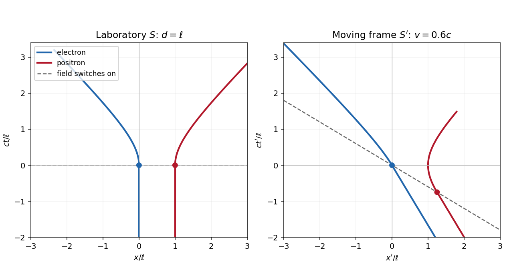

<h1 id="1/a/solution">Solution</h1>

↑ **Parent:** [A](../a.md)

Let $e>0$ be the magnitude of the [electron](../../../../electron.md)'s [electric charge](../../../../electric-charge-split.md), $m=m_e$, $F=eE>0$, and $\ell=mc^2/F$. The [Lorentz force](../../../../lorentz-force.md) is $dp_x/dt=qE$, so the [electron](../../../../electron.md) and [Positron](../../../../positron.md) acquire opposite [momenta](../../../../momentum-split.md):

$$
p_{e,x}=-Ft,\qquad p_{p,x}=Ft,\qquad
\mathcal E_e=\mathcal E_p=\sqrt{m^2c^4+F^2c^2t^2}.
$$

Using the [relativistic energy-momentum relation](../../../../energy-momentum-relation.md), $u_x=pc^2/\mathcal E$, and integrating from rest gives the [world lines](../../../../world-line.md)

$$
\boxed{x_e(t)=-\ell\left[\sqrt{1+(ct/\ell)^2}-1\right],\qquad
x_p(t)=d+\ell\left[\sqrt{1+(ct/\ell)^2}-1\right]\quad(t\geq0).}
$$

For $t<0$, the [world lines](../../../../world-line.md) are vertical at $x=0,d$ on a [spacetime diagram](../../../../spacetime-diagram.md). They join smoothly to the accelerated branches with zero initial [velocity](../../../../velocity.md). At small $t$, $x_e\simeq-Ft^2/(2m)$ and $x_p-d\simeq Ft^2/(2m)$; at large $t$, their [velocities](../../../../velocity.md) approach $-c,+c$, respectively. Each accelerated [world line](../../../../world-line.md) is a branch of a [hyperbola](../../../../hyperbola.md), since $(x_e-\ell)^2-c^2t^2=\ell^2$ and $(x_p-d+\ell)^2-c^2t^2=\ell^2$. The [electric field](../../../../electric-field-split.md) separates the opposite [electric charges](../../../../electric-charge-split.md) in this orientation. The asymptotes are lightlike, while every finite-time tangent is timelike.

**[Figure 1](#1/a/image-accelerated-pair-in-the-laboratory-and-a-moving-frame). Accelerated pair in the laboratory and a moving frame**. Original [spacetime diagrams](../../../../spacetime-diagram.md) for $d=\ell$ and $v=0.6c$. Dots mark the two switching events. The dashed line is the laboratory's simultaneous switching surface, which is tilted in the moving [inertial frame](../../../../inertial-frame.md).

## ↑ Ancestors (12)

1. [A](../a.md)
2. [1](../../1.md)
3. [2021](../../../2021-split.md)
4. [Past exam of the symmetry and relativity course of the University of Oxford](../../../split.md)
5. [Symmetry and relativity course of the University of Oxford](../../../../symmetry-and-relativity-course-of-the-university-of-oxford.md)
6. [Year 3 of the physics course of the University of Oxford](../../../../year-3-of-the-physics-course-of-the-university-of-oxford.md)
7. [Physics course of the University of Oxford](../../../../physics-course-of-the-university-of-oxford.md)
8. [Undergraduate course of the University of Oxford](../../../../undergraduate-course-of-the-university-of-oxford.md)
9. [Course of the University of Oxford](../../../../course-of-the-university-of-oxford.md)
10. [University of Oxford](../../../../university-of-oxford-split.md)
11. [List of universities](../../../../list-of-universities.md)
12. [Codex Wiki](../../../../split.md)
