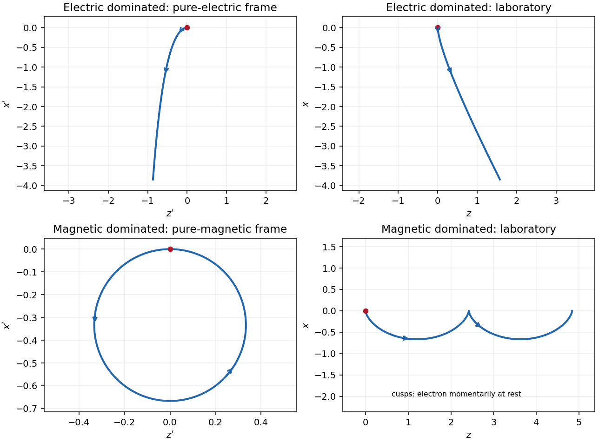

<h1 id="3/a/i/solution">Solution</h1>

↑ **Parent:** [I](../i.md)

Assume $E,B>0$ for the directions and parametrizations; the boost formulas retain their signed meaning for reversed fields. A [Lorentz boost](../../../../../lorentz-boost.md) with [velocity](../../../../../velocity.md) $w\hat{\mathbf z}$ along $\mathbf E\times\mathbf B$ transforms the transverse [electric field](../../../../../electric-field-split.md) and [magnetic field](../../../../../magnetic-field-split.md) as

$$
E'_x=\gamma_w(E-wB),\qquad B'_y=\gamma_w(B-wE/c^2).
$$

In the electric-dominated case choose

$$
\boxed{\mathbf w=\frac{c^2\mathbf E\times\mathbf B}{E^2}
=\frac{c^2B}{E}\hat{\mathbf z},\qquad
\mathbf B'=0,\qquad E'_x=E\sqrt{1-c^2B^2/E^2}.}
$$

The inequality ensures $|w|<c$, so this is an [inertial frame](../../../../../inertial-frame.md). The [field-removing boosts for perpendicular electric and magnetic fields](../../../../../field-removing-boosts-for-perpendicular-electric-and-magnetic-fields.md) are governed by the [electromagnetic field invariants](../../../../../electromagnetic-field-invariants.md) $\mathbf E\cdot\mathbf B=0$ and $E^2-c^2B^2>0$ explain why a purely electric [inertial frame](../../../../../inertial-frame.md) exists and a purely magnetic one does not.

The [electron](../../../../../electron.md) is **not initially at rest** in this convenient [inertial frame](../../../../../inertial-frame.md): its initial [velocity](../../../../../velocity.md) is $-w\hat{\mathbf z}$ and its initial [three-momentum](../../../../../three-momentum.md) is $p'_z=-\gamma_wmw$. Thereafter $p'_x=-eE't'$, while $p'_z$ stays constant. The [electric field](../../../../../electric-field-split.md) accelerates it toward $-x$; as its [relativistic energy](../../../../../relativistic-energy.md) increases, its negative transverse [velocity](../../../../../velocity.md) decreases in magnitude. Defining $a=eE'/m>0$ and $s=a\tau/c$ gives a useful parametric [world line](../../../../../world-line.md):

$$
t'=\frac{\gamma_wc}{a}\sinh s,\qquad
x'=-\frac{\gamma_wc^2}{a}(\cosh s-1),\qquad
z'=-\frac{\gamma_wwc}{a}s.
$$

Here $\tau$ is the [proper time](../../../../../proper-time.md). These formulas follow by integrating $U'^0=\gamma_wc\cosh s$, $U'^x=-\gamma_wc\sinh s$, and constant $U'^z=-\gamma_ww$. Its projection onto the $t',x'$ plane is a [hyperbola](../../../../../hyperbola.md), but the spatial trajectory includes the initial transverse motion and is not a straight line.

Transforming back with $z=\gamma_w(z'+wt')$, $t=\gamma_w(t'+wz'/c^2)$ gives

$$
x=x',\qquad z=\frac{\gamma_w^2wc}{a}(\sinh s-s),\qquad
t=\frac{\gamma_w^2c}{a}(\sinh s-w^2s/c^2).
$$

The laboratory trajectory starts from rest toward $-x$, then bends toward $+z$. It is unbounded in $-x$ and ultimately has $u_z\to w=c^2B/E$ and $u_x\to-c/\gamma_w$. Thus the late [velocity](../../../../../velocity.md) has magnitude $c$ as a limit, consistent with the [relativistic energy-momentum relation](../../../../../energy-momentum-relation.md), rather than undergoing a closed [cyclotron orbit](../../../../../gyromotion.md).

**[Figure 2](#3/a/i/image-electron-trajectories-in-electric-dominated-and-magnetic-dominated-crossed-fields). Electron trajectories in electric-dominated and magnetic-dominated crossed fields**. Original parametric spatial trajectories in the convenient [inertial frame](../../../../../inertial-frame.md) and laboratory, with dimensionless units $c=m=e=1$. Arrows show increasing time. The initial transverse motion in the purely electric frame and the laboratory cusps in the purely magnetic case are visible.

## ↑ Ancestors (13)

1. [I](../i.md)
2. [A](../../a.md)
3. [3](../../../3.md)
4. [2021](../../../../2021-split.md)
5. [Past exam of the symmetry and relativity course of the University of Oxford](../../../../split.md)
6. [Symmetry and relativity course of the University of Oxford](../../../../../symmetry-and-relativity-course-of-the-university-of-oxford.md)
7. [Year 3 of the physics course of the University of Oxford](../../../../../year-3-of-the-physics-course-of-the-university-of-oxford.md)
8. [Physics course of the University of Oxford](../../../../../physics-course-of-the-university-of-oxford.md)
9. [Undergraduate course of the University of Oxford](../../../../../undergraduate-course-of-the-university-of-oxford.md)
10. [Course of the University of Oxford](../../../../../course-of-the-university-of-oxford.md)
11. [University of Oxford](../../../../../university-of-oxford-split.md)
12. [List of universities](../../../../../list-of-universities.md)
13. [Codex Wiki](../../../../../split.md)
