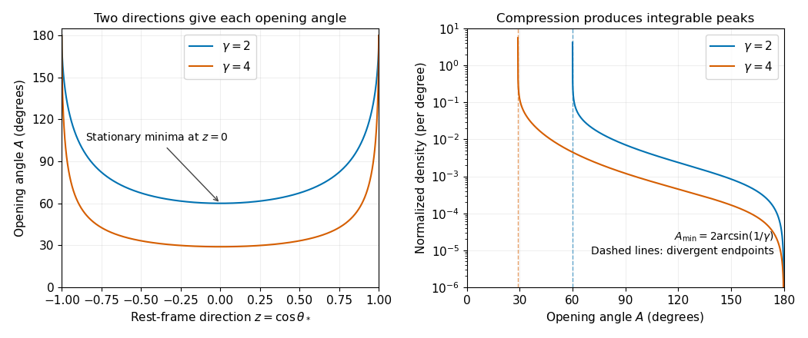

# 2022

↑ **Parent:** [Past exam of the symmetry and relativity course of the University of Oxford](../past-exam-of-the-symmetry-and-relativity-course-of-the-university-of-oxford.md)

Source: [https://www.whatdotheyknow.com/request/oxford_physics_past_papers_2/response/2340696/attach/10/Physics%20Papers%202021.pdf?cookie_passthrough=1](https://www.whatdotheyknow.com/request/oxford_physics_past_papers_2/response/2340696/attach/10/Physics%20Papers%202021.pdf?cookie_passthrough=1)

Source bundle pages 71–75. The cover establishes 2022 despite the attachment filename. Throughout these solutions the [metric signature](../topological-manifold.md#metric-signature) is $(-,+,+,+)$, as fixed by the source's lowered time coordinate. Question 2 uses $c=1$. Signs and additional assumptions needed by particular printed conclusions are explained where they arise.

**Table of contents**

- [1](#1)
  - [a](#1/a)
    - [Solution](#1/a/solution)
  - [b](#1/b)
    - [Solution](#1/b/solution)
  - [c](#1/c)
    - [Solution](#1/c/solution)
  - [d](#1/d)
    - [Solution](#1/d/solution)
  - [e](#1/e)
    - [Solution](#1/e/solution)
- [2](#2)
  - [a](#2/a)
    - [Solution](#2/a/solution)
  - [b](#2/b)
    - [Solution](#2/b/solution)
  - [c](#2/c)
    - [Solution](#2/c/solution)
  - [d](#2/d)
    - [Solution](#2/d/solution)
- [3](#3)
  - [a](#3/a)
    - [Solution](#3/a/solution)
  - [b](#3/b)
    - [Solution](#3/b/solution)
  - [c](#3/c)
    - [Solution](#3/c/solution)
  - [d](#3/d)
    - [Solution](#3/d/solution)
- [4](#4)
  - [a](#4/a)
    - [Solution](#4/a/solution)
  - [b](#4/b)
    - [Solution](#4/b/solution)
  - [c](#4/c)
    - [Solution](#4/c/solution)
  - [d](#4/d)
    - [Solution](#4/d/solution)

## 1

↑ **Parent:** [2022](2022.md)

<h3 id="1/a">a</h3>

↑ **Parent:** [1](#1)

<h4 id="1/a/solution">Solution</h4>

↑ **Parent:** [A](#1/a)

Write the [Lorentz transformation](../special-relativity.md#lorentz-transformation) as $x'^\mu=\Lambda^\mu{}_{\nu}x^\nu$. Acting on a [scalar field](../classical-field-theory.md#scalar-field), the [chain rule](../calculus.md#chain-rule) gives the [four-gradient](../special-relativity.md#four-gradient)

$$
\partial'_\mu=\frac{\partial x^\nu}{\partial x'^\mu}\partial_\nu
=(\Lambda^{-1})^\nu{}_{\mu}\partial_\nu.
$$

For the specified [Lorentz boost](../special-relativity.md#lorentz-boost), the inverse is obtained by changing $\beta$ to $-\beta$, so

$$
\partial'_0=\gamma(\partial_0+\beta\partial_1),\qquad
\partial'_1=\gamma(\partial_1+\beta\partial_0),\qquad
\partial'_2=\partial_2,\quad\partial'_3=\partial_3.
$$

These are precisely the [covector](../dual-space.md#covector) component rules for the lowered coordinates. Raising the index with the [Minkowski metric](../special-relativity.md#minkowski-metric) $\eta^{\mu\nu}=\operatorname{diag}(-1,1,1,1)$ reverses the time component, yielding

$$
\boxed{\partial_\mu=(c^{-1}\partial_t,\partial_x,\partial_y,\partial_z),\qquad
\partial^\mu=(-c^{-1}\partial_t,\partial_x,\partial_y,\partial_z).}
$$

Indeed $\partial'^0=\gamma(\partial^0-\beta\partial^1)$ and $\partial'^1=\gamma(\partial^1-\beta\partial^0)$, the contravariant [four-vector](../special-relativity.md#four-vector) rules. Thus the index on a [partial derivative](../multivariable-calculus.md#partial-derivative) with respect to an upper coordinate is lower.

<h3 id="1/b">b</h3>

↑ **Parent:** [1](#1)

<h4 id="1/b/solution">Solution</h4>

↑ **Parent:** [B](#1/b)

The [four-gradient](../special-relativity.md#four-gradient) rules from [a](#1/a) give

$$
\partial'_\mu\partial'^\mu
=(\Lambda^{-1})^\nu{}_{\mu}\partial_\nu
\Lambda^\mu{}_{\rho}\partial^\rho
=\delta^\nu{}_{\rho}\partial_\nu\partial^\rho
=\partial_\nu\partial^\nu.
$$

The [Lorentz transformation](../special-relativity.md#lorentz-transformation) coefficients are constant, so the [partial derivatives](../multivariable-calculus.md#partial-derivative) do not differentiate them. This proves the [Lorentz invariance](../special-relativity.md#lorentz-invariance) of the [d'Alembert operator](../wave-equation.md#d-alembert-operator):

$$
\boxed{\Box=\partial_\mu\partial^\mu=\nabla^2-c^{-2}\partial_t^2.}
$$

For example, the two longitudinal terms transform as $-\gamma^2(\partial_0+\beta\partial_1)^2+\gamma^2(\partial_1+\beta\partial_0)^2=-\partial_0^2+\partial_1^2$, using $\gamma^2(1-\beta^2)=1$ and commuting [partial derivatives](../multivariable-calculus.md#partial-derivative). The transverse terms are unchanged. Applied to a [scalar field](../classical-field-theory.md#scalar-field), $\Box$ therefore gives a [Lorentz scalar](../special-relativity.md#lorentz-scalar).

<h3 id="1/c">c</h3>

↑ **Parent:** [1](#1)

<h4 id="1/c/solution">Solution</h4>

↑ **Parent:** [C](#1/c)

Take the [divergence](../multivariable-calculus.md#divergence) of the [Ampère-Maxwell equation](../maxwell-equations.md#ampere-s-circuital-law) and use that the [divergence of a curl is zero](../multivariable-calculus.md#divergence-of-a-curl-is-zero):

$$
0=\nabla\cdot(\nabla\times\mathbf B)
=\mu_0\nabla\cdot\mathbf J+\mu_0\epsilon_0\partial_t(\nabla\cdot\mathbf E)
=\mu_0(\nabla\cdot\mathbf J+\partial_t\rho).
$$

The last step uses [Gauss's law](../maxwell-equations.md#gauss-s-law). Thus the [charge continuity equation](../maxwell-equations.md#charge-continuity-equation) is exactly

$$
\boxed{J^\mu=(c\rho,\mathbf J),\qquad \partial_\mu J^\mu=\partial_t\rho+\nabla\cdot\mathbf J=0.}
$$

For a direct justification that this [four-current](../electric-charge.md#four-current) is a [four-vector](../special-relativity.md#four-vector), take one locally comoving population of [electric charges](../electric-charge.md), with rest [charge density](../electric-charge.md#charge-density) $\rho_0$ and [four-velocity](../special-relativity.md#four-velocity) $U^\mu=\gamma(c,\mathbf v)$. Invariance of [electric charge](../electric-charge.md) and [length contraction](../special-relativity.md#length-contraction) give $\rho=\gamma\rho_0$ and $\mathbf J=\rho\mathbf v$, hence $J^\mu=\rho_0U^\mu$. Summing populations preserves the [four-vector](../special-relativity.md#four-vector) rule. In particular, $c\rho'=\gamma(c\rho-\beta J_x)$ and $J'_x=\gamma(J_x-\beta c\rho)$. The [Lorentz invariance](../special-relativity.md#lorentz-invariance) of its [four-divergence](../special-relativity.md#four-divergence) then explains why [charge conservation](../electric-charge.md#charge-conservation) holds in every [inertial frame](../mathematical-physics.md#inertial-frame). A single zero-divergence condition alone would not determine a field's transformation law; the physical [charge density](../electric-charge.md#charge-density) and [current density](../electric-charge.md#current-density) provide the additional content.

<h3 id="1/d">d</h3>

↑ **Parent:** [1](#1)

<h4 id="1/d/solution">Solution</h4>

↑ **Parent:** [D](#1/d)

The [Lorenz gauge condition](../relativistic-electromagnetism.md#lorenz-gauge-condition) is $\nabla\cdot\mathbf A=-c^{-2}\partial_t\phi$. Substitute the [electric potential](../electric-field.md#electric-potential) and [magnetic vector potential](../electromagnetism.md#magnetic-vector-potential) into [Gauss's law](../maxwell-equations.md#gauss-s-law):

$$
-\nabla^2\phi-\partial_t(\nabla\cdot\mathbf A)=\rho/\epsilon_0,
\qquad
\Box\phi=-\rho/\epsilon_0.
$$

Next the [Ampère-Maxwell equation](../maxwell-equations.md#ampere-s-circuital-law), the [curl of the curl identity](../multivariable-calculus.md#curl-of-the-curl-identity), and the [Lorenz gauge condition](../relativistic-electromagnetism.md#lorenz-gauge-condition) give

$$
\begin{aligned}
\nabla(\nabla\cdot\mathbf A)-\nabla^2\mathbf A
&=\mu_0\mathbf J-c^{-2}\nabla\partial_t\phi-c^{-2}\partial_t^2\mathbf A,\\
\Box\mathbf A&=-\mu_0\mathbf J.
\end{aligned}
$$

The [gradient](../multivariable-calculus.md#gradient) terms cancel. Since $\mu_0\epsilon_0c^2=1$, the time component obeys $\Box(\phi/c)=-\mu_0c\rho$, so together

$$
\boxed{\partial^\nu\partial_\nu A^a=-\mu_0J^a,\qquad A^\mu=(\phi/c,\mathbf A).}
$$

The [four-potential](../relativistic-electromagnetism.md#electromagnetic-four-potential) can be chosen to transform as a [four-vector](../special-relativity.md#four-vector). To make the argument rigorous, choose the [retarded potential](../relativistic-electromagnetism.md#retarded-potential) with no freely added homogeneous solution. If $\Box G_{\mathrm{ret}}(x)=\delta^{(4)}(x)$, this choice is

$$
A^\mu(x)=-\mu_0\int G_{\mathrm{ret}}(x-y)J^\mu(y)\,d^4y.
$$

The [retarded Green function](../quantum-field-theory.md#retarded-green-function) is a [Lorentz scalar](../special-relativity.md#lorentz-scalar) under [proper orthochronous Lorentz transformations](../special-relativity.md#proper-orthochronous-lorentz-transformation), and $d^4y$ is invariant. The [four-vector](../special-relativity.md#four-vector) rule for $J^\mu$ therefore proves $A'^\mu(x')=\Lambda^\mu{}_{\nu}A^\nu(x)$. More generally, transform any homogeneous initial data by this same rule. Both the [wave equation](../wave-equation.md) and the [Lorenz gauge condition](../relativistic-electromagnetism.md#lorenz-gauge-condition) are then preserved.

**Qualification.** The [wave equation](../wave-equation.md) by itself cannot prove the transformation rule for every independently chosen [gauge potential](../relativistic-quantum-field.md#gauge-field): the [d'Alembert operator](../wave-equation.md#d-alembert-operator) has a nontrivial [kernel of a linear map](../kernel-of-a-linear-map.md). For a concrete counterexample, zero sources and zero fields admit $A^\mu=0$ in one [inertial frame](../mathematical-physics.md#inertial-frame) and $A'^\mu=(0,C,0,0)$ in another. Both satisfy the [wave equation](../wave-equation.md) and the [Lorenz gauge condition](../relativistic-electromagnetism.md#lorenz-gauge-condition), but the latter is not the [Lorentz transformation](../special-relativity.md#lorentz-transformation) of zero. It is a [residual Lorenz gauge symmetry](../relativistic-electromagnetism.md#residual-lorenz-gauge-symmetry), generated by $\chi=Cx'$. Thus the usual assertion is a covariant choice of [four-potential](../relativistic-electromagnetism.md#electromagnetic-four-potential), with a consistent [gauge transformation](../electromagnetism.md#gauge-transformation) and homogeneous data, rather than a uniqueness result from the displayed equation.

<h3 id="1/e">e</h3>

↑ **Parent:** [1](#1)

<h4 id="1/e/solution">Solution</h4>

↑ **Parent:** [E](#1/e)

Let $s=k^\mu x_\mu$. The [Lorenz gauge condition](../relativistic-electromagnetism.md#lorenz-gauge-condition) on the [plane electromagnetic wave](../electromagnetic-wave.md#plane-electromagnetic-wave) gives

$$
k_\mu\epsilon^\mu=0.
$$

The vacuum [wave equation](../wave-equation.md) gives $k_\mu k^\mu=0$ for a nonzero amplitude; equivalently $k^0=\omega/c$ and $|\mathbf k|=\omega/c$. Use the [gauge transformation](../electromagnetism.md#gauge-transformation) $A'^\mu=A^\mu+\partial^\mu\chi$ with

$$
\chi=-\lambda\cos s,\qquad \epsilon'^\mu=\epsilon^\mu+\lambda k^\mu.
$$

Because $\Box\chi=0$, this is a [residual Lorenz gauge symmetry](../relativistic-electromagnetism.md#residual-lorenz-gauge-symmetry) and $k_\mu\epsilon'^\mu=0$. For a propagating [plane electromagnetic wave](../electromagnetic-wave.md#plane-electromagnetic-wave), $k^0\ne0$, so take $\lambda=-\epsilon^0/k^0$. Then

$$
\boxed{\epsilon'^0=0,\qquad \mathbf k\cdot\boldsymbol\epsilon'=0.}
$$

The second equality follows from $-k^0\epsilon'^0+\mathbf k\cdot\boldsymbol\epsilon'=0$. The [electric field](../electric-field.md) and [magnetic field](../magnetic-field.md) are unchanged by this [gauge transformation](../electromagnetism.md#gauge-transformation). Thus [Lorenz gauge](../relativistic-electromagnetism.md#lorenz-gauge-condition) permits a representative in [radiation gauge](../electromagnetism.md#radiation-gauge); [Lorenz gauge](../relativistic-electromagnetism.md#lorenz-gauge-condition) alone does not require the spatial amplitude of every representative to be transverse.

## 2

↑ **Parent:** [2022](2022.md)

<h3 id="2/a">a</h3>

↑ **Parent:** [2](#2)

<h4 id="2/a/solution">Solution</h4>

↑ **Parent:** [A](#2/a)

Use $c=1$ and define the total [four-momentum](../special-relativity.md#four-momentum) $P^\mu=(E,\mathbf P)=\sum_i(E_i,\mathbf p_i)$. For an [inertial frame](../mathematical-physics.md#inertial-frame) moving with [velocity](../classical-mechanics.md#velocity) $\mathbf V$ relative to the laboratory, the [Lorentz boost](../special-relativity.md#lorentz-boost) gives

$$
P'_{\parallel}=\gamma_V(P_{\parallel}-VE),\qquad \mathbf P'_{\perp}=\mathbf P_{\perp}.
$$

Choose $\mathbf V$ parallel to $\mathbf P$ and require zero total [three-momentum](../special-relativity.md#three-momentum). Then

$$
\boxed{\mathbf V_{\mathrm{CM/lab}}=\frac{\mathbf P}{E}=\frac{\sum_i\mathbf p_i}{\sum_iE_i}.}
$$

This requires $E>|\mathbf P|$, so that the total [four-momentum](../special-relativity.md#four-momentum) is timelike. Its [invariant mass](../special-relativity.md#invariant-mass) is $\sqrt{E^2-|\mathbf P|^2}$, the total [relativistic energy](../special-relativity.md#relativistic-energy) in the [center-of-momentum frame](../special-relativity.md#center-of-momentum-frame). If all particles are exactly parallel [photons](../quantum-mechanics.md#photon), the total [four-momentum](../special-relativity.md#four-momentum) is null and no finite-[velocity](../classical-mechanics.md#velocity) [center-of-momentum frame](../special-relativity.md#center-of-momentum-frame) exists.

**Sign qualification.** The minus sign printed in the source describes the laboratory's [velocity](../classical-mechanics.md#velocity) in the [center-of-momentum frame](../special-relativity.md#center-of-momentum-frame), or the parameter of an active [Lorentz boost](../special-relativity.md#lorentz-boost) with a plus-sign spatial rule. It is not the [velocity](../classical-mechanics.md#velocity) of the [center-of-momentum frame](../special-relativity.md#center-of-momentum-frame) relative to the laboratory under question 1's passive convention. For example, a single particle with $(E,P_x)=(5,3)$ has its rest frame moving at $V_x=3/5$. The printed $V_x=-3/5$ would give $P'_x=(5/4)(3+3)=15/2$, which is not zero. This explicitly resolves the sign rather than assigning a rest frame moving away from the particle.

<h3 id="2/b">b</h3>

↑ **Parent:** [2](#2)

<h4 id="2/b/solution">Solution</h4>

↑ **Parent:** [B](#2/b)

By [four-momentum conservation](../special-relativity.md#four-momentum-conservation), $p_\pi=p_1+p_2$. With the $(-,+,+,+)$ [Minkowski metric](../special-relativity.md#minkowski-metric), the [neutral pion](../standard-model.md#neutral-pion) has $p_\pi^2=-M_\pi^2$, while each [photon](../quantum-mechanics.md#photon) has $p_i^2=0$ and $|\mathbf p_i|=E_i$. Taking the [Minkowski norm](../special-relativity.md#minkowski-norm) gives

$$
-M_\pi^2=2p_1\cdot p_2
=2(-E_1E_2+\mathbf p_1\cdot\mathbf p_2)
=-2E_1E_2(1-\cos A).
$$

The half-angle identity therefore yields

$$
\boxed{\sin^2(A/2)=\frac{M_\pi^2}{4E_1E_2}.}
$$

This is a measurement of the [diphoton invariant mass](../special-relativity.md#diphoton-invariant-mass) using two [photon](../quantum-mechanics.md#photon) [energies](../energy.md) and their opening angle, independent of the [neutral pion](../standard-model.md#neutral-pion)'s laboratory [velocity](../classical-mechanics.md#velocity).

<h3 id="2/c">c</h3>

↑ **Parent:** [2](#2)

<h4 id="2/c/solution">Solution</h4>

↑ **Parent:** [C](#2/c)

In the [center-of-momentum frame](../special-relativity.md#center-of-momentum-frame), [four-momentum conservation](../special-relativity.md#four-momentum-conservation) gives two opposite [photon](../quantum-mechanics.md#photon) momenta, each of [energy](../energy.md) $M_\pi/2$. Let $z=\cos\theta_*$, with the axis along the [Lorentz boost](../special-relativity.md#lorentz-boost) from that frame to the laboratory. Reversing the axis specified in the source changes $z$ to $-z$ and has no effect on the following product. The [Lorentz transformation](../special-relativity.md#lorentz-transformation) of [four-momentum](../special-relativity.md#four-momentum) gives

$$
E_1=\frac{\gamma M_\pi}{2}(1+\beta z),\qquad
E_2=\frac{\gamma M_\pi}{2}(1-\beta z).
$$

Writing $s=\sin(A/2)$, [b](#2/b) now implies

$$
s^2=\frac1{\gamma^2(1-\beta^2z^2)},\qquad
|z|=\frac{\sqrt{\gamma^2s^2-1}}{\beta\gamma s}.
$$

The [isotropy](../continuum-mechanics.md#isotropy) assumption is $dN=a\,|dz|$ on $-1\le z\le1$. Each interior opening angle has **two** inverse branches, $z$ and $-z$, both of which must enter the [change of variables for probability densities](../continuous-probability-distribution.md#change-of-variables-for-probability-densities). The positive branch has [derivative](../calculus.md#derivative)

$$
\left|\frac{dz}{dA}\right|
=\frac{\cos(A/2)}{2\beta\gamma\sin^2(A/2)\sqrt{\gamma^2\sin^2(A/2)-1}}.
$$

Consequently the [diphoton opening-angle distribution](../special-relativity.md#diphoton-opening-angle-distribution) is

$$
\boxed{\frac{dN}{dA}=\frac a\gamma\frac{\cos(A/2)}{\beta\sin^2(A/2)\sqrt{\gamma^2\sin^2(A/2)-1}},\qquad f(\gamma)=\gamma^{-1}.}
$$

Its [support](../function.md#support) is $2\arcsin(1/\gamma)<A<\pi$ for $0<\beta<1$, and its integral is $2a$, the integral of the original angular [probability density](../wave-function.md#probability-density) before normalization. Thus the normalized [probability density](../wave-function.md#probability-density) is $(2a)^{-1}dN/dA$. Omitting one inverse branch would incorrectly halve the total count.

<h3 id="2/d">d</h3>

↑ **Parent:** [2](#2)

<h4 id="2/d/solution">Solution</h4>

↑ **Parent:** [D](#2/d)

From [c](#2/c), $\sin(A/2)\ge1/\gamma$, with equality when $z=0$: the [photons](../quantum-mechanics.md#photon) are emitted perpendicular to the [Lorentz boost](../special-relativity.md#lorentz-boost) axis in the [center-of-momentum frame](../special-relativity.md#center-of-momentum-frame). Therefore

$$
\boxed{A_{\min}=2\arcsin(\gamma^{-1}),\qquad A_{\mathrm{peak}}=A_{\min}.}
$$

At the minimum, the map $z\mapsto A$ is stationary: writing $A=A_{\min}+\delta$, its leading behavior is $\delta=\beta z^2/\gamma+O(z^4)$. A nonzero interval of uniformly distributed $z$ is therefore compressed near $A_{\min}$, producing an integrable [inverse-square-root singularity](../real-analysis.md#inverse-square-root-singularity) in the opening-angle [probability density](../wave-function.md#probability-density). No [differentiation](../calculus.md#differentiation) of that [probability density](../wave-function.md#probability-density) is needed. For finite $\gamma>1$, the [probability density](../wave-function.md#probability-density) vanishes at $A=\pi$. For $\gamma=1$ the [center-of-momentum frame](../special-relativity.md#center-of-momentum-frame) is the laboratory and every event has $A=\pi$: the [probability distribution](../probability-distribution.md) becomes a [Dirac delta distribution](../distribution-theory.md#dirac-delta-function), rather than the singular $\beta=0$ substitution in [c](#2/c). At large $\gamma$, $A_{\min}\sim2/\gamma$ in radians.

**[Figure 1](#2/d/image-opening-angle-compression-and-its-normalized-probability-density-for-a-boosted-two-photon-decay). Opening-angle compression and its normalized probability density for a boosted two-photon decay**.

## 3

↑ **Parent:** [2022](2022.md)

<h3 id="3/a">a</h3>

↑ **Parent:** [3](#3)

<h4 id="3/a/solution">Solution</h4>

↑ **Parent:** [A](#3/a)

For a massive particle, the [proper time](../special-relativity.md#proper-time) is determined by the [Minkowski interval](../special-relativity.md#minkowski-interval) along its [worldline](../special-relativity.md#world-line):

$$
-c^2d\tau^2=-c^2dt^2+d\mathbf x\cdot d\mathbf x
=-c^2dt^2(1-|\mathbf u|^2/c^2).
$$

Choose future-directed time increments. With the [Lorentz factor](../special-relativity.md#lorentz-factor) $\gamma_u=(1-|\mathbf u|^2/c^2)^{-1/2}$,

$$
\boxed{d\tau=dt/\gamma_u,\qquad U^\alpha=\frac{dx^\alpha}{d\tau}=\gamma_u(c,\mathbf u).}
$$

We use $U^\alpha$ for the source's $u^\alpha$ to distinguish [four-velocity](../special-relativity.md#four-velocity) from [velocity](../classical-mechanics.md#velocity) $\mathbf u$. Since [proper time](../special-relativity.md#proper-time) is invariant and $dx^\alpha$ is a [four-vector](../special-relativity.md#four-vector), $U^\alpha$ is a [four-vector](../special-relativity.md#four-vector), with $U_\alpha U^\alpha=-c^2$. The rest-frame result $U^\alpha=(c,\mathbf0)$ follows immediately.

<h3 id="3/b">b</h3>

↑ **Parent:** [3](#3)

<h4 id="3/b/solution">Solution</h4>

↑ **Parent:** [B](#3/b)

The [Lorentz boost](../special-relativity.md#lorentz-boost) from A to B gives

$$
dt'=\gamma_v(dt-v\,dx/c^2),\quad dx'=\gamma_v(dx-v\,dt),\quad dy'=dy,\quad dz'=dz.
$$

Divide each spatial displacement by $dt'=\gamma_vdt(1-vu_x/c^2)$. The [velocity-addition formula](../special-relativity.md#velocity-addition-formula) is

$$
\boxed{w_x=\frac{u_x-v}{1-vu_x/c^2},\qquad
w_y=\frac{u_y}{\gamma_v(1-vu_x/c^2)},\qquad
w_z=\frac{u_z}{\gamma_v(1-vu_x/c^2)}.}
$$

The same result follows by transforming the [four-velocity](../special-relativity.md#four-velocity) and using $w_i=cU'^i/U'^0$. The transverse [velocities](../classical-mechanics.md#velocity) change because the transformed time increment depends on $dx$, even though the transverse spatial coordinates are unchanged.

<h3 id="3/c">c</h3>

↑ **Parent:** [3](#3)

<h4 id="3/c/solution">Solution</h4>

↑ **Parent:** [C](#3/c)

For $v=|\mathbf v|>0$, decompose the [velocity](../classical-mechanics.md#velocity) as $\mathbf u=\mathbf u_\parallel+\mathbf u_\perp$, parallel and perpendicular to $\mathbf v$. A rotation-free [Lorentz boost](../special-relativity.md#lorentz-boost) gives the [velocity-addition formula](../special-relativity.md#velocity-addition-formula)

$$
\mathbf w_\parallel=\frac{\mathbf u_\parallel-\mathbf v}{D},\qquad
\mathbf w_\perp=\frac{\mathbf u_\perp}{\gamma_vD},\qquad
D=1-\mathbf v\cdot\mathbf u/c^2.
$$

These two components are orthogonal, so

$$
\begin{aligned}
D^2|\mathbf w|^2
&=|\mathbf u_\parallel-\mathbf v|^2+(1-v^2/c^2)|\mathbf u_\perp|^2\\
&=|\mathbf u-\mathbf v|^2-\frac{v^2|\mathbf u_\perp|^2}{c^2}\\
&=|\mathbf u-\mathbf v|^2-\frac{|\mathbf v\times\mathbf u|^2}{c^2}.
\end{aligned}
$$

The last equality is [Lagrange's identity](../multivariable-calculus.md#lagrange-identity-for-the-cross-product) for the [cross product](../vector-space.md#cross-product). For physical [subluminal speeds](../special-relativity.md#subluminal-speed), $D>0$, giving

$$
\boxed{|\mathbf w|=\frac{\sqrt{(\mathbf v-\mathbf u)\cdot(\mathbf v-\mathbf u)-|\mathbf v\times\mathbf u|^2/c^2}}{1-\mathbf v\cdot\mathbf u/c^2}.}
$$

The $\mathbf v=0$ case follows directly or by continuity. An independent form useful for checks is $1-|\mathbf w|^2/c^2=(1-u^2/c^2)(1-v^2/c^2)/D^2$, obtained from the transformed [four-velocity](../special-relativity.md#four-velocity) normalization.

<h3 id="3/d">d</h3>

↑ **Parent:** [3](#3)

<h4 id="3/d/solution">Solution</h4>

↑ **Parent:** [D](#3/d)

Let $\mathbf v_1=(c/2,0,0)$ and $\mathbf v_2=(c/(2\sqrt2),c/(2\sqrt2),0)$ in A. Each has [Lorentz factor](../special-relativity.md#lorentz-factor) $g=2/\sqrt3$. The relative [Lorentz factor](../special-relativity.md#lorentz-factor) of $S_2$ in the rest frame of $S_1$ follows from their [four-velocity](../special-relativity.md#four-velocity) [tensor contraction](../multilinear-algebra.md#tensor-contraction):

$$
\Gamma=-\frac{U_1\cdot U_2}{c^2}
=g^2\left(1-\frac{\mathbf v_1\cdot\mathbf v_2}{c^2}\right)
=\frac{8-\sqrt2}{6}.
$$

Let $b=\sqrt{1-\Gamma^{-2}}$ be the relative [speed](../classical-mechanics.md#speed) divided by $c$. In the rest frame of $S_1$, take $\theta$ between the [photon](../quantum-mechanics.md#photon)'s propagation direction and $S_2$'s [velocity](../classical-mechanics.md#velocity). The observed [angular frequency](../lagrangian-mechanics.md#angular-frequency) is the invariant $\omega=-k\cdot U$. Applying it to the emitter, whose rest [angular frequency](../lagrangian-mechanics.md#angular-frequency) is $\omega_0$, gives $\omega_0=\Gamma\omega_1(1-b\cos\theta)$. Since $\omega_1=\omega_0$,

$$
\boxed{\cos\theta=\frac{1-\Gamma^{-1}}{b}
=\sqrt{\frac{\Gamma-1}{\Gamma+1}}
=\sqrt{\frac{2-\sqrt2}{14-\sqrt2}},\qquad \theta\simeq77.54^\circ.}
$$

This is a [relativistic Doppler effect](../wave.md#relativistic-doppler-effect) calculation using both emitters' and receivers' rest clocks; the time delay of reception introduces no extra factor for constant [velocities](../classical-mechanics.md#velocity).

For the direction in A, write the [wave four-vector](../special-relativity.md#four-wavevector) as $k^\mu=(\omega_A/c)(1,\mathbf n)$, where $\mathbf n$ is a [unit vector](../vector-space.md#unit-vector). Equality of the emitted and received [angular frequencies](../lagrangian-mechanics.md#angular-frequency) gives $k\cdot(U_1-U_2)=0$. Since the two laboratory [Lorentz factors](../special-relativity.md#lorentz-factor) are equal, their time components cancel:

$$
\mathbf n\cdot(\mathbf v_1-\mathbf v_2)=0,
\qquad n_y=(\sqrt2-1)n_x.
$$

Thus the complete answer in three spatial dimensions is

$$
\boxed{\mathbf n=\cos\psi\,\big(\cos(\pi/8),\sin(\pi/8),0\big)+\sin\psi\,(0,0,1),\qquad 0\le\psi<2\pi.}
$$

If propagation is additionally assumed to lie in the stars' motion plane, this reduces to either direction along the internal [angle bisector](../geometry-and-topology.md#angle-bisector), $22.5^\circ$ or $202.5^\circ$ from $+x$. Reflection exchanging the stars' laboratory [velocities](../classical-mechanics.md#velocity) explains the [angle bisector](../geometry-and-topology.md#angle-bisector) by symmetry. **The source does not specify coplanar propagation or the stars' positions**, so it does not fix the sign or exclude an out-of-plane ray. For example $\mathbf n=(0,0,1)$ gives $\omega_1=\omega_2=g\omega_A$ and satisfies the same no-shift condition. Initial positions can be chosen to make such a ray connect emission and reception. All these possibilities give the same rest-frame $\theta$ above.

## 4

↑ **Parent:** [2022](2022.md)

<h3 id="4/a">a</h3>

↑ **Parent:** [4](#4)

<h4 id="4/a/solution">Solution</h4>

↑ **Parent:** [A](#4/a)

For constant laboratory [force](../force.md) $\mathbf F$ and initial rest, [integration](../integral.md) gives [three-momentum](../special-relativity.md#three-momentum) $\mathbf p=\mathbf Ft$. The [energy–momentum relation](../special-relativity.md#energy-momentum-relation) gives $E=\sqrt{m^2c^4+c^2|\mathbf F|^2t^2}$, and $\mathbf v=c^2\mathbf p/E$, so

$$
\boxed{\mathbf v(t)=\frac{\mathbf Ft/m}{\sqrt{1+|\mathbf F|^2t^2/(m^2c^2)}}.}
$$

For $\mathbf F\ne0$ and $t\ge0$, its [speed](../classical-mechanics.md#speed) increases monotonically, is strictly below the [speed of light](../special-relativity.md#speed-of-light) at every finite time, and obeys $\lim_{t\to\infty}|\mathbf v(t)|=c$. Thus $c$ is the limiting supremum, rather than a [speed](../classical-mechanics.md#speed) attained at a finite time. The degenerate case $\mathbf F=0$ leaves the particle at rest and does not have this limit.

<h3 id="4/b">b</h3>

↑ **Parent:** [4](#4)

<h4 id="4/b/solution">Solution</h4>

↑ **Parent:** [B](#4/b)

With constant [rest mass](../special-relativity.md#invariant-mass), $\mathbf p=m\gamma\mathbf v$ and the [chain rule](../calculus.md#chain-rule) gives $\dot\gamma=\gamma^3(\mathbf v\cdot\mathbf a)/c^2$. Hence the laboratory [relativistic force](../special-relativity.md#relativistic-force) is

$$
\mathbf F=m\gamma\mathbf a+\frac{m\gamma^3}{c^2}(\mathbf v\cdot\mathbf a)\mathbf v.
$$

Use the [vector triple product identity](../multivariable-calculus.md#vector-triple-product) $\mathbf v\times(\mathbf v\times\mathbf a)=\mathbf v(\mathbf v\cdot\mathbf a)-v^2\mathbf a$, and $\gamma^3(1-v^2/c^2)=\gamma$, to obtain

$$
\boxed{\mathbf F=m\gamma^3\left(\mathbf a+\frac{\mathbf v\times(\mathbf v\times\mathbf a)}{c^2}\right).}
$$

The [relativistic energy](../special-relativity.md#relativistic-energy) is $E=m\gamma c^2$, whose [time derivative](../multivariable-calculus.md#time-derivative) is $m\gamma^3\mathbf v\cdot\mathbf a$. Taking the [dot product](../inner-product.md#dot-product) of the first expression for $\mathbf F$ with $\mathbf v$ gives the same quantity, because $\gamma+\gamma^3v^2/c^2=\gamma^3$. Thus $dE/dt=\mathbf F\cdot\mathbf v$. Since $d/d\tau=\gamma\,d/dt$, the [four-force](../special-relativity.md#four-force) is

$$
\boxed{F^\alpha=\frac{dp^\alpha}{d\tau}=\left(\frac{\gamma\mathbf F\cdot\mathbf v}{c},\gamma\mathbf F\right).}
$$

Its [tensor contraction](../multilinear-algebra.md#tensor-contraction) with the [four-velocity](../special-relativity.md#four-velocity) vanishes: $F^\alpha U_\alpha=-\gamma^2\mathbf F\cdot\mathbf v+\gamma^2\mathbf F\cdot\mathbf v=0$. This [orthogonality](../inner-product.md#orthogonal-vectors) also follows by differentiating $p^\alpha p_\alpha=-m^2c^2$. Resolving the laboratory [acceleration](../classical-mechanics.md#acceleration) relative to $\mathbf v$ gives $\mathbf F_\parallel=m\gamma^3\mathbf a_\parallel$ and $\mathbf F_\perp=m\gamma\mathbf a_\perp$.

<h3 id="4/c">c</h3>

↑ **Parent:** [4](#4)

<h4 id="4/c/solution">Solution</h4>

↑ **Parent:** [C](#4/c)

**Metric-sign qualification.** With this paper's $(-,+,+,+)$ [metric signature](../topological-manifold.md#metric-signature), [b](#4/b) gives

$$
F^\alpha F_\alpha=\gamma^2\left(|\mathbf F|^2-\frac{(\mathbf F\cdot\mathbf v)^2}{c^2}\right)\ge0.
$$

The minus sign in the printed [Larmor formula](../electromagnetic-radiation.md#larmor-formula) would therefore make a positive radiative loss negative. A concrete counterexample is an instant of rest with nonzero [acceleration](../classical-mechanics.md#acceleration): $F^\alpha=(0,m\mathbf a)$, so the printed expression is $-q^2a^2/(6\pi\epsilon_0c^3)$. That sign is appropriate for the opposite [metric signature](../topological-manifold.md#metric-signature). With the convention already fixed in question 1, positive emitted [power](../energy.md#power) instead is

$$
P_{\mathrm{rad}}=\frac{q^2}{6\pi\epsilon_0m^2c^3}F^\alpha F_\alpha.
$$

Alternatively the printed negative quantity can be interpreted as the particle's signed radiative [energy](../energy.md) change, rather than the positive loss magnitude.

For fixed [rest mass](../special-relativity.md#invariant-mass), resolve the [acceleration](../classical-mechanics.md#acceleration) parallel and perpendicular to the [velocity](../classical-mechanics.md#velocity), as in [b](#4/b). This gives

$$
\begin{aligned}
\frac{F^\alpha F_\alpha}{m^2}
&=\gamma^2\left(\gamma^6a_\parallel^2+\gamma^2a_\perp^2-\gamma^6\frac{v^2}{c^2}a_\parallel^2\right)\\
&=\gamma^6a_\parallel^2+\gamma^4a_\perp^2.
\end{aligned}
$$

Writing $C_q=q^2/(6\pi\epsilon_0c^3)$, the [Liénard radiated-power formula](../electromagnetic-radiation.md#lienard-radiated-power-formula) becomes $P_{\mathrm{rad}}=C_q(\gamma^6a_\parallel^2+\gamma^4a_\perp^2)$. For uniform [circular motion](../classical-mechanics.md#circular-motion), the [acceleration](../classical-mechanics.md#acceleration) is perpendicular to the [velocity](../classical-mechanics.md#velocity); for straight-line motion it is parallel. Comparing the same particle at equal [relativistic energy](../special-relativity.md#relativistic-energy) and equal laboratory [acceleration](../classical-mechanics.md#acceleration) magnitude $a$ therefore gives

$$
\boxed{P_{\mathrm{circular}}=C_q\gamma^4a^2,\qquad
P_{\mathrm{linear}}=C_q\gamma^6a^2,\qquad
\frac{P_{\mathrm{circular}}}{P_{\mathrm{linear}}}=\gamma^{-2}.}
$$

This particular comparison makes the linear loss larger. The familiar larger loss from bending applies to a different comparison: at equal applied laboratory [force](../force.md) magnitude $F$, $a_\perp=F/(m\gamma)$ and $a_\parallel=F/(m\gamma^3)$, giving $P_{\mathrm{circular}}=C_q\gamma^2F^2/m^2$ and $P_{\mathrm{linear}}=C_qF^2/m^2$. Stating which quantity is held fixed is essential.

<h3 id="4/d">d</h3>

↑ **Parent:** [4](#4)

<h4 id="4/d/solution">Solution</h4>

↑ **Parent:** [D](#4/d)

Both the [muon](../standard-model.md#muon) and [electron](../physics.md#electron) have the same [electric charge](../electric-charge.md) magnitude. At equal kinetic [energy](../energy.md) $K$ per particle, their [Lorentz factors](../special-relativity.md#lorentz-factor) are $\gamma=1+K/(mc^2)$, so the heavier [muon](../standard-model.md#muon) has the smaller [Lorentz factor](../special-relativity.md#lorentz-factor). At equal total [relativistic energy](../special-relativity.md#relativistic-energy) the same ordering follows from $\gamma=E/(mc^2)$, provided that [energy](../energy.md) is large enough to create either particle.

**If the equal-[acceleration](../classical-mechanics.md#acceleration) comparison of [c](#4/c) is retained**, $P_{\mathrm{circular}}=C_qa^2\gamma^4\le C_qa^2\gamma^6=P_{\mathrm{linear}}$. Thus the four-way instantaneous comparison selects

$$
\boxed{\text{a muon in a circular accelerator, at fixed energy and coordinate acceleration}.}
$$

For positive $K$, its smaller [Lorentz factor](../special-relativity.md#lorentz-factor) reduces the [power](../energy.md#power) relative to an [electron](../physics.md#electron), and transverse [acceleration](../classical-mechanics.md#acceleration) reduces the [power](../energy.md#power) relative to longitudinal [acceleration](../classical-mechanics.md#acceleration) of the same magnitude. This conclusion follows from the constraint actually stated in [c](#4/c).

**For the customary engineering comparison at equal applied [force](../force.md)**, the result changes. From [c](#4/c),

$$
P_{\mathrm{linear}}=\frac{q^2F^2}{6\pi\epsilon_0m^2c^3},\qquad
P_{\mathrm{circular}}=\gamma^2P_{\mathrm{linear}}.
$$

Under that comparison the choice is

$$
\boxed{\text{a muon in a linear accelerator, at fixed energy and applied force}.}
$$

Its longitudinal radiative [power](../energy.md#power) is smaller than an [electron](../physics.md#electron)'s by $(m_e/m_\mu)^2$, while avoiding bending removes the extra $\gamma^2$ factor. At a fixed bend radius $R$, the circular loss is $C_q\gamma^4v^4/R^2$, giving the familiar $m^{-4}$ suppression at fixed ultrarelativistic [energy](../energy.md) and $R$.

**An [energy](../energy.md) budget alone does not specify a unique optimization.** The [force](../force.md), [acceleration](../classical-mechanics.md#acceleration), bend radius, acceleration time, and length are otherwise unrestricted. For example, in a [linear accelerator](../particle-accelerator.md#linear-particle-accelerator) a constant small [force](../force.md) $F$ gives radiative [power](../energy.md#power) proportional to $F^2$, and reaching a specified final [three-momentum](../special-relativity.md#three-momentum) takes time proportional to $F^{-1}$; the total radiated [energy](../energy.md) therefore tends to zero as $F\to0$. One cannot infer a unique accelerator choice without an additional constraint. The standard practical preference is the second boxed answer, with its stated comparison. [Muon decay](../standard-model.md#muon-decay) introduces a separate lifetime constraint if slow acceleration is contemplated, but it was not part of the specified radiative-loss calculation.

## ↑ Ancestors (9)

1. [Past exam of the symmetry and relativity course of the University of Oxford](../past-exam-of-the-symmetry-and-relativity-course-of-the-university-of-oxford.md)
2. [Symmetry and relativity course of the University of Oxford](../university-of-oxford.md#symmetry-and-relativity-course-of-the-university-of-oxford)
3. [Year 3 of the physics course of the University of Oxford](../university-of-oxford.md#year-3-of-the-physics-course-of-the-university-of-oxford)
4. [Physics course of the University of Oxford](../university-of-oxford.md#physics-course-of-the-university-of-oxford)
5. [Undergraduate course of the University of Oxford](../university-of-oxford.md#undergraduate-course-of-the-university-of-oxford)
6. [Course of the University of Oxford](../university-of-oxford.md#course-of-the-university-of-oxford)
7. [University of Oxford](../university-of-oxford.md)
8. [List of universities](../README.md#list-of-universities)
9. [Codex Wiki](../README.md)
