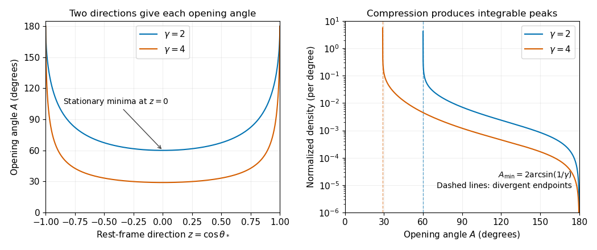

<h1 id="2/d/solution">Solution</h1>

↑ **Parent:** [D](../d.md)

From [c](../c.md), $\sin(A/2)\ge1/\gamma$, with equality when $z=0$: the [photons](../../../../photon.md) are emitted perpendicular to the [Lorentz boost](../../../../lorentz-boost.md) axis in the [center-of-momentum frame](../../../../center-of-momentum-frame.md). Therefore

$$
\boxed{A_{\min}=2\arcsin(\gamma^{-1}),\qquad A_{\mathrm{peak}}=A_{\min}.}
$$

At the minimum, the map $z\mapsto A$ is stationary: writing $A=A_{\min}+\delta$, its leading behavior is $\delta=\beta z^2/\gamma+O(z^4)$. A nonzero interval of uniformly distributed $z$ is therefore compressed near $A_{\min}$, producing an integrable [inverse-square-root singularity](../../../../inverse-square-root-singularity.md) in the opening-angle [probability density](../../../../probability-density.md). No [differentiation](../../../../differentiation.md) of that [probability density](../../../../probability-density.md) is needed. For finite $\gamma>1$, the [probability density](../../../../probability-density.md) vanishes at $A=\pi$. For $\gamma=1$ the [center-of-momentum frame](../../../../center-of-momentum-frame.md) is the laboratory and every event has $A=\pi$: the [probability distribution](../../../../probability-distribution-split.md) becomes a [Dirac delta distribution](../../../../dirac-delta-function.md), rather than the singular $\beta=0$ substitution in [c](../c.md). At large $\gamma$, $A_{\min}\sim2/\gamma$ in radians.

**[Figure 1](#2/d/image-opening-angle-compression-and-its-normalized-probability-density-for-a-boosted-two-photon-decay). Opening-angle compression and its normalized probability density for a boosted two-photon decay**.

## ↑ Ancestors (12)

1. [D](../d.md)
2. [2](../../2.md)
3. [2022](../../../2022-split.md)
4. [Past exam of the symmetry and relativity course of the University of Oxford](../../../split.md)
5. [Symmetry and relativity course of the University of Oxford](../../../../symmetry-and-relativity-course-of-the-university-of-oxford.md)
6. [Year 3 of the physics course of the University of Oxford](../../../../year-3-of-the-physics-course-of-the-university-of-oxford.md)
7. [Physics course of the University of Oxford](../../../../physics-course-of-the-university-of-oxford.md)
8. [Undergraduate course of the University of Oxford](../../../../undergraduate-course-of-the-university-of-oxford.md)
9. [Course of the University of Oxford](../../../../course-of-the-university-of-oxford.md)
10. [University of Oxford](../../../../university-of-oxford-split.md)
11. [List of universities](../../../../list-of-universities.md)
12. [Codex Wiki](../../../../split.md)
