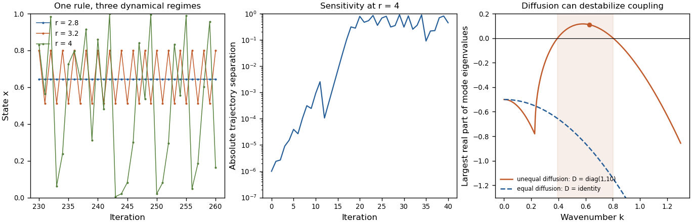

<h1 id="section-i/1-3/solution">Solution</h1>

↑ **Parent:** [1.3](../1-3.md)

**A simple model is especially valuable when it overturns a clearly stated expectation and explains why, but surprise is a means to understanding rather than a requirement that every useful model be counterintuitive.** The expectation must be explicit enough to test, and the model should identify which assumptions make it fail. A surprising simulation without a mechanism or a plausible connection to observations is not sufficient.

One expectation is that a deterministic system with few variables must settle to a simple, predictable state. The [logistic map](../../../../../logistic-map.md),

$$
x_{t+1}=r x_t(1-x_t),\qquad 0\leq x_t\leq1,\quad0\leq r\leq4,
$$

provides a compact counterexample. Its positive [fixed point](../../../../../fixed-point.md) is $x_*=1-1/r$, and the derivative there is $f'(x_*)=2-r$. Thus the [fixed point](../../../../../fixed-point.md) is locally stable for $1<r<3$; changing a single parameter can destroy that stability. At $r=3.2$, repeated iteration approaches a two-cycle near $0.513045$ and $0.799455$. For typical initial conditions at $r=4$, the [Lyapunov exponent](../../../../../lyapunov-exponent.md) is $\log2>0$, so nearby initial states separate exponentially on average until the bounded state space limits their separation. [Robert M. May](../../../../../robert-m-may.md)'s analysis made the consequences of such simple [difference equations](../../../../../difference-equation.md) particularly influential in population modeling.[pp. 459–467, first-order maps, stability changes and complex dynamics](../../../../../simple-mathematical-models-with-very-complicated-dynamics-by-robert-m-may.md)

The broken expectation is not that determinism is false: the rule remains deterministic. Rather, an irregular trajectory need not be caused by a complicated mechanism or external [stochasticity](../../../../../stochasticity.md), and exact rules need not permit long-range prediction from imperfectly measured initial conditions. This does not show that every irregular population time series is chaotic. Real populations may experience demographic noise, environmental variation or overlapping generations, and the map's parameters and state must have a defensible biological interpretation. Evidence should distinguish those alternatives. Even within the mathematical example, special initial states can be periodic; the claim about $r=4$ concerns typical trajectories, not every point of the interval.

A second expectation is that [diffusion](../../../../../diffusion.md) can only erase spatial variation. In a coupled [reaction-diffusion equation](../../../../../reaction-diffusion-system.md),

$$
\partial_t\begin{pmatrix}u\\v\end{pmatrix}
=\begin{pmatrix}f(u,v)\\g(u,v)\end{pmatrix}
+\begin{pmatrix}D_u&0\\0&D_v\end{pmatrix}
\nabla^2\begin{pmatrix}u\\v\end{pmatrix},
$$

[diffusion](../../../../../diffusion.md) smooths each species separately, yet can destabilize their coupled uniform equilibrium. Linearizing about that equilibrium gives the mode matrix $J-k^2D$. Local stability of $J$ therefore does not by itself imply stability of every spatial mode. This is the organizing insight of the [Turing instability](../../../../../turing-instability.md).[§§6–9, instabilities of homogeneous reaction-diffusion systems](../../../../../the-chemical-basis-of-morphogenesis-by-alan-turing.md)

For a concrete dimensionless linearization, take

$$
J=\begin{pmatrix}1&1\\-3&-2\end{pmatrix},\qquad
D=\operatorname{diag}(1,10).
$$

The well-mixed system has trace $-1$ and determinant $1$, so its perturbations decay. Writing $q=k^2$, the spatial mode has trace $-1-11q$ and determinant

$$
\det(J-qD)=1-8q+10q^2.
$$

This determinant is negative for $(4-\sqrt6)/10<q<(4+\sqrt6)/10$, creating one positive [eigenvalue](../../../../../eigenvalue.md) and a growing nonuniform mode. Equal diffusivities would instead shift both [eigenvalues](../../../../../eigenvalue.md) left and could not create this two-species instability. On a finite domain, at least one of the modes allowed by the boundary conditions must lie in the unstable band. The algebra exposes exactly why the intuition about smoothing fails: differential transport changes the balance of an interacting local system.

A [Turing instability](../../../../../turing-instability.md) establishes a possible pattern-generating mechanism, not proof that a particular animal's markings use it. One must identify candidate interacting species, measure transport and response properties, and test perturbations that alter the predicted wavelength or stability. The linear example specifies onset only; nonlinear dynamics determine whether growth saturates into a stable pattern. Its value is to convert a vague statement about [morphogenesis](../../../../../morphogenesis.md) into discriminating questions, while leaving those experimental obligations visible.

**[Figure 1](#section-i/1-3/image-original-mathematical-illustrations-of-changing-logistic-map-dynamics-sensitivity-to-initial-conditions-and-diffusion-driven-instability). Original mathematical illustrations of changing logistic-map dynamics, sensitivity to initial conditions and diffusion-driven instability**.

A third expectation is that an infection with a [basic reproduction number](../../../../../basic-reproduction-number.md) above one must produce a major outbreak. Consider the early phase as a continuous-time [branching process](../../../../../branching-process.md), with independent per-infective transmission rate $\beta$ and recovery rate $\gamma$, while susceptible depletion is negligible. If $q$ is the [probability](../../../../../probability.md) of eventual extinction starting from one infective, conditioning on the first event gives

$$
q=\frac{\gamma}{\beta+\gamma}+\frac{\beta}{\beta+\gamma}q^2.
$$

Taking the smallest solution in $[0,1]$ yields $q=1$ when $\beta\leq\gamma$, and $q=\gamma/\beta=1/R_0$ when $R_0>1$. Thus $R_0=4$ still gives an early-lineage extinction [probability](../../../../../probability.md) of $1/4$. A deterministic [SIR model](../../../../../sir-model.md) describes mean-field growth but omits this individual realization uncertainty. In a finite closed [stochastic SIR model](../../../../../stochastic-sir-model.md), every epidemic eventually ends; the branching calculation concerns early extinction before substantial susceptible depletion, not that eventual end or an arbitrary peak-size cutoff.

These examples show different benefits of simplicity: a stability calculation can separate predictable from sensitive dynamics, a mode calculation can uncover a new mechanism, and a [probability](../../../../../probability.md) recursion can expose what an average trajectory hides. The same discipline also explains why the word “should” needs qualification. A simple exponential-decay model that confirms a familiar expectation can still calibrate a rate, serve as a control, or expose a faulty measurement. A useful [mathematical model](../../../../../mathematical-model.md) must earn its simplifications through the question it answers. **Breaking an expectation is a powerful route to discovery when the contradiction is precise, robust to reasonable assumptions and experimentally consequential; novelty alone is not a validation criterion.**

## ↑ Ancestors (13)

1. [1.3](../1-3.md)
2. [Section I](../../section-i.md)
3. [Paper 1](../../../paper-1-split.md)
4. [2024](../../../split.md)
5. [Past exam of the systems biology course of the University of Cambridge](../../../../split.md)
6. [Systems Biology course of the University of Cambridge](../../../../../systems-biology-course-of-the-university-of-cambridge.md)
7. [Year 4 of the natural sciences course of the University of Cambridge](../../../../../year-4-of-the-natural-sciences-course-of-the-university-of-cambridge.md)
8. [Year of the natural sciences course of the University of Cambridge](../../../../../year-of-the-natural-sciences-course-of-the-university-of-cambridge.md)
9. [Natural sciences course of the University of Cambridge](../../../../../natural-sciences-course-of-the-university-of-cambridge.md)
10. [Course of the University of Cambridge](../../../../../course-of-the-university-of-cambridge.md)
11. [University of Cambridge](../../../../../university-of-cambridge-split.md)
12. [List of universities](../../../../../list-of-universities.md)
13. [Codex Wiki](../../../../../split.md)
