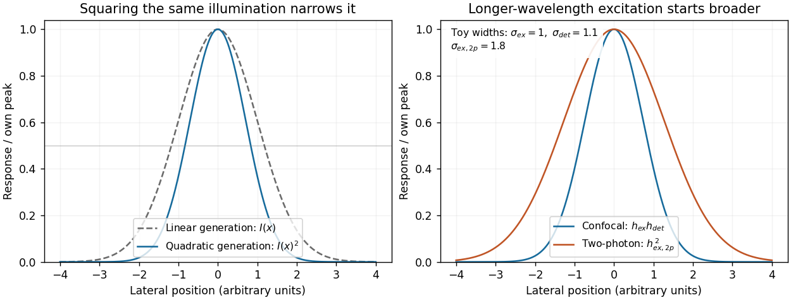

# Paper 2

↑ **Parent:** [2024](../2024.md)

[Original paper, released PDF pages 102–110](https://www.whatdotheyknow.com/request/past_examinations_papers_for_par/response/2882908/attach/3/FOI%202024%201168%20Locke%20materials.pdf?cookie_passthrough=1#page=102)

**Table of contents**

- [1](#1)
  - [Solution](#1/solution)
- [2](#2)
  - [i](#2/i)
    - [Solution](#2/i/solution)
  - [ii](#2/ii)
    - [Solution](#2/ii/solution)
  - [iii](#2/iii)
    - [Solution](#2/iii/solution)
  - [iv](#2/iv)
    - [Solution](#2/iv/solution)
- [3](#3)
  - [i](#3/i)
    - [Solution](#3/i/solution)
  - [ii](#3/ii)
    - [Solution](#3/ii/solution)
- [4](#4)
  - [Solution](#4/solution)
- [5](#5)
  - [Solution](#5/solution)
- [6](#6)
  - [i](#6/i)
    - [Solution](#6/i/solution)
  - [ii](#6/ii)
    - [Solution](#6/ii/solution)
  - [iii](#6/iii)
    - [Solution](#6/iii/solution)
  - [iv](#6/iv)
    - [Solution](#6/iv/solution)

## 1

↑ **Parent:** [Paper 2](paper-2.md)

<h3 id="1/solution">Solution</h3>

↑ **Parent:** [1](#1)

A [reference genome](../../genetics.md#reference-genome) turns sequence reads into measurements with biological coordinates. It supplies the scaffold on which to place [genes](../../genetics.md#gene), regulatory regions and [genetic variants](../../genetics.md#genetic-variant), so experiments in an unfamiliar organism can address mechanisms rather than only produce disconnected sequence fragments. Across the tree of life, its greatest value comes from combining a reliable assembly with comparative sampling and experimental information.

**Reconstructing evolutionary history.** [Phylogenomics](../../biology.md#phylogenomics) compares many loci to infer relationships and the history of [gene duplication](../../molecular-genetics.md#gene-duplication), [gene loss](../../biology.md#gene-loss) and chromosomal change. A [reference genome](../../genetics.md#reference-genome) helps distinguish corresponding [genes](../../genetics.md#gene) through [orthology](../../molecular-genetics.md#orthology) and conserved [synteny](../../genetics.md#synteny). Multiple loci also expose conflicts: a [gene tree](../../biology.md#gene-tree) need not equal the species history because of [incomplete lineage sorting](../../biology.md#incomplete-lineage-sorting) or [horizontal gene transfer](../../biology.md#horizontal-gene-transfer). Dense sampling across distant and closely related lineages can localize when a change occurred; sequencing many almost identical species answers a different question from covering a previously unsampled major lineage.

**Connecting sequence to function.** In [comparative genomics](../../genetics.md#comparative-genomics), regions that change unusually slowly can indicate functional constraint, while lineage-specific changes suggest candidates for adaptation. [Gene duplication](../../molecular-genetics.md#gene-duplication) can create new biochemical functions; changes in noncoding regulation can alter where a conserved [gene](../../genetics.md#gene) is expressed. A useful design compares multiple independent origins of a phenotype and tests candidate changes, rather than attributing every difference between two species to their most conspicuous phenotypic difference. Conserved sequence supports a functional hypothesis, not its complete molecular explanation.

A concrete example is the Zoonomia study, which supplied new mammalian [genome assemblies](../../genetics.md#genome-assembly) and a whole-genome alignment spanning 240 species. Its broad sampling enabled analysis of evolutionary constraint and provided resources relevant to conservation, illustrating how a comparative collection can have more value than isolated reference sequences.[Abstract; sections on phylogenetic diversity, evolutionary constraint and conservation](../../biology-bibliography.md#a-comparative-genomics-multitool-for-scientific-discovery-and-conservation-by-zoonomia-consortium)

**Making experiments possible outside traditional model organisms.** A [reference genome](../../genetics.md#reference-genome) permits reliable read mapping for [RNA sequencing](../../molecular-genetics.md#rna-sequencing), improved [genome annotation](../../genetics.md#genome-annotation), identification of complete coding sequences, and design of targeted [genetic perturbations](../../molecular-genetics.md#genetic-perturbation). It helps place alternative transcripts, discriminate duplicated loci and connect measurements of [gene expression](../../molecular-genetics.md#gene-expression) to candidate regulatory regions. It also supplies a species-specific [protein](../../protein.md) sequence database for [mass spectrometry](../../chemistry.md#mass-spectrometry) identification. Predicted [protein](../../protein.md) sequences can reveal candidate enzymes for useful [metabolic pathways](../../biochemistry.md#metabolic-pathway), but expression and biochemical activity still need validation.

**Conservation, ecology and applications.** A [reference genome](../../genetics.md#reference-genome) supports variant discovery across populations, allowing [conservation genetics](../../population-genetics.md#conservation-genetics) to investigate genetic diversity, [inbreeding](../../population-genetics.md#inbreeding) and connectivity. These quantities can inform breeding and management when combined with ecology and demographic history; a single sequenced animal cannot establish population diversity. Reference sequences also help assign reads from [environmental DNA](../../genetics.md#environmental-dna) or [metagenomics](../../genetics.md#metagenomics) experiments to organisms, investigate host–microbe interactions and track pathogens. In agriculture and biotechnology, they support trait mapping, breeding, disease-resistance studies and discovery of useful enzymes or biosynthetic pathways. Such uses extend naturally to plants, fungi and microbes rather than privileging mammals alone.

**Quality and representation determine what can be concluded.** An assembly should be checked for contamination, missing sequence, collapsed repeats and duplicated haplotypes. [Genome annotation](../../genetics.md#genome-annotation) benefits from [RNA sequencing](../../molecular-genetics.md#rna-sequencing) and comparative evidence; an unannotated or incorrectly assembled region can masquerade as [gene loss](../../biology.md#gene-loss). A [reference genome](../../genetics.md#reference-genome) from one individual also creates [reference bias](../../genetics.md#reference-bias) when reads from divergent individuals are mapped to it. [Pangenomes](../../molecular-genetics.md#pangenome) and additional population samples represent sequence absent from that individual. Low sequencing cost does not remove the costs of sample identification, high-quality material, computation, curation or preserving voucher information.

**The scientific aim is a comparative, testable resource**, with open, well-documented data and appropriate agreements about sample access and benefit sharing. A [reference genome](../../genetics.md#reference-genome) enables hypotheses about evolution and mechanism; it is not a substitute for population sampling, phenotyping or experiments.

## 2

↑ **Parent:** [Paper 2](paper-2.md)

<h3 id="2/i">i</h3>

↑ **Parent:** [2](#2)

<h4 id="2/i/solution">Solution</h4>

↑ **Parent:** [I](#2/i)

Bulk [RNA sequencing](../../molecular-genetics.md#rna-sequencing) mixes the [gene expression](../../molecular-genetics.md#gene-expression) of all sampled cells, while dissociated-cell measurements retain individual profiles but usually lose their original neighbours and positions. [Spatial transcriptomics](../../molecular-genetics.md#spatial-transcriptomics) preserves those relationships. The same [cell type](../../biological-cell.md#cell-type) can behave differently at a tissue boundary, near a blood vessel or beside a tumour, so position can explain a state that a cell-type label alone cannot.

Spatial measurements can reveal tissue layers, developmental boundaries, tumour–immune interfaces and subcellular [RNA localization](../../polymer.md#rna-localization). They can distinguish a change in cell abundance from a change in expression within a particular anatomical niche. Dissociation can also lose fragile cells or induce stress responses.

**Spatial proximity supplies context, not proof of communication.** Adjacent expression of a ligand and receptor suggests an interaction to test; establishing signalling requires additional evidence and perturbation.

<h3 id="2/ii">ii</h3>

↑ **Parent:** [2](#2)

<h4 id="2/ii/solution">Solution</h4>

↑ **Parent:** [Ii](#2/ii)

The central principle is to **attach a recoverable spatial address to an RNA-derived molecule before the tissue's positional organization is destroyed**. After sequencing, each read identifies both a transcript and a capture location.

In the original array-based [spatial transcriptomics](../../molecular-genetics.md#spatial-transcriptomics) method, a thin tissue section is placed on a slide carrying spatially indexed capture primers. The tissue is imaged for [histology](../../biology.md#histology), then permeabilized. Polyadenylated [messenger RNA](../../polymer.md#messenger-rna) binds the oligo(dT) region of the primers and is copied by [reverse transcription](../../molecular-genetics.md#reverse-transcription). The resulting [cDNA](../../molecular-genetics.md#complementary-dna) carries the positional barcode. Sequencing identifies the expressed [gene](../../genetics.md#gene), and a barcode lookup places its counts back on the tissue image. The first published array used approximately $100\,\mu\mathrm m$ capture features, so a feature could contain contributions from several cells; it was not a single-cell measurement by construction.[pp. 78–80, spatially localized cDNA synthesis, positional barcodes and array features](../../biology-bibliography.md#visualization-and-analysis-of-gene-expression-in-tissue-sections-by-spatial-transcriptomics-by-patrik-l-stahl-and-others)

[Slide-seq](../../molecular-genetics.md#slide-seq) applies the same addressing idea using a dense monolayer of roughly $10\,\mu\mathrm m$ barcoded beads. The bead barcode–position map is decoded in advance. A tissue section is transferred onto the beads, released [RNA](../../polymer.md#ribonucleic-acid) is captured, and the sequenced molecular addresses recover the bead-level expression map. This gives much finer spatial sampling than the original coarse array, although RNA capture efficiency and assignment to individual cells remain limiting.[pp. 1463–1465, bead puck construction, positional decoding and RNA capture](../../biology-bibliography.md#slide-seq-a-scalable-technology-for-measuring-genome-wide-expression-at-high-spatial-resolution-by-samuel-g-rodriques-and-others)

Some assays also incorporate a [unique molecular identifier](../../molecular-genetics.md#unique-molecular-identifier) so that amplified reads from one captured molecule can be collapsed, reducing [polymerase chain reaction](../../molecular-genetics.md#polymerase-chain-reaction) duplication bias. Spatial barcodes identify capture locations; [unique molecular identifiers](../../molecular-genetics.md#unique-molecular-identifier) identify molecules within those locations. Neither alone supplies cell boundaries.

For either method, align the coordinate map with [histology](../../biology.md#histology), account for capture efficiency and background, and use independent tissue specimens as [biological replicates](../../design-of-experiments.md#biological-replicate). A smaller capture feature improves sampling granularity but does not guarantee equal effective [spatial resolution](../../optics.md#spatial-resolution) or a pure single-cell transcriptome: tissue thickness, diffusion and mixed cell boundaries still matter.

<h3 id="2/iii">iii</h3>

↑ **Parent:** [2](#2)

<h4 id="2/iii/solution">Solution</h4>

↑ **Parent:** [Iii](#2/iii)

Imaging methods **identify RNA molecules where they remain in the fixed specimen**, rather than recovering their position through a sequencing-library address. Their common foundation is sequence-specific [oligonucleotide probe](../../biology.md#oligonucleotide-probe) binding and repeated [fluorescence microscopy](../../fluorescence.md#fluorescence-microscopy).

In [single-molecule fluorescence in situ hybridization](../../biology.md#single-molecule-fluorescence-in-situ-hybridization), many short complementary probes bind one transcript. Their combined [fluorescence](../../fluorescence.md) produces a detectable spot that can be localized and counted. Multiple probes make an individual bound molecule distinguishable from isolated-probe background. Conventional colour channels limit how many transcript species can be distinguished in one image, and overlapping spots make abundant targets difficult to count.

**[MERFISH](../../biology.md#multiplexed-error-robust-fluorescence-in-situ-hybridization).** Encoding probes bind each target [RNA](../../polymer.md#ribonucleic-acid) and expose selected readout sequences. Across successive hybridization and imaging rounds, fluorescent readout probes interrogate those sequences, producing an on/off code at each molecular position. The code identifies the transcript. The codebook is designed with separation between valid words so that some missing or spurious signals can be detected and, for suitable codes, corrected. Fiducials and image registration keep the same molecule aligned across rounds. This multiplexes many targets without needing one physically separate fluorescence colour for each [gene](../../genetics.md#gene).[Results, encoding scheme and error-robust barcodes; Figs. 1–3](../../biology-bibliography.md#spatially-resolved-highly-multiplexed-rna-profiling-in-single-cells-by-kok-hao-chen-and-others)

**[seqFISH](../../biology.md#sequential-fluorescence-in-situ-hybridization) and [seqFISH+](../../biology.md#seqfish-plus).** Successive probe hybridization rounds encode a transcript through a sequence of detected colours. The expanded [seqFISH+](../../biology.md#seqfish-plus) strategy distributes targets among many pseudocolour states, so each round contains only a sparse subset of the total signals. This reduces optical crowding and makes a much larger target set readable on an ordinary [confocal microscope](../../fluorescence.md#confocal-microscope). The original [seqFISH+](../../biology.md#seqfish-plus) study profiled about 10,000 genes in mouse brain tissue and examined both cellular organization and subcellular expression patterns.[Abstract; Figs. 1–4, pseudocolours, optical crowding and tissue organization](../../biology-bibliography.md#transcriptome-scale-super-resolved-imaging-in-tissues-by-rna-seqfish-plus-by-chee-huat-linus-eng-and-others)

These are two distinct multiplexing implementations, although both build on repeated in situ probe readout. Their performance depends on probe specificity, the codebook, stripping or inactivation of previous signals, retention of [RNA](../../polymer.md#ribonucleic-acid), registration across rounds and the density of simultaneously visible spots. Imaging many rounds can be slow, and tissue [autofluorescence](../../fluorescence.md#autofluorescence) or poor probe penetration can obscure molecules.

Finally, use nuclear and membrane information for [cell segmentation](../../computer-science.md#cell-segmentation), with checks for errors at touching cells and tissue boundaries. A precise molecular coordinate does not guarantee correct cell assignment. Negative or unused codes and independent probes help estimate false calls; [biological replicates](../../design-of-experiments.md#biological-replicate) establish whether a spatial pattern is reproducible.

<h3 id="2/iv">iv</h3>

↑ **Parent:** [2](#2)

<h4 id="2/iv/solution">Solution</h4>

↑ **Parent:** [Iv](#2/iv)

The distinction is principally **molecular readout by sequencing versus molecular readout by imaging**; it does not impose one universal ranking of sensitivity or spatial resolution.

| Issue | Sequencing-based [spatial transcriptomics](../../molecular-genetics.md#spatial-transcriptomics) | Imaging-based [spatial transcriptomics](../../molecular-genetics.md#spatial-transcriptomics) |
| --- | --- | --- |
| Target breadth | Many capture assays survey broad polyadenylated [RNA](../../polymer.md#ribonucleic-acid) without a fixed gene panel. | Probe-based assays usually require a designed target set, though [seqFISH+](../../biology.md#seqfish-plus) and [MERFISH](../../biology.md#multiplexed-error-robust-fluorescence-in-situ-hybridization) can be highly multiplexed. |
| Spatial information | Positions are capture features or beads; some collect mixtures of cells. | Individual molecular coordinates and subcellular distributions can be retained. |
| Sensitivity and bias | Capture, [reverse transcription](../../molecular-genetics.md#reverse-transcription) and library sampling lose molecules; amplification and diffusion add bias. | Probe accessibility, optical crowding, [autofluorescence](../../fluorescence.md#autofluorescence) and decoding errors determine detection. |
| Resources | Requires sequencing capacity and barcode-aware analysis. | Requires extensive imaging, repeated fluidics, registration and image storage. |
| Cell assignment | Mixed features may need statistical estimation using reference cell profiles. | Usually needs explicit [cell segmentation](../../computer-science.md#cell-segmentation), which can misassign otherwise well-localized molecules. |

For discovery of unexpected [gene expression](../../molecular-genetics.md#gene-expression) programmes across a large section, broad sequencing-based capture is attractive. To test where selected transcripts lie within cells or precisely map a known anatomical niche, molecular imaging is attractive. Neither implies that every transcript is measured, and a nominal spot size should not be confused with biological assignment accuracy.

A productive study can combine broad discovery with targeted spatial validation on independent sections. Compare effective detection, tissue area, resolution, cost and replicate count for the specific implementations available, rather than treating all sequencing assays as coarse and all imaging assays as low-plex. Cells or capture spots from one donor are not substitutes for independent [biological replicates](../../design-of-experiments.md#biological-replicate).

## 3

↑ **Parent:** [Paper 2](paper-2.md)

<h3 id="3/i">i</h3>

↑ **Parent:** [3](#3)

<h4 id="3/i/solution">Solution</h4>

↑ **Parent:** [I](#3/i)

**Affinity purification and proximity labeling answer related but different questions.** The former enriches material that remains associated during extraction; the latter marks a neighbourhood before extraction. Neither alone proves a direct [protein-protein interaction](../../protein.md#protein-protein-interaction).

In [affinity purification-mass spectrometry](../../biology.md#affinity-purification-mass-spectrometry), isolate a bait [protein](../../protein.md) with an [antibody](../../protein.md#antibody) or an endogenous [epitope tag](../../protein.md#epitope-tag). Lyse under conditions chosen to preserve the relevant [protein complex](../../protein.md#protein-complex), capture the bait on an affinity matrix, wash away background and identify co-purifying [proteins](../../protein.md) by [liquid chromatography-mass spectrometry](../../chemistry.md#liquid-chromatography-mass-spectrometry) after digestion into [peptides](../../protein.md#peptide). [Co-immunoprecipitation](../../biology.md#co-immunoprecipitation) is the antibody-based version of this association test. Gentle conditions preserve more weak interactions but also increase background; stringent washing improves specificity at the cost of labile partners. Extraction can disrupt membrane assemblies or create associations that were not present in intact cells.

Controls should include matched tag-only or untagged cells, an appropriate antibody control, input abundance and, where feasible, a binding-defective bait that retains its normal localization. Check that tagging has not changed the bait's abundance, localization or function. Reciprocal capture of a candidate partner is useful validation. If an association might be bridged by [RNA](../../polymer.md#ribonucleic-acid) or [DNA](../../polymer.md#deoxyribonucleic-acid), compare nuclease-treated and untreated samples while recognizing that nuclease treatment may dismantle a biologically genuine assembly.

For [proximity labeling](../../biology.md#proximity-labeling), fuse the bait to [TurboID](../../biology.md#turboid), which activates [biotin](../../chemical-substance.md#biotin) and covalently labels accessible nearby [proteins](../../protein.md) in living cells. After a timed labeling pulse, harsh lysis can be used because recovery no longer requires the original assembly to survive. Capture biotinylated material using [streptavidin](../../protein.md#streptavidin) and identify enriched [proteins](../../protein.md) by [mass spectrometry](../../chemistry.md#mass-spectrometry). This can recover transient or insoluble neighbourhoods missed by ordinary extraction. A localization-matched control enzyme, no-added-biotin condition and matched expression help separate the bait's neighbourhood from diffuse labeling and endogenous biotinylated proteins.[Figs. 1–3, enzyme activity, labeling time and compartment-specific comparisons](../../biology-bibliography.md#efficient-proximity-labeling-in-living-cells-and-organisms-with-turboid-by-tess-c-branon-and-others)

The label records proximity, accessibility and time spent nearby. A neighbour need not bind the bait; a real binder might label poorly if reactive groups are inaccessible. Pulse duration therefore trades temporal selectivity against labeling yield, rather than defining an exact universal distance cutoff.

**Quantification distinguishes enrichment from a list of contaminants.** Use [label-free quantification](../../biochemistry.md#label-free-quantification) of [peptide](../../protein.md#peptide) signals across independent bait and control purifications, or [SILAC](../../biochemistry.md#stable-isotope-labeling-by-amino-acids-in-cell-culture) in compatible cell cultures to compare light and heavy samples. In [SILAC](../../biochemistry.md#stable-isotope-labeling-by-amino-acids-in-cell-culture), isotope-containing amino acids enter newly synthesized [proteins](../../protein.md); matched peptides form distinguishable mass pairs. A label swap helps identify isotope-condition confounding. [Tandem mass tags](../../biochemistry.md#tandem-mass-tag) offer multiplexed comparison using reporter signals, but interfering co-isolated peptides can compress ratios.

Estimate enrichment and its reproducibility relative to matched controls, accounting for bait recovery and input abundance. Common abundant contaminants should not be promoted solely because many spectra identify them. Statistical scoring such as SAINT models the contrast between specific and background recovery across controls and replicates, allowing candidate associations to be ranked with estimated error rates.[Statistical model, control purifications and interaction-probability estimation](../../biology-bibliography.md#saint-probabilistic-scoring-of-affinity-purification-mass-spectrometry-data-by-hyungwon-choi-and-others) **A reproducibly enriched candidate is evidence for the assay-defined association or neighbourhood, not automatically a direct binding partner or fixed stoichiometric subunit.**

<h3 id="3/ii">ii</h3>

↑ **Parent:** [3](#3)

<h4 id="3/ii/solution">Solution</h4>

↑ **Parent:** [Ii](#3/ii)

Structural analysis should ask more than whether a candidate was recovered: **which surfaces are near one another, which regions change on association, and how are subunits arranged?** Enrichment from part (i) supplies material and candidates, but structural measurements require their own controls.

In [chemical cross-linking mass spectrometry](../../chemistry.md#chemical-cross-linking-mass-spectrometry), react the assembly with a cross-linker of known chemical specificity and spacer properties, digest it and identify linked [peptide](../../protein.md#peptide) pairs by [tandem mass spectrometry](../../chemistry.md#tandem-mass-spectrometry). An inter-protein link places two reactive residues near one another in at least a sampled conformation; intra-protein links constrain folding or conformation. These constraints can test a structural model or place subunits within an assembly. The useful distance bound includes side chains and linker reach, not only the nominal spacer length. Search-space expansion and ambiguous assignments require error control at the linked-pair level, rather than borrowing an ordinary single-peptide error estimate.

In [hydrogen-deuterium exchange mass spectrometry](../../chemistry.md#hydrogen-deuterium-exchange-mass-spectrometry), compare the incorporation of [deuterium](../../chemical-substance.md#deuterium) into exchangeable backbone positions in free and bound samples over a time course. After quenching and peptide analysis, reduced exchange can reveal protected or stabilized regions. Protection may indicate an interface, but it can also arise from an allosteric change, altered [hydrogen bonds](../../chemical-bond.md#hydrogen-bond) or reduced structural opening. It therefore constrains a hypothesis rather than identifying a unique atomic contact.

[Native mass spectrometry](../../chemistry.md#native-mass-spectrometry) can examine intact assemblies and subcomplexes, providing evidence about composition and [stoichiometry](../../chemical-reaction.md#stoichiometry). Gas-phase loss and differing ionization efficiencies must be considered. [Cryo-electron microscopy](../../optics.md#cryo-electron-microscopy) can then reveal overall architecture and, with sufficient data quality and suitable particle behaviour, high-resolution interfaces. Heterogeneity, flexible regions and purification artefacts can limit the reconstruction. Combining these observations is often more informative than demanding that one technique answer every structural question.

**Quantitative [proteomics](../../biochemistry.md#proteomics) is necessary in both enrichment and structural comparisons.** For an assembled versus disrupted complex, measure component abundances as well as cross-linked-peptide signals. A decreased inter-protein link may reflect loss of one subunit rather than movement of an interface. Comparing cross-link abundance after accounting for recovered protein amounts helps distinguish these explanations. Matched labeling chemistry, reaction time, independent reactions and a dose series reduce artefacts caused by unequal cross-linking or excessive stabilization.

For [hydrogen-deuterium exchange mass spectrometry](../../chemistry.md#hydrogen-deuterium-exchange-mass-spectrometry), compare matched peptide sequences at multiple labeling times, control back-exchange and retain replicate uncertainty. A consistent local change without a corresponding abundance loss supports a structural effect. Differential [peptide](../../protein.md#peptide) intensities, exchange measurements and the affinity-enrichment data should be interpreted together; an ordinary protein abundance ratio does not itself measure a distance or a direct interface.

Finally, test a predicted interface by changing selected residues while retaining folding and expression, then repeat the quantitative association assay. Loss of the candidate association with preserved bait integrity strengthens the interface interpretation. **The convincing result connects selective recovery, structural constraints and a controlled perturbation**, rather than treating one recovered band or one protected segment as a complete structure.

## 4

↑ **Parent:** [Paper 2](paper-2.md)

<h3 id="4/solution">Solution</h3>

↑ **Parent:** [4](#4)

A genome-wide study of [protein](../../protein.md)–[RNA](../../polymer.md#ribonucleic-acid) interactions usually means a **transcriptome-wide map for one selected [RNA-binding protein](../../protein.md#rna-binding-protein)**, not simultaneous identification of every binding protein. The choice depends on whether the question concerns whole transcripts in an assembly or direct contacts at particular sites.

**[RIP-seq](../../biology.md#rip-seq).** Immunoprecipitate the selected [RNA-binding protein](../../protein.md#rna-binding-protein) under native or suitably stabilized conditions, recover associated [RNA](../../polymer.md#ribonucleic-acid) and identify it by [RNA sequencing](../../molecular-genetics.md#rna-sequencing). This can preserve broad ribonucleoprotein assemblies and works without introducing a photoreactive nucleoside. It is appropriate for identifying candidate associated transcripts. Native complexes can dissociate or reassort after lysis, however, and recovered [RNA](../../polymer.md#ribonucleic-acid) may be attached through another [protein](../../protein.md). Enrichment across a whole transcript does not locate the binding site. Chemical fixation can stabilize assemblies but may preserve indirect contacts as well.

**[CLIP-seq](../../biology.md#clip-seq).** Ultraviolet irradiation creates covalent links at some close [protein](../../protein.md)–[RNA](../../polymer.md#ribonucleic-acid) contacts in intact material. Partial nuclease digestion shortens the [RNA](../../polymer.md#ribonucleic-acid); the chosen [protein](../../protein.md) is immunoprecipitated, stringently washed, and its attached fragments converted into a sequencing library. Reads map local contacts against a [reference genome](../../genetics.md#reference-genome) or transcript set. Unlike native [RIP-seq](../../biology.md#rip-seq), the covalent linkage permits purification conditions that remove many noncovalently associated RNAs. Cross-linking efficiency is low and depends on sequence, amino-acid chemistry and local geometry, so absent signal is not proof of absent binding.

**[iCLIP](../../biology.md#iclip)** exploits the tendency of [reverse transcription](../../molecular-genetics.md#reverse-transcription) to terminate at the peptide remnant of the cross-link. Library preparation recovers these truncated products, and their starts identify contact positions at near-nucleotide precision. Random molecular barcodes help distinguish independently recovered molecules from amplification duplicates. The original work used this information to map hnRNP particles involved in [RNA splicing](../../biology.md#rna-splicing).[pp. 909–912, truncated cDNA recovery, molecular barcodes and hnRNP C binding maps](../../biology-bibliography.md#iclip-reveals-the-function-of-hnrnp-particles-in-splicing-at-individual-nucleotide-resolution-by-julian-konig-and-others)

**[PAR-CLIP](../../biology.md#par-clip)** metabolically incorporates a photoreactive nucleoside such as 4-thiouridine into newly made [RNA](../../polymer.md#ribonucleic-acid), then uses longer-wavelength ultraviolet cross-linking. Characteristic T-to-C changes in the resulting sequence reads provide evidence of cross-link positions. This can aid contact detection but requires nucleoside uptake and incorporation, may perturb cells and preferentially samples the labeled RNA population. It is consequently harder to apply directly to an inaccessible intact tissue or a specimen that cannot be metabolically labeled.[pp. 129–132, photoreactive nucleoside incorporation and diagnostic conversions](../../biology-bibliography.md#transcriptome-wide-identification-of-rna-binding-protein-and-microrna-target-sites-by-par-clip-by-markus-hafner-and-others)

**[eCLIP](../../biology.md#eclip)** improves adapter ligation and library recovery and incorporates a size-matched input control. It retains information from cross-link-associated [reverse transcription](../../molecular-genetics.md#reverse-transcription) termination while helping identify sites enriched beyond background and abundant RNA. Its controls and reproducibility framework make it useful for systematic comparisons, but it still depends on the target antibody and shares cross-linking and mapping biases.[pp. 508–511, adapter strategy, molecular identifiers and size-matched input enrichment](../../biology-bibliography.md#robust-transcriptome-wide-discovery-of-rna-binding-protein-binding-sites-with-enhanced-clip-eclip-by-eric-l-van-nostrand-and-others)

Across methods, use independent [biological replicates](../../design-of-experiments.md#biological-replicate), input abundance, appropriate immunoprecipitation controls, molecular duplicate handling and a suitable [reference genome](../../genetics.md#reference-genome). Repetitive sequences and multiple transcript isoforms can make assignment ambiguous. Compare enrichment after accounting for transcript abundance; a more abundant transcript can yield more reads without an increased bound fraction.

For example, to test whether a splicing regulator affects an exon by binding an adjacent intron, choose [iCLIP](../../biology.md#iclip) or [eCLIP](../../biology.md#eclip) over whole-transcript [RIP-seq](../../biology.md#rip-seq). A positional map can distinguish binding upstream, within or downstream of the regulated exon. Combine it with [RNA sequencing](../../molecular-genetics.md#rna-sequencing) after controlled depletion and an interface or RNA-site mutation, or a [minigene splicing reporter](../../biology.md#minigene-splicing-reporter), to test whether the contact contributes to exon choice. For an initial survey of transcripts in a stable assembly, [RIP-seq](../../biology.md#rip-seq) may instead be sufficient and simpler. **Direct contact, transcript association and functional regulation are distinct conclusions**, and no enrichment method by itself supplies all three.

## 5

↑ **Parent:** [Paper 2](paper-2.md)

<h3 id="5/solution">Solution</h3>

↑ **Parent:** [5](#5)

**Test metabolic response and verified exposure, rather than using body weight as the sole definition of efficacy.** Equal body weight can coexist with altered liver [triglycerides](../../chemical-substance.md#triglyceride), altered circulating [lipids](../../chemical-substance.md#lipid) or different substrate use. A fair cross-species comparison must also distinguish failure to deliver [docosahexaenoic acid](../../chemical-substance.md#docosahexaenoic-acid) from failure to respond after it reaches the relevant compartments.

**Parallel randomized interventions.** In mice, compare a standardized high-fat/high-sucrose diet containing [docosahexaenoic acid](../../chemical-substance.md#docosahexaenoic-acid) with an otherwise matched control diet in which an equal energy amount of control fat replaces it. Keep total fat, sugar, protein, micronutrients and energy density constant; measure actual food intake. Include a normal-diet reference group to contextualize the diet-induced disturbance and, if intake differs, a separate [pair feeding](../../design-of-experiments.md#pair-feeding) control to address intake-mediated effects. The pair-fed group answers a different question from the freely fed control, so it should not replace it. Standardize age and housing, include both sexes with a planned analysis, and randomize across cages and processing batches. If diet is assigned by cage, replicate and analyze the cage-level assignment rather than treating all cage-mates as independent treatment allocations.

In humans, use a parallel, double-blind [randomized controlled trial](../../causal-inference.md#randomized-controlled-trial) of a characterized [docosahexaenoic acid](../../chemical-substance.md#docosahexaenoic-acid) preparation versus a matched, isoenergetic control preparation in adults with obesity. Choose the exposure under an approved clinical protocol, maintain background diet and activity as consistently as practical, and record medication, alcohol and other supplement use. Avoid combining one arm with an unbalanced weight-loss programme. The control oil is a defined comparator with its own possible biology, not an assumed metabolically inert substance. Block randomization on important baseline factors and blind clinical assessors and laboratory staff.

Choose dose and duration to compare **achieved exposure**, not simply the same milligrams per kilogram across species. Analyze the administered diets and preparations for fatty-acid composition and oxidation. Measure [docosahexaenoic acid](../../chemical-substance.md#docosahexaenoic-acid) incorporation in plasma and longer-lived cellular lipid fractions to assess adherence and delivery. A predeclared study duration of roughly twelve weeks in humans, with a comparable mouse time course chosen for its biology, is an example design rather than a claim that identical calendar time implies identical metabolic exposure.

**Samples and timing.** Collect standardized fasting plasma before treatment and at early, intermediate and final visits, for example weeks 2, 6 and 12 in humans. In a subset, add a standardized-meal time course before and after intervention to measure postprandial trajectories rather than only a fasting endpoint. Record fasting duration, collection time, handling delay and recent diet. Collect urine for complementary small-molecule measurements. In mice, obtain serial blood within appropriate sampling limits, and collect liver, [adipose tissue](../../physiology.md#adipose-tissue) and muscle from randomized terminal cohorts at selected early and final time points. These terminal tissues are from different animals and must not be analyzed as within-animal repeated measurements.

Use comparable plasma fractions in both species for the primary cross-species analysis. Mouse liver gives a mechanistic view of [hepatic steatosis](../../biology.md#hepatic-steatosis); human liver fat can be followed noninvasively by a suitable [magnetic resonance imaging](../../nuclear-magnetic-resonance.md#magnetic-resonance-imaging) measurement of liver fat. Do not require research liver biopsies solely to make the matrices match. Optional tissue collection must have separate justification. Measure body composition, liver fat and relevant clinical metabolic traits alongside [metabolomics](../../biochemistry.md#metabolomics), so molecular changes can be related to a physiological outcome.

**Analytical measurements.** Use broad [liquid chromatography-mass spectrometry](../../chemistry.md#liquid-chromatography-mass-spectrometry) [metabolomics](../../biochemistry.md#metabolomics) to survey polar metabolites, together with dedicated [lipidomics](../../biochemistry.md#lipidomics) separations and [tandem mass spectrometry](../../chemistry.md#tandem-mass-spectrometry) for intact lipid classes and molecular species. Different extraction and chromatographic conditions are needed for polar compounds and hydrophobic [lipids](../../chemical-substance.md#lipid). [Gas chromatography-mass spectrometry](../../chemistry.md#gas-chromatography-mass-spectrometry) of appropriately prepared fatty-acid derivatives provides an independent quantitative fatty-acid composition measurement. [NMR spectroscopy](../../nuclear-magnetic-resonance.md) can complement these assays with robust quantification of abundant soluble metabolites, although it usually detects fewer low-abundance compounds than [mass spectrometry](../../chemistry.md#mass-spectrometry).

Prespecify molecular outcomes such as [docosahexaenoic acid](../../chemical-substance.md#docosahexaenoic-acid) incorporation into [phospholipids](../../chemical-substance.md#phospholipid) and [triglycerides](../../chemical-substance.md#triglyceride), then exploratory responses in other lipid classes, [acylcarnitines](../../chemical-substance.md#acylcarnitine) and central [metabolic pathways](../../biochemistry.md#metabolic-pathway). A possible response is incorporation of more highly unsaturated lipid species without weight loss; reduced liver fat or altered postprandial handling could then reveal a metabolic effect missed by body weight. Conversely, altered precursor pools do not themselves prove increased pathway flux. [Acylcarnitine](../../chemical-substance.md#acylcarnitine) changes should be interpreted with other measurements, not automatically equated with increased fatty-acid oxidation. These are hypotheses to test, not assumed treatment outcomes.

Use isotope-labeled [internal standards](../../chemistry.md#internal-standard), extraction blanks and a [pooled quality-control sample](../../biochemistry.md#pooled-quality-control-sample) injected throughout each analytical batch. Randomize sample order while balancing species, arm and time; include shared reference material across batches. Standardize rapid cooling, extraction, storage and freeze–thaw exposure, because highly unsaturated [lipids](../../chemical-substance.md#lipid) are susceptible to oxidation. Verify key metabolite identities with retention behaviour, fragmentation and authentic standards where available. An accurate mass alone does not uniquely establish a lipid's double-bond positions or distinguish all structural isomers.

**Statistical plan.** Power the study for a limited set of primary biochemical or physiological endpoints, using anticipated variance and independent treatment units. Keep discovery [lipidomics](../../biochemistry.md#lipidomics) separate from confirmatory endpoints. Inspect [principal component analysis](../../statistical-learning.md#principal-component-analysis) plots for outliers and [batch effects](../../design-of-experiments.md#batch-effect); an apparent separation is not by itself a treatment test. For repeated plasma measurements, use a [mixed model](../../statistical-model.md#mixed-model) with participant or animal [random effects](../../latent-variable.md#random-effect), baseline adjustment and treatment-by-time terms, with cage effects where relevant. Report [effect sizes](../../statistical-inference.md#effect-size) and [confidence intervals](../../statistical-inference.md#confidence-interval); use a prespecified [Benjamini-Hochberg procedure](../../statistical-hypothesis-test.md#benjamini-hochberg-procedure) for exploratory [multiple testing](../../statistical-hypothesis-test.md#multiple-hypothesis-testing).

For matched molecular endpoints, model the log abundance or change using species, treatment, time and their interactions, or compare harmonized treatment [effect sizes](../../statistical-inference.md#effect-size) across species. **A species-by-treatment interaction addresses differing responses.** A significant result in mice and a nonsignificant result in humans does not establish that the responses differ. Differences in achieved exposure, sampled tissue, starting diet or baseline disease can still explain an apparent interaction; document these before attributing the difference to species physiology. Use [intention-to-treat analysis](../../causal-inference.md#intention-to-treat-analysis) for the primary human trial, with adherence-based analyses clearly secondary, and validate exploratory molecular findings in independent samples.

**Ethics.** Obtain informed consent and independent ethical review, explain uncertainty about benefit, protect identifiable molecular and clinical data, monitor adverse events and allow withdrawal. Do not induce obesity or require a harmful diet merely to mimic the mouse model, and do not withhold established care. Minimize blood and tissue sampling and justify any optional biopsy separately. Animal work likewise needs justified numbers, humane endpoints and refinement of sampling. The design should answer the cross-species question with the least invasive measurements that can distinguish exposure, molecular response and physiology.

## 6

↑ **Parent:** [Paper 2](paper-2.md)

<h3 id="6/i">i</h3>

↑ **Parent:** [6](#6)

<h4 id="6/i/solution">Solution</h4>

↑ **Parent:** [I](#6/i)

**$\boxed{\text{(a): two-photon excitation; (b): one-photon/confocal excitation.}}$** The compact emitting region in (a) indicates that excitation itself is strongly localized. In (b), the illuminated path generates out-of-focus [fluorescence](../../fluorescence.md) as well as fluorescence near the focus. A confocal detection pinhole can reject much of that unwanted emission from the recorded image; it does not prevent the dye solution from emitting it.

In ordinary one-photon excitation, the local fluorescence-generation rate is approximately proportional to excitation [light intensity](../../wave.md#light-intensity) $I$. In unsaturated [two-photon excitation microscopy](../../fluorescence.md#two-photon-excitation-microscopy), it is proportional to $I^2$. Simultaneous absorption is appreciable only in the high-intensity focal region, generally produced using a pulsed [laser](../../laser.md). Two lower-energy photons jointly excite the fluorophore; the excitation [wavelength](../../wave-equation.md#wavelength) is therefore typically substantially longer than in its one-photon experiment. This reduces out-of-focus excitation and permits detection without a confocal pinhole.[pp. 73–75, quadratic excitation, optical sectioning and pulsed illumination](../../biology-bibliography.md#two-photon-laser-scanning-fluorescence-microscopy-by-winfried-denk-and-others)

For a small detection pinhole, the effective confocal [point spread function](../../point-spread-function.md) is approximately

$$
\boxed{h_{\rm conf}(\mathbf r)\propto h_{\rm exc}(\mathbf r)h_{\rm det}(\mathbf r)}.
$$

Here each factor denotes an intensity response. Excitation and detection jointly select the focal region. Enlarging the pinhole increases collected signal but weakens axial rejection and changes the effective [point spread function](../../point-spread-function.md). In [two-photon excitation microscopy](../../fluorescence.md#two-photon-excitation-microscopy) with broad collection, the spatial response is dominated by

$$
\boxed{h_{2p}(\mathbf r)\propto[h_{\rm exc,2p}(\mathbf r)]^2}.
$$

The pinhole product and excitation square are different physical mechanisms even when simplified mathematical profiles resemble one another.[Confocal formation and conjugate focal selection, Fig. 3; discussion of excitation and detection responses](../../physics-bibliography.md#confocal-microscopy-chapter-manuscript-by-brad-amos-and-others)

**Compare both lateral and axial widths using the actual wavelengths and objective.** For a [diffraction-limited system](../../point-spread-function.md#diffraction-limited-system), their characteristic scalings are

$$
\delta_{xy}\sim\frac{\lambda}{\mathrm{NA}},\qquad
\delta_z\sim\frac{n_{\rm med}\lambda}{\mathrm{NA}^2},
$$

where $\mathrm{NA}$ is [numerical aperture](../../point-spread-function.md#numerical-aperture) and $n_{\rm med}$ is the medium's [refractive index](../../electromagnetic-wave.md#refractive-index). Numerical prefactors depend on the width criterion and high-aperture optical model. Axial resolution is generally worse than lateral resolution. A small confocal pinhole improves axial sectioning and can narrow the lateral response, at the cost of photon throughput.

As a simple [Gaussian function](../../calculus.md#gaussian-function) example, $h(x)=\exp[-x^2/(2\sigma^2)]$ has squared profile $h(x)^2=\exp[-x^2/\sigma^2]$, so its width is reduced by $1/\sqrt2$. However, the two-photon illumination spot itself is broader at its longer excitation [wavelength](../../wave-equation.md#wavelength). **Two-photon excitation is not automatically higher-resolution than confocal microscopy**, and ordinary two-photon sectioning is not intrinsically super-resolution. Compare measured [point spread functions](../../point-spread-function.md), pinhole settings, [numerical apertures](../../point-spread-function.md#numerical-aperture), scattering and [optical aberrations](../../geometrical-optics.md#optical-aberration), not just the fact that one profile is squared.

The original model figure below separates focal confinement from wavelength-dependent width. It is an illustrative one-dimensional [Gaussian function](../../calculus.md#gaussian-function) calculation, not a reproduction or quantitative fit of the supplied photograph.

**[Figure 1](#6/i/image-local-excitation-nonlinearity-and-wavelength-dependent-point-spread-widths). Local excitation nonlinearity and wavelength-dependent point-spread widths**. Left: squaring the same normalized Gaussian illumination narrows the local generation profile. Right: a longer-wavelength illumination profile can remain broader after squaring than an illustrative confocal excitation-times-detection response. All widths are synthetic; peak normalization does not equate photon throughput or excitation dose.

<h3 id="6/ii">ii</h3>

↑ **Parent:** [6](#6)

<h4 id="6/ii/solution">Solution</h4>

↑ **Parent:** [Ii](#6/ii)

Start with the biological quantity to measure: compartment location, molecular colocalization, fast cell dynamics, deep-tissue activity or nanometre-scale organization. Specify the required field, depth, lateral and axial resolution, temporal sampling and acceptable perturbation before choosing the instrument.

For a thin fixed specimen or a shallow live preparation, [confocal microscopy](../../fluorescence.md#confocal-microscopy) provides flexible multicolour imaging and effective [optical sectioning](../../optics.md#optical-sectioning) with widely available labels. Adjust the pinhole and dwell time against [signal-to-noise ratio](../../electrical-engineering.md#signal-to-noise-ratio), bleaching and speed. Repeatedly scanning a large volume can become too slow, and out-of-focus excitation can damage regions that contribute little useful signal.

For a living scattering specimen, [two-photon excitation microscopy](../../fluorescence.md#two-photon-excitation-microscopy) often offers better access to depth and confinement of excitation. Longer excitation [wavelengths](../../wave-equation.md#wavelength) scatter less strongly in many tissues, and broad collection can recover scattered emission without a detection pinhole. These benefits do not eliminate depth-dependent [optical aberrations](../../geometrical-optics.md#optical-aberration), absorption, heating or focal [phototoxicity](../../fluorescence.md#phototoxicity). Pulsed excitation can also make instrumentation and suitable multicolour excitation more demanding.

If the priority is rapid, gentle volumetric observation of a suitable specimen, consider [light-sheet fluorescence microscopy](../../fluorescence.md#light-sheet-fluorescence-microscopy) rather than forcing either point-scanning method to cover every use case. If subdiffraction molecular organization is required, consider a suitable super-resolution method and assess its labeling, speed and dose costs.

Finally, calibrate the [point spread function](../../point-spread-function.md) in a sample-relevant medium, sample finely enough in all three dimensions, and check registration between colour channels. Match photon collection and exposure to the question, with controls for label-induced changes and [photobleaching](../../fluorescence.md#photobleaching). **The best method meets the biological resolution and timing requirements with sufficient signal and acceptable perturbation; the smallest nominal resolution number alone does not decide.**

<h3 id="6/iii">iii</h3>

↑ **Parent:** [6](#6)

<h4 id="6/iii/solution">Solution</h4>

↑ **Parent:** [Iii](#6/iii)

**[Stimulated emission depletion microscopy](../../fluorescence.md#stimulated-emission-depletion-microscopy) narrows the region allowed to emit detectable fluorescence.** A focused excitation pulse or beam populates the [excited state](../../energy-eigenvalue.md#excited-state). A red-shifted depletion beam with a central intensity minimum drives [stimulated emission](../../laser.md#stimulated-emission) from the surrounding excited fluorophores. The stimulated photons are rejected from the fluorescence detection channel, leaving spontaneous emission concentrated near the depletion zero. Scanning this small effective emission region builds the image.[pp. 780–782, depletion of the outer excitation region and proposed beam geometry](../../biology-bibliography.md#breaking-the-diffraction-resolution-limit-by-stimulated-emission-stimulated-emission-depletion-fluorescence-microscopy-by-stefan-w-hell-and-others)

Near an ideal zero, take depletion intensity proportional to squared radius. The radius at which it reaches a saturation scale decreases as the depletion amplitude grows. A common approximate resolution law is

$$
\boxed{d_{\rm STED}\simeq\frac{d_0}{\sqrt{1+I_{\max}/I_{\rm sat}}}},
$$

where $d_0$ is the undepleted characteristic width and $I_{\rm sat}$ depends on fluorophore kinetics and illumination timing. It is an idealized scaling, not a universal instrument calibration. For example, a threefold width reduction needs $I_{\max}/I_{\rm sat}\approx8$ in this model. The illumination beams remain diffraction limited; nonlinear control of the emitting population creates the smaller effective response.

The cost is high depletion intensity, with possible [photobleaching](../../fluorescence.md#photobleaching), [phototoxicity](../../fluorescence.md#phototoxicity) and heating, demanding fluorophore photophysics, precise beam alignment and maintenance of the central zero. Point scanning limits speed and trades off field size, dwell time and photon statistics. Scattering and aberrations can fill the depletion minimum and degrade performance in depth. A simple lateral doughnut mainly improves lateral resolution; improved axial confinement requires an appropriate three-dimensional depletion pattern. **Resolution gain is therefore conditional on usable photons, sample integrity and the actual depletion geometry.**

<h3 id="6/iv">iv</h3>

↑ **Parent:** [6](#6)

<h4 id="6/iv/solution">Solution</h4>

↑ **Parent:** [Iv](#6/iv)

**[Stochastic optical reconstruction microscopy](../../fluorescence.md#stochastic-optical-reconstruction-microscopy)** separates emitters in time rather than shrinking every illuminating spot. Switch only a sparse subset of labeled molecules into a fluorescent state, localize their individual [point spread functions](../../point-spread-function.md), switch or bleach them off, and repeat. Combining many fitted positions reconstructs structure finer than the individual diffraction-blurred spots.[pp. 793–795, sparse activation and localization reconstruction](../../biology-bibliography.md#sub-diffraction-limit-imaging-by-stochastic-optical-reconstruction-microscopy-storm-by-michael-j-rust-and-others)

An interesting application is the neuronal axon. [STORM](../../fluorescence.md#stochastic-optical-reconstruction-microscopy) revealed approximately $180$–$190\,\mathrm{nm}$ periodic organization of [actin](../../protein.md#actin), [spectrin](../../biological-cell.md#spectrin) and associated proteins, supporting a membrane-associated cytoskeletal architecture that ordinary fluorescence images did not resolve clearly.[Figs. 1–3, actin periodicity and spectrin organization](../../biology-bibliography.md#actin-spectrin-and-associated-proteins-form-a-periodic-cytoskeletal-structure-in-axons-by-ke-xu-and-others)

[Localization precision](../../fluorescence.md#localization-precision) improves with detected photons, but reconstructed resolution also depends on label density, label size, drift and reliable separation of emitters. Many frames are needed, so motion and slow acquisition can limit live imaging. Multiple localizations of one blinking label must not automatically be counted as multiple molecules. **A precise molecular fit and a faithful reconstructed biological structure are related but distinct achievements.**

## ↑ Ancestors (10)

1. [2024](../2024.md)
2. [Past exam of the systems biology course of the University of Cambridge](../../past-exam-of-the-systems-biology-course-of-the-university-of-cambridge.md)
3. [Systems Biology course of the University of Cambridge](../../university-of-cambridge.md#systems-biology-course-of-the-university-of-cambridge)
4. [Year 4 of the natural sciences course of the University of Cambridge](../../university-of-cambridge.md#year-4-of-the-natural-sciences-course-of-the-university-of-cambridge)
5. [Year of the natural sciences course of the University of Cambridge](../../university-of-cambridge.md#year-of-the-natural-sciences-course-of-the-university-of-cambridge)
6. [Natural sciences course of the University of Cambridge](../../university-of-cambridge.md#natural-sciences-course-of-the-university-of-cambridge)
7. [Course of the University of Cambridge](../../university-of-cambridge.md#course-of-the-university-of-cambridge)
8. [University of Cambridge](../../university-of-cambridge.md)
9. [List of universities](../../README.md#list-of-universities)
10. [Codex Wiki](../../README.md)
