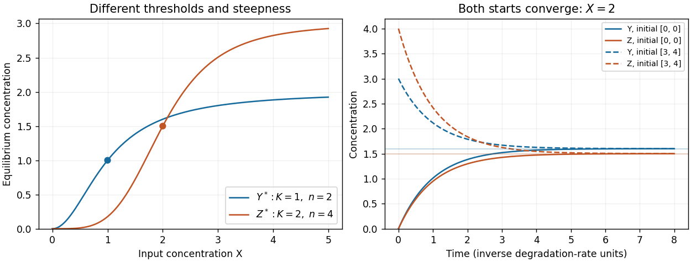

<h1 id="3/b/solution">Solution</h1>

↑ **Parent:** [B](../b.md)

For a constant $X$, set both [ordinary differential equation](../../../../../ordinary-differential-equation.md) derivatives to zero:

$$
\boxed{Y^*(X)=a_Y\frac{X^{n_{XY}}}{K_{XY}^{n_{XY}}+X^{n_{XY}}},\qquad
Z^*_{\rm direct}(X)=a_Z\frac{X^{n_{XZ}}}{K_{XZ}^{n_{XZ}}+X^{n_{XZ}}}}.
$$

These [equilibrium concentrations](../../../../../equilibrium-concentration.md) are unique for each input. For a loss rate $\gamma$ other than one, divide the corresponding production term by $\gamma$.

Choose $a_Y=2$, $K_{XY}=1$, $n_{XY}=2$ and $a_Z=3$, $K_{XZ}=2$, $n_{XZ}=4$. The following Python code plots the requested [equilibrium concentrations](../../../../../equilibrium-concentration.md) and defines the functions used in part (c):

```
import numpy as np
import matplotlib.pyplot as plt

def hill(u, K, n):
    u = np.asarray(u)
    return u**n / (K**n + u**n)

X_grid = np.linspace(0, 5, 501)
Y_eq = 2 * hill(X_grid, 1, 2)
Z_eq = 3 * hill(X_grid, 2, 4)
plt.figure(figsize=(6, 4))
plt.plot(X_grid, Y_eq, label="Y equilibrium: K=1, n=2")
plt.plot(X_grid, Z_eq, label="Z equilibrium: K=2, n=4")
plt.xlabel("X concentration")
plt.ylabel("Equilibrium concentration")
plt.legend()
plt.tight_layout()
plt.show()
```

The [Hill constant](../../../../../hill-constant.md) sets the half-maximum input: $Y^*(1)=1$ and $Z^*_{\rm direct}(2)=1.5$. Increasing that constant shifts activation toward larger $X$. The [Hill coefficient](../../../../../hill-coefficient.md) changes steepness rather than the half-maximum position; the normalized slope at $X=K$ is $n/(4K)$. Because the two examples also differ in $K$ and maximal production, compare normalized responses when isolating the effect of $n$ alone. Both curves vanish at zero and saturate toward their respective maxima.

<a id="3/b/image-independent-hill-activation-and-convergence-from-two-initial-states"></a>


**[Figure 1](#3/b/image-independent-hill-activation-and-convergence-from-two-initial-states). Independent Hill activation and convergence from two initial states**. The left panel shows different half-activation inputs and Hill coefficients. The right panel integrates the two independent output equations at fixed X=2; dashed curves start above equilibrium and solid curves start at zero.

## ↑ Ancestors (13)

1. [B](../b.md)
2. [3](../../3.md)
3. [Paper 3](../../../paper-3-split.md)
4. [2024](../../../split.md)
5. [Past exam of the systems biology course of the University of Cambridge](../../../../split.md)
6. [Systems Biology course of the University of Cambridge](../../../../../systems-biology-course-of-the-university-of-cambridge.md)
7. [Year 4 of the natural sciences course of the University of Cambridge](../../../../../year-4-of-the-natural-sciences-course-of-the-university-of-cambridge.md)
8. [Year of the natural sciences course of the University of Cambridge](../../../../../year-of-the-natural-sciences-course-of-the-university-of-cambridge.md)
9. [Natural sciences course of the University of Cambridge](../../../../../natural-sciences-course-of-the-university-of-cambridge.md)
10. [Course of the University of Cambridge](../../../../../course-of-the-university-of-cambridge.md)
11. [University of Cambridge](../../../../../university-of-cambridge-split.md)
12. [List of universities](../../../../../list-of-universities.md)
13. [Codex Wiki](../../../../../split.md)
