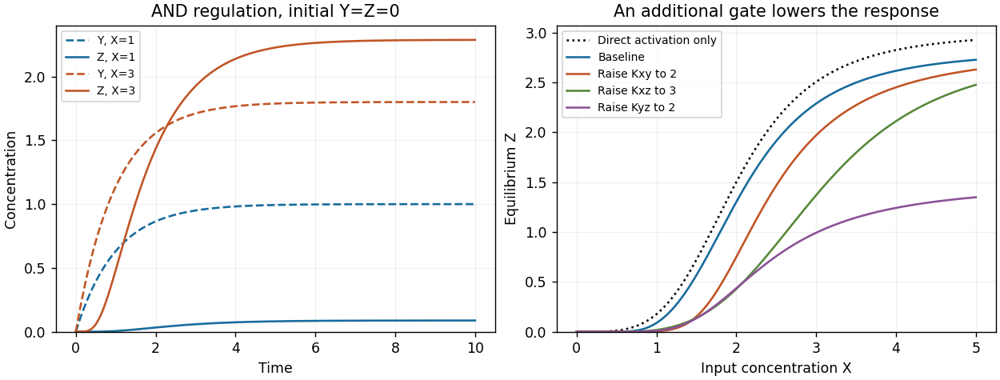

<h1 id="3/d/solution">Solution</h1>

↑ **Parent:** [D](../d.md)

Add the activating link from $Y$ to $Z$ and multiply the two [Hill activation functions](../../../../../hill-activation-function.md) for the target:

$$
\boxed{\frac{dY}{dt}=a_Yh(X;K_{XY},n_{XY})-Y,\qquad
\frac{dZ}{dt}=a_Zh(X;K_{XZ},n_{XZ})h(Y;K_{YZ},n_{YZ})-Z}.
$$

The extra [Hill constant](../../../../../hill-constant.md) $K_{YZ}>0$ has units of $Y$ [concentration](../../../../../concentration.md) and $n_{YZ}>0$ is its [Hill coefficient](../../../../../hill-coefficient.md). Both inputs are required for substantial target production: if either is zero, the production term for $Z$ vanishes. This all-activating circuit is a [coherent feed-forward loop](../../../../../coherent-feed-forward-loop.md). A product of graded input functions implements the specified AND rule; it is a phenomenological rule rather than a complete molecular promoter model.

Retain the parameter values of parts (b) and (c), and set $K_{YZ}=1$, $n_{YZ}=4$. Continue the same Python script with the altered right-hand side:

```
def and_rhs(state, X):
    Y, Z = state
    return np.array([2*hill(X, 1, 2) - Y,
                     3*hill(X, 2, 4)*hill(Y, 1, 4) - Z])

times = np.linspace(0, 10, 1001)
plt.figure(figsize=(7, 4))
for X in [1, 3]:
    trajectory = integrate(lambda s: and_rhs(s, X), [0, 0], times)
    plt.plot(times, trajectory[:, 0], "--", label=f"Y, X={X}")
    plt.plot(times, trajectory[:, 1], label=f"Z, X={X}")
plt.xlabel("Time")
plt.ylabel("Concentration")
plt.legend()
plt.tight_layout()
plt.show()
```

At $X=1$, $Y^*=1$ and $Z^*=(3/17)(1/2)=3/34\approx0.08824$. At $X=3$, $Y^*=1.8$ and $Z^*\approx2.2873$. In both simulations $Y$ first accumulates and opens the additional gate; $Z$ therefore initially grows more slowly than under direct activation alone. The [equilibrium concentration](../../../../../equilibrium-concentration.md) of $Y$ is unchanged by the added outgoing interaction.

<a id="3/d/image-and-feed-forward-dynamics-and-the-effect-of-activation-thresholds"></a>


**[Figure 2](#3/d/image-and-feed-forward-dynamics-and-the-effect-of-activation-thresholds). AND feed-forward dynamics and the effect of activation thresholds**. The left panel compares fixed inputs X=1 and X=3 from the zero state. The right panel compares the full feed-forward equilibrium response with direct activation alone and with individual Hill constants increased.

## ↑ Ancestors (13)

1. [D](../d.md)
2. [3](../../3.md)
3. [Paper 3](../../../paper-3-split.md)
4. [2024](../../../split.md)
5. [Past exam of the systems biology course of the University of Cambridge](../../../../split.md)
6. [Systems Biology course of the University of Cambridge](../../../../../systems-biology-course-of-the-university-of-cambridge.md)
7. [Year 4 of the natural sciences course of the University of Cambridge](../../../../../year-4-of-the-natural-sciences-course-of-the-university-of-cambridge.md)
8. [Year of the natural sciences course of the University of Cambridge](../../../../../year-of-the-natural-sciences-course-of-the-university-of-cambridge.md)
9. [Natural sciences course of the University of Cambridge](../../../../../natural-sciences-course-of-the-university-of-cambridge.md)
10. [Course of the University of Cambridge](../../../../../course-of-the-university-of-cambridge.md)
11. [University of Cambridge](../../../../../university-of-cambridge-split.md)
12. [List of universities](../../../../../list-of-universities.md)
13. [Codex Wiki](../../../../../split.md)
