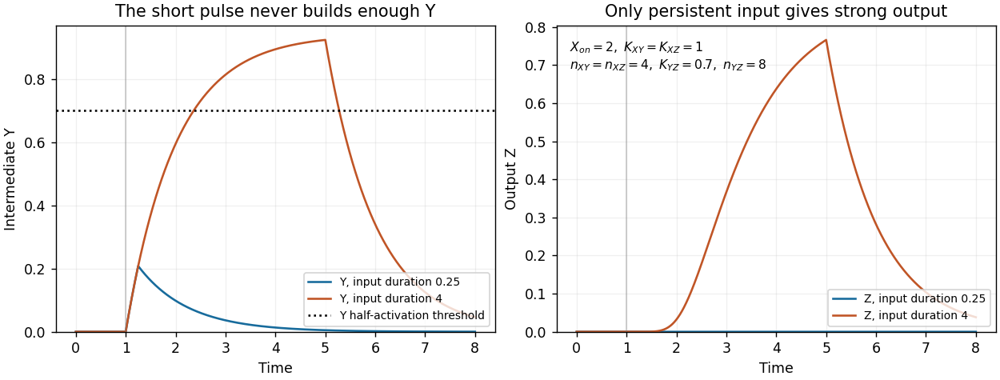

<h1 id="3/e/solution">Solution</h1>

↑ **Parent:** [E](../e.md)

The [quasi-steady-state approximation](../../../../../quasi-steady-state-approximation.md) for $Y$ sets $Y=a_Yh(X;K_{XY},n_{XY})$. Substituting into the $Z$ equation gives

$$
\frac{dZ}{dt}=a_Zh(X;K_{XZ},n_{XZ})
 h\!\left(a_Yh(X;K_{XY},n_{XY});K_{YZ},n_{YZ}\right)-Z.
$$

Its [equilibrium concentration](../../../../../equilibrium-concentration.md) is therefore

$$
\boxed{Z^*_{\rm AND}(X)=a_Z\frac{X^{n_{XZ}}}{K_{XZ}^{n_{XZ}}+X^{n_{XZ}}}
\frac{\left(a_Y X^{n_{XY}}/(K_{XY}^{n_{XY}}+X^{n_{XY}})\right)^{n_{YZ}}}
{K_{YZ}^{n_{YZ}}+\left(a_Y X^{n_{XY}}/(K_{XY}^{n_{XY}}+X^{n_{XY}})\right)^{n_{YZ}}}}.
$$

For constant input this is also the **exact equilibrium** of the full two-variable model: the fast-$Y$ assumption is needed to replace the transient dynamics, not to calculate a [fixed point](../../../../../fixed-point.md).

Relative to the direct-activation result, **$\boxed{Z^*_{\rm AND}=Z^*_{\rm direct}\,h(Y^*;K_{YZ},n_{YZ})\leq Z^*_{\rm direct}}$**. The extra activation gate suppresses the response at low input and can sharpen its rise. The high-input limit is $a_Zh(a_Y;K_{YZ},n_{YZ})$, which need not reach $a_Z$ because $Y^*$ saturates at $a_Y$.

For the parameters in part (d), the following Python continuation plots the expression and changes each [Hill constant](../../../../../hill-constant.md) separately:

```
def z_equilibrium(X, Kxy=1, Kxz=2, Kyz=1):
    Yeq = 2 * hill(X, Kxy, 2)
    return 3 * hill(X, Kxz, 4) * hill(Yeq, Kyz, 4)

X_grid = np.linspace(0, 5, 501)
plt.figure(figsize=(7, 4))
plt.plot(X_grid, 3*hill(X_grid, 2, 4), ":", label="Direct activation")
for parameters, label in [((1, 2, 1), "Baseline"),
                          ((2, 2, 1), "Kxy=2"),
                          ((1, 3, 1), "Kxz=3"),
                          ((1, 2, 2), "Kyz=2")]:
    plt.plot(X_grid, z_equilibrium(X_grid, *parameters), label=label)
plt.xlabel("X concentration")
plt.ylabel("Equilibrium Z")
plt.legend()
plt.tight_layout()
plt.show()
```

Increasing $K_{XY}$ lowers $Y^*$ at fixed finite $X$, delaying opening of the indirect gate. Increasing $K_{XZ}$ delays opening of the direct gate. Neither changes the limiting response as $X\to\infty$, provided the constants remain finite. Increasing $K_{YZ}$ makes a given $Y$ less effective and also lowers the high-input plateau. These changes are visible in the preceding figure. At small $X$, the response is proportional to $X^{n_{XZ}+n_{XY}n_{YZ}}$, while both gates are far below saturation, explaining the increased low-input suppression.

For a **[persistence detector](../../../../../persistence-detector.md)**, retain finite $Y$ dynamics and use, for example,

$$
\boxed{a_Y=a_Z=1,\quad K_{XY}=K_{XZ}=1,\quad
n_{XY}=n_{XZ}=4,\quad K_{YZ}=0.7,\quad n_{YZ}=8},
$$

with unit loss rates, $X_{\rm off}=0$, $X_{\rm on}=2$, and initially $Y=Z=0$. On switching the input on, $Y_\infty=16/17$ and

$$
Y(t)=\frac{16}{17}(1-e^{-t}).
$$

The time to reach the half-activation threshold of the indirect gate is

$$
\boxed{t_{\rm gate}=-\log\!\left(1-\frac{0.7}{16/17}\right)
=\log(160/41)\approx1.362}.
$$

An isolated input pulse of duration $0.25$ ends well before this threshold; a duration-four pulse persists long enough to open the gate. The large but finite [Hill coefficient](../../../../../hill-coefficient.md) makes this a graded filter, not a perfectly sharp cutoff. Once $X$ vanishes, its direct gate closes immediately and stops production of $Z$, which then decays with time constant one. The [protein](../../../../../protein-split.md) output itself does not drop discontinuously. This delayed-on, prompt-production-off mechanism is the characteristic [persistence detector](../../../../../persistence-detector.md) interpretation of an AND-type [coherent feed-forward loop](../../../../../coherent-feed-forward-loop.md).[p. 11981, Equations for Gene Regulation Reactions; pp. 11983–11985, coherent FFL kinetics and Coherent FFLs as Persistence Detectors](../../../../../structure-and-function-of-the-feed-forward-loop-network-motif-by-shmoolik-mangan-and-uri-alon.md)

This final Python continuation simulates both pulse durations. Each discontinuity is placed on the time grid and the input is held constant within each integration step:

```
def persistence_rhs(state, X):
    Y, Z = state
    return np.array([hill(X, 1, 4) - Y,
                     hill(X, 1, 4)*hill(Y, 0.7, 8) - Z])

def pulse_trajectory(duration, dt=0.005):
    times = np.arange(round(8/dt) + 1) * dt
    out = np.zeros((len(times), 2))
    for j in range(len(times)-1):
        X = 2.0 if 1 <= times[j] + dt/2 < 1 + duration else 0.0
        # Each step is integrated with its constant input.
        out[j+1] = integrate(lambda s: persistence_rhs(s, X),
                             out[j], [0, dt])[-1]
    return times, out

fig, axes = plt.subplots(1, 2, figsize=(10, 4))
for duration in [0.25, 4]:
    times, out = pulse_trajectory(duration)
    axes[0].plot(times, out[:, 0], label=f"Y, duration {duration}")
    axes[1].plot(times, out[:, 1], label=f"Z, duration {duration}")
    print(duration, "maximum output", out[:, 1].max())
axes[0].axhline(0.7, color="black", linestyle=":")
for ax in axes:
    ax.set_xlabel("Time")
    ax.set_ylabel("Concentration")
    ax.legend()
plt.tight_layout()
plt.show()
```

The chosen example produces peak $Z$ of about $1.72\times10^{-6}$ for the short pulse and $0.766$ for the long pulse. These are original illustrative simulations, not fitted experimental measurements.

<a id="3/e/image-a-coherent-feed-forward-loop-distinguishes-short-and-persistent-input-pulses"></a>


**[Figure 3](#3/e/image-a-coherent-feed-forward-loop-distinguishes-short-and-persistent-input-pulses). A coherent feed-forward loop distinguishes short and persistent input pulses**. Both inputs switch from zero to X=2 at time one. One ends after 0.25 time units and the other after four. The intermediate Y crosses its activation threshold only for the sustained input, producing a much larger target response.

Finally, the strict instantaneous-$Y$ reduction used for the equilibrium calculation has no separate intermediate accumulation delay. Its remaining one-variable dynamics can still attenuate short pulses through ordinary output relaxation, but it cannot demonstrate the additional delay caused by finite $Y$ buildup. The pulse test therefore uses the full two-variable model.

## ↑ Ancestors (13)

1. [E](../e.md)
2. [3](../../3.md)
3. [Paper 3](../../../paper-3-split.md)
4. [2024](../../../split.md)
5. [Past exam of the systems biology course of the University of Cambridge](../../../../split.md)
6. [Systems Biology course of the University of Cambridge](../../../../../systems-biology-course-of-the-university-of-cambridge.md)
7. [Year 4 of the natural sciences course of the University of Cambridge](../../../../../year-4-of-the-natural-sciences-course-of-the-university-of-cambridge.md)
8. [Year of the natural sciences course of the University of Cambridge](../../../../../year-of-the-natural-sciences-course-of-the-university-of-cambridge.md)
9. [Natural sciences course of the University of Cambridge](../../../../../natural-sciences-course-of-the-university-of-cambridge.md)
10. [Course of the University of Cambridge](../../../../../course-of-the-university-of-cambridge.md)
11. [University of Cambridge](../../../../../university-of-cambridge-split.md)
12. [List of universities](../../../../../list-of-universities.md)
13. [Codex Wiki](../../../../../split.md)
