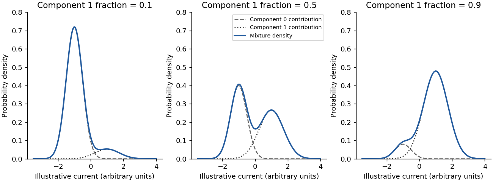

<h1 id="section-i/1-2/solution">Solution</h1>

↑ **Parent:** [1.2](../1-2.md)

The [probability density function](../../../../../probability-density-function.md) is

$$
\boxed{f(x)=\sum_{j=0}^1\frac{\pi_j}{\sigma_j\sqrt{2\pi}}\exp\!\left[-\frac{(x-\mu_j)^2}{2\sigma_j^2}\right].}
$$

Every term is nonnegative because its weight is nonnegative, its scale is positive and its exponential is positive. By [linearity of the integral](../../../../../linearity-of-integration.md) and normalization of each [normal distribution](../../../../../normal-distribution.md),

$$
\int_{-\infty}^{\infty}f(x)\,dx=\sum_{j=0}^1\pi_j\int_{-\infty}^{\infty}\phi_{\mu_j,\sigma_j}(x)\,dx=\pi_0+\pi_1=1.
$$

Thus $f$ is nonnegative and integrates to one. It is a weighted sum of densities, rather than a product or an unweighted sum whose [integral](../../../../../integral-split.md) would equal two.

**[Figure 1](#section-i/1-2/image-illustrative-gaussian-mixtures-with-shared-component-distributions-and-different-modification-fractions). Illustrative Gaussian mixtures with shared component distributions and different modification fractions**.

## ↑ Ancestors (13)

1. [1.2](../1-2.md)
2. [Section I](../../section-i.md)
3. [Paper 4](../../../paper-4-split.md)
4. [2024](../../../split.md)
5. [Past exam of the systems biology course of the University of Cambridge](../../../../split.md)
6. [Systems Biology course of the University of Cambridge](../../../../../systems-biology-course-of-the-university-of-cambridge.md)
7. [Year 4 of the natural sciences course of the University of Cambridge](../../../../../year-4-of-the-natural-sciences-course-of-the-university-of-cambridge.md)
8. [Year of the natural sciences course of the University of Cambridge](../../../../../year-of-the-natural-sciences-course-of-the-university-of-cambridge.md)
9. [Natural sciences course of the University of Cambridge](../../../../../natural-sciences-course-of-the-university-of-cambridge.md)
10. [Course of the University of Cambridge](../../../../../course-of-the-university-of-cambridge.md)
11. [University of Cambridge](../../../../../university-of-cambridge-split.md)
12. [List of universities](../../../../../list-of-universities.md)
13. [Codex Wiki](../../../../../split.md)
