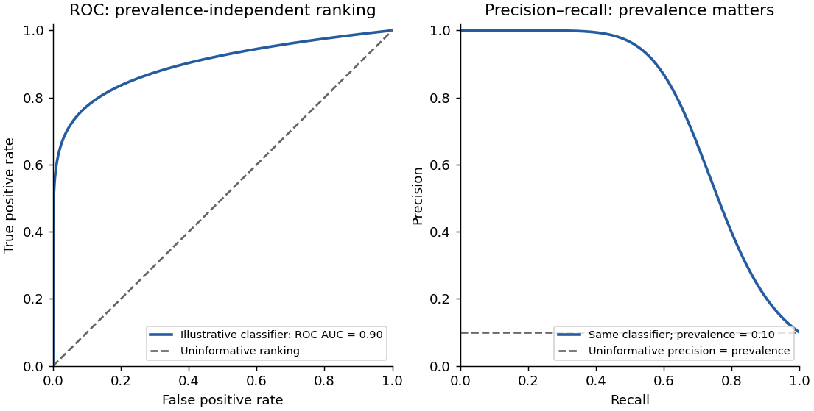

<h1 id="section-i/1-7/solution">Solution</h1>

↑ **Parent:** [1.7](../1-7.md)

A good [receiver operating characteristic](../../../../../receiver-operating-characteristic.md) rises toward the upper-left corner: many reference-positive loci are detected while few reference-negative loci are accepted. The [area under the ROC curve](../../../../../area-under-the-roc-curve.md) summarizes this discrimination over cutoffs. **Higher is better in the stated score direction; perfect separation gives one.** The displayed value near 0.86 indicates substantial ranking discrimination against this reference.

The area can also be interpreted as the [probability](../../../../../probability.md) that a randomly chosen positive receives a higher score than a randomly chosen negative, with half credit for ties. It does not select a cutoff or demonstrate that most retained calls are correct: those practical questions also depend on prevalence and the relative costs of errors.

**[Figure 2](#section-i/1-7/image-the-same-illustrative-classifier-viewed-through-roc-and-precision-recall-curves-at-ten-percent-prevalence). The same illustrative classifier viewed through ROC and precision–recall curves at ten percent prevalence**.

## ↑ Ancestors (13)

1. [1.7](../1-7.md)
2. [Section I](../../section-i.md)
3. [Paper 4](../../../paper-4-split.md)
4. [2024](../../../split.md)
5. [Past exam of the systems biology course of the University of Cambridge](../../../../split.md)
6. [Systems Biology course of the University of Cambridge](../../../../../systems-biology-course-of-the-university-of-cambridge.md)
7. [Year 4 of the natural sciences course of the University of Cambridge](../../../../../year-4-of-the-natural-sciences-course-of-the-university-of-cambridge.md)
8. [Year of the natural sciences course of the University of Cambridge](../../../../../year-of-the-natural-sciences-course-of-the-university-of-cambridge.md)
9. [Natural sciences course of the University of Cambridge](../../../../../natural-sciences-course-of-the-university-of-cambridge.md)
10. [Course of the University of Cambridge](../../../../../course-of-the-university-of-cambridge.md)
11. [University of Cambridge](../../../../../university-of-cambridge-split.md)
12. [List of universities](../../../../../list-of-universities.md)
13. [Codex Wiki](../../../../../split.md)
