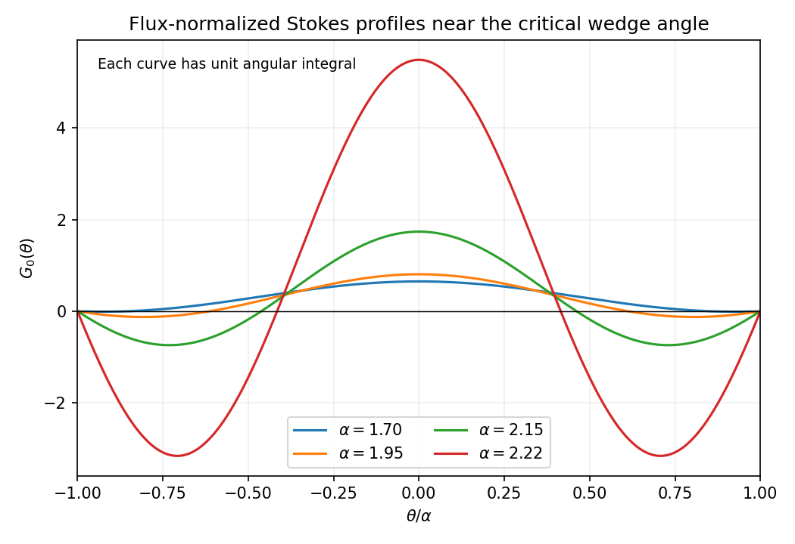
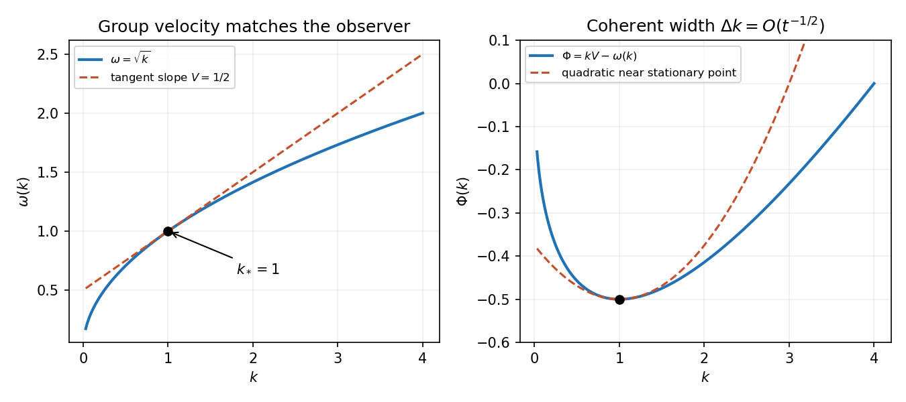

# 2008

↑ **Parent:** [Past exam of the theoretical mechanics course of the University of Oxford](../past-exam-of-the-theoretical-mechanics-course-of-the-university-of-oxford.md)

Original solutions to the paper released at [the source request](https://www.whatdotheyknow.com/request/maths_past_papers_3). The complete editable transcription is retained in the private examination archive.

**Table of contents**

- [A](#a)
  - [1](#a/1)
    - [i](#a/1/i)
      - [Solution](#a/1/i/solution)
    - [ii](#a/1/ii)
      - [Solution](#a/1/ii/solution)
    - [iii](#a/1/iii)
      - [Solution](#a/1/iii/solution)
  - [2](#a/2)
    - [i](#a/2/i)
      - [Solution](#a/2/i/solution)
    - [ii](#a/2/ii)
      - [Solution](#a/2/ii/solution)
  - [3](#a/3)
    - [i](#a/3/i)
      - [Solution](#a/3/i/solution)
    - [ii](#a/3/ii)
      - [Solution](#a/3/ii/solution)
    - [iii](#a/3/iii)
      - [Solution](#a/3/iii/solution)
  - [4](#a/4)
    - [i](#a/4/i)
      - [Solution](#a/4/i/solution)
    - [ii](#a/4/ii)
      - [Solution](#a/4/ii/solution)
- [B](#b)
  - [5](#b/5)
    - [Solution](#b/5/solution)
  - [6](#b/6)
    - [Solution](#b/6/solution)
  - [7](#b/7)
    - [Solution](#b/7/solution)
  - [8](#b/8)
    - [Solution](#b/8/solution)

## A

↑ **Parent:** [2008](2008.md)

<h3 id="a/1">1</h3>

↑ **Parent:** [A](#a)

<h4 id="a/1/i">i</h4>

↑ **Parent:** [1](#a/1)

<h5 id="a/1/i/solution">Solution</h5>

↑ **Parent:** [I](#a/1/i)

Label fluid particles by $\mathbf a$, with [flow map](../dynamical-systems.md#flow-map) $\mathbf x=\chi(\mathbf a,t)$ satisfying $\chi_t=\mathbf u(\chi,t)$. If $J=\det D_{\mathbf a}\chi$, differentiation of the determinant gives $J_t=J\nabla\cdot\mathbf u$. Pull the material-volume integral back to a fixed initial volume:

$$
\frac d{dt}\int_{V(t)}F\,dV=\frac d{dt}\int_{V(0)}F(\chi(\mathbf a,t),t)J\,d\mathbf a.
$$

The [chain rule](../calculus.md#chain-rule) and the Jacobian identity give the integrand $J(F_t+\mathbf u\cdot\nabla F+F\nabla\cdot\mathbf u)$. Transforming back yields the [Reynolds transport theorem](../continuum-mechanics.md#reynolds-transport-theorem)

$$
\boxed{\frac d{dt}\int_{V(t)}F\,dV=\int_{V(t)}[F_t+\nabla\cdot(F\mathbf u)]\,dV.}
$$

Equivalently the additional surface [flux](../mathematical-physics.md#flux) is $\int_{\partial V(t)}F\mathbf u\cdot\mathbf n\,dS$. The material boundary moves with the same normal [velocity](../classical-mechanics.md#velocity) as the fluid, which is the key distinction from a fixed [control volume](../fluid-mechanics.md#control-volume).

<h4 id="a/1/ii">ii</h4>

↑ **Parent:** [1](#a/1)

<h5 id="a/1/ii/solution">Solution</h5>

↑ **Parent:** [Ii](#a/1/ii)

Use [conservation of mass](../continuum-mechanics.md#mass-conservation) and Newton's [momentum balance](../continuum-mechanics.md#momentum-balance-for-a-material-fluid-element), in addition to the supplied [constitutive law](../continuum-mechanics.md#constitutive-equation). For a [material volume](../continuum-mechanics.md#material-volume),

$$
\frac d{dt}\int_{V(t)}\rho\mathbf u\,dV=\int_{\partial V(t)}\boldsymbol\sigma\mathbf n\,dS+\int_{V(t)}\rho\mathbf g\,dV.
$$

The [Reynolds transport theorem](../continuum-mechanics.md#reynolds-transport-theorem) and $\rho_t+\nabla\cdot(\rho\mathbf u)=0$ reduce the left side to $\int\rho D\mathbf u/Dt$. The [divergence theorem](../multivariable-calculus.md#divergence-theorem) then gives $\rho D u_i/Dt=\partial_j\sigma_{ij}+\rho g_i$. For constant $\mu$,

$$
\partial_j\sigma_{ij}=-\partial_ip+\mu\partial_j\partial_ju_i+\mu\partial_i(\partial_ju_j).
$$

[Incompressibility](../fluid-mechanics.md#incompressible-flow) removes the last term. Thus

$$
\boxed{\rho\frac{D\mathbf u}{Dt}=-\nabla p+\mu\nabla^2\mathbf u+\rho\mathbf g.}
$$

The stress formula and zero divergence alone are not a dynamical law: the [force](../force.md) balance supplies the required physical input.

<h4 id="a/1/iii">iii</h4>

↑ **Parent:** [1](#a/1)

<h5 id="a/1/iii/solution">Solution</h5>

↑ **Parent:** [Iii](#a/1/iii)

Take $\mathbf u=(u(y),0)$ and no imposed streamwise [pressure gradient](../fluid-mechanics.md#pressure-gradient). The normal [momentum balance](../continuum-mechanics.md#momentum-balance-for-a-material-fluid-element) gives $p=p_* -\rho gy\cos\alpha$. The streamwise equation is $\mu u''+\rho g\sin\alpha=0$, since the convective acceleration vanishes. With [no slip](../viscous-fluid-flow.md#no-slip-boundary-condition) at the lower wall and signed upper-wall traction $\tau$ in the positive $x$ direction, the conditions are

$$
u(0)=0,\qquad\mu u'(h)=\tau.
$$

Integration gives

$$
\boxed{u(y)=\frac{\rho g\sin\alpha}{2\mu}y(2h-y)+\frac\tau\mu y,\quad\beta=\frac\rho{2\mu},\quad\gamma=2h+\frac{2\tau}{\rho g\sin\alpha}.}
$$

The required upper-wall [velocity](../classical-mechanics.md#velocity) is its endpoint value $u(h)=\rho gh^2\sin\alpha/(2\mu)+\tau h/\mu$. The unfactored formula remains meaningful when $\sin\alpha=0$.

The fluid exerts shear $\boxed{\mu u'(0)=\rho gh\sin\alpha+\tau}$ per unit length on the lower plane in the positive $x$ direction. The [force](../force.md) of that plane on the fluid has the opposite sign. The total wall [force](../force.md) on the fluid balances its downslope weight, providing an independent sign check.

<h3 id="a/2">2</h3>

↑ **Parent:** [A](#a)

<h4 id="a/2/i">i</h4>

↑ **Parent:** [2](#a/2)

<h5 id="a/2/i/solution">Solution</h5>

↑ **Parent:** [I](#a/2/i)

Let $\delta=Re^{-1/2}$, stretch $Y=y/\delta$ and write the original transverse [velocity](../classical-mechanics.md#velocity) as $v=\delta V$. Continuity then gives $u_x+V_Y=0$. In the streamwise momentum equation $u_{yy}/Re=u_{YY}$ is order one, while $u_{xx}/Re$ is negligible. The transverse equation gives $p_Y=0$ to leading order, so [pressure](../pressure.md) is supplied by the outer Euler flow. Its streamwise balance is $p_x=-U U'$. Consequently

$$
\boxed{u u_x+V u_Y=U U'+u_{YY},\qquad u_x+V_Y=0.}
$$

For a stationary impermeable plate, $\boxed{u(x,0)=V(x,0)=0}$, with matching $\boxed{u(x,Y)\to U(x)}$ as $Y\to\infty$. The transverse [velocity](../classical-mechanics.md#velocity) must match the outer displacement flow; it is generally wrong to impose $V\to0$ independently at infinity.

At the leading edge the wall no-slip data meet the external stream abruptly, and the [boundary-layer approximation](../continuum-mechanics.md#boundary-layer) is nonuniform. For a constant external speed, the thickness is $O(\sqrt{x/Re})$, whose ratio to $x$ ceases to be small when the local [Reynolds number](../dynamic-viscosity.md#reynolds-number) is order one. A leading-edge region retaining neglected derivatives is needed there. An [adverse pressure gradient](../fluid-mechanics.md#adverse-pressure-gradient) can also cause separation farther downstream; a large global [Reynolds number](../dynamic-viscosity.md#reynolds-number) alone does not prevent it.

<h4 id="a/2/ii">ii</h4>

↑ **Parent:** [2](#a/2)

<h5 id="a/2/ii/solution">Solution</h5>

↑ **Parent:** [Ii](#a/2/ii)

Use $u=\psi_Y$, $V=-\psi_x$, and put $\eta=Y/x^\gamma$, $\psi=x^\beta f(\eta)$. Then

$$
u=x^{\beta-\gamma}f',\qquad V=-x^{\beta-1}(\beta f-\gamma\eta f').
$$

Matching $u\sim x^m$ requires $\beta-\gamma=m$. Equating the powers in streamwise [inertia](../classical-mechanics.md#inertia) $x^{2m-1}$ and transverse diffusion $x^{m-2\gamma}$ gives

$$
\boxed{\gamma=\frac{1-m}{2},\qquad\beta=\frac{1+m}{2}.}
$$

The two convective terms combine to $x^{2m-1}[m(f')^2-\beta f f'']$, while $UU'=mx^{2m-1}$. Hence the [Falkner-Skan equation](../continuum-mechanics.md#falkner-skan-equation) in this scaling is

$$
\boxed{f^{(3)}+\beta f f''+m[1-(f')^2]=0,\quad f(0)=f'(0)=0,\quad f'(\infty)=1.}
$$

The additive stream-function constant is fixed by $f(0)=0$; when $\beta\ne0$ this also encodes [no penetration](../viscous-fluid-flow.md#no-penetration-boundary-condition). For $\beta=0$ it is a harmless choice of additive constant choice. Existence of an attached physical branch for a given $m$ is a separate issue from deriving the similarity reduction.

On an attached branch with $w=f'>0$ away from the wall, use $f$ itself as the independent variable. The [chain rule](../calculus.md#chain-rule) gives $f''=w w_f$ and $f^{(3)}=w(w_f^2+w w_{ff})$. Therefore

$$
\boxed{w^2w_{ff}+w(w_f)^2+\beta f w w_f+m(1-w^2)=0,\qquad w(0)=0,\quad w(f)\to1\text{ as }f\to\infty.}
$$

If the [wall shear](../continuum-mechanics.md#wall-shear-stress) $s=f''(0)>0$, then $f\sim s\eta^2/2$, so $w(f)\sim\sqrt{2sf}$. Thus $w_f$ is singular at zero while $w w_f\to s$ is finite. Imposing a finite arbitrary $w_f(0)$ would remove the usual attached branch. This is the [velocity as dependent variable in the Falkner-Skan equation](../continuum-mechanics.md#velocity-as-dependent-variable-in-the-falkner-skan-equation) reduction.

<h3 id="a/3">3</h3>

↑ **Parent:** [A](#a)

<h4 id="a/3/i">i</h4>

↑ **Parent:** [3](#a/3)

<h5 id="a/3/i/solution">Solution</h5>

↑ **Parent:** [I](#a/3/i)

Set $u_\theta=0$. Continuity gives $\partial_r(ru_r)=0$, hence $\boxed{u_r=g(\theta)/r}$. Substituting into radial and angular momentum gives

$$
p_r=\frac\rho{r^3}(g^2+\nu g''),\qquad p_\theta=\frac{2\rho\nu}{r^2}g'.
$$

For example $\nabla^2u_r-u_r/r^2=g''/r^3$, and the radial acceleration is $-g^2/r^3$. Equality of the mixed [pressure](../pressure.md) derivatives now requires

$$
\rho(2gg'+\nu g^{(3)})/r^3=-4\rho\nu g'/r^3.
$$

Thus the equation for [radial viscous flow in a wedge](../viscous-fluid-flow.md#radial-viscous-flow-in-a-wedge) is

$$
\boxed{\nu(g^{(3)}+4g')+2gg'=0.}
$$

It can also be integrated once as $\nu(g''+4g)+g^2=\text{constant}$.

<h4 id="a/3/ii">ii</h4>

↑ **Parent:** [3](#a/3)

<h5 id="a/3/ii/solution">Solution</h5>

↑ **Parent:** [Ii](#a/3/ii)

[No slip](../viscous-fluid-flow.md#no-slip-boundary-condition) on the two fixed radial walls gives $g(\pm\alpha)=0$. The outward [flux](../mathematical-physics.md#flux) through a circular arc is $\int_{-\alpha}^\alpha u_r r\,d\theta=\int_{-\alpha}^\alpha g\,d\theta$, so [source strength](../fluid-mechanics.md#volumetric-flow-rate) $Q$ requires that integral to equal $Q$. Set $g=QG$ and $\epsilon=Q/\nu$. Then

$$
G^{(3)}+4G'+2\epsilon GG'=0,\quad G(\pm\alpha)=0,\quad\int_{-\alpha}^\alpha G\,d\theta=1.
$$

At leading order $G_0^{(3)}+4G_0'=0$, whose general solution is a constant plus sine and cosine of $2\theta$. The symmetric source-driven branch has no sine term; for generic $\alpha$ this also follows directly by subtracting its two wall conditions. Thus

$$
\boxed{G_0=C(\cos2\theta-\cos2\alpha),\qquad C=\frac1{\sin2\alpha-2\alpha\cos2\alpha}.}
$$

Indeed its integral is $C(\sin2\alpha-2\alpha\cos2\alpha)=1$. At isolated angles where an odd zero-[flux](../mathematical-physics.md#flux) homogeneous mode satisfies both wall conditions, symmetry selects the stated branch.

<h4 id="a/3/iii">iii</h4>

↑ **Parent:** [3](#a/3)

<h5 id="a/3/iii/solution">Solution</h5>

↑ **Parent:** [Iii](#a/3/iii)

The normalization denominator vanishes when $\sin2\alpha-2\alpha\cos2\alpha=0$, namely $\boxed{\tan2\alpha_c=2\alpha_c}$. The relevant first root above $\pi/2$ is $\alpha_c\simeq2.24670$ radians. The zero root is not the critical angle of interest.

For $\pi/2<\alpha<\alpha_c$ the denominator is positive. The profile is even, with outward flow near the bisector and reverse flow adjacent to each wall:

$$
G_0>0\quad(|\theta|<\pi-\alpha),\qquad G_0<0\quad(\pi-\alpha<|\theta|<\alpha).
$$

It vanishes at the walls and at $\theta=\pm(\pi-\alpha)$; its minima are at $\theta=\pm\pi/2$. The following sketch shows the leading approximation to $G$ for small $\epsilon$.

**[Figure 1](#a/3/iii/image-leading-radial-wedge-flow-profiles-outward-central-flux-and-reverse-wall-layers-grow-near-the-critical-angle). Leading radial wedge-flow profiles: outward central flux and reverse wall layers grow near the critical angle**.

As $\alpha$ approaches $\alpha_c$ from below, the large positive central and negative wall contributions nearly cancel while the prescribed net [flux](../mathematical-physics.md#flux) remains one. The leading Stokes solution diverges, so the supposedly small nonlinear inertial term can no longer be treated as a [perturbation](../asymptotic-expansion.md#perturbation). This is the [critical angle of a flux-normalized Stokes wedge flow](../viscous-fluid-flow.md#critical-angle-of-a-flux-normalized-stokes-wedge-flow). It demonstrates breakdown of this [regular expansion](../asymptotic-expansion.md#regular-perturbation); it does not establish that the exact viscous flow must have infinite speed or that a global steady branch continues through the critical angle.

<h3 id="a/4">4</h3>

↑ **Parent:** [A](#a)

<h4 id="a/4/i">i</h4>

↑ **Parent:** [4](#a/4)

<h5 id="a/4/i/solution">Solution</h5>

↑ **Parent:** [I](#a/4/i)

Let $X=x_{\rm dim}/L$, $Y=y/h_0$, scale horizontal and vertical velocities by $U$ and $Uh_0/L$, and define $P=(p_{\rm dim}-p_0)h_0^2/(\mu UL)$. The small [aspect ratio](../physics.md#aspect-ratio) makes $P$ independent of $Y$ at leading order. The second small parameter, $Uh_0^2/(\nu L)$, makes [inertia](../classical-mechanics.md#inertia) negligible compared with transverse viscous stress. Thus the [lubrication equations](../viscous-fluid-flow.md#lubrication-theory) are $u_{YY}=P_X$ and $u_X+V_Y=0$.

[No slip](../viscous-fluid-flow.md#no-slip-boundary-condition) gives $u(X,0)=1$, $u(X,h)=0$, so

$$
\boxed{u=1-\frac Yh+\frac{P_X}{2}Y(Y-h),\qquad q=\int_0^hu\,dY=\frac h2-\frac{h^3P_X}{12}.}
$$

[No penetration](../viscous-fluid-flow.md#no-penetration-boundary-condition) at the two solid walls and continuity make $q$ constant. Therefore, writing the [dimensionless](../physics.md#dimensionless-quantity) variables again as $x,p$,

$$
\boxed{\frac d{dx}(h^3p'-6h)=0,\qquad p(0)=p(1)=0.}
$$

The [pressure](../pressure.md) scale is set by balancing the longitudinal [pressure gradient](../fluid-mechanics.md#pressure-gradient) with shear across the thin gap, not by the inertial dynamic-[pressure](../pressure.md) scale.

<h4 id="a/4/ii">ii</h4>

↑ **Parent:** [4](#a/4)

<h5 id="a/4/ii/solution">Solution</h5>

↑ **Parent:** [Ii](#a/4/ii)

Integrate once and use $h=e^{-\alpha x}$ to obtain $p'=6e^{2\alpha x}+C e^{3\alpha x}$. The two zero endpoint [pressures](../pressure.md) determine

$$
C=-9\frac{e^{2\alpha}-1}{e^{3\alpha}-1}=-6M,\qquad M=\frac{3(e^{2\alpha}-1)}{2(e^{3\alpha}-1)}.
$$

Consequently

$$
p'=6e^{3\alpha x}(e^{-\alpha x}-M),\qquad
p=\frac3\alpha(e^{2\alpha x}-1)-\frac{2M}\alpha(e^{3\alpha x}-1).
$$

The constant $M=\int_0^1h^{-2}\,dx/\int_0^1h^{-3}\,dx$ is a [weighted average](../arithmetic.md#weighted-arithmetic-mean) of $h$ with positive weight $h^{-3}$, so $e^{-\alpha}<M<1$. Since $e^{-\alpha x}$ decreases strictly, $p'$ changes sign exactly once, from positive to negative. Thus the unique maximum is at

$$
\boxed{x_m=-\frac1\alpha\log M=-\frac1\alpha\log\frac{3(e^{2\alpha}-1)}{2(e^{3\alpha}-1)}.}
$$

For small $\alpha$, $\log M=-\alpha/2-5\alpha^2/24+O(\alpha^4)$, so $\boxed{x_m=\tfrac12+\tfrac5{24}\alpha+O(\alpha^3)\sim\tfrac12}$. The [exponential-gap slider bearing](../viscous-fluid-flow.md#exponential-gap-slider-bearing) provides a particularly simple example where a converging gap produces positive load-bearing [pressure](../pressure.md).

## B

↑ **Parent:** [2008](2008.md)

<h3 id="b/5">5</h3>

↑ **Parent:** [B](#b)

<h4 id="b/5/solution">Solution</h4>

↑ **Parent:** [5](#b/5)

The first [energy](../energy.md) term is the rate of change of internal plus [kinetic energy](../energy.md#kinetic-energy) per unit volume; the second transports that [energy](../energy.md) with the moving gas; the [pressure](../pressure.md) term is the mechanical [work](../energy.md#work) [flux](../mathematical-physics.md#flux) across the boundary. There is no [heat flux](../heat.md#heat-flux-density) or viscous [work](../energy.md#work) in the stated inviscid [adiabatic](../first-law-of-thermodynamics.md#adiabatic-process) model.

Use mass conservation to replace a conservative derivative of $\rho e$ by $\rho De/Dt$. Dotting the momentum equation with $\mathbf u$ gives $\rho D(|\mathbf u|^2/2)/Dt=-\mathbf u\cdot\nabla p$. Subtraction from total [energy](../energy.md) leaves

$$
\rho c_v\frac{DT}{Dt}+p\nabla\cdot\mathbf u=0.
$$

Now $p=\rho RT$ and $D\rho/Dt=-\rho\nabla\cdot\mathbf u$ imply

$$
\frac{DS}{Dt}=c_v\left(\frac1p\frac{Dp}{Dt}-\frac\gamma\rho\frac{D\rho}{Dt}\right)=\frac{c_v}T\frac{DT}{Dt}+R\nabla\cdot\mathbf u=0.
$$

Thus $\boxed{DS/Dt=0}$: smooth [adiabatic](../first-law-of-thermodynamics.md#adiabatic-process) inviscid trajectories are [isentropic](../compressible-flow.md#isentropic-flow). [Shocks](../transport-equation.md#shock-wave) need an [entropy inequality](../continuum-mechanics.md#lagrangian-entropy-inequality) rather than this smooth equality.

Adding $\nabla\cdot(k\nabla T)$ models [Fourier heat conduction](../heat.md#fourier-s-law), with [heat flux](../heat.md#heat-flux-density) $-k\nabla T$. The same subtraction gives $\rho c_vDT/Dt+p\nabla\cdot\mathbf u=\nabla\cdot(k\nabla T)$, hence

$$
\boxed{T\frac{DS}{Dt}=\frac1\rho\nabla\cdot(k\nabla T).}
$$

For a fixed container use impermeability $\mathbf u\cdot\mathbf n=0$, insulation $k\nabla T\cdot\mathbf n=0$, and mass conservation. Then

$$
\frac d{dt}\int_D\rho S\,dV=\int_D\frac1T\nabla\cdot(k\nabla T)\,dV=\int_D\frac{k|\nabla T|^2}{T^2}\,dV.
$$

The boundary term vanishes and $\nabla(1/T)=-\nabla T/T^2$ supplies the positive sign. For $T>0$, $k\geq0$, total [entropy](../entropy.md) cannot decrease: this is [entropy production by Fourier heat conduction](../heat.md#entropy-production-by-fourier-heat-conduction).

<h3 id="b/6">6</h3>

↑ **Parent:** [B](#b)

<h4 id="b/6/solution">Solution</h4>

↑ **Parent:** [6](#b/6)

Rigid walls require zero normal [velocity](../classical-mechanics.md#velocity), so $\phi_x=0$ at $x=0,L$ and $\phi_y=0$ at $y=0,b$. [Separation of variables](../partial-differential-equation.md#separation-of-variables) gives spatial modes $\cos(m\pi x/L)\cos(n\pi y/b)$, for nonnegative integers $m,n$. The [wave equation](../wave-equation.md) therefore gives

$$
\boxed{\omega_{m,n}^2=\pi^2c_0^2(m^2/L^2+n^2/b^2).}
$$

The $(0,0)$ spatially constant mode has zero frequency and is not an ordinary positive-frequency [acoustic oscillation](../fluid-mechanics.md#acoustic-wave).

A spatially uniform boundary forcing excites the $n=0$ transverse mode. Put $\phi=X(x)\cos\omega t$. Then $X''+(\omega/c_0)^2X=0$ and $X'(L)=0$, hence $X=C\cos[\omega(L-x)/c_0]$. The condition $X'(0)=a$ fixes $C$ and gives

$$
\boxed{\phi=\frac{ac_0\cos[\omega(L-x)/c_0]}{\omega\sin(\omega L/c_0)}\cos\omega t.}
$$

Arbitrary free oscillations can be superposed. The denominator vanishes at longitudinal [resonances](../dynamical-systems.md#resonance). Near them the lossless steady harmonic response ceases to be a uniformly small-amplitude approximation; [damping](../wave-equation.md#damping) from [viscosity](../dynamic-viscosity.md), heat transfer or wall losses regularizes the response, and large amplitudes can require nonlinear [equations of motion](../classical-mechanics.md#equation-of-motion) or a more accurate moving-boundary model. At exact [resonance](../dynamical-systems.md#resonance) a switched-on ideal forcing produces secular growth rather than a bounded harmonic particular solution.

For the semi-infinite duct expand $F(y)=\sum_{n\geq0}F_n\cos(n\pi y/b)$. Each axial mode has

$$
\boxed{k_n^2=\omega^2/c_0^2-(n\pi/b)^2.}
$$

For a propagating mode a particular solution is $\phi_n=(F_n/k_n)\cos(n\pi y/b)\cos(k_nx-\omega t)$; differentiating at zero gives the prescribed $F_n\cos(n\pi y/b)\sin\omega t$. A nonzero higher transverse coefficient propagates when $|\omega|>n\pi c_0/b$.

The outgoing [radiation condition](../gravity-wave.md#radiation-condition) selects $c_0^2k_n/\omega>0$, its positive axial [group velocity](../dispersion-relation.md#group-velocity). Thus $\boxed{\omega k_n>0}$. This sign is selected by the absence of waves incident from infinity, not by the differential equation alone. If $F$ has a nonzero mean, its $n=0$ component can propagate even below every higher-mode cutoff.

For $F=\cos(\pi y/b)$ and $0<|\omega|<\pi c_0/b$, put $\kappa=\sqrt{(\pi/b)^2-\omega^2/c_0^2}$. The decaying solution is

$$
\boxed{\phi=-\frac1\kappa e^{-\kappa x}\cos(\pi y/b)\sin\omega t.}
$$

It is evanescent and carries no mean [energy](../energy.md) to infinity. These mode and sign conditions are summarized by the [radiation condition for a waveguide mode](../wave.md#radiation-condition-for-a-waveguide-mode).

<h3 id="b/7">7</h3>

↑ **Parent:** [B](#b)

<h4 id="b/7/solution">Solution</h4>

↑ **Parent:** [7](#b/7)

Along $x=Vt+x_0$, the phase is $t\Phi(k)+kx_0$, with $\Phi(k)=kV-\omega(k)$. Graphically, a line of slope $V$ intersects the [dispersion curve](../dispersion-relation.md) transversely except where it is tangent. On a transverse region, neighboring [wavenumbers](../wave-equation.md#wavenumber) acquire order-one phase differences over a width $\Delta k\sim t^{-1}$, so cancellation leaves an $O(t^{-1})$ contribution. More formally, [integration by parts](../calculus.md#integration-by-parts) uses

$$
e^{it\Phi}=\frac1{it\Phi'}\frac d{dk}e^{it\Phi}
$$

and gives that order when the amplitude and its derivative are integrable and $\Phi'$ is bounded away from zero on the region.

At a nondegenerate tangent point $k_*$, $\Phi'(k_*)=0$, equivalently $\boxed{V=\omega'(k_*)}$, and $\Phi(k)=\Phi(k_*)-\omega''(k_*)(k-k_*)^2/2+\cdots$. Coherent [wavenumbers](../wave-equation.md#wavenumber) now occupy width $O(t^{-1/2})$, yielding the stationary-phase contribution

$$
A(k_*)e^{ik_*x_0+it\Phi(k_*)-i\operatorname{sgn}(\omega''(k_*))\pi/4}\sqrt{\frac{2\pi}{t|\omega''(k_*)|}}.
$$

These are the packets whose [group velocity](../dispersion-relation.md#group-velocity) follows the observer. The displayed decay rates require the usual regularity and nondegeneracy hypotheses; $A\to0$ alone is not a complete analytic hypothesis, and a vanishing amplitude or degenerate stationary point changes the leading order.

**[Figure 2](#b/7/image-a-tangent-of-slope-v-selects-the-gravity-wave-packet-that-remains-near-the-moving-observer). A tangent of slope V selects the gravity-wave packet that remains near the moving observer**.

For deep water take a [velocity](../classical-mechanics.md#velocity) potential satisfying [Laplace's equation](../partial-differential-equation.md#laplace-equation) below the undisturbed surface and decaying with depth. A Fourier mode has vertical factor $e^{|k|z}$. The linearized kinematic and dynamic surface conditions are $\eta_t=\phi_z$ and $\phi_t+g\eta=0$ at $z=0$. Thus

$$
\partial_t^2\overline\eta(k,t)+g|k|\overline\eta(k,t)=0.
$$

Release from rest gives $\overline\eta_t(k,0)=0$, so inversion of the [Fourier transform](../fourier-transform.md) gives

$$
\boxed{\eta(x,t)=\frac1{2\pi}\int_{-\infty}^\infty\overline\eta_0(k)\cos(t\sqrt{g|k|})e^{-ikx}\,dk.}
$$

Evenness of the initial profile makes its transform even and the reconstructed surface even; the same formula also [works](../energy.md#work) without that symmetry when the usual reality condition holds.

Split the cosine into its two time phases. Along the moving observer, their stationary conditions are $\pm\omega'(k)=V$, where $\omega(k)=\sqrt{g|k|}$. Since $|\omega'(k)|=\sqrt g/(2\sqrt{|k|})$, for $V\ne0$,

$$
\boxed{|k_*|=\frac g{4V^2},\qquad k_*=\pm\frac g{4V^2}.}
$$

These are the possible dominant stationary-phase packets, provided the initial Fourier amplitude at the selected [wavenumber](../wave-equation.md#wavenumber) is nonzero. For $V=0$ there is no finite nonzero stationary [wavenumber](../wave-equation.md#wavenumber); the formula must not be applied by division by zero.

<h3 id="b/8">8</h3>

↑ **Parent:** [B](#b)

<h4 id="b/8/solution">Solution</h4>

↑ **Parent:** [8](#b/8)

Let the bed be $z=0$ and the free surface $z=h(x,t)$. In a long, shallow layer, vertical acceleration is smaller than gravity, so the vertical [Euler equation](../euler-equations-for-an-inviscid-fluid.md) gives [hydrostatic pressure](../fluid-mechanics.md#hydrostatic-pressure) $p=p_{\rm atm}+\rho g(h-z)$. [Incompressibility](../fluid-mechanics.md#incompressible-flow) makes the vertical speed smaller than the horizontal speed by the [aspect ratio](../physics.md#aspect-ratio); [irrotationality](../vorticity.md#irrotational-flow) then makes the leading horizontal [velocity](../classical-mechanics.md#velocity) depth-independent. The horizontal [Euler equation](../euler-equations-for-an-inviscid-fluid.md) becomes

$$
\boxed{u_t+uu_x+gh_x=0.}
$$

Integrating $u_x+w_z=0$ across the depth, using bed impermeability $w(0)=0$ and the surface condition $w(h)=h_t+uh_x$, yields

$$
\boxed{h_t+(hu)_x=0.}
$$

Combining these gives the conservative momentum equation $(hu)_t+(hu^2+gh^2/2)_x=0$. Integral mass and [momentum balance](../continuum-mechanics.md#momentum-balance-for-a-material-fluid-element) across a stationary thin jump therefore require

$$
\boxed{[hu]_-^+=0,\qquad[hu^2+gh^2/2]_-^+=0.}
$$

These conservation laws still apply across a jump where the smooth hydrostatic/[irrotational](../multivariable-calculus.md#irrotational-vector-field) derivation does not resolve the internal turbulent structure.

Put $A=h_-$, $B=h_+$ and $q=Au_-=Bu_+>0$, orienting the flow from minus to plus. For a nontrivial jump the momentum condition gives $q^2=gAB(A+B)/2$. Its change in mechanical-[energy](../energy.md) [flux](../mathematical-physics.md#flux) is

$$
\begin{aligned}
[\rho hu(u^2/2+gh)]_-^+
&=\rho q\left[\frac{q^2}{2}\left(\frac1{B^2}-\frac1{A^2}\right)+g(B-A)\right]\\
&=-\frac{\rho gq(B-A)^3}{4AB}
=\boxed{\frac{\rho gu_-(h_--h_+)^3}{4h_+}}.
\end{aligned}
$$

A passive jump cannot create mechanical [energy](../energy.md), so the change is nonpositive. Since $q>0$, $\boxed{h_+>h_-}$ for a genuine jump; equality describes no jump. The upstream flow is supercritical and the downstream flow subcritical, since $Fr_-^2=B(A+B)/(2A^2)>1$ and $Fr_+^2=A(A+B)/(2B^2)<1$.

The gas-dynamic analogue is a compressive [normal shock](../compressible-flow.md#normal-shock-wave): [density](../fluid-mechanics.md#density) and [pressure](../pressure.md) increase and flow changes from [supersonic](../compressible-flow.md#supersonic-flow) to [subsonic](../compressible-flow.md#subsonic-flow). [Entropy](../entropy.md) increases; directed mechanical [energy](../energy.md) is irreversibly converted into [internal energy](../internal-energy.md). Total gas [energy](../energy.md), including [internal energy](../internal-energy.md), is conserved across an [adiabatic](../first-law-of-thermodynamics.md#adiabatic-process) [shock](../transport-equation.md#shock-wave). This distinguishes that total-[energy](../energy.md) balance from the reduced shallow-water mechanical-[energy](../energy.md) loss.

## ↑ Ancestors (9)

1. [Past exam of the theoretical mechanics course of the University of Oxford](../past-exam-of-the-theoretical-mechanics-course-of-the-university-of-oxford.md)
2. [Theoretical mechanics course of the University of Oxford](../university-of-oxford.md#theoretical-mechanics-course-of-the-university-of-oxford)
3. [Year 3 of the mathematics course of the University of Oxford](../university-of-oxford.md#year-3-of-the-mathematics-course-of-the-university-of-oxford)
4. [Mathematics course of the University of Oxford](../university-of-oxford.md#mathematics-course-of-the-university-of-oxford)
5. [Undergraduate course of the University of Oxford](../university-of-oxford.md#undergraduate-course-of-the-university-of-oxford)
6. [Course of the University of Oxford](../university-of-oxford.md#course-of-the-university-of-oxford)
7. [University of Oxford](../university-of-oxford.md)
8. [List of universities](../README.md#list-of-universities)
9. [Codex Wiki](../README.md)
