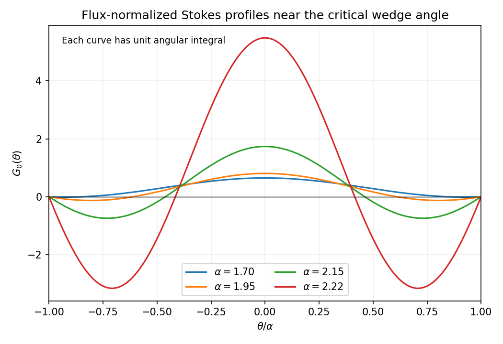

<h1 id="a/3/iii/solution">Solution</h1>

↑ **Parent:** [Iii](../iii.md)

The normalization denominator vanishes when $\sin2\alpha-2\alpha\cos2\alpha=0$, namely $\boxed{\tan2\alpha_c=2\alpha_c}$. The relevant first root above $\pi/2$ is $\alpha_c\simeq2.24670$ radians. The zero root is not the critical angle of interest.

For $\pi/2<\alpha<\alpha_c$ the denominator is positive. The profile is even, with outward flow near the bisector and reverse flow adjacent to each wall:

$$
G_0>0\quad(|\theta|<\pi-\alpha),\qquad G_0<0\quad(\pi-\alpha<|\theta|<\alpha).
$$

It vanishes at the walls and at $\theta=\pm(\pi-\alpha)$; its minima are at $\theta=\pm\pi/2$. The following sketch shows the leading approximation to $G$ for small $\epsilon$.

**[Figure 1](#a/3/iii/image-leading-radial-wedge-flow-profiles-outward-central-flux-and-reverse-wall-layers-grow-near-the-critical-angle). Leading radial wedge-flow profiles: outward central flux and reverse wall layers grow near the critical angle**.

As $\alpha$ approaches $\alpha_c$ from below, the large positive central and negative wall contributions nearly cancel while the prescribed net [flux](../../../../../flux.md) remains one. The leading Stokes solution diverges, so the supposedly small nonlinear inertial term can no longer be treated as a [perturbation](../../../../../perturbation.md). This is the [critical angle of a flux-normalized Stokes wedge flow](../../../../../critical-angle-of-a-flux-normalized-stokes-wedge-flow.md). It demonstrates breakdown of this [regular expansion](../../../../../regular-perturbation.md); it does not establish that the exact viscous flow must have infinite speed or that a global steady branch continues through the critical angle.

## ↑ Ancestors (13)

1. [Iii](../iii.md)
2. [3](../../3.md)
3. [A](../../../a.md)
4. [2008](../../../../2008-split.md)
5. [Past exam of the theoretical mechanics course of the University of Oxford](../../../../split.md)
6. [Theoretical mechanics course of the University of Oxford](../../../../../theoretical-mechanics-course-of-the-university-of-oxford.md)
7. [Year 3 of the mathematics course of the University of Oxford](../../../../../year-3-of-the-mathematics-course-of-the-university-of-oxford.md)
8. [Mathematics course of the University of Oxford](../../../../../mathematics-course-of-the-university-of-oxford.md)
9. [Undergraduate course of the University of Oxford](../../../../../undergraduate-course-of-the-university-of-oxford.md)
10. [Course of the University of Oxford](../../../../../course-of-the-university-of-oxford.md)
11. [University of Oxford](../../../../../university-of-oxford-split.md)
12. [List of universities](../../../../../list-of-universities.md)
13. [Codex Wiki](../../../../../split.md)
