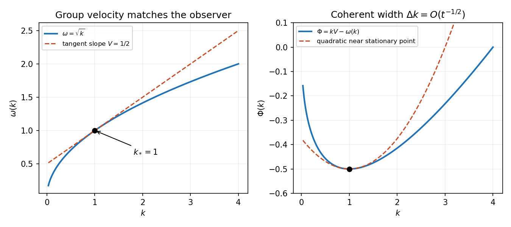

<h1 id="b/7/solution">Solution</h1>

↑ **Parent:** [7](../7.md)

Along $x=Vt+x_0$, the phase is $t\Phi(k)+kx_0$, with $\Phi(k)=kV-\omega(k)$. Graphically, a line of slope $V$ intersects the [dispersion curve](../../../../dispersion-relation-split.md) transversely except where it is tangent. On a transverse region, neighboring [wavenumbers](../../../../wavenumber.md) acquire order-one phase differences over a width $\Delta k\sim t^{-1}$, so cancellation leaves an $O(t^{-1})$ contribution. More formally, [integration by parts](../../../../integration-by-parts.md) uses

$$
e^{it\Phi}=\frac1{it\Phi'}\frac d{dk}e^{it\Phi}
$$

and gives that order when the amplitude and its derivative are integrable and $\Phi'$ is bounded away from zero on the region.

At a nondegenerate tangent point $k_*$, $\Phi'(k_*)=0$, equivalently $\boxed{V=\omega'(k_*)}$, and $\Phi(k)=\Phi(k_*)-\omega''(k_*)(k-k_*)^2/2+\cdots$. Coherent [wavenumbers](../../../../wavenumber.md) now occupy width $O(t^{-1/2})$, yielding the stationary-phase contribution

$$
A(k_*)e^{ik_*x_0+it\Phi(k_*)-i\operatorname{sgn}(\omega''(k_*))\pi/4}\sqrt{\frac{2\pi}{t|\omega''(k_*)|}}.
$$

These are the packets whose [group velocity](../../../../group-velocity.md) follows the observer. The displayed decay rates require the usual regularity and nondegeneracy hypotheses; $A\to0$ alone is not a complete analytic hypothesis, and a vanishing amplitude or degenerate stationary point changes the leading order.

**[Figure 2](#b/7/image-a-tangent-of-slope-v-selects-the-gravity-wave-packet-that-remains-near-the-moving-observer). A tangent of slope V selects the gravity-wave packet that remains near the moving observer**.

For deep water take a [velocity](../../../../velocity.md) potential satisfying [Laplace's equation](../../../../laplace-equation.md) below the undisturbed surface and decaying with depth. A Fourier mode has vertical factor $e^{|k|z}$. The linearized kinematic and dynamic surface conditions are $\eta_t=\phi_z$ and $\phi_t+g\eta=0$ at $z=0$. Thus

$$
\partial_t^2\overline\eta(k,t)+g|k|\overline\eta(k,t)=0.
$$

Release from rest gives $\overline\eta_t(k,0)=0$, so inversion of the [Fourier transform](../../../../fourier-transform-split.md) gives

$$
\boxed{\eta(x,t)=\frac1{2\pi}\int_{-\infty}^\infty\overline\eta_0(k)\cos(t\sqrt{g|k|})e^{-ikx}\,dk.}
$$

Evenness of the initial profile makes its transform even and the reconstructed surface even; the same formula also [works](../../../../work.md) without that symmetry when the usual reality condition holds.

Split the cosine into its two time phases. Along the moving observer, their stationary conditions are $\pm\omega'(k)=V$, where $\omega(k)=\sqrt{g|k|}$. Since $|\omega'(k)|=\sqrt g/(2\sqrt{|k|})$, for $V\ne0$,

$$
\boxed{|k_*|=\frac g{4V^2},\qquad k_*=\pm\frac g{4V^2}.}
$$

These are the possible dominant stationary-phase packets, provided the initial Fourier amplitude at the selected [wavenumber](../../../../wavenumber.md) is nonzero. For $V=0$ there is no finite nonzero stationary [wavenumber](../../../../wavenumber.md); the formula must not be applied by division by zero.

## ↑ Ancestors (12)

1. [7](../7.md)
2. [B](../../b.md)
3. [2008](../../../2008-split.md)
4. [Past exam of the theoretical mechanics course of the University of Oxford](../../../split.md)
5. [Theoretical mechanics course of the University of Oxford](../../../../theoretical-mechanics-course-of-the-university-of-oxford.md)
6. [Year 3 of the mathematics course of the University of Oxford](../../../../year-3-of-the-mathematics-course-of-the-university-of-oxford.md)
7. [Mathematics course of the University of Oxford](../../../../mathematics-course-of-the-university-of-oxford.md)
8. [Undergraduate course of the University of Oxford](../../../../undergraduate-course-of-the-university-of-oxford.md)
9. [Course of the University of Oxford](../../../../course-of-the-university-of-oxford.md)
10. [University of Oxford](../../../../university-of-oxford-split.md)
11. [List of universities](../../../../list-of-universities.md)
12. [Codex Wiki](../../../../split.md)
