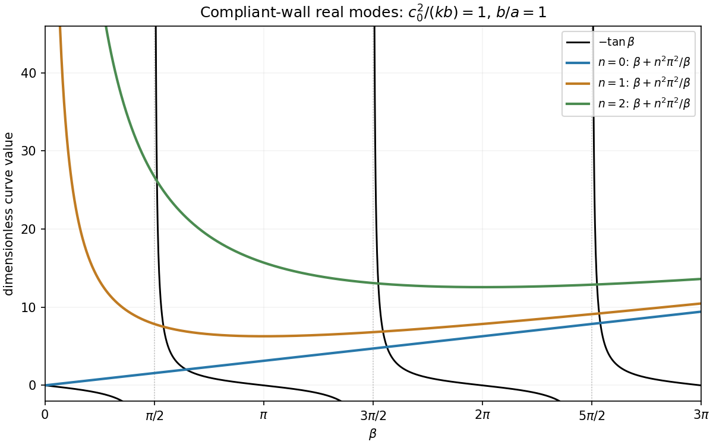

<h1 id="b/4/d/solution">Solution</h1>

↑ **Parent:** [D](../d.md)

Retain the rigid-wall cosine in $x$ and the lower-wall cosine in $y$:

$$
\phi=A\cos(n\pi x/a)\cos(\beta y/b)e^{-i\omega t}.
$$

The [wave equation](../../../../../wave-equation-split.md) gives $\omega^2=c_0^2[(n\pi/a)^2+(\beta/b)^2]$. The upper-wall condition gives $-k\beta\sin\beta/b-\omega^2\cos\beta=0$, hence

$$
\boxed{\beta\tan\beta=-\omega^2b/k.}
$$

For nonzero real $\beta$, eliminating $\omega$ gives $-\tan\beta=M(\beta+\kappa_n^2/\beta)$ with $M=c_0^2/(kb)>0$, $\kappa_n=n\pi b/a$.

On every interval $((j+1/2)\pi,(j+1)\pi)$, the left side decreases from positive infinity to zero, while the right side is finite and positive. Continuity gives at least one intersection per interval for each $n$. The functions are analytic between their poles, so roots are isolated there; their union over countably many intervals is a countably infinite set. Reflection gives the redundant negative-$\beta$ solutions. For $n=0$, the limiting formal root $\beta=0$ is the zero-frequency gauge mode, not one of these positive-frequency branches.

**[Figure 1](#b/4/d/image-real-vertical-mode-intersections-for-three-horizontal-mode-numbers). Real vertical-mode intersections for three horizontal mode numbers**.

The graph uses representative dimensionless values $M=1$ and $b/a=1$; the interval argument applies for all positive values. For fixed $n$ and fixed branch $j$, take $M\to\infty$. The positive right side becomes large, forcing the intersection towards the tangent pole from the right:

$$
\beta_j=(j+\tfrac12)\pi+O(M^{-1}).
$$

More precisely, if $\beta_j^0=(j+1/2)\pi$, then $\beta_j-\beta_j^0\sim\beta_j^0/[M((\beta_j^0)^2+\kappa_n^2)]$. Therefore the requested real-branch frequencies satisfy

$$
\boxed{\omega_{n,j}\sim\pi c_0\sqrt{\frac{n^2}{a^2}+\frac{(j+1/2)^2}{b^2}},\qquad n,j=0,1,2,\ldots.}
$$

The limiting upper condition is effectively [pressure](../../../../../pressure-split.md) release for these acoustic branches. No claim is made here about imaginary or other complex $\beta$ branches, which were excluded from the requested analysis.

## ↑ Ancestors (13)

1. [D](../d.md)
2. [4](../../4.md)
3. [B](../../../b.md)
4. [2009](../../../../2009-split.md)
5. [Past exam of the theoretical mechanics course of the University of Oxford](../../../../split.md)
6. [Theoretical mechanics course of the University of Oxford](../../../../../theoretical-mechanics-course-of-the-university-of-oxford.md)
7. [Year 3 of the mathematics course of the University of Oxford](../../../../../year-3-of-the-mathematics-course-of-the-university-of-oxford.md)
8. [Mathematics course of the University of Oxford](../../../../../mathematics-course-of-the-university-of-oxford.md)
9. [Undergraduate course of the University of Oxford](../../../../../undergraduate-course-of-the-university-of-oxford.md)
10. [Course of the University of Oxford](../../../../../course-of-the-university-of-oxford.md)
11. [University of Oxford](../../../../../university-of-oxford-split.md)
12. [List of universities](../../../../../list-of-universities.md)
13. [Codex Wiki](../../../../../split.md)
