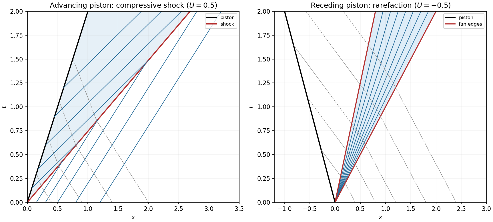

<h1 id="b/6/c/solution">Solution</h1>

↑ **Parent:** [C](../c.md)

The second law requires the [specific entropy](../../../../../specific-entropy.md) to increase along the fluid's passage through a nontrivial physical [shock](../../../../../shock-wave.md): $s_1>s_0$. For a [perfect gas](../../../../../ideal-gas-split.md) this selects a compressive [shock](../../../../../shock-wave.md), whose upstream [shock](../../../../../shock-wave.md)-frame [Mach number](../../../../../mach-number.md) is greater than one and whose downstream [shock](../../../../../shock-wave.md)-frame flow is subsonic.

Here the upstream [Mach number](../../../../../mach-number.md) is $M_0=V/c_0$. The quadratic gives $V^2-c_0^2=(\gamma+1)UV/2>0$, so $\boxed{M_0>1}$. [Density](../../../../../density.md) and [pressure](../../../../../pressure-split.md) both rise. With $c_1^2=\gamma p_1/\rho_1$, one also has $V-U<c_1$. For example, put $M=V/c_0$ and use the normal-[shock](../../../../../shock-wave.md) identity

$$
\frac{(V-U)^2}{c_1^2}=\frac{(\gamma-1)M^2+2}{2\gamma M^2-(\gamma-1)}<1\quad(M>1).
$$

The characteristic geometry is therefore $c_0<V<U+c_1$. The plus-family characteristics from the gas ahead are overtaken by the [shock](../../../../../shock-wave.md), while those behind catch up with it; they converge into the discontinuity. The minus-family speeds are $-c_0$ ahead and $U-c_1$ behind. The piston is the line $x=Ut$ and the [shock](../../../../../shock-wave.md) is the steeper-in-$x/t$ line $x=Vt$.

**[Figure 2](#b/6/c/image-compressive-shock-for-an-advancing-piston-and-expansion-fan-for-a-receding-piston). Compressive shock for an advancing piston and expansion fan for a receding piston**.

## ↑ Ancestors (13)

1. [C](../c.md)
2. [6](../../6.md)
3. [B](../../../b.md)
4. [2009](../../../../2009-split.md)
5. [Past exam of the theoretical mechanics course of the University of Oxford](../../../../split.md)
6. [Theoretical mechanics course of the University of Oxford](../../../../../theoretical-mechanics-course-of-the-university-of-oxford.md)
7. [Year 3 of the mathematics course of the University of Oxford](../../../../../year-3-of-the-mathematics-course-of-the-university-of-oxford.md)
8. [Mathematics course of the University of Oxford](../../../../../mathematics-course-of-the-university-of-oxford.md)
9. [Undergraduate course of the University of Oxford](../../../../../undergraduate-course-of-the-university-of-oxford.md)
10. [Course of the University of Oxford](../../../../../course-of-the-university-of-oxford.md)
11. [University of Oxford](../../../../../university-of-oxford-split.md)
12. [List of universities](../../../../../list-of-universities.md)
13. [Codex Wiki](../../../../../split.md)
