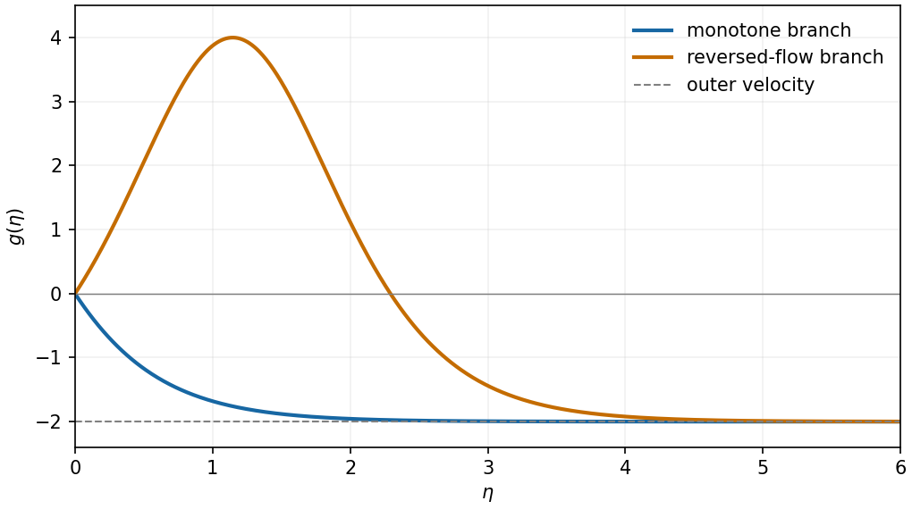
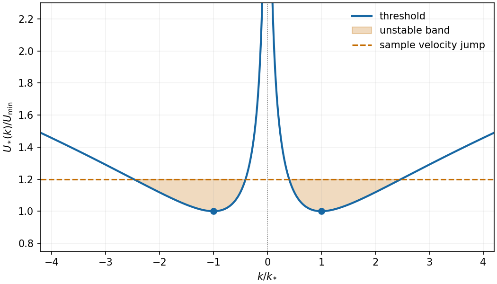
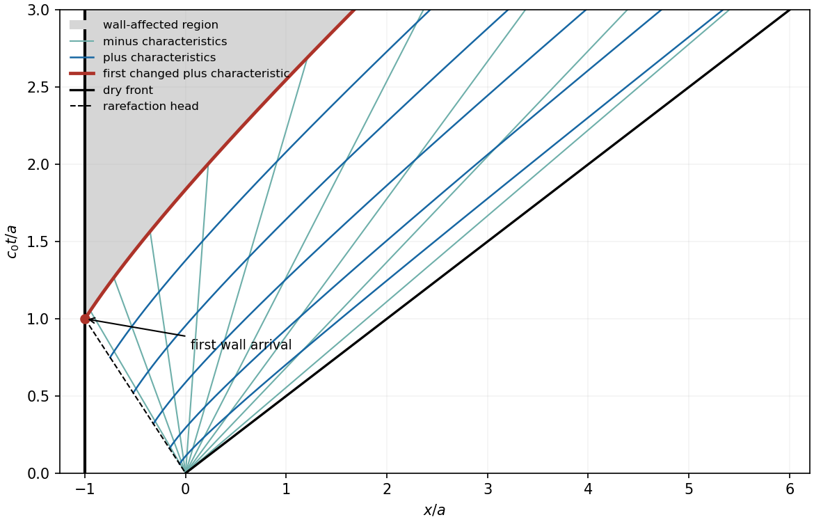

# 2010

↑ **Parent:** [Past exam of the theoretical mechanics course of the University of Oxford](../past-exam-of-the-theoretical-mechanics-course-of-the-university-of-oxford.md)

Original solutions to the paper released at [the source request](https://www.whatdotheyknow.com/request/maths_past_papers_3). The complete editable transcription is retained in the private examination archive.

**Table of contents**

- [A](#a)
  - [1](#a/1)
    - [a](#a/1/a)
      - [Solution](#a/1/a/solution)
    - [b](#a/1/b)
      - [Solution](#a/1/b/solution)
    - [c](#a/1/c)
      - [Solution](#a/1/c/solution)
  - [2](#a/2)
    - [a](#a/2/a)
      - [Solution](#a/2/a/solution)
    - [b](#a/2/b)
      - [Solution](#a/2/b/solution)
    - [c](#a/2/c)
      - [Solution](#a/2/c/solution)
  - [3](#a/3)
    - [a](#a/3/a)
      - [Solution](#a/3/a/solution)
    - [b](#a/3/b)
      - [Solution](#a/3/b/solution)
    - [c](#a/3/c)
      - [Solution](#a/3/c/solution)
- [B](#b)
  - [4](#b/4)
    - [a](#b/4/a)
      - [i](#b/4/a/i)
        - [Solution](#b/4/a/i/solution)
      - [ii](#b/4/a/ii)
        - [Solution](#b/4/a/ii/solution)
      - [iii](#b/4/a/iii)
        - [Solution](#b/4/a/iii/solution)
    - [b](#b/4/b)
      - [i](#b/4/b/i)
        - [Solution](#b/4/b/i/solution)
      - [ii](#b/4/b/ii)
        - [Solution](#b/4/b/ii/solution)
      - [iii](#b/4/b/iii)
        - [Solution](#b/4/b/iii/solution)
  - [5](#b/5)
    - [a](#b/5/a)
      - [Solution](#b/5/a/solution)
    - [b](#b/5/b)
      - [i](#b/5/b/i)
        - [Solution](#b/5/b/i/solution)
      - [ii](#b/5/b/ii)
        - [Solution](#b/5/b/ii/solution)
      - [iii](#b/5/b/iii)
        - [Solution](#b/5/b/iii/solution)
      - [iv](#b/5/b/iv)
        - [Solution](#b/5/b/iv/solution)
  - [6](#b/6)
    - [a](#b/6/a)
      - [Solution](#b/6/a/solution)
    - [b](#b/6/b)
      - [i](#b/6/b/i)
        - [Solution](#b/6/b/i/solution)
      - [ii](#b/6/b/ii)
        - [Solution](#b/6/b/ii/solution)
      - [iii](#b/6/b/iii)
        - [Solution](#b/6/b/iii/solution)

## A

↑ **Parent:** [2010](2010.md)

<h3 id="a/1">1</h3>

↑ **Parent:** [A](#a)

<h4 id="a/1/a">a</h4>

↑ **Parent:** [1](#a/1)

<h5 id="a/1/a/solution">Solution</h5>

↑ **Parent:** [A](#a/1/a)

Let $\mathbf x(\mathbf X,t)$ be the particle [flow map](../dynamical-systems.md#flow-map) from the fixed reference volume $V_0$ to the [material volume](../continuum-mechanics.md#material-volume), and let $J=\det(\partial\mathbf x/\partial\mathbf X)$. Change variables and differentiate on the fixed domain:

$$
\frac d{dt}\int_{V(t)}f\,dV
=\int_{V_0}\left(\frac{Df}{Dt}J+f\frac{DJ}{Dt}\right)dV_0.
$$

Use the two permitted identities, $DJ/Dt=J\nabla\cdot\mathbf u$ and $Df/Dt=f_t+\mathbf u\cdot\nabla f$. Changing back gives

$$
\boxed{\frac d{dt}\int_{V(t)}f\,dV
=\int_{V(t)}\left(f_t+\mathbf u\cdot\nabla f+f\nabla\cdot\mathbf u\right)dV
=\int_{V(t)}\left(f_t+\nabla\cdot(f\mathbf u)\right)dV.}
$$

This is the [Reynolds transport theorem](../continuum-mechanics.md#reynolds-transport-theorem): both the value carried by each particle and the changing volume element contribute.

<h4 id="a/1/b">b</h4>

↑ **Parent:** [1](#a/1)

<h5 id="a/1/b/solution">Solution</h5>

↑ **Parent:** [B](#a/1/b)

The [traction](../continuum-mechanics.md#traction) $\mathbf t(\mathbf n)$ is force per unit area across an oriented surface with unit normal $\mathbf n$. The stress component $\sigma_{ij}$ is its $i$th component on a surface normal to the $j$th coordinate axis. [Cauchy's stress theorem](../continuum-mechanics.md#cauchy-s-stress-theorem) states that this dependence is linear:

$$
\boxed{t_i(\mathbf n)=\sigma_{ij}n_j.}
$$

For the boundary of a [material volume](../continuum-mechanics.md#material-volume), take the outward normal and the [traction](../continuum-mechanics.md#traction) exerted by the surrounding fluid. Newton's law and the [divergence theorem](../multivariable-calculus.md#divergence-theorem) give

$$
\frac d{dt}\int_{V(t)}\rho u_i\,dV
=\int_{\partial V(t)}\sigma_{ij}n_j\,dS
=\int_{V(t)}\partial_j\sigma_{ij}\,dV.
$$

Constant [density](../fluid-mechanics.md#density) and [incompressibility](../fluid-mechanics.md#incompressible-flow) make the transport-theorem integrand on the left $\rho Du_i/Dt$. The volume is arbitrary, so

$$
\boxed{\rho\frac{Du_i}{Dt}=\partial_j\sigma_{ij}.}
$$

Substitute the Newtonian constitutive law. With constant viscosity,

$$
\partial_j\sigma_{ij}=-\partial_i p+\mu\partial_j\partial_j u_i
+\mu\partial_i(\partial_j u_j)=-\partial_i p+\mu\nabla^2u_i.
$$

Hence

$$
\boxed{\rho(\mathbf u_t+(\mathbf u\cdot\nabla)\mathbf u)
=-\nabla p+\mu\nabla^2\mathbf u.}
$$

<h4 id="a/1/c">c</h4>

↑ **Parent:** [1](#a/1)

<h5 id="a/1/c/solution">Solution</h5>

↑ **Parent:** [C](#a/1/c)

For a steady unidirectional field $\mathbf u=w\mathbf k$, [incompressibility](../fluid-mechanics.md#incompressible-flow) gives $\partial_z w=0$. Thus $w=w(x,y)$ and the convective acceleration vanishes. The transverse momentum equations give $p_x=p_y=0$, so $p=p(z)$. The axial equation is

$$
\mu\Delta_\perp w=p'(z).
$$

Its left side is independent of $z$ and its right side independent of $x,y$, so both equal a constant $G$. No slip against the translating wall gives $w=U$ on the boundary. Thus the asserted Poisson problem follows.

For the circular pipe, the axisymmetric solution is

$$
\boxed{w(r)=U+\frac G{4\mu}(r^2-R^2).}
$$

It satisfies the boundary value and $\Delta_\perp r^2=4$. Integrating over the cross-section gives

$$
Q=2\pi\int_0^Rw(r)r\,dr=\pi R^2U-\frac{\pi R^4G}{8\mu}.
$$

Therefore the laboratory-frame [volume flux](../fluid-mechanics.md#volumetric-flow-rate) vanishes precisely when

$$
\boxed{U=\frac{R^2}{8\mu}\frac{dp}{dz}.}
$$

For a [pressure](../pressure.md) decrease in the positive axial direction, this requires upstream wall translation.

<h3 id="a/2">2</h3>

↑ **Parent:** [A](#a)

<h4 id="a/2/a">a</h4>

↑ **Parent:** [2](#a/2)

<h5 id="a/2/a/solution">Solution</h5>

↑ **Parent:** [A](#a/2/a)

Balance streamwise convection of order one with transverse viscous diffusion $Re^{-1}\partial_y^2u$. This requires a thickness $Re^{-1/2}$. Continuity then makes the normal [velocity](../classical-mechanics.md#velocity) of that same small order. Set

$$
\boxed{Y=Re^{1/2}y,\qquad V=Re^{1/2}v.}
$$

The normal momentum equation makes the leading [pressure](../pressure.md) independent of $Y$. It equals the outer [pressure](../pressure.md), whose inviscid tangential momentum balance gives $-p_x=U_sU_s'$. The leading tangential equation and continuity are consequently

$$
\boxed{uu_x+Vu_Y=U_sU_s'+u_{YY},\qquad u_x+V_Y=0.}
$$

The [divergence](../multivariable-calculus.md#divergence)-free field $(u,V)$ has a [streamfunction](../fluid-mechanics.md#stream-function) with $u=\Psi_Y$, $V=-\Psi_x$. Substituting yields

$$
\boxed{\Psi_Y\Psi_{xY}-\Psi_x\Psi_{YY}=U_sU_s'+\Psi_{YYY}.}
$$

The stationary impermeable wall has $u=V=0$, so $\Psi_Y(x,0)=0$ and $\Psi(x,0)$ is constant, chosen to be zero. Matching to the outer slip [velocity](../classical-mechanics.md#velocity) gives $\Psi_Y(x,\infty)=U_s(x)$.

<h4 id="a/2/b">b</h4>

↑ **Parent:** [2](#a/2)

<h5 id="a/2/b/solution">Solution</h5>

↑ **Parent:** [B](#a/2/b)

For the proposed form,

$$
u=x^{\alpha-\beta}f',\quad
V=-x^{\alpha-1}(\alpha f-\beta\eta f'),\quad
u_Y=x^{\alpha-2\beta}f''.
$$

Matching the outer [velocity](../classical-mechanics.md#velocity) requires $\alpha-\beta=m$. The convective and outer-[pressure](../pressure.md) terms have order $x^{2m-1}$, while $u_{YY}$ has order $x^{\alpha-3\beta}$. Equality of exponents gives

$$
\boxed{\alpha=\frac{1+m}{2},\qquad\beta=\frac{1-m}{2}.}
$$

The two terms containing $\eta f'f''$ cancel in $uu_x+Vu_Y$, leaving $x^{2m-1}[m(f')^2-\alpha ff'']$. Since $U_sU_s'=mA^2x^{2m-1}$, the reduced equation is

$$
\boxed{f^{(3)}+\frac{1+m}{2}ff''+m\{A^2-(f')^2\}=0.}
$$

The wall and matching conditions become $\boxed{f(0)=f'(0)=0,\ f'(\infty)=A}$. This establishes a consistent similarity reduction; existence of an actual profile is a separate boundary-value question for a particular choice of parameters.

<h4 id="a/2/c">c</h4>

↑ **Parent:** [2](#a/2)

<h5 id="a/2/c/solution">Solution</h5>

↑ **Parent:** [C](#a/2/c)

At these parameters the equation becomes $g''+g^2-4=0$, where $g=f'$. Multiply by $g'$ and integrate:

$$
\frac12(g')^2+\frac13g^3-4g=C.
$$

Outer matching gives $g\to-2$ and $g'\to0$, so $C=16/3$. No slip gives $g(0)=0$. At that point the [first integral](../differential-equation.md#first-integral) fixes $g'(0)=\pm4\sqrt{2/3}$, so there are exactly two smooth initial-value solutions of the second-order equation satisfying the matching condition. Put $\eta_0=\operatorname{arctanh}\sqrt{2/3}$. Translation invariance of the supplied profile gives them explicitly:

$$
\boxed{g_-(\eta)=4-6\tanh^2(\eta+\eta_0),\qquad
 g_+(\eta)=4-6\tanh^2(\eta-\eta_0).}
$$

The first decreases monotonically from zero to $-2$. The second first rises to $4$ at $\eta_0$, crosses zero again at $2\eta_0$, and then tends to $-2$. Integrating either profile from zero recovers $f$ with $f(0)=0$.

**[Figure 1](#a/2/c/image-two-translated-similarity-profiles-monotone-outer-flow-matching-and-a-branch-with-an-internal-reversed-flow-region). Two translated similarity profiles: monotone outer-flow matching and a branch with an internal reversed-flow region**.

One would **not expect both branches to be equally stable**. The rising branch contains flow opposite to its negative outer stream and interior [inflection points](../topology.md#inflection-point), typical ingredients for [shear instability](../hydrodynamic-stability.md#shear-instability). The monotone branch has $g''=4-g^2>0$ at finite positive $\eta$ and no interior [inflection point](../topology.md#inflection-point), so the classical inviscid inflection-point mechanism is absent there. This motivates expecting the reversed-flow branch to be unstable and the monotone branch to be the stable candidate. A definitive viscous temporal-stability result requires perturbing the time-dependent equations; the steady [first integral](../differential-equation.md#first-integral) alone is not a stability proof.

<h3 id="a/3">3</h3>

↑ **Parent:** [A](#a)

<h4 id="a/3/a">a</h4>

↑ **Parent:** [3](#a/3)

<h5 id="a/3/a/solution">Solution</h5>

↑ **Parent:** [A](#a/3/a)

Introduce $\mathcal R=\rho UL/\mu$. Balancing the streamwise [pressure gradient](../fluid-mechanics.md#pressure-gradient) $\Pi/L$ with cross-layer viscosity $\mu U/(\delta^2L^2)$ gives

$$
\boxed{\Pi=\frac{\mu U}{\delta^2L}.}
$$

After division by that viscous scale, the streamwise momentum equation is

$$
\delta^2\mathcal R\bigl(\widehat u_{\widehat t}+\widehat u\widehat u_{\widehat x}
+\widehat w\widehat u_{\widehat z}\bigr)
=-\widehat p_{\widehat x}+\widehat u_{\widehat z\widehat z}
+\delta^2\widehat u_{\widehat x\widehat x}+S,
\quad S=\frac{\delta^2\rho gL^2}{\mu U}.
$$

The transverse equation, divided by its [pressure](../pressure.md)-[gradient](../multivariable-calculus.md#gradient) scale, is

$$
\delta^4\mathcal R\bigl(\widehat w_{\widehat t}+\widehat u\widehat w_{\widehat x}
+\widehat w\widehat w_{\widehat z}\bigr)
=-\widehat p_{\widehat z}+\delta^2\widehat w_{\widehat z\widehat z}
+\delta^4\widehat w_{\widehat x\widehat x}.
$$

Continuity scales exactly to $\widehat u_{\widehat x}+\widehat w_{\widehat z}=0$. With $\delta\ll1$, $\delta^2\mathcal R\ll1$ and $S=O(1)$, the leading equations are

$$
\boxed{0=-\widehat p_{\widehat x}+\widehat u_{\widehat z\widehat z}+S,
\qquad\widehat p_{\widehat z}=0,
\qquad\widehat u_{\widehat x}+\widehat w_{\widehat z}=0.}
$$

<h4 id="a/3/b">b</h4>

↑ **Parent:** [3](#a/3)

<h5 id="a/3/b/solution">Solution</h5>

↑ **Parent:** [B](#a/3/b)

No slip and impermeability give dimensional $u=-U$, $w=0$ on the upward-moving wall, so $\boxed{\widehat u=-1,\ \widehat w=0}$ there. For the interface normal, $h_x=\delta\widehat h_{\widehat x}$, and hence

$$
\mathbf n=(\delta\widehat h_{\widehat x},-1)+O(\delta^2)
$$

in its $x,z$ components. The relevant stresses scale as

$$
\sigma_{xx}=-\Pi\widehat p+O(\mu U/L),\qquad
\sigma_{xz}=\frac{\mu U}{\delta L}\widehat u_{\widehat z}+O(\delta\mu U/L),
\qquad\sigma_{zz}=-\Pi\widehat p+O(\mu U/L).
$$

Multiplying by the inward normal gives the leading [traction](../continuum-mechanics.md#traction)

$$
\boxed{\mathbf t\sim-\frac{\mu U}{\delta L}
(\widehat p\widehat h_{\widehat x}+\widehat u_{\widehat z})\mathbf i
+\frac{\mu U}{\delta^2L}\widehat p\mathbf k.}
$$

Its leading normal component vanishes only if $\widehat p=0$ at the interface; the tangential component then requires $\widehat u_{\widehat z}=0$.

The [free surface](../fluid-mechanics.md#free-surface) is material. Applying the [material derivative](../continuum-mechanics.md#material-derivative) to $z-h(x,t)=0$ gives $w=h_t+uh_x$, which in the scaled variables becomes

$$
\boxed{\widehat w=\widehat h_{\widehat t}+\widehat u\widehat h_{\widehat x},\qquad
\widehat p=0,\qquad\widehat u_{\widehat z}=0
\quad\text{at }\widehat z=\widehat h.}
$$

<h4 id="a/3/c">c</h4>

↑ **Parent:** [3](#a/3)

<h5 id="a/3/c/solution">Solution</h5>

↑ **Parent:** [C](#a/3/c)

Suppress hats for this calculation. Transverse [pressure](../pressure.md) uniformity and zero surface [pressure](../pressure.md) give $p=0$ throughout the film. Thus $u_{zz}=-S$. Integrating twice, using $u_z(h)=0$ and $u(0)=-1$, gives

$$
\boxed{u(z)=-1+S(hz-z^2/2).}
$$

The flux is $q=\int_0^h u\,dz=-h+Sh^3/3$. Integrate continuity across the layer and apply the wall and kinematic conditions to obtain $h_t+q_x=0$. Restoring hats yields

$$
\boxed{\widehat h_{\widehat t}+(S\widehat h^2-1)\widehat h_{\widehat x}=0.}
$$

The cubic flux contains downward [gravity](../physics.md#gravity)-driven transport and upward wall entrainment.

<h2 id="b">B</h2>

↑ **Parent:** [2010](2010.md)

<h3 id="b/4">4</h3>

↑ **Parent:** [B](#b)

<h4 id="b/4/a">a</h4>

↑ **Parent:** [4](#b/4)

<h5 id="b/4/a/i">i</h5>

↑ **Parent:** [A](#b/4/a)

<h6 id="b/4/a/i/solution">Solution</h6>

↑ **Parent:** [I](#b/4/a/i)

The [material derivative](../continuum-mechanics.md#material-derivative) $\boxed{D/Dt=\partial_t+\mathbf u\cdot\nabla}$ measures change while following a moving gas parcel. The four equations respectively express **[mass conservation](../continuum-mechanics.md#mass-conservation)**, **[momentum conservation](../momentum.md#momentum-conservation)**, **internal-energy balance**, and the **[ideal gas law](../ideal-gas.md#ideal-gas-law)**. The first accounts for [density](../fluid-mechanics.md#density) change under expansion or compression. The second is Newton's law with [pressure](../pressure.md) as the only force. In the third the specific internal energy is $c_vT$ and [pressure](../pressure.md) work $-p\nabla\cdot\mathbf u$ heats compression and cools expansion. The fourth relates thermodynamic [pressure](../pressure.md), [density](../fluid-mechanics.md#density) and temperature; $R$ is the gas constant per unit mass.

<h5 id="b/4/a/ii">ii</h5>

↑ **Parent:** [A](#b/4/a)

<h6 id="b/4/a/ii/solution">Solution</h6>

↑ **Parent:** [Ii](#b/4/a/ii)

Continuity gives $D\log\rho/Dt=-\nabla\cdot\mathbf u$. Using $p=\rho RT$, the temperature equation gives $D\log T/Dt=-(R/c_v)\nabla\cdot\mathbf u$. Therefore

$$
\frac{D\log p}{Dt}=\frac{D\log\rho}{Dt}+\frac{D\log T}{Dt}
=-\gamma\nabla\cdot\mathbf u,\qquad\gamma=1+R/c_v.
$$

Consequently

$$
\boxed{\frac{DS}{Dt}=c_v\left(\frac{D\log p}{Dt}-\gamma\frac{D\log\rho}{Dt}\right)=0.}
$$

Each smooth parcel evolves isentropically under these adiabatic inviscid equations; the argument does not cover [entropy](../entropy.md)-producing shocks.

<h5 id="b/4/a/iii">iii</h5>

↑ **Parent:** [A](#b/4/a)

<h6 id="b/4/a/iii/solution">Solution</h6>

↑ **Parent:** [Iii](#b/4/a/iii)

Conservation of the parcel's [entropy](../entropy.md) makes $p/\rho^\gamma$ constant along its trajectory. Its initial value is $p_0/\rho_0^\gamma$, so

$$
\boxed{p=p_0\left(\frac\rho{\rho_0}\right)^\gamma.}
$$

This is a relation following the specified parcel; parcels with different initial [entropy](../entropy.md) can have different constants.

<h4 id="b/4/b">b</h4>

↑ **Parent:** [4](#b/4)

<h5 id="b/4/b/i">i</h5>

↑ **Parent:** [B](#b/4/b)

<h6 id="b/4/b/i/solution">Solution</h6>

↑ **Parent:** [I](#b/4/b/i)

[Linearization](../algebra.md#linearization) about the uniform resting state gives

$$
\rho'_t+\rho_0\nabla\cdot\mathbf u'=0,\qquad
\rho_0\mathbf u'_t=-\nabla p',\qquad
p'_t=-\gamma p_0\nabla\cdot\mathbf u'.
$$

For irrotational motion write $\mathbf u'=\nabla\phi$. The momentum equation integrates to $p'=-\rho_0\phi_t$ after choosing the time-dependent potential gauge. Substituting into the [pressure](../pressure.md) equation yields

$$
\boxed{\phi_{tt}=c_0^2\nabla^2\phi,\qquad
c_0=\sqrt{\gamma p_0/\rho_0}.}
$$

The constant is the adiabatic [sound speed](../compressible-flow.md#speed-of-sound), also given by $(\partial p/\partial\rho)_S^{1/2}$ at the base state.

<h5 id="b/4/b/ii">ii</h5>

↑ **Parent:** [B](#b/4/b)

<h6 id="b/4/b/ii/solution">Solution</h6>

↑ **Parent:** [Ii](#b/4/b/ii)

Rigid impermeable walls require zero normal fluid [velocity](../classical-mechanics.md#velocity), so the potential satisfies a homogeneous Neumann condition. In the cylinder,

$$
\boxed{\phi_r(a,\theta,z,t)=0,\qquad
\phi_z(r,\theta,0,t)=\phi_z(r,\theta,h,t)=0.}
$$

It is also single-valued and periodic in $\theta$, and regular on the axis. No tangential [no-slip boundary condition](../viscous-fluid-flow.md#no-slip-boundary-condition) is imposed on this inviscid acoustic potential.

<h5 id="b/4/b/iii">iii</h5>

↑ **Parent:** [B](#b/4/b)

<h6 id="b/4/b/iii/solution">Solution</h6>

↑ **Parent:** [Iii](#b/4/b/iii)

Use $\phi=F(r)\Theta(\theta)Z(z)e^{-i\omega t}$. Periodicity gives $\Theta=\cos m\theta$ or $\sin m\theta$, $m\geq0$, with only the cosine branch for $m=0$. The end-wall conditions give $Z=\cos(\ell\pi z/h)$, $\ell\geq0$. With radial separation constant $\kappa^2$, the remaining equation is

$$
F''+\frac1rF'+\left(\kappa^2-\frac{m^2}{r^2}\right)F=0,
\qquad\omega^2=c_0^2\left(\kappa^2+\frac{\ell^2\pi^2}{h^2}\right).
$$

For $\kappa>0$, boundedness on the axis selects $F=J_m(\kappa r)$. The cylindrical wall then requires $J_m'(\kappa a)=0$. Thus the modes are real and imaginary parts of

$$
\boxed{J_m(k_{m,n}r/a)\{\cos m\theta,\sin m\theta\}
\cos(\ell\pi z/h)e^{-i\omega t},\qquad
\omega^2=c_0^2\left(\frac{k_{m,n}^2}{a^2}+\frac{\ell^2\pi^2}{h^2}\right).}
$$

Here take the positive derivative zeros and include the separate constant radial mode $m=0$, $k=0$. For zero radial separation constant, regularity gives $r^m$ when $m>0$, which fails the wall condition, and a constant for $m=0$. This avoids counting a formal derivative zero at the origin that would make $J_m(0\,r)$ identically zero. The completely constant mode has zero frequency and no [velocity](../classical-mechanics.md#velocity); the remaining modes are acoustic oscillations. The self-adjoint [Neumann Laplacian](../partial-differential-equation.md#neumann-laplacian) has these separated modes as a complete system, so no additional nonzero natural frequencies occur.

<h3 id="b/5">5</h3>

↑ **Parent:** [B](#b)

<h4 id="b/5/a">a</h4>

↑ **Parent:** [5](#b/5)

<h5 id="b/5/a/solution">Solution</h5>

↑ **Parent:** [A](#b/5/a)

[Incompressibility](../fluid-mechanics.md#incompressible-flow) and $\mathbf u=\nabla\phi$ give $\boxed{\nabla^2\phi=0}$. The permitted vector identity, with zero [vorticity](../vorticity.md), gives $(\mathbf u\cdot\nabla)\mathbf u=\nabla(|\mathbf u|^2/2)$. Substituting into Euler's equation yields

$$
\nabla\left(\rho\phi_t+\frac\rho2|\nabla\phi|^2+p+\rho gz\right)=0.
$$

The bracket is spatially constant in a connected fluid region, so

$$
\boxed{\rho\phi_t+\frac\rho2|\nabla\phi|^2+p+\rho gz=F(t).}
$$

Adding a function of time to the potential changes only $F(t)$ and leaves the [velocity](../classical-mechanics.md#velocity) unchanged.

<h4 id="b/5/b">b</h4>

↑ **Parent:** [5](#b/5)

<h5 id="b/5/b/i">i</h5>

↑ **Parent:** [B](#b/5/b)

<h6 id="b/5/b/i/solution">Solution</h6>

↑ **Parent:** [I](#b/5/b/i)

Each perturbation potential is harmonic in its own half-space:

$$
\boxed{\widetilde\phi_{i,xx}+\widetilde\phi_{i,zz}=0.}
$$

Write $D_1=\partial_t+(U/2)\partial_x$ and $D_2=\partial_t-(U/2)\partial_x$. Linearizing the material-interface condition at $z=0$ gives

$$
\boxed{D_1\eta=\widetilde\phi_{1,z},\qquad
D_2\eta=\widetilde\phi_{2,z}.}
$$

[Bernoulli's equation](../euler-equations-for-an-inviscid-fluid.md#bernoulli-equation) at the displaced interface gives $p_i'= -\rho_i(D_i\widetilde\phi_i+g\eta)$. Using the supplied [pressure](../pressure.md) jump therefore yields

$$
\boxed{\rho_1D_1\widetilde\phi_1-\rho_2D_2\widetilde\phi_2
=(\rho_2-\rho_1)g\eta-\gamma\eta_{xx}\quad(z=0).}
$$

The potentials decay toward their respective infinities. The hydrostatic displacement terms are retained in this dynamic condition.

<h5 id="b/5/b/ii">ii</h5>

↑ **Parent:** [B](#b/5/b)

<h6 id="b/5/b/ii/solution">Solution</h6>

↑ **Parent:** [Ii](#b/5/b/ii)

Put $q=|k|>0$ and $\omega_1=\omega-kU/2$, $\omega_2=\omega+kU/2$. Harmonicity and decay select

$$
\widetilde\phi_1=B_1e^{-qz}e^{i(kx-\omega t)},\qquad
\widetilde\phi_2=B_2e^{qz}e^{i(kx-\omega t)}.
$$

The kinematic conditions give $B_1=i\omega_1A/q$ and $B_2=-i\omega_2A/q$. Inserting them into the dynamic condition and cancelling the nonzero interface amplitude gives

$$
\rho_1\omega_1^2+\rho_2\omega_2^2
=q\{(\rho_2-\rho_1)g+\gamma k^2\}.
$$

Expansion proves

$$
\boxed{(\rho_1+\rho_2)\omega^2+(\rho_2-\rho_1)Uk\omega
+\frac14(\rho_1+\rho_2)U^2k^2
-\{(\rho_2-\rho_1)g+\gamma k^2\}|k|=0.}
$$

<h5 id="b/5/b/iii">iii</h5>

↑ **Parent:** [B](#b/5/b)

<h6 id="b/5/b/iii/solution">Solution</h6>

↑ **Parent:** [Iii](#b/5/b/iii)

Let $\Sigma=\rho_1+\rho_2$, $\Delta=\rho_2-\rho_1>0$. Completing the square in the [dispersion relation](../dispersion-relation.md) gives

$$
\left(\omega+\frac{\Delta Uk}{2\Sigma}\right)^2
=\frac{|k|(\Delta g+\gamma k^2)}\Sigma
-\frac{\rho_1\rho_2U^2k^2}{\Sigma^2}.
$$

The coefficients are real. There is an exponentially growing temporal mode exactly when the right side is negative, because one root then has positive imaginary part in $e^{-i\omega t}$. Rearrangement gives

$$
\boxed{|U|>U_*(k),\qquad
U_*(k)=\left[\frac{\Sigma}{\rho_1\rho_2}
\left(\frac{\Delta g}{|k|}+\gamma|k|\right)\right]^{1/2}.}
$$

Equality is the marginal threshold rather than [exponential growth](../calculus.md#exponential-growth).

<h5 id="b/5/b/iv">iv</h5>

↑ **Parent:** [B](#b/5/b)

<h6 id="b/5/b/iv/solution">Solution</h6>

↑ **Parent:** [Iv](#b/5/b/iv)

For positive [surface tension](../surface-tension.md) the threshold is even in $k$, tends to infinity as $k\to0$ and as $|k|\to\infty$, and has its two equal minima at

$$
\boxed{|k|=k_*=\sqrt{\Delta g/\gamma}.}
$$

Minimizing $\Delta g/q+\gamma q$ for $q>0$ gives

$$
\boxed{U_{\min}=\left[\frac{2\Sigma}{\rho_1\rho_2}\sqrt{\Delta g\gamma}\right]^{1/2}.}
$$

Thus the initial state has some exponentially growing mode exactly when $|U|>U_{\min}$. If $D=\rho_1\rho_2U^2/\Sigma$, the unstable band is

$$
\boxed{q_-<|k|<q_+,\qquad
q_\pm=\frac{D\pm\sqrt{D^2-4\gamma\Delta g}}{2\gamma}.}
$$

[Gravity](../physics.md#gravity) suppresses long wavelengths and [surface tension](../surface-tension.md) suppresses short ones; intermediate wavelengths become unstable when the shear is large enough.

**[Figure 2](#b/5/b/iv/image-even-instability-threshold-with-minima-at-the-gravity-capillary-balance-the-sample-shear-destabilizes-the-shaded-intermediate-bands). Even instability threshold with minima at the gravity-capillary balance; the sample shear destabilizes the shaded intermediate bands**.

<h3 id="b/6">6</h3>

↑ **Parent:** [B](#b)

<h4 id="b/6/a">a</h4>

↑ **Parent:** [6](#b/6)

<h5 id="b/6/a/solution">Solution</h5>

↑ **Parent:** [A](#b/6/a)

For positive depth put $c=\sqrt{gh}$. The equations become

$$
u_t+uu_x+2cc_x=0,\qquad c_t+uc_x+\frac c2u_x=0.
$$

Adding or subtracting twice the second equation to the first gives

$$
\boxed{(\partial_t+(u\pm c)\partial_x)(u\pm2c)=0.}
$$

Thus the two [characteristic speeds](../transport-equation.md#characteristic-speed) are $\boxed{dx/dt=u\pm c}$ and the corresponding conserved [Riemann invariants](../compressible-flow.md#riemann-invariant) are $\boxed{Q_\pm=u\pm2c}$. At a dry front $c=0$ the two speeds coincide; the positive-depth formulas are applied up to that limit.

<h4 id="b/6/b">b</h4>

↑ **Parent:** [6](#b/6)

<h5 id="b/6/b/i">i</h5>

↑ **Parent:** [B](#b/6/b)

<h6 id="b/6/b/i/solution">Solution</h6>

↑ **Parent:** [I](#b/6/b/i)

Before a signal traveling left at speed $c_0$ can reach the wall, the portion $-a<x<-c_0t$ remains at rest with $c=c_0$, $h=h_0$. In the rarefaction fan, right-running characteristics bring the unchanged invariant $Q_+=2c_0$. The left-running family originates at the removed dam and has speed $u-c=x/t$. Solving these two relations gives

$$
u=\frac23(c_0+x/t),\qquad c=\frac13(2c_0-x/t).
$$

At the dry front $c=0$, so its speed and location are $2c_0$ and $2c_0t$, consistent with the stated constant-speed condition. Therefore, for $0<t<a/c_0$,

$$
\boxed{c(x,t)=\begin{cases}c_0,&-a<x<-c_0t,\\
(2c_0-x/t)/3,&-c_0t\leq x<2c_0t,
\end{cases}}
$$

$$
\boxed{h(x,t)=\begin{cases}h_0,&-a<x<-c_0t,\\
(2c_0-x/t)^2/(9g),&-c_0t\leq x<2c_0t.
\end{cases}}
$$

The [velocity](../classical-mechanics.md#velocity) is zero in the untouched region and $2(c_0+x/t)/3$ in the fan. Ahead of the front there is no fluid, so $h=c=0$ and a fluid [velocity](../classical-mechanics.md#velocity) need not be assigned. In particular the wall remains at $u=0,c=c_0$ until time $a/c_0$.

**[Figure 3](#b/6/b/i/image-dam-break-characteristics-in-units-with-a-and-c0-equal-to-one-the-wall-first-affects-the-fan-at-time-one). Dam-break characteristics in units with a and c0 equal to one; the wall first affects the fan at time one**.

<h5 id="b/6/b/ii">ii</h5>

↑ **Parent:** [B](#b/6/b)

<h6 id="b/6/b/ii/solution">Solution</h6>

↑ **Parent:** [Ii](#b/6/b/ii)

Inside the fan, $u+c=(4c_0+x/t)/3$. Hence a right-running characteristic satisfies

$$
\boxed{\frac{dx_+}{dt}-\frac{x_+}{3t}=\frac{4c_0}3.}
$$

Multiplication by the [integrating factor](../linear-ordinary-differential-equation.md#integrating-factor) $t^{-1/3}$ gives

$$
\frac d{dt}(t^{-1/3}x_+)=\frac{4c_0}{3}t^{-1/3}.
$$

Integration yields $x_+=2c_0t+Ct^{1/3}$. Requiring $x_+(\tau)=-c_0\tau$ determines $C=-3c_0\tau^{2/3}$, so

$$
\boxed{x_+(t)=2c_0t-3c_0\tau^{2/3}t^{1/3},\qquad t\geq\tau.}
$$

The invariant $Q_+=2c_0$ stays constant along it until it enters a region affected by new boundary data.

<h5 id="b/6/b/iii">iii</h5>

↑ **Parent:** [B](#b/6/b)

<h6 id="b/6/b/iii/solution">Solution</h6>

↑ **Parent:** [Iii](#b/6/b/iii)

The head of the rarefaction reaches the wall at $(-a,t_0)$ with $t_0=a/c_0$. The right-running characteristic through that event is obtained by setting $\tau=t_0$ in the preceding formula:

$$
\boxed{x_b(t)=2c_0t-3a(c_0t/a)^{1/3}.}
$$

It bounds the region reached by the first wall-induced change in $Q_+$. To its right the characteristic information remains the original dam-break information, so

$$
\boxed{u=\frac23(c_0+x/t)\quad\text{for }x_b(t)\leq x<2c_0t.}
$$

Behind it, the impermeable wall must keep $u(-a,t)=0$. Continuing the original fan there would instead give $2(c_0-a/t)/3>0$ for $t>t_0$. Reflected characteristic data therefore change $Q_+$ and invalidate the simple fan formula. The shaded region in the characteristic diagram represents this changed [domain of dependence](../partial-differential-equation.md#domain-of-dependence); it includes $0<x<x_b(t)$ once that interval becomes nonempty. Its first positive extent occurs when $t/t_0>(3/2)^{3/2}$.

## ↑ Ancestors (9)

1. [Past exam of the theoretical mechanics course of the University of Oxford](../past-exam-of-the-theoretical-mechanics-course-of-the-university-of-oxford.md)
2. [Theoretical mechanics course of the University of Oxford](../university-of-oxford.md#theoretical-mechanics-course-of-the-university-of-oxford)
3. [Year 3 of the mathematics course of the University of Oxford](../university-of-oxford.md#year-3-of-the-mathematics-course-of-the-university-of-oxford)
4. [Mathematics course of the University of Oxford](../university-of-oxford.md#mathematics-course-of-the-university-of-oxford)
5. [Undergraduate course of the University of Oxford](../university-of-oxford.md#undergraduate-course-of-the-university-of-oxford)
6. [Course of the University of Oxford](../university-of-oxford.md#course-of-the-university-of-oxford)
7. [University of Oxford](../university-of-oxford.md)
8. [List of universities](../README.md#list-of-universities)
9. [Codex Wiki](../README.md)
