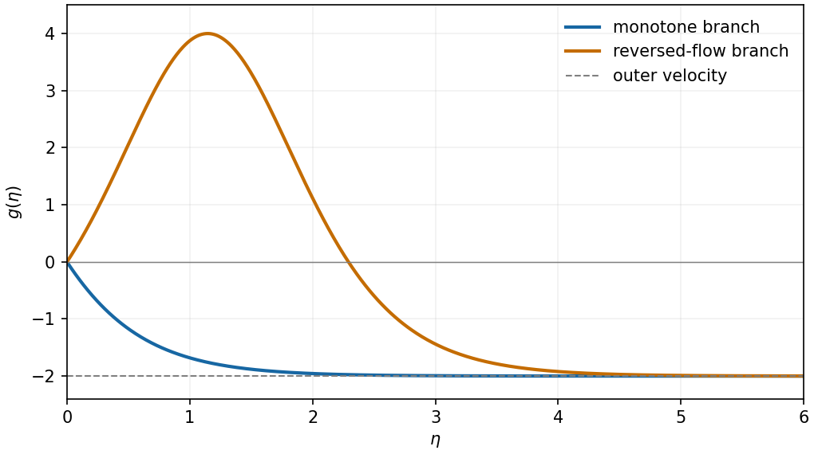

<h1 id="a/2/c/solution">Solution</h1>

↑ **Parent:** [C](../c.md)

At these parameters the equation becomes $g''+g^2-4=0$, where $g=f'$. Multiply by $g'$ and integrate:

$$
\frac12(g')^2+\frac13g^3-4g=C.
$$

Outer matching gives $g\to-2$ and $g'\to0$, so $C=16/3$. No slip gives $g(0)=0$. At that point the [first integral](../../../../../first-integral.md) fixes $g'(0)=\pm4\sqrt{2/3}$, so there are exactly two smooth initial-value solutions of the second-order equation satisfying the matching condition. Put $\eta_0=\operatorname{arctanh}\sqrt{2/3}$. Translation invariance of the supplied profile gives them explicitly:

$$
\boxed{g_-(\eta)=4-6\tanh^2(\eta+\eta_0),\qquad
 g_+(\eta)=4-6\tanh^2(\eta-\eta_0).}
$$

The first decreases monotonically from zero to $-2$. The second first rises to $4$ at $\eta_0$, crosses zero again at $2\eta_0$, and then tends to $-2$. Integrating either profile from zero recovers $f$ with $f(0)=0$.

**[Figure 1](#a/2/c/image-two-translated-similarity-profiles-monotone-outer-flow-matching-and-a-branch-with-an-internal-reversed-flow-region). Two translated similarity profiles: monotone outer-flow matching and a branch with an internal reversed-flow region**.

One would **not expect both branches to be equally stable**. The rising branch contains flow opposite to its negative outer stream and interior [inflection points](../../../../../inflection-point.md), typical ingredients for [shear instability](../../../../../shear-instability.md). The monotone branch has $g''=4-g^2>0$ at finite positive $\eta$ and no interior [inflection point](../../../../../inflection-point.md), so the classical inviscid inflection-point mechanism is absent there. This motivates expecting the reversed-flow branch to be unstable and the monotone branch to be the stable candidate. A definitive viscous temporal-stability result requires perturbing the time-dependent equations; the steady [first integral](../../../../../first-integral.md) alone is not a stability proof.

## ↑ Ancestors (13)

1. [C](../c.md)
2. [2](../../2.md)
3. [A](../../../a.md)
4. [2010](../../../../2010-split.md)
5. [Past exam of the theoretical mechanics course of the University of Oxford](../../../../split.md)
6. [Theoretical mechanics course of the University of Oxford](../../../../../theoretical-mechanics-course-of-the-university-of-oxford.md)
7. [Year 3 of the mathematics course of the University of Oxford](../../../../../year-3-of-the-mathematics-course-of-the-university-of-oxford.md)
8. [Mathematics course of the University of Oxford](../../../../../mathematics-course-of-the-university-of-oxford.md)
9. [Undergraduate course of the University of Oxford](../../../../../undergraduate-course-of-the-university-of-oxford.md)
10. [Course of the University of Oxford](../../../../../course-of-the-university-of-oxford.md)
11. [University of Oxford](../../../../../university-of-oxford-split.md)
12. [List of universities](../../../../../list-of-universities.md)
13. [Codex Wiki](../../../../../split.md)
