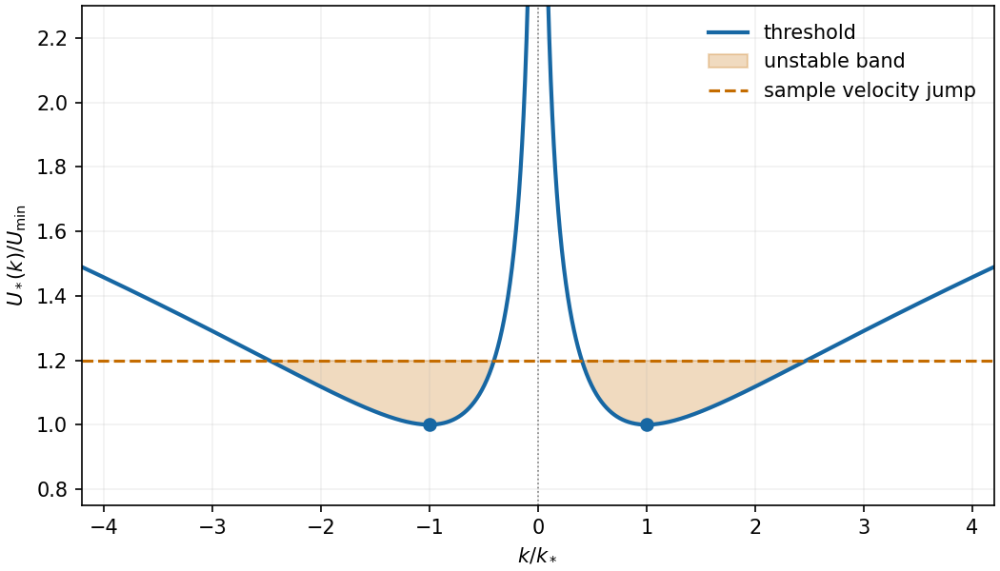

<h1 id="b/5/b/iv/solution">Solution</h1>

↑ **Parent:** [Iv](../iv.md)

For positive [surface tension](../../../../../../surface-tension-split.md) the threshold is even in $k$, tends to infinity as $k\to0$ and as $|k|\to\infty$, and has its two equal minima at

$$
\boxed{|k|=k_*=\sqrt{\Delta g/\gamma}.}
$$

Minimizing $\Delta g/q+\gamma q$ for $q>0$ gives

$$
\boxed{U_{\min}=\left[\frac{2\Sigma}{\rho_1\rho_2}\sqrt{\Delta g\gamma}\right]^{1/2}.}
$$

Thus the initial state has some exponentially growing mode exactly when $|U|>U_{\min}$. If $D=\rho_1\rho_2U^2/\Sigma$, the unstable band is

$$
\boxed{q_-<|k|<q_+,\qquad
q_\pm=\frac{D\pm\sqrt{D^2-4\gamma\Delta g}}{2\gamma}.}
$$

[Gravity](../../../../../../gravity.md) suppresses long wavelengths and [surface tension](../../../../../../surface-tension-split.md) suppresses short ones; intermediate wavelengths become unstable when the shear is large enough.

**[Figure 2](#b/5/b/iv/image-even-instability-threshold-with-minima-at-the-gravity-capillary-balance-the-sample-shear-destabilizes-the-shaded-intermediate-bands). Even instability threshold with minima at the gravity-capillary balance; the sample shear destabilizes the shaded intermediate bands**.

## ↑ Ancestors (14)

1. [Iv](../iv.md)
2. [B](../../b.md)
3. [5](../../../5.md)
4. [B](../../../../b.md)
5. [2010](../../../../../2010-split.md)
6. [Past exam of the theoretical mechanics course of the University of Oxford](../../../../../split.md)
7. [Theoretical mechanics course of the University of Oxford](../../../../../../theoretical-mechanics-course-of-the-university-of-oxford.md)
8. [Year 3 of the mathematics course of the University of Oxford](../../../../../../year-3-of-the-mathematics-course-of-the-university-of-oxford.md)
9. [Mathematics course of the University of Oxford](../../../../../../mathematics-course-of-the-university-of-oxford.md)
10. [Undergraduate course of the University of Oxford](../../../../../../undergraduate-course-of-the-university-of-oxford.md)
11. [Course of the University of Oxford](../../../../../../course-of-the-university-of-oxford.md)
12. [University of Oxford](../../../../../../university-of-oxford-split.md)
13. [List of universities](../../../../../../list-of-universities.md)
14. [Codex Wiki](../../../../../../split.md)
