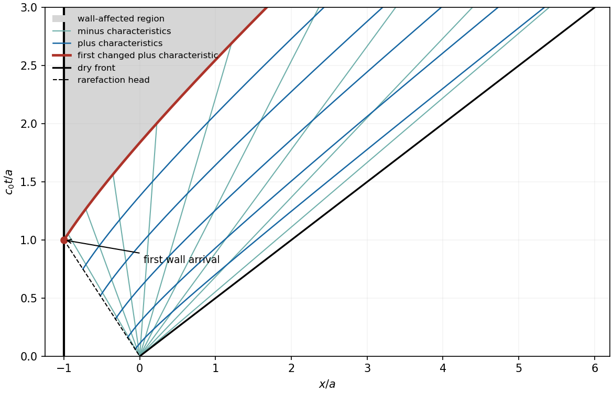

<h1 id="b/6/b/i/solution">Solution</h1>

↑ **Parent:** [I](../i.md)

Before a signal traveling left at speed $c_0$ can reach the wall, the portion $-a<x<-c_0t$ remains at rest with $c=c_0$, $h=h_0$. In the rarefaction fan, right-running characteristics bring the unchanged invariant $Q_+=2c_0$. The left-running family originates at the removed dam and has speed $u-c=x/t$. Solving these two relations gives

$$
u=\frac23(c_0+x/t),\qquad c=\frac13(2c_0-x/t).
$$

At the dry front $c=0$, so its speed and location are $2c_0$ and $2c_0t$, consistent with the stated constant-speed condition. Therefore, for $0<t<a/c_0$,

$$
\boxed{c(x,t)=\begin{cases}c_0,&-a<x<-c_0t,\\
(2c_0-x/t)/3,&-c_0t\leq x<2c_0t,
\end{cases}}
$$

$$
\boxed{h(x,t)=\begin{cases}h_0,&-a<x<-c_0t,\\
(2c_0-x/t)^2/(9g),&-c_0t\leq x<2c_0t.
\end{cases}}
$$

The [velocity](../../../../../../velocity.md) is zero in the untouched region and $2(c_0+x/t)/3$ in the fan. Ahead of the front there is no fluid, so $h=c=0$ and a fluid [velocity](../../../../../../velocity.md) need not be assigned. In particular the wall remains at $u=0,c=c_0$ until time $a/c_0$.

**[Figure 3](#b/6/b/i/image-dam-break-characteristics-in-units-with-a-and-c0-equal-to-one-the-wall-first-affects-the-fan-at-time-one). Dam-break characteristics in units with a and c0 equal to one; the wall first affects the fan at time one**.

## ↑ Ancestors (14)

1. [I](../i.md)
2. [B](../../b.md)
3. [6](../../../6.md)
4. [B](../../../../b.md)
5. [2010](../../../../../2010-split.md)
6. [Past exam of the theoretical mechanics course of the University of Oxford](../../../../../split.md)
7. [Theoretical mechanics course of the University of Oxford](../../../../../../theoretical-mechanics-course-of-the-university-of-oxford.md)
8. [Year 3 of the mathematics course of the University of Oxford](../../../../../../year-3-of-the-mathematics-course-of-the-university-of-oxford.md)
9. [Mathematics course of the University of Oxford](../../../../../../mathematics-course-of-the-university-of-oxford.md)
10. [Undergraduate course of the University of Oxford](../../../../../../undergraduate-course-of-the-university-of-oxford.md)
11. [Course of the University of Oxford](../../../../../../course-of-the-university-of-oxford.md)
12. [University of Oxford](../../../../../../university-of-oxford-split.md)
13. [List of universities](../../../../../../list-of-universities.md)
14. [Codex Wiki](../../../../../../split.md)
