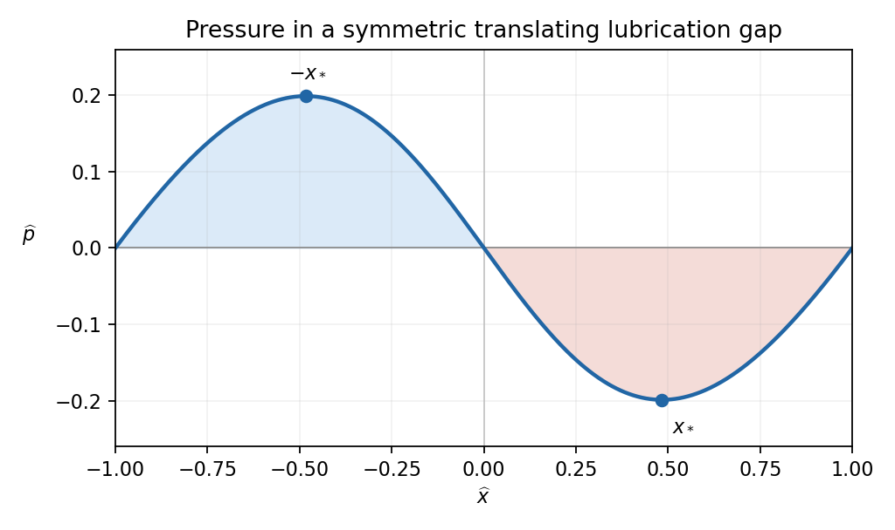

# 2011

↑ **Parent:** [Past exam of the theoretical mechanics course of the University of Oxford](../past-exam-of-the-theoretical-mechanics-course-of-the-university-of-oxford.md)

Source release: [Oxford examination archive release thread](https://www.whatdotheyknow.com/request/maths_past_papers_3), Part B bundle pages 284–290. The cover identifies Theoretical Mechanics, paper B6, Friday 17 June 2011. Section A concerns viscous flow and section B [waves](../wave.md) and compressible flow.

Answer availability checked on 28 October 2026: bounded official Oxford searches by exact year, title, module and formal code found no full-paper or selected-part solution advertisement. No release policy for later years was assumed to cover 2011.

**Table of contents**

- [A](#a)
  - [1](#a/1)
    - [a](#a/1/a)
      - [i](#a/1/a/i)
        - [Solution](#a/1/a/i/solution)
      - [ii](#a/1/a/ii)
        - [Solution](#a/1/a/ii/solution)
      - [iii](#a/1/a/iii)
        - [Solution](#a/1/a/iii/solution)
    - [b](#a/1/b)
      - [i](#a/1/b/i)
        - [Solution](#a/1/b/i/solution)
      - [ii](#a/1/b/ii)
        - [Solution](#a/1/b/ii/solution)
  - [2](#a/2)
    - [a](#a/2/a)
      - [i](#a/2/a/i)
        - [Solution](#a/2/a/i/solution)
      - [ii](#a/2/a/ii)
        - [Solution](#a/2/a/ii/solution)
    - [b](#a/2/b)
      - [i](#a/2/b/i)
        - [Solution](#a/2/b/i/solution)
      - [ii](#a/2/b/ii)
        - [Solution](#a/2/b/ii/solution)
      - [iii](#a/2/b/iii)
        - [Solution](#a/2/b/iii/solution)
  - [3](#a/3)
    - [a](#a/3/a)
      - [i](#a/3/a/i)
        - [Solution](#a/3/a/i/solution)
      - [ii](#a/3/a/ii)
        - [Solution](#a/3/a/ii/solution)
    - [b](#a/3/b)
      - [i](#a/3/b/i)
        - [Solution](#a/3/b/i/solution)
      - [ii](#a/3/b/ii)
        - [Solution](#a/3/b/ii/solution)
- [B](#b)
  - [4](#b/4)
    - [a](#b/4/a)
      - [Solution](#b/4/a/solution)
    - [b](#b/4/b)
      - [Solution](#b/4/b/solution)
    - [c](#b/4/c)
      - [Solution](#b/4/c/solution)
  - [5](#b/5)
    - [a](#b/5/a)
      - [i](#b/5/a/i)
        - [Solution](#b/5/a/i/solution)
      - [ii](#b/5/a/ii)
        - [Solution](#b/5/a/ii/solution)
    - [b](#b/5/b)
      - [i](#b/5/b/i)
        - [Solution](#b/5/b/i/solution)
      - [ii](#b/5/b/ii)
        - [Solution](#b/5/b/ii/solution)
      - [iii](#b/5/b/iii)
        - [Solution](#b/5/b/iii/solution)
      - [iv](#b/5/b/iv)
        - [Solution](#b/5/b/iv/solution)
  - [6](#b/6)
    - [a](#b/6/a)
      - [i](#b/6/a/i)
        - [Solution](#b/6/a/i/solution)
      - [ii](#b/6/a/ii)
        - [Solution](#b/6/a/ii/solution)
      - [iii](#b/6/a/iii)
        - [Solution](#b/6/a/iii/solution)
    - [b](#b/6/b)
      - [i](#b/6/b/i)
        - [Solution](#b/6/b/i/solution)
      - [ii](#b/6/b/ii)
        - [Solution](#b/6/b/ii/solution)
      - [iii](#b/6/b/iii)
        - [Solution](#b/6/b/iii/solution)

## A

↑ **Parent:** [2011](2011.md)

<h3 id="a/1">1</h3>

↑ **Parent:** [A](#a)

<h4 id="a/1/a">a</h4>

↑ **Parent:** [1](#a/1)

<h5 id="a/1/a/i">i</h5>

↑ **Parent:** [A](#a/1/a)

<h6 id="a/1/a/i/solution">Solution</h6>

↑ **Parent:** [I](#a/1/a/i)

For a material [volume](../geometry-and-topology.md#volume) moving with the [fluid](../fluid-mechanics.md#fluid), the [Reynolds transport theorem](../continuum-mechanics.md#reynolds-transport-theorem) gives, componentwise,

$$
\frac d{dt}\int_{V(t)}q\,dV=\int_{V(t)}\bigl(\partial_tq+\nabla\cdot(q\mathbf u)\bigr)\,dV.
$$

For a scalar $q$ this is also $\int_{V(t)}(Dq/Dt+q\nabla\cdot\mathbf u)dV$. Apply the component formula to [momentum](../momentum.md) [density](../fluid-mechanics.md#density) $q=\rho u_i$. Constant [density](../fluid-mechanics.md#density) and [incompressibility](../fluid-mechanics.md#incompressible-flow) make the integrand $\rho Du_i/Dt$.

The [traction](../continuum-mechanics.md#traction) $\mathbf t(\mathbf n)$ is the [force](../force.md) per unit [area](../differential-geometry.md#surface-area) exerted by the material outside a surface on the material inside, with outward [unit normal](../differential-geometry.md#unit-normal) $\mathbf n$. Reversing the normal exchanges the two sides of the same internal surface. Thus $\mathbf t(-\mathbf n)=-\mathbf t(\mathbf n)$ expresses equal and opposite internal contact [forces](../force.md), the local form of [Newton's third law](../force.md#newton-s-third-law).

With no [body force](../fluid-mechanics.md#body-force), [Newton's second law](../force.md#newton-s-second-law) equates the rate of change of the material [volume](../geometry-and-topology.md#volume)'s total [momentum](../momentum.md) to its surface [force](../force.md). Combining this balance with the transport theorem gives

$$
\boxed{\int_{V(t)}\rho\frac{D\mathbf u}{Dt}\,dV=\int_{\partial V(t)}\mathbf t(\mathbf n)\,dS.}
$$

This is a [vector](../vector-space.md#vector) identity, since the component argument applies to each direction.

<h5 id="a/1/a/ii">ii</h5>

↑ **Parent:** [A](#a/1/a)

<h6 id="a/1/a/ii/solution">Solution</h6>

↑ **Parent:** [Ii](#a/1/a/ii)

Define $\sigma_{ij}=\mathbf e_i\cdot\mathbf t(\mathbf e_j)$: the second index labels the normal direction of a coordinate face, and the first labels the [force](../force.md) component. These nine entries form the [Cauchy stress tensor](../continuum-mechanics.md#cauchy-stress-tensor).

Take a small tetrahedron with oblique face of [area](../differential-geometry.md#surface-area) $S$ and outward normal $\mathbf n$. First suppose $n_j>0$; its other three faces have normals $-\mathbf e_j$ and areas $S_j=n_jS$, by [orthogonal](../inner-product.md#orthogonal-vectors) projection of the oblique face. The total surface [force](../force.md) is

$$
S\mathbf t(\mathbf n)+\sum_jS_j\mathbf t(-\mathbf e_j).
$$

If its linear size is $\ell$, its inertia is $O(\ell^3)$ while its surface [forces](../force.md) are $O(\ell^2)$. Divide the [momentum](../momentum.md) balance by $S$ and shrink the tetrahedron to the point. Smoothness of the stress and the odd-normal relation then give $\mathbf t(\mathbf n)=\sum_jn_j\mathbf t(\mathbf e_j)$. Choosing coordinate faces with the appropriate reversed normals gives the same identity in the other octants. In components,

$$
\boxed{\mathbf t(\mathbf n)=\sum_{i,j}\mathbf e_i\sigma_{ij}n_j=\boldsymbol\sigma\mathbf n.}
$$

The face-[area](../differential-geometry.md#surface-area) relations used are exactly $S_j=|n_j|S$, with each coordinate face oriented opposite the corresponding component of the oblique normal.

<h5 id="a/1/a/iii">iii</h5>

↑ **Parent:** [A](#a/1/a)

<h6 id="a/1/a/iii/solution">Solution</h6>

↑ **Parent:** [Iii](#a/1/a/iii)

Insert the [traction](../continuum-mechanics.md#traction) formula into the material-[volume](../geometry-and-topology.md#volume) balance and apply the [divergence theorem](../multivariable-calculus.md#divergence-theorem) to each row of the [stress tensor](../continuum-mechanics.md#cauchy-stress-tensor):

$$
\int_{V(t)}\rho\frac{Du_i}{Dt}\,dV=\int_{\partial V(t)}\sigma_{ij}n_j\,dS=\int_{V(t)}\partial_j\sigma_{ij}\,dV.
$$

The [volume](../geometry-and-topology.md#volume) is arbitrary, so continuity of the fields gives the local [Cauchy momentum equation](../continuum-mechanics.md#cauchy-momentum-equation)

$$
\boxed{\rho\frac{D\mathbf u}{Dt}=\mathbf e_i\frac{\partial\sigma_{ij}}{\partial x_j}.}
$$

For an incompressible [Newtonian fluid](../viscous-fluid-flow.md#newtonian-fluid), the constitutive law is

$$
\boxed{\sigma_{ij}=-p\delta_{ij}+\mu(\partial_ju_i+\partial_iu_j).}
$$

Here the [pressure](../pressure.md) enforces [incompressibility](../fluid-mechanics.md#incompressible-flow), and the viscous stress is twice the [viscosity](../dynamic-viscosity.md) times the symmetric rate-of-strain [tensor](../multilinear-algebra.md#tensor). With constant $\mu$,

$$
\partial_j\sigma_{ij}=-\partial_ip+\mu\nabla^2u_i+\mu\partial_i(\partial_ju_j)=-\partial_ip+\mu\nabla^2u_i.
$$

Using $D/Dt=\partial_t+\mathbf u\cdot\nabla$ proves the stated [Navier-Stokes equations](../viscous-fluid-flow.md#navier-stokes-equation).

<h4 id="a/1/b">b</h4>

↑ **Parent:** [1](#a/1)

<h5 id="a/1/b/i">i</h5>

↑ **Parent:** [B](#a/1/b)

<h6 id="a/1/b/i/solution">Solution</h6>

↑ **Parent:** [I](#a/1/b/i)

The only [velocity](../classical-mechanics.md#velocity) component is axial, so [incompressibility](../fluid-mechanics.md#incompressible-flow) gives $\partial_zw=0$. Thus $w=w(x,y)$, and the steady convective [acceleration](../classical-mechanics.md#acceleration) is $w\partial_z(w\mathbf k)=0$. The transverse [momentum](../momentum.md) equations give $p_x=p_y=0$, so $p=p(z)$. The axial [momentum](../momentum.md) equation is therefore

$$
\boxed{\mu(w_{xx}+w_{yy})=p'(z).}
$$

Its left side depends only on $x,y$, while its right side depends only on $z$. Equality throughout the pipe [forces](../force.md) both to be one constant, say $G$. Consequently **the axial [pressure gradient](../fluid-mechanics.md#pressure-gradient) is constant**, and $p(z)=Gz+p_*$. This is absence of dependence on a coordinate, rather than probabilistic independence.

<h5 id="a/1/b/ii">ii</h5>

↑ **Parent:** [B](#a/1/b)

<h6 id="a/1/b/ii/solution">Solution</h6>

↑ **Parent:** [Ii](#a/1/b/ii)

For [equilateral triangular pipe flow](../viscous-fluid-flow.md#equilateral-triangular-pipe-flow), the [polynomial](../polynomial.md) vanishes on all three walls, so it satisfies [no-slip boundary conditions](../viscous-fluid-flow.md#no-slip-boundary-condition). Direct differentiation gives

$$
\nabla_\perp^2\bigl[(x^2-3y^2)(x-a)\bigr]=(6x-2a)+(-6x+6a)=4a.
$$

Thus

$$
\boxed{A=\frac{G}{4a\mu},\qquad G=\frac{dp}{dz}.}
$$

For $G<0$, $A<0$ and the [velocity](../classical-mechanics.md#velocity) is positive in the triangular interior.

At the wall $x=a$, the outward normal of the [fluid](../fluid-mechanics.md#fluid) is $\mathbf e_x$. The axial [traction](../continuum-mechanics.md#traction) exerted by the wall on the [fluid](../fluid-mechanics.md#fluid) is $\mu w_x$, so the [fluid](../fluid-mechanics.md#fluid) exerts the opposite axial [traction](../continuum-mechanics.md#traction) on the wall. Since $w_x(a,y)=A(a^2-3y^2)$, the [force](../force.md) per unit axial length is

$$
\frac{\mathbf F}{\text{axial length}}=-\mu A\mathbf k\int_{-a/\sqrt3}^{a/\sqrt3}(a^2-3y^2)\,dy
=-\mu A\frac{4a^3}{3\sqrt3}\mathbf k
=\boxed{-\frac{a^2}{3\sqrt3}\frac{dp}{dz}\,\mathbf k.}
$$

It points with the flow for a negative axial [pressure gradient](../fluid-mechanics.md#pressure-gradient). As a check, the triangular [area](../differential-geometry.md#surface-area) is $a^2/\sqrt3$, so the total [pressure](../pressure.md) driving [force](../force.md) per unit length is $-Ga^2/\sqrt3$; each of the three equivalent walls receives one third.

<h3 id="a/2">2</h3>

↑ **Parent:** [A](#a)

<h4 id="a/2/a">a</h4>

↑ **Parent:** [2](#a/2)

<h5 id="a/2/a/i">i</h5>

↑ **Parent:** [A](#a/2/a)

<h6 id="a/2/a/i/solution">Solution</h6>

↑ **Parent:** [I](#a/2/a/i)

Take the tangential length and [velocity](../classical-mechanics.md#velocity) scales as order one. In the [boundary layer](../continuum-mechanics.md#boundary-layer), continuity reads $u_x+(\delta_2/\delta_1)V_Y=0$, so a nontrivial balance requires $\delta_2\sim\delta_1$. Tangential inertia is order one, and the normal viscous term has size $\mathrm{Re}^{-1}\delta_1^{-2}$. Balancing them gives

$$
\boxed{\delta_1=\delta_2=\mathrm{Re}^{-1/2}}
$$

up to constants absorbable in the scaled variables. Streamwise diffusion is then smaller by $\mathrm{Re}^{-1}$. The normal [momentum](../momentum.md) equation has a [pressure](../pressure.md) term of size $\delta_1^{-1}p_Y$ and inertial/viscous terms of size $\delta_1$, hence $p_Y=0$ at leading order. The remaining [Prandtl boundary-layer equations](../viscous-fluid-flow.md#prandtl-boundary-layer-equation) are

$$
\boxed{uu_x+Vu_Y=-p_x+u_{YY},\qquad p_Y=0,\qquad u_x+V_Y=0.}
$$

The [boundary conditions](../differential-equation.md#boundary-condition) are **no slip and no penetration at the plate, and matching to the outer tangential [velocity](../classical-mechanics.md#velocity)**:

$$
\boxed{u(x,0)=0,\qquad V(x,0)=0,\qquad u(x,Y)\longrightarrow U_s(x)\quad(Y\to\infty).}
$$

The outer inviscid tangential [momentum](../momentum.md) equation supplies $p_x=-U_sU_s'$; [pressure](../pressure.md) is shared between the [boundary layer](../continuum-mechanics.md#boundary-layer) and outer flow because it has no leading normal variation.

<h5 id="a/2/a/ii">ii</h5>

↑ **Parent:** [A](#a/2/a)

<h6 id="a/2/a/ii/solution">Solution</h6>

↑ **Parent:** [Ii](#a/2/a/ii)

Continuity allows a [stream function](../fluid-mechanics.md#stream-function) with $u=\Psi_Y$ and $V=-\Psi_x$. Substituting these into the tangential equation gives

$$
uu_x+Vu_Y=\Psi_Y\Psi_{xY}-\Psi_x\Psi_{YY}.
$$

The outer inviscid equation gives $-p_x=U_sU_s'$, while $u_{YY}=\Psi_{YYY}$. Thus

$$
\boxed{\Psi_Y\Psi_{xY}-\Psi_x\Psi_{YY}=U_sU_s'+\Psi_{YYY}.}
$$

The wall no-penetration condition makes $\Psi$ constant along the wall; its additive freedom may be used to set that constant to zero.

<h4 id="a/2/b">b</h4>

↑ **Parent:** [2](#a/2)

<h5 id="a/2/b/i">i</h5>

↑ **Parent:** [B](#a/2/b)

<h6 id="a/2/b/i/solution">Solution</h6>

↑ **Parent:** [I](#a/2/b/i)

For a [boundary layer with exponentially varying outer velocity](../viscous-fluid-flow.md#boundary-layer-with-exponentially-varying-outer-velocity), the ansatz has $u=\Psi_Y=e^{(\beta+\gamma)x}f'(\eta)$. Matching it to $Ae^{\alpha x}$ requires $\beta+\gamma=\alpha$ and $f'(\infty)=A$. The nonlinear terms in the stream-[function](../function.md) equation scale as $e^{2(\beta+\gamma)x}$, whereas $\Psi_{YYY}$ scales as $e^{(\beta+3\gamma)x}$. Matching exponents gives $\beta=\gamma$, hence

$$
\boxed{\beta=\gamma=\alpha/2.}
$$

More explicitly,

$$
\Psi_Y\Psi_{xY}-\Psi_x\Psi_{YY}
=e^{2\alpha x}\left[\alpha(f')^2-\frac\alpha2ff''\right],\qquad
\Psi_{YYY}=e^{2\alpha x}f''',\qquad U_sU_s'=\alpha A^2e^{2\alpha x}.
$$

Canceling the common factor gives

$$
\boxed{f'''+\frac\alpha2ff''+\alpha\bigl(A^2-(f')^2\bigr)=0.}
$$

Together with $f(0)=0$, the other two conditions are

$$
\boxed{f'(0)=0,\qquad f'(\eta)\longrightarrow A\quad(\eta\to\infty).}
$$

They represent wall no slip and outer-flow matching, respectively.

<h5 id="a/2/b/ii">ii</h5>

↑ **Parent:** [B](#a/2/b)

<h6 id="a/2/b/ii/solution">Solution</h6>

↑ **Parent:** [Ii](#a/2/b/ii)

Use [autonomous third-order reduction using the dependent variable](../differential-equation.md#autonomous-third-order-reduction-using-the-dependent-variable). On a monotone branch where $f$ can serve as the independent variable, the [chain rule](../calculus.md#chain-rule) gives

$$
f''=GG_f,\qquad f'''=G(G_f^2+GG_{ff}).
$$

Therefore the reduced second-order equation is

$$
\boxed{G^2G_{ff}+G(G_f)^2+\frac\alpha2 fGG_f+\alpha(A^2-G^2)=0.}
$$

The wall and matching conditions become

$$
\boxed{G(0)=0,\qquad G(f)\longrightarrow A\text{ as }f\to\operatorname{sgn}(A)\infty.}
$$

For the usual positive outer flow this is the limit $f\to+\infty$. The reduced equation is singular at $G=0$: if $f''(0)=b\ne0$, then $f\sim b\eta^2/2$ and $G\sim b\eta$, so $G$ has square-root behavior as a [function](../function.md) of $f$ near the wall. A finite value for $G_f(0)$ should not be imposed as an extra [boundary condition](../differential-equation.md#boundary-condition).

<h5 id="a/2/b/iii">iii</h5>

↑ **Parent:** [B](#a/2/b)

<h6 id="a/2/b/iii/solution">Solution</h6>

↑ **Parent:** [Iii](#a/2/b/iii)

An attached similarity profile must approach $f'\to A$ as $\eta\to\infty$. Linearizing about $f\sim A\eta+\text{constant}$ gives, for the small [velocity](../classical-mechanics.md#velocity) correction $g=f'-A$,

$$
g''+\frac{\alpha A}{2}\eta g'-2\alpha A g\simeq0.
$$

When $\alpha A>0$, one independent far-field correction decays with a Gaussian factor; when $\alpha A<0$, the two nontrivial asymptotic modes grow, one algebraically and one exponentially, so a nonconstant wall profile cannot decay into the prescribed outer flow. Thus the attached exponential similarity construction requires

$$
\boxed{\alpha A>0.}
$$

Equivalently the outer speed increases along the direction of motion, giving a favorable [pressure gradient](../fluid-mechanics.md#pressure-gradient). In the intended flow away from the leading edge along positive $x$, this means **$A>0$ and $\alpha>0$**. The sign-reversed choice $A<0,\alpha<0$ describes locally favorable flow in the opposite direction; it is not a layer developing downstream from the stated leading edge.

The asymptotic approximation also requires a geometrically thin layer, away from the leading-edge region. Comparing its thickness with the streamwise variation length $1/|\alpha|$ gives the local condition $\mathrm{Re}|A|e^{\alpha x}/|\alpha|\gg1$. An exponentially decaying outer speed eventually violates this condition on an infinite downstream interval. These scale and orientation requirements distinguish formal similarity reduction from a uniformly valid attached [boundary layer](../continuum-mechanics.md#boundary-layer).

<h3 id="a/3">3</h3>

↑ **Parent:** [A](#a)

<h4 id="a/3/a">a</h4>

↑ **Parent:** [3](#a/3)

<h5 id="a/3/a/i">i</h5>

↑ **Parent:** [A](#a/3/a)

<h6 id="a/3/a/i/solution">Solution</h6>

↑ **Parent:** [I](#a/3/a/i)

Let $\mathrm{Re}=\rho UL/\mu$ and use the given anisotropic scales. Continuity makes the transverse [velocity](../classical-mechanics.md#velocity) scale $\delta U$ consistent with the gap height $\delta L$. The streamwise viscous stress [divergence](../multivariable-calculus.md#divergence) has scale $\mu U/(\delta^2L^2)$, while the streamwise [pressure gradient](../fluid-mechanics.md#pressure-gradient) has scale $\Pi/L$. Their balance selects

$$
\boxed{\Pi=\frac{\mu U}{\delta^2L}.}
$$

The streamwise equation then has the dimensionless form

$$
\delta^2\mathrm{Re}(\widehat u\widehat u_{\widehat x}+\widehat w\widehat u_{\widehat z})
=-\widehat p_{\widehat x}+\widehat u_{\widehat z\widehat z}+\delta^2\widehat u_{\widehat x\widehat x}.
$$

The normal equation becomes

$$
\delta^4\mathrm{Re}(\widehat u\widehat w_{\widehat x}+\widehat w\widehat w_{\widehat z})
=-\widehat p_{\widehat z}+\delta^2\widehat w_{\widehat z\widehat z}+\delta^4\widehat w_{\widehat x\widehat x}.
$$

When $\delta\ll1$ and $\delta^2\mathrm{Re}\ll1$, neglecting the indicated smaller terms gives

$$
\boxed{\widehat u_{\widehat z\widehat z}=\widehat p_{\widehat x},\qquad\widehat p_{\widehat z}=0,\qquad
\widehat u_{\widehat x}+\widehat w_{\widehat z}=0.}
$$

The bottom conditions express **no slip on a plate moving at speed $U$ and no penetration**. The top conditions express **no slip and no penetration on the stationary wall**. The leading [pressure](../pressure.md) is a [function](../function.md) of the streamwise coordinate alone.

<h5 id="a/3/a/ii">ii</h5>

↑ **Parent:** [A](#a/3/a)

<h6 id="a/3/a/ii/solution">Solution</h6>

↑ **Parent:** [Ii](#a/3/a/ii)

Suppress hats temporarily. Mass conservation between any two cross-sections, together with impermeability of both walls, makes their fluxes equal. Where the wall is differentiable, the same result follows locally by differentiating the [flux](../mathematical-physics.md#flux) with a variable upper limit and using continuity gives

$$
Q'(x)=\int_0^{h(x)}u_x\,dz+u(x,h)h'=-\int_0^hw_z\,dz=-(w(x,h)-w(x,0))=0.
$$

Both the upper-limit term and the boundary velocities vanish by the wall conditions. Thus **the [flux](../mathematical-physics.md#flux) is constant**. Since $p=p(x)$, integrate $u_{zz}=p'(x)$ twice and impose $u(0)=1$, $u(h)=0$:

$$
\boxed{u(x,z)=1-\frac zh+\frac{p'}2z(z-h).}
$$

Integrating across the gap gives $Q=h/2-p'h^3/12$. Restoring hats,

$$
\boxed{\frac{d\widehat p}{d\widehat x}=\frac{6(\widehat h-2Q)}{\widehat h^3},\qquad
\widehat p(-1)=\widehat p(1)=0.}
$$

The endpoint conditions are the specified equal reservoir pressures after subtracting $p_0$ and dividing by the [pressure](../pressure.md) scale.

<h4 id="a/3/b">b</h4>

↑ **Parent:** [3](#a/3)

<h5 id="a/3/b/i">i</h5>

↑ **Parent:** [B](#a/3/b)

<h6 id="a/3/b/i/solution">Solution</h6>

↑ **Parent:** [I](#a/3/b/i)

The [flux average for a translating lubrication gap](../viscous-fluid-flow.md#flux-average-for-a-translating-lubrication-gap) follows by integrating the [pressure gradient](../fluid-mechanics.md#pressure-gradient) between the endpoints:

$$
0=6\int_{-1}^1\frac{\widehat h-2Q}{\widehat h^3}\,d\widehat x.
$$

If $2Q$ were smaller than the minimum height, the integrand would be strictly positive everywhere, contradicting zero total [pressure](../pressure.md) change. If it were larger than the maximum, the integrand would be strictly negative. Therefore

$$
\boxed{\min\widehat h\leq2Q\leq\max\widehat h.}
$$

Equivalently,

$$
2Q=\frac{\int_{-1}^1\widehat h^{-2}\,d\widehat x}{\int_{-1}^1\widehat h^{-3}\,d\widehat x}
$$

is a weighted average of the height with strictly positive weight $\widehat h^{-3}$. This also identifies the constant [flux](../mathematical-physics.md#flux) uniquely.

<h5 id="a/3/b/ii">ii</h5>

↑ **Parent:** [B](#a/3/b)

<h6 id="a/3/b/ii/solution">Solution</h6>

↑ **Parent:** [Ii](#a/3/b/ii)

For [pressure lobes in a symmetric translating lubrication gap](../viscous-fluid-flow.md#pressure-lobes-in-a-symmetric-translating-lubrication-gap), the height integrals are

$$
\int_{-1}^1\widehat h^{-2}\,d\widehat x=\int_{-1}^1\frac{d\widehat x}{1+\widehat x^2}=\frac\pi2,\qquad
\int_{-1}^1\widehat h^{-3}\,d\widehat x=\left[\frac{\widehat x}{\sqrt{1+\widehat x^2}}\right]_{-1}^1=\sqrt2.
$$

Hence

$$
\boxed{Q=\frac\pi{4\sqrt2}.}
$$

The denominator of the [pressure gradient](../fluid-mechanics.md#pressure-gradient) is positive. Its numerator changes sign when $\sqrt{1+\widehat x^2}=\pi/(2\sqrt2)$, that is at $\widehat x=\pm x_*$ with $x_*=(\pi^2/8-1)^{1/2}$. The [gradient](../multivariable-calculus.md#gradient) is positive for $|\widehat x|>x_*$, zero at those two points, and negative for $|\widehat x|<x_*$. Integration, with either endpoint condition, gives

$$
\boxed{\widehat p(\widehat x)=6\arctan\widehat x-\frac{3\pi}{\sqrt2}\frac{\widehat x}{\sqrt{1+\widehat x^2}}.}
$$

This [function](../function.md) is odd and vanishes at $-1,0,1$. It has a positive maximum at $-x_*$ and a negative minimum at $x_*$. Thus the sketch has a positive [pressure](../pressure.md) lobe in the converging left half of the gap and a negative gauge-[pressure](../pressure.md) lobe in the diverging right half.

**[Figure 1](#a/3/b/ii/image-the-lubrication-pressure-in-a-symmetric-translating-gap-and-its-two-stationary-points). The lubrication pressure in a symmetric translating gap and its two stationary points**.

<h2 id="b">B</h2>

↑ **Parent:** [2011](2011.md)

<h3 id="b/4">4</h3>

↑ **Parent:** [B](#b)

<h4 id="b/4/a">a</h4>

↑ **Parent:** [4](#b/4)

<h5 id="b/4/a/solution">Solution</h5>

↑ **Parent:** [A](#b/4/a)

Let $R(t)$ rotate [vectors](../vector-space.md#vector) from the rotating frame to the inertial frame. For any rotating-frame [vector](../vector-space.md#vector) $\mathbf a$, differentiating $R\mathbf a$ adds $R(\boldsymbol\Omega\times\mathbf a)$ to $R\dot{\mathbf a}$. Thus an inertial particle [velocity](../classical-mechanics.md#velocity) is $R(\mathbf u+\boldsymbol\Omega\times\mathbf x)$, and, for constant [angular velocity](../rigid-body-dynamics.md#angular-velocity), its [acceleration](../classical-mechanics.md#acceleration) is

$$
R\left[\frac{D\mathbf u}{Dt}+2\boldsymbol\Omega\times\mathbf u+\boldsymbol\Omega\times(\boldsymbol\Omega\times\mathbf x)\right].
$$

Insert this into the inertial [Euler equations](../euler-equations-for-an-inviscid-fluid.md) and express [forces](../force.md) in the rotating coordinates. This gives

$$
\boxed{\frac{D\mathbf u}{Dt}+2\boldsymbol\Omega\times\mathbf u+\boldsymbol\Omega\times(\boldsymbol\Omega\times\mathbf x)=-\rho^{-1}\nabla p+\mathbf g.}
$$

The additional terms are the [Coriolis acceleration](../mathematical-physics.md#coriolis-acceleration) and the centripetal term associated with frame rotation. There is no angular-[acceleration](../classical-mechanics.md#acceleration) term because $\boldsymbol\Omega$ is constant.

Write the conservative [body force](../fluid-mechanics.md#body-force) as $\mathbf g=-\nabla\Phi_g$. The supplied [vector](../vector-space.md#vector) identity gives $\boldsymbol\Omega\times(\boldsymbol\Omega\times\mathbf x)=-\tfrac12\nabla|\boldsymbol\Omega\times\mathbf x|^2$. For constant [density](../fluid-mechanics.md#density), define

$$
\boxed{P=p+\rho\Phi_g-\frac\rho2|\boldsymbol\Omega\times\mathbf x|^2.}
$$

Moving the centrifugal and conservative terms to the right then gives $\partial_t\mathbf u+(\mathbf u\cdot\nabla)\mathbf u+2\boldsymbol\Omega\times\mathbf u=-\rho^{-1}\nabla P$. Only the [gradient](../multivariable-calculus.md#gradient) of this reduced [pressure](../pressure.md) matters, so an additive spatial constant is immaterial.

<h4 id="b/4/b">b</h4>

↑ **Parent:** [4](#b/4)

<h5 id="b/4/b/solution">Solution</h5>

↑ **Parent:** [B](#b/4/b)

Linearize about rest, with the equilibrium [forces](../force.md) already absorbed in the reduced [pressure](../pressure.md). The quadratic convective [acceleration](../classical-mechanics.md#acceleration) drops out. Since $\mathbf k\times(u\mathbf i+v\mathbf j+w\mathbf k)=-v\mathbf i+u\mathbf j$, the component equations are

$$
\boxed{u_t-2\Omega v=-P_x/\rho,\qquad v_t+2\Omega u=-P_y/\rho,\qquad w_t=-P_z/\rho,\qquad u_x+v_y+w_z=0.}
$$

The scan prints $v_w$ in the [continuity equation](../mathematical-physics.md#continuity-equation); **the [derivative](../calculus.md#derivative) required by [incompressibility](../fluid-mechanics.md#incompressible-flow) is $v_y$**.

To eliminate [pressure](../pressure.md), put $\zeta=v_x-u_y$ and $\nabla_h^2=\partial_x^2+\partial_y^2$. Taking the vertical component of the [curl](../multivariable-calculus.md#curl) of [momentum](../momentum.md) gives

$$
\zeta_t+2\Omega(u_x+v_y)=0,\qquad\text{so}\qquad\zeta_t=2\Omega w_z.
$$

Taking horizontal [divergence](../multivariable-calculus.md#divergence) of [momentum](../momentum.md) and substituting continuity gives

$$
\rho^{-1}\nabla_h^2P=w_{zt}+2\Omega\zeta.
$$

Differentiate this in $z$ and use $P_z/\rho=-w_t$:

$$
\partial_t(\nabla^2w)+2\Omega\zeta_z=0.
$$

One more time [derivative](../calculus.md#derivative), followed by the [vorticity](../vorticity.md) relation, yields the [Poincaré equation for inertial waves](../geophysical-fluid-dynamics.md#poincare-equation-for-inertial-waves)

$$
\boxed{\partial_t^2(\nabla^2w)+4\Omega^2w_{zz}=0.}
$$

This derivation retains all three [velocity](../classical-mechanics.md#velocity) components, including the transverse component coupled by rotation.

<h4 id="b/4/c">c</h4>

↑ **Parent:** [4](#b/4)

<h5 id="b/4/c/solution">Solution</h5>

↑ **Parent:** [C](#b/4/c)

Write $\omega$ for the nonzero forcing [frequency](../wave.md#frequency), to distinguish it from the vertical [velocity](../classical-mechanics.md#velocity) $w$. Put $k_z=\pi/h$ and $Z(z)=\cos(\pi(2z+h)/(2h))=-\sin(k_zz)$. Then $Z(0)=Z(h)=0$ and $Z''=-k_z^2Z$, so it meets the rigid-wall conditions. Substituting $w=\operatorname{Re}(f(x)e^{-i\omega t}Z(z))$ into the scalar [wave](../wave.md) equation gives

$$
-\omega^2(f''-k_z^2f)-4\Omega^2k_z^2f=0,
$$

or

$$
\boxed{f''+k_z^2\left(\frac{4\Omega^2}{\omega^2}-1\right)f=0,\qquad f(0)=a.}
$$

The [radiation sign for an inertial wave](../geophysical-fluid-dynamics.md#radiation-sign-for-an-inertial-wave) must exclude any disturbance arriving from $x=+\infty$. This means an [radiation condition](../gravity-wave.md#radiation-condition) for propagating [waves](../wave.md), or bounded decay for an evanescent [wave](../wave.md).

For $0<|\omega|<2|\Omega|$, put $q=k_z\sqrt{4\Omega^2/\omega^2-1}$. The solutions are oscillatory. The [inertial-wave dispersion relation](../geophysical-fluid-dynamics.md#inertial-wave-dispersion-relation) is $\omega^2=4\Omega^2k_z^2/(k_x^2+k_z^2)$; its horizontal [group velocity](../dispersion-relation.md#group-velocity) is $c_{g,x}=-\omega k_x/(k_x^2+k_z^2)$. Positive energy transport into the channel therefore requires $k_x=-\operatorname{sgn}(\omega)q$. The solution is

$$
\boxed{w(x,z,t)=\operatorname{Re}\left[a\,e^{-i\operatorname{sgn}(\omega)qx-i\omega t}\cos\left(\frac\pi{2h}(2z+h)\right)\right].}
$$

For a positive [frequency](../wave.md#frequency), the phase travels towards negative $x$ while the [group velocity](../dispersion-relation.md#group-velocity) travels towards positive $x$. Choosing the outgoing sign from the [phase velocity](../dispersion-relation.md#phase-velocity) alone would give the wrong result.

For $|\omega|>2|\Omega|$, set $\kappa=k_z\sqrt{1-4\Omega^2/\omega^2}$. Excluding the exponentially growing solution gives

$$
\boxed{w(x,z,t)=\operatorname{Re}\left[a\,e^{-\kappa x-i\omega t}\cos\left(\frac\pi{2h}(2z+h)\right)\right].}
$$

This disturbance decays away from the wavemaker and does not propagate horizontally. At the cutoff the ODE degenerates to $f''=0$; zero [frequency](../wave.md#frequency) is not a nonzero forced harmonic mode with this vertical shape.

There is a second printed inconsistency: the stated [velocity](../classical-mechanics.md#velocity) $u\mathbf i+w\mathbf k$, if taken literally with no $y$ dependence and no transverse [velocity](../classical-mechanics.md#velocity), cannot support a nontrivial rotating [inertial wave](../geophysical-fluid-dynamics.md#inertial-wave). Its transverse [momentum](../momentum.md) equation would give $2\Omega u=0$, then continuity and the rigid walls would [force](../force.md) $w=0$. The scalar solutions above are the intended inertial-[wave](../wave.md) solutions when two-dimensional means dependence on $x,z$ while **retaining the transverse component $v$**. For a mode, $-i\omega v+2\Omega u=0$ explicitly supplies the generally nonzero transverse [velocity](../classical-mechanics.md#velocity). Thus the scalar equation can be solved as requested, but the full [vector](../vector-space.md#vector) field needs this correction to the printed two-component description.

<h3 id="b/5">5</h3>

↑ **Parent:** [B](#b)

<h4 id="b/5/a">a</h4>

↑ **Parent:** [5](#b/5)

<h5 id="b/5/a/i">i</h5>

↑ **Parent:** [A](#b/5/a)

<h6 id="b/5/a/i/solution">Solution</h6>

↑ **Parent:** [I](#b/5/a/i)

Take the nondegenerate [stationary point](../calculus-of-variations.md#stationary-point) in the interior of the integration interval. Choose a smooth cutoff equal to one near $k_\star$. Away from its support, $\psi'$ is bounded away from zero. [Integration by parts](../calculus.md#integration-by-parts) using $e^{it\psi}=(it\psi')^{-1}\partial_ke^{it\psi}$ makes that nonstationary contribution $O(t^{-1})$, under the usual smooth-phase assumptions.

Near the [stationary point](../calculus-of-variations.md#stationary-point) use the signed coordinate

$$
s=\operatorname{sgn}(k-k_\star)\sqrt{2(\psi(k)-\psi(k_\star))}.
$$

Since $\psi''(k_\star)>0$, this is locally invertible, with $ds/dk=\sqrt{\psi''(k_\star)}$ at the point. The local [integral](../integral.md) becomes

$$
e^{it\psi(k_\star)}\int a(s)e^{its^2/2}\,ds,\qquad a(0)=\frac{f(k_\star)}{\sqrt{\psi''(k_\star)}}.
$$

Scale $s=\sqrt{2/t}\,r$. The supplied [Fresnel integral](../fourier-transform.md#fresnel-integral) gives $\int_{-\infty}^{\infty}e^{ir^2}dr=e^{i\pi/4}\sqrt\pi$. Approximating the smooth [amplitude](../wave.md#wave-amplitude) by its value at zero, with a cutoff and a nonstationary estimate for the tails, therefore gives

$$
\boxed{I(t)=f(k_\star)e^{it\psi(k_\star)+i\pi/4}\sqrt{\frac{2\pi}{t\psi''(k_\star)}}+o(t^{-1/2}).}
$$

If $f(k_\star)\ne0$, this is the requested asymptotic equivalence. The phase shift $\pi/4$ comes from the positive quadratic curvature. A [stationary point](../calculus-of-variations.md#stationary-point) at an integration endpoint instead needs a one-sided formula.

The printed auxiliary estimate asserting an $O(\gamma^{-1})$ Fourier [integral](../integral.md) for every continuous [amplitude](../wave.md#wave-amplitude) is too strong without extra regularity. The argument here uses [integration by parts](../calculus.md#integration-by-parts) only for the actual smooth, cutoff nonstationary amplitudes, where that estimate is justified; continuity alone generally guarantees convergence to zero, not this rate.

<h5 id="b/5/a/ii">ii</h5>

↑ **Parent:** [A](#b/5/a)

<h6 id="b/5/a/ii/solution">Solution</h6>

↑ **Parent:** [Ii](#b/5/a/ii)

For a negative second [derivative](../calculus.md#derivative), the corresponding local normal form is $\psi=\psi(k_\star)-s^2/2$. The oscillatory Gaussian [integral](../integral.md) is the complex conjugate of the positive-curvature one, so the phase shift changes sign. Thus

$$
\boxed{I(t)=f(k_\star)e^{it\psi(k_\star)-i\pi/4}\sqrt{\frac{2\pi}{t|\psi''(k_\star)|}}+o(t^{-1/2}).}
$$

When the leading [amplitude](../wave.md#wave-amplitude) is nonzero, the equality may again be written as an asymptotic equivalence. Both signs are summarized by the factor $e^{i\pi\operatorname{sgn}(\psi'')/4}$.

<h4 id="b/5/b">b</h4>

↑ **Parent:** [5](#b/5)

<h5 id="b/5/b/i">i</h5>

↑ **Parent:** [B](#b/5/b)

<h6 id="b/5/b/i/solution">Solution</h6>

↑ **Parent:** [I](#b/5/b/i)

Irrotationality permits a [velocity potential](../fluid-mechanics.md#velocity-potential) with $\mathbf u=(\phi_x,\phi_z)$. [Incompressibility](../fluid-mechanics.md#incompressible-flow) gives [Laplace's equation](../partial-differential-equation.md#laplace-equation) in the moving domain $z<\eta(x,t)$. Neglecting surface tension and taking the free-surface [pressure](../pressure.md) as constant atmospheric [pressure](../pressure.md), the full surface conditions are

$$
\boxed{\phi_{xx}+\phi_{zz}=0\quad(z<\eta),\qquad
\eta_t+\phi_x\eta_x=\phi_z\quad(z=\eta),\qquad
\phi_t+\tfrac12(\phi_x^2+\phi_z^2)+g\eta=0\quad(z=\eta).}
$$

The kinematic condition makes the [free surface](../fluid-mechanics.md#free-surface) material; the dynamic condition is [Bernoulli's equation](../euler-equations-for-an-inviscid-fluid.md#bernoulli-equation) on that surface. A time-dependent additive gauge in $\phi$ has absorbed the spatially uniform Bernoulli constant. Deep below the surface, impose $\nabla\phi\to0$ as $z\to-\infty$, together with suitable horizontal decay. Initially $\eta(x,0)=\eta_0(x)$ and the [fluid](../fluid-mechanics.md#fluid) is at rest, so $\nabla\phi(x,z,0)=0$; its initial constant may be chosen as zero.

<h5 id="b/5/b/ii">ii</h5>

↑ **Parent:** [B](#b/5/b)

<h6 id="b/5/b/ii/solution">Solution</h6>

↑ **Parent:** [Ii](#b/5/b/ii)

Linearize about a flat quiescent surface. The product $\phi_x\eta_x$ and the kinetic-energy term are quadratic, and the [boundary conditions](../differential-equation.md#boundary-condition) can be evaluated at $z=0$ to first order. Thus $\eta_t=\phi_z$ and $\phi_t+g\eta=0$ there. Fourier transformation in $x$ changes $\partial_x^2$ into multiplication by $-k^2$, giving

$$
\boxed{\widehat\phi_{zz}=k^2\widehat\phi\quad(z<0),\qquad\widehat\phi_z\to0\quad(z\to-\infty),\qquad
\widehat\eta_t=\widehat\phi_z\quad(z=0),\qquad\widehat\phi_t+g\widehat\eta=0\quad(z=0).}
$$

The transform uses $e^{-ikx}$ in its forward definition; the inverse transform therefore uses $e^{ikx}/(2\pi)$. The zero-[wavenumber](../wave-equation.md#wavenumber) potential has an irrelevant spatially constant gauge freedom.

<h5 id="b/5/b/iii">iii</h5>

↑ **Parent:** [B](#b/5/b)

<h6 id="b/5/b/iii/solution">Solution</h6>

↑ **Parent:** [Iii](#b/5/b/iii)

For $k\ne0$, the solution decaying at depth is $\widehat\phi(k,z,t)=C(k,t)e^{|k|z}$. The surface conditions give $\widehat\eta_t=|k|C$ and $C_t=-g\widehat\eta$, hence

$$
\widehat\eta_{tt}+g|k|\widehat\eta=0.
$$

Initial rest implies $\widehat\eta_t(k,0)=0$. Define the transform of the initial elevation by $\widehat\eta_0(k)=\int_{\mathbb R}\eta_0(x)e^{-ikx}dx$. Solving this oscillator equation and inverting the transform gives

$$
\boxed{\eta(x,t)=\frac1{2\pi}\int_{\mathbb R}\widehat\eta_0(k)\cos(t\sqrt{g|k|})e^{ikx}\,dk.}
$$

The formula also includes the continuous zero-[frequency](../wave.md#frequency) limit. For real even initial data, the transform is real and even, ensuring a real even surface profile at every time.

<h5 id="b/5/b/iv">iv</h5>

↑ **Parent:** [B](#b/5/b)

<h6 id="b/5/b/iv/solution">Solution</h6>

↑ **Parent:** [Iv](#b/5/b/iv)

For [wavenumber selection by a moving observer of deep-water waves](../fluid-mechanics.md#wavenumber-selection-by-a-moving-observer-of-deep-water-waves), an observer with nonzero [velocity](../classical-mechanics.md#velocity) $V$ follows $x=Vt$ up to a constant initial displacement. Splitting the cosine into exponentials gives phase [functions](../function.md) $\psi_\pm(k)=kV\pm\sqrt{g|k|}$. Their stationary points satisfy

$$
V\pm\frac{\sqrt g\,\operatorname{sgn}k}{2\sqrt{|k|}}=0,
$$

so the selected wavenumbers are

$$
\boxed{k=\pm\frac g{4V^2}.}
$$

The two signs arise in the conjugate branches needed for a real [wave](../wave.md). Equivalently the observer selects [wave](../wave.md) packets whose [group velocity](../dispersion-relation.md#group-velocity) equals $V$. Stationary-phase contributions decay as $t^{-1/2}$, whereas smooth nonstationary contributions decay more rapidly, so these are the dominant wavenumbers when the initial spectrum is nonzero there.

For real even data, one may make this explicit. Set $k_*=g/(4V^2)$. The stationary curvature has magnitude $2|V|^3/g$, yielding

$$
\eta(Vt,t)\sim\widehat\eta_0(k_*)\sqrt{\frac{g}{4\pi|V|^3t}}\cos\left(\frac{gt}{4|V|}-\frac\pi4\right)
$$

when its leading coefficient is nonzero. If that spectral value vanishes, the leading stationary term vanishes too. At $V=0$ there is no finite nonzero stationary [wavenumber](../wave-equation.md#wavenumber) selected by this condition.

<h3 id="b/6">6</h3>

↑ **Parent:** [B](#b)

<h4 id="b/6/a">a</h4>

↑ **Parent:** [6](#b/6)

<h5 id="b/6/a/i">i</h5>

↑ **Parent:** [A](#b/6/a)

<h6 id="b/6/a/i/solution">Solution</h6>

↑ **Parent:** [I](#b/6/a/i)

A [weak solution](../partial-differential-equation.md#weak-solution) is a field $\mathbf u$ for which the composed densities $\mathbf P(x,t,\mathbf u)$ and fluxes $\mathbf Q(x,t,\mathbf u)$ are locally integrable and

$$
\boxed{\iint\bigl(\mathbf P\cdot\partial_t\boldsymbol\varphi+\mathbf Q\cdot\partial_x\boldsymbol\varphi\bigr)\,dx\,dt=0}
$$

for every smooth compactly supported [vector](../vector-space.md#vector) [test function](../distribution-theory.md#test-function) $\boldsymbol\varphi$ in the spacetime domain. This is the distributional form of the [conservation law](../mathematical-physics.md#conservation-law), obtained by moving [derivatives](../calculus.md#derivative) onto the [test function](../distribution-theory.md#test-function). If tests are allowed to meet an initial boundary $t=0$, the specified initial [density](../fluid-mechanics.md#density) contributes the additional term $\int\mathbf P(x,0,\mathbf u_0)\cdot\boldsymbol\varphi(x,0)dx$ in the usual initial-value formulation.

<h5 id="b/6/a/ii">ii</h5>

↑ **Parent:** [A](#b/6/a)

<h6 id="b/6/a/ii/solution">Solution</h6>

↑ **Parent:** [Ii](#b/6/a/ii)

If the fields are continuously differentiable and obey the pointwise [conservation law](../mathematical-physics.md#conservation-law), [integration by parts](../calculus.md#integration-by-parts) against a compactly supported [test function](../distribution-theory.md#test-function) gives the weak identity, with no boundary terms. Conversely, integrate the weak identity by parts for a continuously differentiable field:

$$
\iint(\partial_t\mathbf P+\partial_x\mathbf Q)\cdot\boldsymbol\varphi\,dx\,dt=0
$$

for every [test function](../distribution-theory.md#test-function). The [fundamental lemma of the calculus of variations](../calculus-of-variations.md#fundamental-lemma-of-the-calculus-of-variations), applied to each component, makes the continuous integrand vanish at every point. Hence **the classical and weak formulations are equivalent for continuously differentiable fields**.

<h5 id="b/6/a/iii">iii</h5>

↑ **Parent:** [A](#b/6/a)

<h6 id="b/6/a/iii/solution">Solution</h6>

↑ **Parent:** [Iii](#b/6/a/iii)

Write the shock as $x=s(t)$ and let the plus trace be on $x>s(t)$. Locally its discontinuous part can be represented with the Heaviside factor $H(x-s(t))$. Distributional differentiation gives $\partial_tH=-s'(t)\delta(x-s(t))$ and $\partial_xH=\delta(x-s(t))$. The singular part of the [conservation law](../mathematical-physics.md#conservation-law) is therefore

$$
\bigl(-s'(t)[\mathbf P]_-^++[\mathbf Q]_-^+\bigr)\delta(x-s(t)).
$$

It must vanish, so the [Rankine-Hugoniot conditions](../transport-equation.md#rankine-hugoniot-conditions) are

$$
\boxed{V[\mathbf P]_-^+=[\mathbf Q]_-^+,\qquad V=s'(t).}
$$

The smooth parts of the fields still satisfy the classical [conservation law](../mathematical-physics.md#conservation-law) on each side. The jump condition ensures that the moving discontinuity creates no extra source of the conserved quantities.

<h4 id="b/6/b">b</h4>

↑ **Parent:** [6](#b/6)

<h5 id="b/6/b/i">i</h5>

↑ **Parent:** [B](#b/6/b)

<h6 id="b/6/b/i/solution">Solution</h6>

↑ **Parent:** [I](#b/6/b/i)

Put $v=u-V$, the [velocity](../classical-mechanics.md#velocity) in the shock frame. The mass jump condition gives a common [mass flux](../mathematical-physics.md#mass-flux) $j=\rho v$. Subtracting $V$ times the mass balance from the [momentum](../momentum.md) balance gives

$$
\boxed{[\rho(u-V)]_-^+=0,\qquad[p+\rho(u-V)^2]_-^+=0.}
$$

For energy, transform the conserved energy to the shock frame by subtracting $V$ times [momentum](../momentum.md) and adding $V^2/2$ times mass. The resulting energy [flux](../mathematical-physics.md#flux) is

$$
\rho v\left(\frac{v^2}{2}+\frac{\gamma p}{(\gamma-1)\rho}\right).
$$

For a genuine shock, $j\ne0$; dividing its continuous energy [flux](../mathematical-physics.md#flux) by the same nonzero $j$ on both sides gives

$$
\boxed{\left[\frac{(u-V)^2}{2}+\frac{\gamma p}{(\gamma-1)\rho}\right]_-^+=0.}
$$

The second term is the ideal-gas [specific enthalpy](../enthalpy.md#specific-enthalpy). A [contact discontinuity](../transport-equation.md#contact-discontinuity) has zero relative [mass flux](../mathematical-physics.md#mass-flux) and does not in general require equal specific enthalpies; the division here is appropriate for the shock specified in the question.

<h5 id="b/6/b/ii">ii</h5>

↑ **Parent:** [B](#b/6/b)

<h6 id="b/6/b/ii/solution">Solution</h6>

↑ **Parent:** [Ii](#b/6/b/ii)

Let the undisturbed state ahead have $(\rho_0,p_0,u_0)=(\rho_0,p_0,0)$, and the uniform compressed state behind have [velocity](../classical-mechanics.md#velocity) $u_1=U$. The piston boundary fixes that downstream [velocity](../classical-mechanics.md#velocity). Mass and [momentum](../momentum.md) jumps give

$$
\rho_1(V-U)=\rho_0V,\qquad p_1-p_0=\rho_0UV.
$$

Thus $\rho_1/\rho_0=V/(V-U)$. Equality of specific stagnation [enthalpy](../enthalpy.md) in the shock frame is

$$
\frac{V^2}{2}+\frac{\gamma p_0}{(\gamma-1)\rho_0}
=\frac{(V-U)^2}{2}+\frac{\gamma p_1}{(\gamma-1)\rho_1}.
$$

Substitute $p_1=p_0+\rho_0UV$ and $1/\rho_1=(V-U)/(\rho_0V)$, then multiply by $2(\gamma-1)V$. The resulting difference factors as $U[-2V^2+(\gamma+1)UV+2\gamma p_0/\rho_0]=0$. Since the piston moves into the gas with $U>0$, division gives

$$
\boxed{2V^2-(\gamma+1)UV-2c_0^2=0,\qquad c_0^2=\gamma p_0/\rho_0.}
$$

This determines the constant speed of the compression shock ahead of the piston.

<h5 id="b/6/b/iii">iii</h5>

↑ **Parent:** [B](#b/6/b)

<h6 id="b/6/b/iii/solution">Solution</h6>

↑ **Parent:** [Iii](#b/6/b/iii)

For a [piston-driven normal shock](../compressible-flow.md#piston-driven-normal-shock) with $U>0$, $c_0>0$ and $\gamma>1$, the quadratic has one positive and one negative root. The forward-moving shock uses

$$
\boxed{V=\frac{(\gamma+1)U+\sqrt{(\gamma+1)^2U^2+16c_0^2}}4.}
$$

Since the square root is greater than $(\gamma+1)U$,

$$
V-U>\frac{\gamma-1}{2}U>0.
$$

Therefore **there is always a forward root with shock speed greater than the gas and piston speed** under the stated compression assumptions. This also makes the [density](../fluid-mechanics.md#density) ratio $V/(V-U)$ positive and greater than one. Evaluating the quadratic at $V=c_0$ gives a negative value, so the positive root additionally has $V>c_0$: it is [supersonic](../compressible-flow.md#supersonic-flow) relative to the undisturbed gas. The negative root does not describe the shock driven into the region $x>0$.

## ↑ Ancestors (9)

1. [Past exam of the theoretical mechanics course of the University of Oxford](../past-exam-of-the-theoretical-mechanics-course-of-the-university-of-oxford.md)
2. [Theoretical mechanics course of the University of Oxford](../university-of-oxford.md#theoretical-mechanics-course-of-the-university-of-oxford)
3. [Year 3 of the mathematics course of the University of Oxford](../university-of-oxford.md#year-3-of-the-mathematics-course-of-the-university-of-oxford)
4. [Mathematics course of the University of Oxford](../university-of-oxford.md#mathematics-course-of-the-university-of-oxford)
5. [Undergraduate course of the University of Oxford](../university-of-oxford.md#undergraduate-course-of-the-university-of-oxford)
6. [Course of the University of Oxford](../university-of-oxford.md#course-of-the-university-of-oxford)
7. [University of Oxford](../university-of-oxford.md)
8. [List of universities](../README.md#list-of-universities)
9. [Codex Wiki](../README.md)
