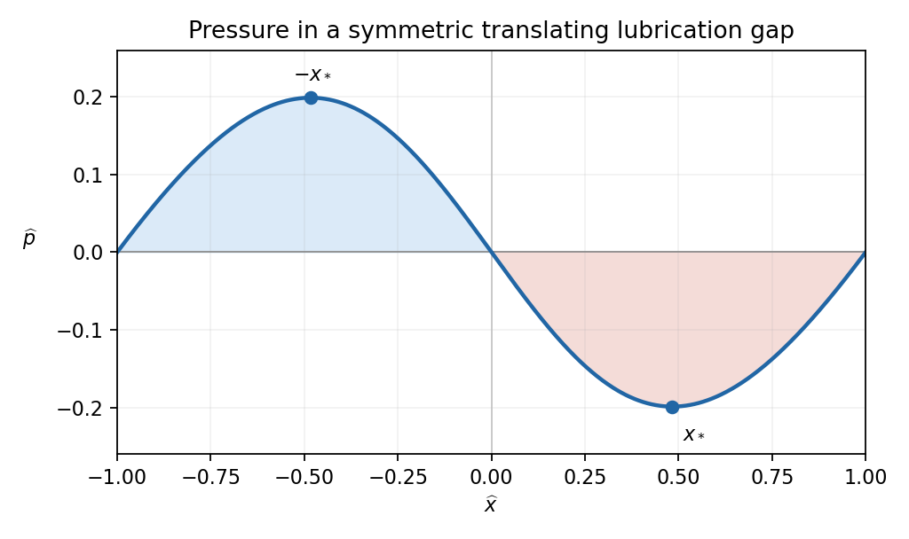

<h1 id="a/3/b/ii/solution">Solution</h1>

↑ **Parent:** [Ii](../ii.md)

For [pressure lobes in a symmetric translating lubrication gap](../../../../../../pressure-lobes-in-a-symmetric-translating-lubrication-gap.md), the height integrals are

$$
\int_{-1}^1\widehat h^{-2}\,d\widehat x=\int_{-1}^1\frac{d\widehat x}{1+\widehat x^2}=\frac\pi2,\qquad
\int_{-1}^1\widehat h^{-3}\,d\widehat x=\left[\frac{\widehat x}{\sqrt{1+\widehat x^2}}\right]_{-1}^1=\sqrt2.
$$

Hence

$$
\boxed{Q=\frac\pi{4\sqrt2}.}
$$

The denominator of the [pressure gradient](../../../../../../pressure-gradient.md) is positive. Its numerator changes sign when $\sqrt{1+\widehat x^2}=\pi/(2\sqrt2)$, that is at $\widehat x=\pm x_*$ with $x_*=(\pi^2/8-1)^{1/2}$. The [gradient](../../../../../../gradient.md) is positive for $|\widehat x|>x_*$, zero at those two points, and negative for $|\widehat x|<x_*$. Integration, with either endpoint condition, gives

$$
\boxed{\widehat p(\widehat x)=6\arctan\widehat x-\frac{3\pi}{\sqrt2}\frac{\widehat x}{\sqrt{1+\widehat x^2}}.}
$$

This [function](../../../../../../function-split.md) is odd and vanishes at $-1,0,1$. It has a positive maximum at $-x_*$ and a negative minimum at $x_*$. Thus the sketch has a positive [pressure](../../../../../../pressure-split.md) lobe in the converging left half of the gap and a negative gauge-[pressure](../../../../../../pressure-split.md) lobe in the diverging right half.

**[Figure 1](#a/3/b/ii/image-the-lubrication-pressure-in-a-symmetric-translating-gap-and-its-two-stationary-points). The lubrication pressure in a symmetric translating gap and its two stationary points**.

## ↑ Ancestors (14)

1. [Ii](../ii.md)
2. [B](../../b.md)
3. [3](../../../3.md)
4. [A](../../../../a.md)
5. [2011](../../../../../2011-split.md)
6. [Past exam of the theoretical mechanics course of the University of Oxford](../../../../../split.md)
7. [Theoretical mechanics course of the University of Oxford](../../../../../../theoretical-mechanics-course-of-the-university-of-oxford.md)
8. [Year 3 of the mathematics course of the University of Oxford](../../../../../../year-3-of-the-mathematics-course-of-the-university-of-oxford.md)
9. [Mathematics course of the University of Oxford](../../../../../../mathematics-course-of-the-university-of-oxford.md)
10. [Undergraduate course of the University of Oxford](../../../../../../undergraduate-course-of-the-university-of-oxford.md)
11. [Course of the University of Oxford](../../../../../../course-of-the-university-of-oxford.md)
12. [University of Oxford](../../../../../../university-of-oxford-split.md)
13. [List of universities](../../../../../../list-of-universities.md)
14. [Codex Wiki](../../../../../../split.md)
