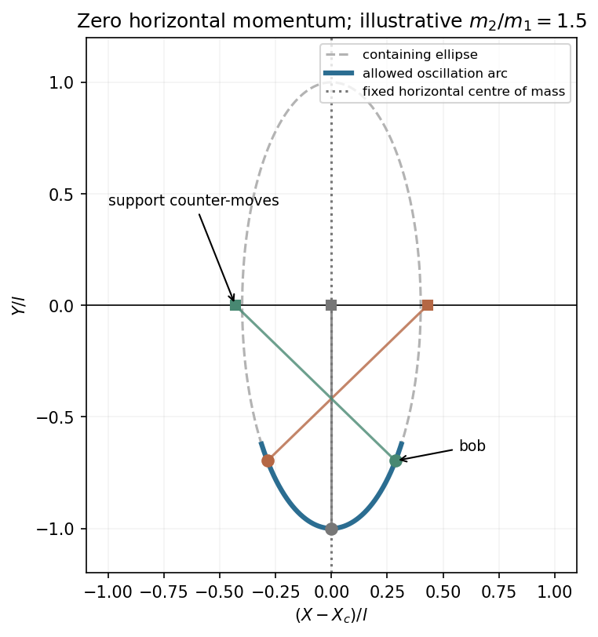

<h1 id="1/c/solution">Solution</h1>

↑ **Parent:** [C](../c.md)

Write $M=m_1+m_2$. Integrating the zero-momentum condition gives $Mx+m_2l\sin\phi=MX_c$, where $X_c$ is the constant horizontal centre-of-mass position. Therefore the bob coordinates are

$$
X=x+l\sin\phi=X_c+\frac{m_1l}{M}\sin\phi,\qquad Y=-l\cos\phi.
$$

Eliminating the angle gives the [elliptic bob path at zero horizontal momentum](../../../../../elliptic-bob-path-at-zero-horizontal-momentum.md),

$$
\boxed{\frac{(X-X_c)^2}{(m_1l/M)^2}+\frac{Y^2}{l^2}=1.}
$$

The semiaxes are $m_1l/M$ horizontally and $l$ vertically. An [oscillation](../../../../../oscillation.md) traverses only the allowed arc, reversing at its [turning points](../../../../../turning-point.md). The support counter-moves to keep the horizontal [centre of mass](../../../../../center-of-mass.md) fixed. The heavy-support limit tends to the familiar fixed-pivot circle.

**[Figure 1](#1/c/image-pendulum-ellipse-and-support-motion). Pendulum ellipse and support motion**.

## ↑ Ancestors (15)

1. [C](../c.md)
2. [1](../../1.md)
3. [Paper 1](../../../paper-1-split.md)
4. [2012](../../../split.md)
5. [Past exam of the theoretical physics I course of the University of Cambridge](../../../../split.md)
6. [Theoretical Physics I course of the University of Cambridge](../../../../../theoretical-physics-i-course-of-the-university-of-cambridge.md)
7. [Theoretical Physics course of the University of Cambridge](../../../../../theoretical-physics-course-of-the-university-of-cambridge.md)
8. [Physics course of the year 3 of the natural sciences course of the University of Cambridge](../../../../../physics-course-of-the-year-3-of-the-natural-sciences-course-of-the-university-of-cambridge.md)
9. [Year 3 of the natural sciences course of the University of Cambridge](../../../../../year-3-of-the-natural-sciences-course-of-the-university-of-cambridge.md)
10. [Year of the natural sciences course of the University of Cambridge](../../../../../year-of-the-natural-sciences-course-of-the-university-of-cambridge.md)
11. [Natural sciences course of the University of Cambridge](../../../../../natural-sciences-course-of-the-university-of-cambridge.md)
12. [Course of the University of Cambridge](../../../../../course-of-the-university-of-cambridge.md)
13. [University of Cambridge](../../../../../university-of-cambridge-split.md)
14. [List of universities](../../../../../list-of-universities.md)
15. [Codex Wiki](../../../../../split.md)
