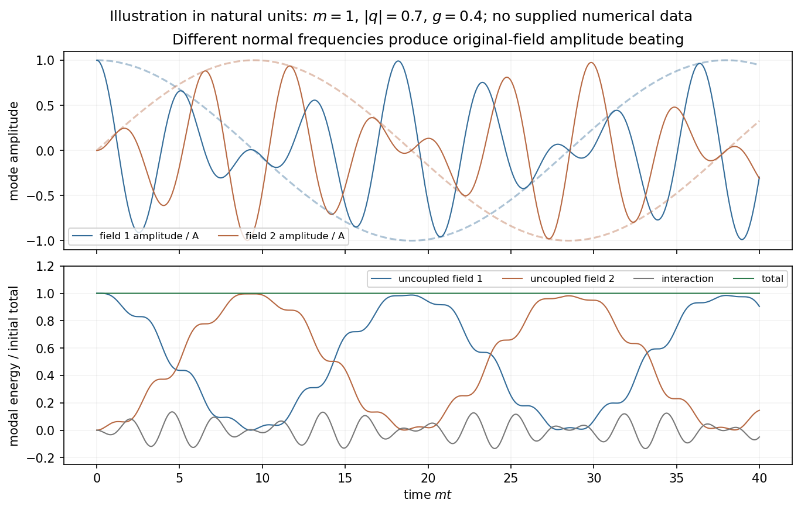

<h1 id="4/solution">Solution</h1>

↑ **Parent:** [4](../4.md)

Use [metric signature](../../../../metric-signature.md) $(+,-,-,-)$ and units with propagation speed one. The scalar [Euler-Lagrange equation](../../../../euler-lagrange-equation.md) gives

$$
\frac{\partial\mathcal L_{\rm KG}}{\partial\phi}=-m^2\phi,\qquad
\frac{\partial\mathcal L_{\rm KG}}{\partial(\partial_\mu\phi)}=\partial^\mu\phi,
\qquad
\boxed{(\partial_t^2-\nabla^2+m^2)\phi=0.}
$$

With the stated spatial Fourier convention, $-\nabla^2$ becomes $k^2$. Each transformed mode obeys

$$
\ddot{\tilde\phi}+\omega_k^2\tilde\phi=0,\qquad
\omega_k=\sqrt{k^2+m^2},\qquad
\boxed{\tilde\phi(\mathbf k,t)=F(\mathbf k)\cos\omega_kt+
\frac{V(\mathbf k)}{\omega_k}\sin\omega_kt.}
$$

Here $F$ and $V$ are the initial transformed field and [velocity](../../../../velocity.md). Reality requires $F(-\mathbf k)=F(\mathbf k)^*$ and the same for $V$; the Fourier convention places no extra $(2\pi)^3$ in these evolution formulas.

Including the interaction gives the [two coupled real Klein-Gordon fields](../../../../two-coupled-real-klein-gordon-fields.md),

$$
\boxed{(\Box+m^2)\phi_1-g\phi_2=0,\qquad
(\Box+m^2)\phi_2-g\phi_1=0.}
$$

Adding and subtracting diagonalizes them:

$$
(\Box+m^2-g)\phi_+=0,\qquad
(\Box+m^2+g)\phi_-=0,\qquad
\omega_\pm(k)=\sqrt{k^2+m^2\mp g}.
$$

Both squared masses are positive for $0<g<m^2$. For arbitrary [initial data](../../../../initial-data-in-general-relativity.md) $F_i=\tilde\phi_i(0)$ and $V_i=\dot{\tilde\phi}_i(0)$, define

$$
U_\pm(\mathbf k,t)=(F_1\pm F_2)\cos\omega_\pm t+
\frac{V_1\pm V_2}{\omega_\pm}\sin\omega_\pm t.
$$

Then the general solution is $\tilde\phi_1=(U_++U_-)/2$, $\tilde\phi_2=(U_+-U_-)/2$, with the corresponding reality conditions on [initial data](../../../../initial-data-in-general-relativity.md).

For the specified sinusoidal initial [displacement](../../../../displacement.md), put $\Omega_\pm=\sqrt{q^2+m^2\mp g}$. Both normal fields initially have amplitude $A\sin(\mathbf q\cdot\mathbf x)$ and zero time [derivative](../../../../derivative.md). Consequently

$$
\boxed{\phi_1=\frac A2\sin(\mathbf q\cdot\mathbf x)
[\cos\Omega_+t+\cos\Omega_-t],\qquad
\phi_2=\frac A2\sin(\mathbf q\cdot\mathbf x)
[\cos\Omega_+t-\cos\Omega_-t].}
$$

Writing $\bar\Omega=(\Omega_-+\Omega_+)/2$ and $\delta\Omega=(\Omega_--\Omega_+)/2$ gives $\phi_1=A\sin(\mathbf q\cdot\mathbf x)\cos\bar\Omega t\cos\delta\Omega t$ and $\phi_2=A\sin(\mathbf q\cdot\mathbf x)\sin\bar\Omega t\sin\delta\Omega t$. This is [field-amplitude beating of coupled Klein-Gordon modes](../../../../field-amplitude-beating-of-coupled-klein-gordon-modes.md). The conserved [energy](../../../../energy-split.md) includes the interaction term $-g\phi_1\phi_2$; separate uncoupled-field [energies](../../../../energy-split.md) need not be conserved, and an envelope zero is not by itself exact complete [energy](../../../../energy-split.md) transfer.

**[Figure 2](#4/image-coupled-scalar-mode-beating). Coupled scalar-mode beating**.

## ↑ Ancestors (14)

1. [4](../4.md)
2. [Paper 1](../../paper-1-split.md)
3. [2012](../../split.md)
4. [Past exam of the theoretical physics I course of the University of Cambridge](../../../split.md)
5. [Theoretical Physics I course of the University of Cambridge](../../../../theoretical-physics-i-course-of-the-university-of-cambridge.md)
6. [Theoretical Physics course of the University of Cambridge](../../../../theoretical-physics-course-of-the-university-of-cambridge.md)
7. [Physics course of the year 3 of the natural sciences course of the University of Cambridge](../../../../physics-course-of-the-year-3-of-the-natural-sciences-course-of-the-university-of-cambridge.md)
8. [Year 3 of the natural sciences course of the University of Cambridge](../../../../year-3-of-the-natural-sciences-course-of-the-university-of-cambridge.md)
9. [Year of the natural sciences course of the University of Cambridge](../../../../year-of-the-natural-sciences-course-of-the-university-of-cambridge.md)
10. [Natural sciences course of the University of Cambridge](../../../../natural-sciences-course-of-the-university-of-cambridge.md)
11. [Course of the University of Cambridge](../../../../course-of-the-university-of-cambridge.md)
12. [University of Cambridge](../../../../university-of-cambridge-split.md)
13. [List of universities](../../../../list-of-universities.md)
14. [Codex Wiki](../../../../split.md)
