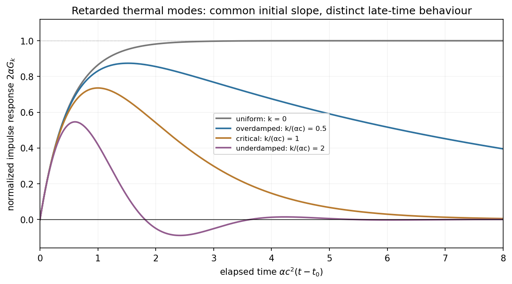

<h1 id="6/b/solution">Solution</h1>

↑ **Parent:** [B](../b.md)

The spatial transform of $\cos(px)$ is $\pi[\delta(k-p)+\delta(k+p)]$. [Convolution](../../../../../convolution.md) with the impulsive source and the inverse transform therefore give simply $T(x,t)=\cos(px)G_p(t-t_0)$. Take $p\geq0$ without loss of generality and set $\tau=t-t_0$.

For $\alpha>p/c$, let $d_p=\sqrt{\alpha^2c^4-p^2c^2}$. Then

$$
\boxed{T(x,t)=\Theta(\tau)\cos(px)\frac{c^2}{d_p}e^{-\alpha c^2\tau}\sinh(d_p\tau).}
$$

For $\alpha<p/c$, let $\Omega_p=\sqrt{p^2c^2-\alpha^2c^4}$. Then

$$
\boxed{T(x,t)=\Theta(\tau)\cos(px)\frac{c^2}{\Omega_p}e^{-\alpha c^2\tau}\sin(\Omega_p\tau).}
$$

Both satisfy $T(t_0^+)=0$ and $\partial_tT(t_0^+)=c^2\cos(px)$, so the impulse changes the time [derivative](../../../../../derivative.md) rather than discontinuously changing [temperature](../../../../../temperature-split.md). The first case rises and then relaxes without sign [oscillations](../../../../../oscillation.md) for a nonzero mode; the second oscillates as its amplitude decays. The limiting equality gives $T=\Theta(\tau)c^2\tau e^{-\alpha c^2\tau}\cos(px)$, and $p=0$ gives the nondecaying uniform increment discussed above.

A cosine source has both positive and negative regions, so this linear solution can be understood as a [temperature](../../../../../temperature-split.md) perturbation about a background; its negative values are not assertions of negative absolute [temperature](../../../../../temperature-split.md). The temporal [oscillations](../../../../../oscillation.md) arise from the second-time-derivative term. Dropping that term changes the initial-jump structure as well as removing the underdamped regime.

**[Figure 3](#6/b/image-retarded-thermal-mode-responses). Retarded thermal-mode responses**.

## ↑ Ancestors (15)

1. [B](../b.md)
2. [6](../../6.md)
3. [Paper 1](../../../paper-1-split.md)
4. [2012](../../../split.md)
5. [Past exam of the theoretical physics I course of the University of Cambridge](../../../../split.md)
6. [Theoretical Physics I course of the University of Cambridge](../../../../../theoretical-physics-i-course-of-the-university-of-cambridge.md)
7. [Theoretical Physics course of the University of Cambridge](../../../../../theoretical-physics-course-of-the-university-of-cambridge.md)
8. [Physics course of the year 3 of the natural sciences course of the University of Cambridge](../../../../../physics-course-of-the-year-3-of-the-natural-sciences-course-of-the-university-of-cambridge.md)
9. [Year 3 of the natural sciences course of the University of Cambridge](../../../../../year-3-of-the-natural-sciences-course-of-the-university-of-cambridge.md)
10. [Year of the natural sciences course of the University of Cambridge](../../../../../year-of-the-natural-sciences-course-of-the-university-of-cambridge.md)
11. [Natural sciences course of the University of Cambridge](../../../../../natural-sciences-course-of-the-university-of-cambridge.md)
12. [Course of the University of Cambridge](../../../../../course-of-the-university-of-cambridge.md)
13. [University of Cambridge](../../../../../university-of-cambridge-split.md)
14. [List of universities](../../../../../list-of-universities.md)
15. [Codex Wiki](../../../../../split.md)
