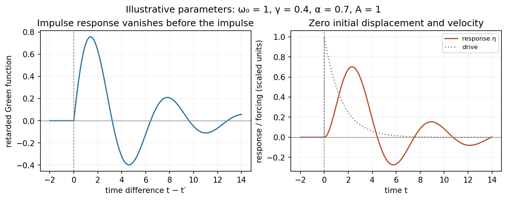
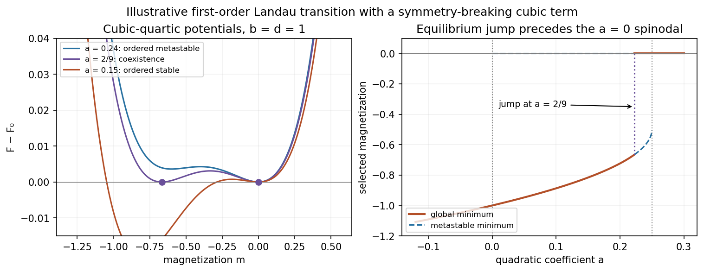

# Paper 1

↑ **Parent:** [2013](../2013.md)

[Original public PDF, physical pages 274–279; examination dated 16 January 2013](https://www.whatdotheyknow.com/request/natural_science_tripos_physics_e_2/response/2340776/attach/2/FOI%202023%20399%20Zahid%20materials.pdf?cookie_passthrough=1#page=274)

**Table of contents**

- [1](#1)
  - [a](#1/a)
    - [Solution](#1/a/solution)
  - [b](#1/b)
    - [Solution](#1/b/solution)
  - [c](#1/c)
    - [Solution](#1/c/solution)
  - [d](#1/d)
    - [Solution](#1/d/solution)
- [2](#2)
  - [a](#2/a)
    - [Solution](#2/a/solution)
  - [b](#2/b)
    - [Solution](#2/b/solution)
  - [c](#2/c)
    - [Solution](#2/c/solution)
  - [d](#2/d)
    - [Solution](#2/d/solution)
- [3](#3)
  - [a](#3/a)
    - [Solution](#3/a/solution)
  - [b](#3/b)
    - [Solution](#3/b/solution)
- [4](#4)
  - [Solution](#4/solution)
- [5](#5)
  - [a](#5/a)
    - [Solution](#5/a/solution)
  - [b](#5/b)
    - [Solution](#5/b/solution)
- [6](#6)
  - [a](#6/a)
    - [Solution](#6/a/solution)
  - [b](#6/b)
    - [Solution](#6/b/solution)
  - [c](#6/c)
    - [Solution](#6/c/solution)
  - [d](#6/d)
    - [Solution](#6/d/solution)

## 1

↑ **Parent:** [Paper 1](paper-1.md)

<h3 id="1/a">a</h3>

↑ **Parent:** [1](#1)

<h4 id="1/a/solution">Solution</h4>

↑ **Parent:** [A](#1/a)

Measure both [angles](../../geometry-and-topology.md#angle) from the downward vertical, as in the PDF. With the support as origin and downward coordinate $z$,

$$
\mathbf r_B=\ell(\sin\theta,\cos\theta),\qquad
\mathbf r_C=\ell(\sin\theta+\sin\phi,\cos\theta+\cos\phi).
$$

Thus $|AC|^2=2\ell^2[1+\cos(\theta-\phi)]$. The requested expression implicitly uses a **[zero-rest-length spring](../../elasticity-physics.md#zero-rest-length-spring)**: its [energy](../../energy.md) is $\kappa|AC|^2/2$. The exact [Lagrangian](../../calculus-of-variations.md#lagrangian) for equal [masses](../../classical-mechanics.md#mass) is

$$
L=m\ell^2\dot\theta^2+\frac{m\ell^2}{2}\dot\phi^2
+m\ell^2\dot\theta\dot\phi\cos(\theta-\phi)
+mg\ell(2\cos\theta+\cos\phi)
-\kappa\ell^2[1+\cos(\theta-\phi)].
$$

Expand the [cosines](../../geometry-and-topology.md#cosine) and count [angles](../../geometry-and-topology.md#angle) and [velocities](../../classical-mechanics.md#velocity) as first order. The cosine correction multiplying $\dot\theta\dot\phi$ is fourth order and is dropped. After removing constants,

$$
\boxed{L_2=\frac{m\ell^2}{2}(2\dot\theta^2+2\dot\theta\dot\phi+\dot\phi^2)
-\frac{mg\ell}{2}(2\theta^2+\phi^2)
+\frac{\kappa\ell^2}{2}(\theta-\phi)^2.}
$$

The positive [spring](../../elasticity-physics.md#spring) term in $L_2$ means the [spring](../../elasticity-physics.md#spring) lowers its [energy](../../energy.md) when the straight assembly bends. If its natural length were $s_0$, this term would instead be $\kappa\ell(2\ell-s_0)(\theta-\phi)^2/4$. An unspecified ordinary natural length cannot simply be ignored; the displayed target fixes the zero-length idealization.

<h3 id="1/b">b</h3>

↑ **Parent:** [1](#1)

<h4 id="1/b/solution">Solution</h4>

↑ **Parent:** [B](#1/b)

Put $G=g/\ell$ and $s=\kappa/m$. Applying the [Euler-Lagrange equations](../../analysis.md#euler-lagrange-equation) to the [quadratic Lagrangian](../../quantum-field-theory.md#quadratic-lagrangian) gives

$$
\boxed{2\ddot\theta+\ddot\phi+(2G-s)\theta+s\phi=0,\qquad
\ddot\theta+\ddot\phi+s\theta+(G-s)\phi=0.}
$$

A nonzero motion satisfying the specified equal-and-opposite initial displacements can have one [frequency](../../wave.md#frequency) only if $(1,-1)$ is a normal-mode [vector](../../vector-space.md#vector). Its acceleration terms are proportional to $(1,0)$, while the restoring terms are proportional to $(2G-2s,2s-G)$. Hence

$$
\boxed{s=G/2,\qquad \kappa=\frac{mg}{2\ell},\qquad \omega^2=G,}
$$

and

$$
\boxed{\theta(t)=\xi\cos(\sqrt{g/\ell}\,t),\qquad
\phi(t)=-\xi\cos(\sqrt{g/\ell}\,t).}
$$

The rods swing oppositely. The hinge [mass](../../classical-mechanics.md#mass) moves sideways, while the final [mass](../../classical-mechanics.md#mass) has no first-order displacement: the two horizontal contributions cancel and its vertical change is quadratic in angle. In the corresponding geometric ansatz it moves vertically at twice the small-oscillation [frequency](../../wave.md#frequency) to leading nonzero order, but the displayed single-frequency solution is a linearized result. The trivial case $\xi=0$ imposes no parameter condition.

<h3 id="1/c">c</h3>

↑ **Parent:** [1](#1)

<h4 id="1/c/solution">Solution</h4>

↑ **Parent:** [C](#1/c)

Removing the hinge [mass](../../classical-mechanics.md#mass) gives the exact [Lagrangian](../../calculus-of-variations.md#lagrangian)

$$
L=\frac{m\ell^2}{2}[\dot\theta^2+\dot\phi^2+2\dot\theta\dot\phi\cos(\theta-\phi)]
+mg\ell(\cos\theta+\cos\phi)-\kappa\ell^2[1+\cos(\theta-\phi)].
$$

The stated equations again concern its small-angle quadratic approximation. In the sum and difference coordinates this becomes

$$
\boxed{L_2=\frac{m\ell^2}{2}\left[\dot\eta^2-\omega_0^2\eta^2
-(\omega_0^2-\omega_1^2)\nu^2\right],\quad
\omega_0^2=\frac g{2\ell},\quad \omega_1^2=\frac\kappa m.}
$$

Consequently

$$
\boxed{\ddot\eta+\omega_0^2\eta=0,\qquad
(\omega_0^2-\omega_1^2)\nu=0.}
$$

For unequal squared [frequencies](../../wave.md#frequency), $\nu=0$: the rods remain aligned to first order and the end [mass](../../classical-mechanics.md#mass) swings like a pendulum of length $2\ell$. This [degenerate Lagrangian](../../lagrangian-mechanics.md#degenerate-lagrangian) gives the difference coordinate no quadratic kinetic term, so its equation is an algebraic constraint, not a second oscillator. If $\omega_0=\omega_1$, the quadratic [action](../../lagrangian-mechanics.md#action) loses all dependence on $\nu$. **Its motion is then undetermined at this order**; nonlinear terms or a small hinge [mass](../../classical-mechanics.md#mass) must resolve the degeneracy. For larger [spring](../../elasticity-physics.md#spring) stiffness the straight constrained branch is not a minimum of the bending potential, despite the absence of a finite-inertia growing mode in this strictly massless quadratic description.

<h3 id="1/d">d</h3>

↑ **Parent:** [1](#1)

<h4 id="1/d/solution">Solution</h4>

↑ **Parent:** [D](#1/d)

Write $u=t-t'$ and $\Omega=\sqrt{\omega_0^2-\gamma^2/4}$. With the printed [Fourier transform](../../fourier-transform.md) convention, a time [derivative](../../calculus.md#derivative) transforms to $i\omega$. The [retarded Green function](../../quantum-field-theory.md#retarded-green-function) is

$$
G(u)=\int_{-\infty}^\infty\frac{d\omega}{2\pi}
\frac{e^{i\omega u}}{\omega_0^2-\omega^2+i\gamma\omega}.
$$

Its [poles](../../isolated-singularity.md#pole) are $\omega=\pm\Omega+i\gamma/2$, both in the upper half-plane. For $u>0$ close the contour above; for $u<0$ close below, where there are no [poles](../../isolated-singularity.md#pole). [Residues](../../analysis.md#residue) give

$$
\boxed{G(t-t')=\Theta(t-t')e^{-\gamma(t-t')/2}
\frac{\sin[\Omega(t-t')]}{\Omega}.}
$$

It is continuous at $u=0$ and has [derivative](../../calculus.md#derivative) jump $G'(0^+)-G'(0^-)=1$, reproducing the [Dirac delta function](../../distribution-theory.md#dirac-delta-function) source. Thus the solution initially at rest is

$$
\eta(t)=A\int_0^t G(t-s)e^{-\alpha s}\,ds\quad(t\geq0),
$$

and vanishes for $t<0$. Set $D=\alpha^2-\gamma\alpha+\omega_0^2=(\alpha-\gamma/2)^2+\Omega^2>0$. Evaluating the integral gives

$$
\boxed{\eta(t)=\frac A D\left[e^{-\alpha t}
-e^{-\gamma t/2}\cos(\Omega t)
+\frac{\alpha-\gamma/2}{\Omega}e^{-\gamma t/2}\sin(\Omega t)\right],\quad t\geq0.}
$$

The [homogeneous solution](../../linear-ordinary-differential-equation.md#homogeneous-solution) constants are $C_1=-A/D$ and $C_2=A(\alpha-\gamma/2)/(D\Omega)$. Substitution at zero gives $\eta(0)=\dot\eta(0)=0$. [Causality](../../special-relativity.md#causality) selects this response; an arbitrarily excited prehistory would add a [homogeneous solution](../../linear-ordinary-differential-equation.md#homogeneous-solution).

**[Figure 1](#1/d/image-illustrative-retarded-impulse-response-and-initially-resting-response-to-a-decaying-drive). Illustrative retarded impulse response and initially resting response to a decaying drive**.

## 2

↑ **Parent:** [Paper 1](paper-1.md)

<h3 id="2/a">a</h3>

↑ **Parent:** [2](#2)

<h4 id="2/a/solution">Solution</h4>

↑ **Parent:** [A](#2/a)

Use the magnetic-coupling convention of the supplied [Hamiltonian](../../hamiltonian-mechanics.md#hamiltonian); electromagnetic unit factors are absorbed into the stated $e$ and $B$. Let $\alpha=m_1/M$ and $\beta=m_2/M$, so

$$
\mathbf r_1=\mathbf R-\beta\mathbf r,\qquad
\mathbf r_2=\mathbf R+\alpha\mathbf r.
$$

The [kinetic energy](../../energy.md#kinetic-energy) separates into $M\dot{\mathbf R}^2/2+\mu\dot{\mathbf r}^2/2$. The [symmetric gauge](../../quantum-theory.md#symmetric-gauge) coupling $\sum_i e_i\dot{\mathbf r}_i\cdot(\mathbf B\times\mathbf r_i)/2$ becomes

$$
-\frac e2[\dot{\mathbf R}\cdot(\mathbf B\times\mathbf r)
+\dot{\mathbf r}\cdot(\mathbf B\times\mathbf R)]
-e^*\dot{\mathbf r}\cdot(\mathbf B\times\mathbf r),\quad
e^*=\frac{e(m_1-m_2)}{2M}.
$$

The [scalar triple product](../../multilinear-algebra.md#scalar-triple-product) identity gives

$$
\dot{\mathbf r}\cdot(\mathbf B\times\mathbf R)
=\frac d{dt}[\mathbf r\cdot(\mathbf B\times\mathbf R)]
+\dot{\mathbf R}\cdot(\mathbf B\times\mathbf r).
$$

Discarding $-e/2$ times that [total derivative](../../calculus.md#total-derivative), which changes endpoint terms and [canonical momenta](../../hamiltonian-mechanics.md#canonical-momentum) but not the trajectories, leaves

$$
\boxed{L=\frac M2\dot{\mathbf R}^2+\frac\mu2\dot{\mathbf r}^2+\frac{e^2}{r}
-e^*\dot{\mathbf r}\cdot(\mathbf B\times\mathbf r)
-e\dot{\mathbf R}\cdot(\mathbf B\times\mathbf r).}
$$

<h3 id="2/b">b</h3>

↑ **Parent:** [2](#2)

<h4 id="2/b/solution">Solution</h4>

↑ **Parent:** [B](#2/b)

For this [neutral Coulomb pair in a uniform magnetic field](../../quantum-theory.md#neutral-coulomb-pair-in-a-uniform-magnetic-field), the reduced [Lagrangian](../../calculus-of-variations.md#lagrangian) gives the [canonical momenta](../../hamiltonian-mechanics.md#canonical-momentum)

$$
\mathbf P=M\dot{\mathbf R}-e\mathbf B\times\mathbf r,\qquad
\mathbf p=\mu\dot{\mathbf r}-e^*\mathbf B\times\mathbf r.
$$

Invert these relations and take the [Legendre transform](../../convex-optimization.md#convex-conjugate). The velocity-linear terms cancel against their [momentum](../../momentum.md) contributions, giving

$$
\boxed{H=\frac{|\mathbf P+e\mathbf B\times\mathbf r|^2}{2M}
+\frac{|\mathbf p+e^*\mathbf B\times\mathbf r|^2}{2\mu}-\frac{e^2}{r}.}
$$

There is no explicit time dependence, so $dH/dt=0$. There is no dependence on $\mathbf R$, so $\dot{\mathbf P}=0$. The distinction between [kinetic momentum and magnetic pseudomomentum](../../quantum-theory.md#kinetic-momentum-and-magnetic-pseudomomentum) matters: **the conserved [vector](../../vector-space.md#vector) is $\mathbf P$, not generally $M\dot{\mathbf R}$**. The mechanical centre-of-mass [momentum](../../momentum.md) $M\dot{\mathbf R}=\mathbf P+e\mathbf B\times\mathbf r$ generally varies as the separation changes. A neutral pair can therefore have accelerated centre-of-mass motion in a [magnetic field](../../magnetic-field.md).

<h3 id="2/c">c</h3>

↑ **Parent:** [2](#2)

<h4 id="2/c/solution">Solution</h4>

↑ **Parent:** [C](#2/c)

Interpret $\mathbf P=0$ as the zero-pseudomomentum sector, rather than assuming the mechanical [centre of mass](../../classical-mechanics.md#center-of-mass) is at rest. Define $\mathbf u=\mathbf p+e^*\mathbf B\times\mathbf r$. [Hamilton's equations](../../hamiltonian-mechanics.md#hamilton-s-equations) are

$$
\boxed{\dot{\mathbf R}=\frac eM\mathbf B\times\mathbf r,\quad
\dot{\mathbf P}=0,\quad
\dot{\mathbf r}=\frac{\mathbf u}{\mu},\quad
\dot{\mathbf p}=\frac{e^*}{\mu}\mathbf B\times\mathbf u
-\left(\frac{e^2B^2}{M}+\frac{e^2}{r^3}\right)\mathbf r.}
$$

For example, differentiating the relative kinetic term with respect to $\mathbf r$ gives $-e^*\mathbf B\times\mathbf u/\mu$ because the cross-product matrix is antisymmetric. Hamilton's minus sign then gives the positive cross-product term in $\dot{\mathbf p}$. The [Coulomb force](../../electrostatics.md#coulomb-force) is attractive. A change to a moving frame need not preserve a pure magnetic external field, so setting $\mathbf P=0$ is a restriction on the chosen solution family.

<h3 id="2/d">d</h3>

↑ **Parent:** [2](#2)

<h4 id="2/d/solution">Solution</h4>

↑ **Parent:** [D](#2/d)

Differentiate $\mu\dot{\mathbf r}=\mathbf p+e^*\mathbf B\times\mathbf r$ and substitute the previous [momentum](../../momentum.md) equation:

$$
\mu\ddot{\mathbf r}=2e^*\mathbf B\times\dot{\mathbf r}
-\left(\frac{e^2B^2}{M}+\frac{e^2}{r^3}\right)\mathbf r.
$$

For a planar [vector](../../vector-space.md#vector), $\mathbf B\times\dot{\mathbf r}=B(-\dot y,\dot x)$, which gives the two component equations with the printed signs.

For [circular relative motion of a neutral Coulomb pair](../../quantum-theory.md#circular-relative-motion-of-a-neutral-coulomb-pair) of separation radius $R$, $\dot{\mathbf r}=\omega\hat{\mathbf z}\times\mathbf r$ and $\ddot{\mathbf r}=-\omega^2\mathbf r$. Thus

$$
\mu\omega^2-2e^*B\omega-\frac{e^2B^2}{M}-\frac{e^2}{R^3}=0.
$$

Since $(e^*)^2+\mu e^2/M=e^2/4$, the two signed [frequencies](../../wave.md#frequency) are

$$
\boxed{\omega_\pm=\frac{e^*B}{\mu}\pm
\sqrt{\frac{e^2B^2}{4\mu^2}+\frac{e^2}{\mu R^3}}.}
$$

One is positive and the other negative. At $B=0$ they give the two senses of an ordinary Coulomb circular orbit; equal [masses](../../classical-mechanics.md#mass) remove the term linear in $B$ from their average. With negligible Coulomb attraction and $eB>0$, the branches approach $eB/m_2$ and $-eB/m_1$, the appropriate signed free cyclotron limits.

The actual particle paths follow by integrating the centre-of-mass [velocity](../../classical-mechanics.md#velocity):

$$
\mathbf R_{\rm cm}=\mathbf R_0+\frac{eB}{M\omega}\mathbf r,
\quad
\mathbf r_1=\mathbf R_0+\frac{eB/\omega-m_2}{M}\mathbf r,
\quad
\mathbf r_2=\mathbf R_0+\frac{eB/\omega+m_1}{M}\mathbf r.
$$

Both particles move on circles about the same fixed [guiding centre](../../electromagnetism.md#guiding-center) with a constant separation and common signed [frequency](../../wave.md#frequency), with a possible relative phase reversal encoded by a negative coefficient. Their mechanical [centre of mass](../../classical-mechanics.md#center-of-mass) also generally circles. This is consistent with magnetic deflection plus a central mutual force; central interaction alone does not eliminate the external Lorentz forces.

## 3

↑ **Parent:** [Paper 1](paper-1.md)

<h3 id="3/a">a</h3>

↑ **Parent:** [3](#3)

<h4 id="3/a/solution">Solution</h4>

↑ **Parent:** [A](#3/a)

In [canonical coordinates](../../hamiltonian-mechanics.md#canonical-variables), the [Poisson bracket](../../hamiltonian-mechanics.md#poisson-bracket) is

$$
\boxed{\{f,g\}=\sum_i\left(\frac{\partial f}{\partial q_i}\frac{\partial g}{\partial p_i}
-\frac{\partial f}{\partial p_i}\frac{\partial g}{\partial q_i}\right).}
$$

In particular, $\{q_j,g\}=\partial_{p_j}g$, $\{p_j,g\}=-\partial_{q_j}g$, $\{f,q_j\}=-\partial_{p_j}f$ and $\{f,p_j\}=\partial_{q_j}f$. Hence $\{q_i,p_j\}=\delta_{ij}$ and the coordinate–coordinate and [momentum](../../momentum.md)–[momentum](../../momentum.md) brackets vanish.

The [chain rule](../../calculus.md#chain-rule) along a [Hamiltonian](../../hamiltonian-mechanics.md#hamiltonian) trajectory gives

$$
\frac{df}{dt}=\partial_tf+\sum_i(\partial_{q_i}f\,\dot q_i+\partial_{p_i}f\,\dot p_i)
=\boxed{\partial_tf+\{f,H\}.}
$$

The [Poisson bracket of time-dependent conserved quantities](../../hamiltonian-mechanics.md#poisson-bracket-of-time-dependent-conserved-quantities) follows by defining $D_t=\partial_t+\{\,\cdot\,,H\}$. The ordinary [product rule](../../calculus.md#product-rule) and [Jacobi identity](../../lie-algebra.md#jacobi-identity) imply

$$
D_t\{f,g\}=\{D_tf,g\}+\{f,D_tg\}.
$$

To see the [Hamiltonian](../../hamiltonian-mechanics.md#hamiltonian) part explicitly, Jacobi rearranges to $\{\{f,g\},H\}=\{\{f,H\},g\}+\{f,\{g,H\}\}$. Therefore $D_tf=D_tg=0$ implies **$D_t\{f,g\}=0$**, even when the conserved functions depend explicitly on time.

<h3 id="3/b">b</h3>

↑ **Parent:** [3](#3)

<h4 id="3/b/solution">Solution</h4>

↑ **Parent:** [B](#3/b)

A locally invertible time-independent [canonical transformation](../../hamiltonian-mechanics.md#canonical-transformation) is canonical when

$$
\boxed{\{Q_i,Q_j\}=0,\quad\{P_i,P_j\}=0,\quad\{Q_i,P_j\}=\delta_{ij}.}
$$

The proposed coordinates are locally independent only for $q_1\ne0$, since their configuration-space Jacobian has [determinant](../../multilinear-algebra.md#determinant) $2q_1$. [Work](../../energy.md#work) on one sign branch of $q_1$.

The mixed brackets first require

$$
P_1=\frac{p_1-p_2}{2q_1}+A(q_1,q_2),\qquad
P_2=p_2+B(q_1,q_2).
$$

The last bracket condition is

$$
\{P_1,P_2\}=\partial_{q_2}A-
\frac{\partial_{q_1}B-\partial_{q_2}B}{2q_1}=0.
$$

Expressing $A,B$ in the $Q$ coordinates turns this into $\partial_{Q_2}A=\partial_{Q_1}B$. Thus their shift one-form is closed and locally is the differential of an arbitrary smooth function $S(Q_1,Q_2)$. The [canonical momenta for a squared coordinate](../../symplectic-geometry.md#canonical-momenta-for-a-squared-coordinate) therefore have the general local form

$$
\boxed{P_1=\frac{p_1-p_2}{2q_1}+\frac{\partial S}{\partial Q_1},\qquad
P_2=p_2+\frac{\partial S}{\partial Q_2}.}
$$

Conversely, any such $S$ satisfies all bracket conditions. This does not give one nonsingular transformation through $q_1=0$, or identify the two sign branches globally.

Choose $S=Q_2^3/3$. Then

$$
\boxed{P_1=\frac{p_1-p_2}{2q_1},\qquad P_2=p_2+(q_1+q_2)^2,\qquad H=P_1^2+P_2.}
$$

## 4

↑ **Parent:** [Paper 1](paper-1.md)

<h3 id="4/solution">Solution</h3>

↑ **Parent:** [4](#4)

For a [real scalar triplet](../../scalar-field-theory.md#real-scalar-triplet), with metric signature $(+---)$, differentiating the [Lagrangian density](../../classical-field-theory.md#lagrangian-density) gives $\partial\mathcal L/\partial\phi_a=-\lambda\phi_a$ and $\partial\mathcal L/\partial(\partial_\mu\phi_a)=\partial^\mu\phi_a$. Hence

$$
\boxed{(\Box+\lambda)\phi_a=0,\qquad
\partial_t^2\phi_a-\nabla^2\phi_a+\lambda\phi_a=0.}
$$

For a constant internal [rotation](../../riemannian-geometry.md#rotation-mathematics) parameter, the variation is

$$
\delta\mathcal L=\theta\epsilon_{abc}n_b
\left[(\partial_\mu\phi_a)(\partial^\mu\phi_c)-\lambda\phi_a\phi_c\right]=0.
$$

Each bracketed [tensor](../../multilinear-algebra.md#tensor) is symmetric in $a,c$, so its contraction with the antisymmetric symbol vanishes. This rotates the three field components, not the space coordinates; both the kinetic term and common [mass](../../classical-mechanics.md#mass) term are invariant.

For a first-principles [Noether current](../../classical-field-theory.md#noether-current) derivation, temporarily let $\theta$ depend on spacetime. The terms proportional to $\theta$ still cancel, leaving

$$
\delta\mathcal L=j^\mu(\mathbf n)\partial_\mu\theta,\qquad
j^\mu(\mathbf n)=\partial^\mu\phi_a\epsilon_{abc}n_b\phi_c.
$$

On a solution of the field equations, the [action](../../lagrangian-mechanics.md#action) variation for a compactly supported $\theta$ vanishes after [integration by parts](../../calculus.md#integration-by-parts). Thus $\partial_\mu j^\mu=0$. To match the charges printed in the question, use the equivalent overall sign convention for the [SO(3) Noether current of a real scalar triplet](../../scalar-field-theory.md#so-3-noether-current-of-a-real-scalar-triplet)

$$
\boxed{J_a^\mu=\epsilon_{abc}(\partial^\mu\phi_b)\phi_c,\qquad
j^\mu(\mathbf n)=-n_aJ_a^\mu.}
$$

Arbitrariness of $\mathbf n$ gives three [continuity equations](../../mathematical-physics.md#continuity-equation). Their charges are exactly

$$
\boxed{Q_a=\int d^3x\,J_a^0=\int d^3x\,\epsilon_{abc}\dot\phi_b\phi_c.}
$$

An overall reversal of all currents is immaterial; the minus sign above keeps the generator convention distinct from the supplied charge convention.

Direct verification is also short:

$$
\dot Q_a=\int d^3x\,\epsilon_{abc}
[(\nabla^2\phi_b-\lambda\phi_b)\phi_c+\dot\phi_b\dot\phi_c]
=\int_{\partial V}dS\,\epsilon_{abc}(\partial_n\phi_b)\phi_c.
$$

The [mass](../../classical-mechanics.md#mass) term and the products of equal-type derivatives cancel by antisymmetry; [integration by parts](../../calculus.md#integration-by-parts) produces the boundary term. **The charges are conserved when these integrals exist and the net boundary flux vanishes**: sufficiently decaying fields on all space, [periodic boundary conditions](../../differential-equation.md#periodic-boundary-conditions), or suitable symmetry-preserving no-flux boundaries suffice. Arbitrary open boundaries do not. A common constant $\lambda$ is necessary for this internal symmetry; its positivity is a stability issue, not needed for the algebraic conservation proof.

## 5

↑ **Parent:** [Paper 1](paper-1.md)

<h3 id="5/a">a</h3>

↑ **Parent:** [5](#5)

<h4 id="5/a/solution">Solution</h4>

↑ **Parent:** [A](#5/a)

The [Euler-Lagrange field equation](../../classical-field-theory.md#euler-lagrange-field-equation) is $F'(\phi)-\partial_t^2\phi+\partial_x^2\phi=0$. Therefore

$$
\boxed{\partial_t^2\phi-\partial_x^2\phi=f(\phi).}
$$

Put $c=\cosh\beta$, $s=\sinh\beta$, $X=cx+st$ and $T=ct+sx$. The [chain rule](../../calculus.md#chain-rule) gives $\partial_t=s\partial_X+c\partial_T$ and $\partial_x=c\partial_X+s\partial_T$. Cross terms cancel and $c^2-s^2=1$, so

$$
(\partial_t^2-\partial_x^2)\phi(X,T)
=(\partial_T^2-\partial_X^2)\phi(X,T)=f(\phi(X,T)).
$$

Thus **the boosted [scalar field](../../classical-field-theory.md#scalar-field) is another solution** for any constant [rapidity](../../special-relativity.md#rapidity). The nonlinear term in the [nonlinear Klein-Gordon equation](../../wave-equation.md#nonlinear-klein-gordon-equation) is unchanged because it is a local function of the scalar itself.

<h3 id="5/b">b</h3>

↑ **Parent:** [5](#5)

<h4 id="5/b/solution">Solution</h4>

↑ **Parent:** [B](#5/b)

Use the amplitude placement in the original PDF: $w=[A\cosh^2(Bx)]^{1/(1-n)}$. Introduce the actual peak $C=A^{-1/(n-1)}$ and $p=2/(n-1)$, so $w=C\operatorname{sech}^{p}(Bx)$. Its derivatives satisfy

$$
\frac{w''}{w}=p^2B^2-p(p+1)B^2\operatorname{sech}^2(Bx),\qquad
w^{n-1}=C^{n-1}\operatorname{sech}^2(Bx).
$$

The static equation is $w''=aw-bw^n$. Matching the constant and $\operatorname{sech}^2$ terms gives

$$
\boxed{B=\frac{n-1}{2}\sqrt a,\qquad
C=\left[\frac{a(n+1)}{2b}\right]^{1/(n-1)},\qquad
A=\frac{2b}{a(n+1)}.}
$$

Changing the sign of $B$ leaves the profile unchanged. If $A$ is instead defined as an outside prefactor, as in the held TeX transcription, its value is $C$, not the PDF's $A$. This notation discrepancy does not change the physical profile.

The nonconstant positive [power-law nonlinear Klein-Gordon pulse](../../wave-equation.md#power-law-nonlinear-klein-gordon-pulse) is even, smooth, has peak $C$ at zero and decays as $e^{-\sqrt a|x|}$. The requested sketches below compare several powers with illustrative $a=b=1$. For odd $n$, its negative is also a solution. A separate constant branch occurs for $B=0$: the positive equilibrium has $C=(a/b)^{1/(n-1)}$, or $A=b/a$ in the PDF convention. The zero solution is another equilibrium, obtained as a limiting profile rather than finite positive $A$.

**[Figure 2](#5/b/image-localized-scalar-pulses-for-several-nonlinear-powers-and-lorentz-contracted-travelling-snapshots). Localized scalar pulses for several nonlinear powers, and Lorentz-contracted travelling snapshots**.

Now apply the [Lorentz boost](../../special-relativity.md#lorentz-boost) with [rapidity](../../special-relativity.md#rapidity) $-\beta$ to the static field. It gives

$$
\boxed{\phi(x,t)=C\operatorname{sech}^{2/(n-1)}
\left[B\cosh\beta\,(x-vt)\right],\qquad v=\tanh\beta.}
$$

For positive $\beta$, the centre moves to the right at $0<v<1$, with [speed](../../classical-mechanics.md#speed) one the wave-speed unit. The peak stays $C$ and the width contracts by $1/\cosh\beta$. The shape translates without changing in time. This establishes a travelling solitary pulse; it does not by itself prove stability or elastic multi-pulse scattering.

## 6

↑ **Parent:** [Paper 1](paper-1.md)

<h3 id="6/a">a</h3>

↑ **Parent:** [6](#6)

<h4 id="6/a/solution">Solution</h4>

↑ **Parent:** [A](#6/a)

The expansion is a local phenomenological description in a small scalar [order parameter](../../critical-phenomenon.md#order-parameter) near a transition. Its coefficients summarize microscopic physics and generally depend smoothly on [temperature](../../temperature.md). At zero field, spin-reversal [Z2 symmetry](../../quantum-field-theory.md#z2-symmetry) requires even powers of [magnetization](../../electromagnetism.md#magnetization); the conjugate field supplies the term $-hm$. The additive $F_0$ does not affect minimization with respect to $m$.

For the ordinary continuous-transition quartic model, **$b>0$ ensures stability**, and the quadratic coefficient changes sign, $a=a_0t+O(t^2)$ with $a_0>0$. If $b$ vanishes or is negative, stabilizing higher powers are required and the phase structure can change. Treating one uniform [magnetization](../../electromagnetism.md#magnetization) neglects spatial gradients, fluctuations and domains; the resulting exponents are predictions of [mean-field theory](../../statistical-physics.md#mean-field-theory).

<h3 id="6/b">b</h3>

↑ **Parent:** [6](#6)

<h4 id="6/b/solution">Solution</h4>

↑ **Parent:** [B](#6/b)

Equilibrium requires $h=am+bm^3$. On the critical isotherm $a=0$, so

$$
\boxed{h=bm^3,\qquad m=\operatorname{sgn}(h)|h/b|^{1/3},\qquad\delta=3.}
$$

Here $\delta$ is defined by $h\propto\operatorname{sgn}(m)|m|^\delta$ at the [critical temperature](../../quantum-ideal-gas-statistics.md#critical-temperature), or equivalently $|m|\propto|h|^{1/\delta}$. The positive quartic coefficient selects a stable equilibrium, including the flat but stable zero-field [thermodynamic critical point](../../critical-phenomenon.md#thermodynamic-critical-point).

<h3 id="6/c">c</h3>

↑ **Parent:** [6](#6)

<h4 id="6/c/solution">Solution</h4>

↑ **Parent:** [C](#6/c)

Differentiate the [equation of state](../../pressure.md#equation-of-state) at fixed [temperature](../../temperature.md):

$$
\chi=\frac1{a+3bm^2}.
$$

Above the transition, zero-field equilibrium has $m=0$. Below it the stable pure phases have $m^2=-a/b$. Thus

$$
\boxed{\chi(t)=\frac1{a_0t}\ (t>0),\qquad
\chi(t)=\frac1{2a_0|t|}\ (t<0),\qquad
\lim_{t\to0^+}\frac{\chi(t)}{\chi(-t)}=2.}
$$

This is the [mean-field magnetic-susceptibility amplitude ratio](../../statistical-physics.md#mean-field-magnetic-susceptibility-amplitude-ratio). Below the transition, take a one-sided response in a selected ordered phase: the globally minimizing [magnetization](../../electromagnetism.md#magnetization) switches discontinuously between opposite phases when $h$ crosses zero. Its two-sided [derivative](../../calculus.md#derivative) at precisely zero field is therefore not the finite pure-phase [magnetic susceptibility](../../statistical-physics.md#magnetic-susceptibility) used in the ratio.

<h3 id="6/d">d</h3>

↑ **Parent:** [6](#6)

<h4 id="6/d/solution">Solution</h4>

↑ **Parent:** [D](#6/d)

Assume $b>0$ and temperature-independent $d$ for the local model. The zero-field [stationary points](../../calculus-of-variations.md#stationary-point) obey

$$
m(a+dm+bm^2)=0,\qquad
m_\pm=\frac{-d\pm\sqrt{d^2-4ab}}{2b}.
$$

For $d\ne0$, the favoured ordered sign is opposite to $d$. The nonzero extrema first appear at $a=d^2/(4b)$; their existence is not yet a coexistence condition. To find the equilibrium transition, require both $F'(m_*)=0$ and $F(m_*)=F(0)$. Substituting $a=-dm_*-bm_*^2$ into the [free energy](../../thermodynamic-potential.md#thermodynamic-free-energy) gives

$$
F(m_*)-F_0=-\frac d6m_*^3-\frac b4m_*^4.
$$

Hence

$$
\boxed{m_*=-\frac{2d}{3b},\qquad a_* =\frac{2d^2}{9b}>0.}
$$

At coexistence the entire potential factorizes:

$$
F-F_0=\frac b4m^2\left(m+\frac{2d}{3b}\right)^2.
$$

It has equal minima at zero and $m_*$ separated by a barrier. **Every fixed nonzero cubic coefficient produces a first-order transition in this quartic model**, with a finite [magnetization](../../electromagnetism.md#magnetization) jump before the quadratic coefficient reaches zero.

For $d^2/(4b)>a>a_*$, the ordered minimum is metastable and zero is globally stable. For $a_* >a>0$, the ordered state is globally stable and zero is metastable. At $a=0$ the zero minimum loses local stability. Thus the spinodals are $a=d^2/(4b)$ and $a=0$, distinct from $a_*$. For $a<0$, the opposite-sign nonzero state can also be a [local minimum](../../analysis.md#local-minimum), but the cubic term favours the state of sign $-d$.

**[Figure 3](#6/d/image-first-order-coexistence-metastability-and-the-magnetization-jump-in-a-cubic-quartic-landau-model). First-order coexistence, metastability and the magnetization jump in a cubic-quartic Landau model**.

If $a=a_0(T-T_c)/T_c$, the transition is shifted to $T_*=T_c[1+2d^2/(9ba_0)]$. With $b,d$ constant and $a'(T)>0$, the [entropy](../../entropy.md) jump from the disordered to ordered phase is $-a'(T_*)m_*^2/2$, giving a [latent heat](../../thermodynamic-potential.md#latent-heat) of magnitude $T_*a'(T_*)m_*^2/2$. As $d\to0$, the jump and shift vanish and the original continuous transition is recovered.

A genuine zero-field uniaxial [ferromagnet](../../electromagnetism.md#ferromagnet) with exact spin-reversal [Z2 symmetry](../../quantum-field-theory.md#z2-symmetry) forbids this cubic term. The modified model therefore presumes that symmetry has been changed; it must not be presented as a symmetry-allowed correction for the original [ferromagnet](../../electromagnetism.md#ferromagnet).

## ↑ Ancestors (12)

1. [2013](../2013.md)
2. [Past exam of the theoretical physics I course of the University of Cambridge](../../past-exam-of-the-theoretical-physics-i-course-of-the-university-of-cambridge.md)
3. [Theoretical Physics I course of the University of Cambridge](../../university-of-cambridge.md#theoretical-physics-i-course-of-the-university-of-cambridge)
4. [Theoretical Physics course of the University of Cambridge](../../university-of-cambridge.md#theoretical-physics-course-of-the-university-of-cambridge)
5. [Physics course of the year 3 of the natural sciences course of the University of Cambridge](../../university-of-cambridge.md#physics-course-of-the-year-3-of-the-natural-sciences-course-of-the-university-of-cambridge)
6. [Year 3 of the natural sciences course of the University of Cambridge](../../university-of-cambridge.md#year-3-of-the-natural-sciences-course-of-the-university-of-cambridge)
7. [Year of the natural sciences course of the University of Cambridge](../../university-of-cambridge.md#year-of-the-natural-sciences-course-of-the-university-of-cambridge)
8. [Natural sciences course of the University of Cambridge](../../university-of-cambridge.md#natural-sciences-course-of-the-university-of-cambridge)
9. [Course of the University of Cambridge](../../university-of-cambridge.md#course-of-the-university-of-cambridge)
10. [University of Cambridge](../../university-of-cambridge.md)
11. [List of universities](../../README.md#list-of-universities)
12. [Codex Wiki](../../README.md)
