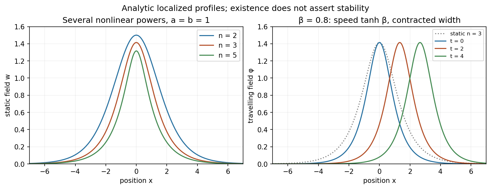

<h1 id="5/b/solution">Solution</h1>

↑ **Parent:** [B](../b.md)

Use the amplitude placement in the original PDF: $w=[A\cosh^2(Bx)]^{1/(1-n)}$. Introduce the actual peak $C=A^{-1/(n-1)}$ and $p=2/(n-1)$, so $w=C\operatorname{sech}^{p}(Bx)$. Its derivatives satisfy

$$
\frac{w''}{w}=p^2B^2-p(p+1)B^2\operatorname{sech}^2(Bx),\qquad
w^{n-1}=C^{n-1}\operatorname{sech}^2(Bx).
$$

The static equation is $w''=aw-bw^n$. Matching the constant and $\operatorname{sech}^2$ terms gives

$$
\boxed{B=\frac{n-1}{2}\sqrt a,\qquad
C=\left[\frac{a(n+1)}{2b}\right]^{1/(n-1)},\qquad
A=\frac{2b}{a(n+1)}.}
$$

Changing the sign of $B$ leaves the profile unchanged. If $A$ is instead defined as an outside prefactor, as in the held TeX transcription, its value is $C$, not the PDF's $A$. This notation discrepancy does not change the physical profile.

The nonconstant positive [power-law nonlinear Klein-Gordon pulse](../../../../../power-law-nonlinear-klein-gordon-pulse.md) is even, smooth, has peak $C$ at zero and decays as $e^{-\sqrt a|x|}$. The requested sketches below compare several powers with illustrative $a=b=1$. For odd $n$, its negative is also a solution. A separate constant branch occurs for $B=0$: the positive equilibrium has $C=(a/b)^{1/(n-1)}$, or $A=b/a$ in the PDF convention. The zero solution is another equilibrium, obtained as a limiting profile rather than finite positive $A$.

**[Figure 2](#5/b/image-localized-scalar-pulses-for-several-nonlinear-powers-and-lorentz-contracted-travelling-snapshots). Localized scalar pulses for several nonlinear powers, and Lorentz-contracted travelling snapshots**.

Now apply the [Lorentz boost](../../../../../lorentz-boost.md) with [rapidity](../../../../../rapidity.md) $-\beta$ to the static field. It gives

$$
\boxed{\phi(x,t)=C\operatorname{sech}^{2/(n-1)}
\left[B\cosh\beta\,(x-vt)\right],\qquad v=\tanh\beta.}
$$

For positive $\beta$, the centre moves to the right at $0<v<1$, with [speed](../../../../../speed.md) one the wave-speed unit. The peak stays $C$ and the width contracts by $1/\cosh\beta$. The shape translates without changing in time. This establishes a travelling solitary pulse; it does not by itself prove stability or elastic multi-pulse scattering.

## ↑ Ancestors (15)

1. [B](../b.md)
2. [5](../../5.md)
3. [Paper 1](../../../paper-1-split.md)
4. [2013](../../../split.md)
5. [Past exam of the theoretical physics I course of the University of Cambridge](../../../../split.md)
6. [Theoretical Physics I course of the University of Cambridge](../../../../../theoretical-physics-i-course-of-the-university-of-cambridge.md)
7. [Theoretical Physics course of the University of Cambridge](../../../../../theoretical-physics-course-of-the-university-of-cambridge.md)
8. [Physics course of the year 3 of the natural sciences course of the University of Cambridge](../../../../../physics-course-of-the-year-3-of-the-natural-sciences-course-of-the-university-of-cambridge.md)
9. [Year 3 of the natural sciences course of the University of Cambridge](../../../../../year-3-of-the-natural-sciences-course-of-the-university-of-cambridge.md)
10. [Year of the natural sciences course of the University of Cambridge](../../../../../year-of-the-natural-sciences-course-of-the-university-of-cambridge.md)
11. [Natural sciences course of the University of Cambridge](../../../../../natural-sciences-course-of-the-university-of-cambridge.md)
12. [Course of the University of Cambridge](../../../../../course-of-the-university-of-cambridge.md)
13. [University of Cambridge](../../../../../university-of-cambridge-split.md)
14. [List of universities](../../../../../list-of-universities.md)
15. [Codex Wiki](../../../../../split.md)
