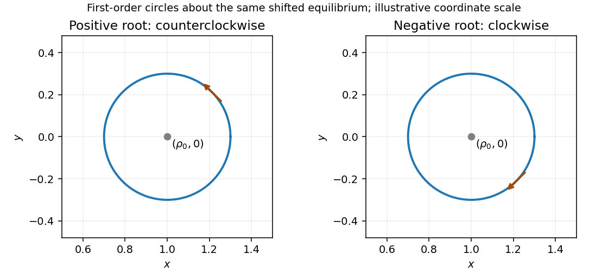

<h1 id="2/d/solution">Solution</h1>

↑ **Parent:** [D](../d.md)

Substitution of the proposed sine and cosine displacements into either linearized equation gives $m\omega^2+qB\omega-k=0$. Thus

$$
\boxed{\omega_{1,2}=-\frac{qB}{2m}
\left[1\mp\sqrt{1+\frac{4mk}{q^2B^2}}\right].}
$$

These are signed angular frequencies, not two positive [frequency](../../../../../frequency.md) magnitudes. To first order, with $\varepsilon\ll\rho_0$,

$$
x=\rho_0+\varepsilon\cos\omega t+O(\varepsilon^2/\rho_0),
\qquad y=\varepsilon\sin\omega t+O(\varepsilon^2/\rho_0).
$$

The orbit is therefore a **circle of radius $\varepsilon$ about $(\rho_0,0)$** at this order. The positive root runs counterclockwise; the negative root runs clockwise and has the larger magnitude. A positive charge in $B\hat{\mathbf z}$ alone circles clockwise. Here the spring permits an additional counterclockwise mode by providing inward force against its magnetic force.

**[Figure 1](#2/d/image-opposite-handed-circular-modes-about-the-shifted-spring-equilibrium). Opposite-handed circular modes about the shifted spring equilibrium**.

## ↑ Ancestors (15)

1. [D](../d.md)
2. [2](../../2.md)
3. [Paper 1](../../../paper-1-split.md)
4. [2014](../../../split.md)
5. [Past exam of the theoretical physics I course of the University of Cambridge](../../../../split.md)
6. [Theoretical Physics I course of the University of Cambridge](../../../../../theoretical-physics-i-course-of-the-university-of-cambridge.md)
7. [Theoretical Physics course of the University of Cambridge](../../../../../theoretical-physics-course-of-the-university-of-cambridge.md)
8. [Physics course of the year 3 of the natural sciences course of the University of Cambridge](../../../../../physics-course-of-the-year-3-of-the-natural-sciences-course-of-the-university-of-cambridge.md)
9. [Year 3 of the natural sciences course of the University of Cambridge](../../../../../year-3-of-the-natural-sciences-course-of-the-university-of-cambridge.md)
10. [Year of the natural sciences course of the University of Cambridge](../../../../../year-of-the-natural-sciences-course-of-the-university-of-cambridge.md)
11. [Natural sciences course of the University of Cambridge](../../../../../natural-sciences-course-of-the-university-of-cambridge.md)
12. [Course of the University of Cambridge](../../../../../course-of-the-university-of-cambridge.md)
13. [University of Cambridge](../../../../../university-of-cambridge-split.md)
14. [List of universities](../../../../../list-of-universities.md)
15. [Codex Wiki](../../../../../split.md)
