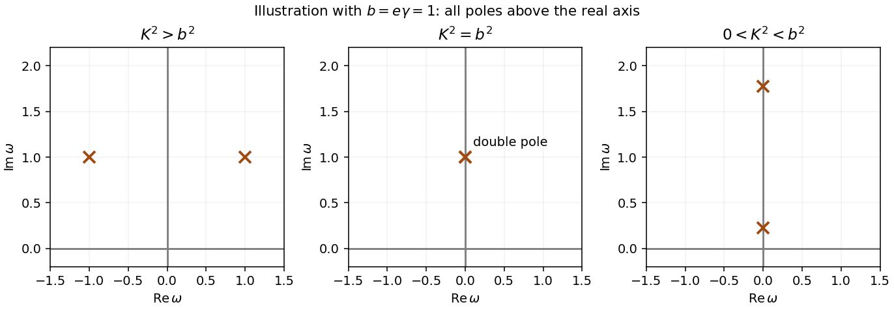

<h1 id="5/c/solution">Solution</h1>

↑ **Parent:** [C](../c.md)

The delta function in the artificial constant potential collapses the convolution. Put $b=e\gamma$ and $K^2=k^2+m^2$. Then

$$
\boxed{G(\mathbf k;\omega)=\frac1{-\omega^2+2ib\omega+K^2},
\qquad\omega_\pm=ib\pm\sqrt{K^2-b^2}.}
$$

Inverse [Fourier transform](../../../../../fourier-transform-split.md) gives the stated real-frequency integral with exponential $e^{-i\omega(t-t')}$. For $K^2>b^2$, the [poles](../../../../../pole.md) have opposite real parts and common imaginary part $b$. For $0<K^2<b^2$, both are imaginary, at $i[b\pm\sqrt{b^2-K^2}]$. They remain in the upper half-plane if $b>0$, or the lower half-plane if $b<0$. At equality they merge into a **second-order [pole](../../../../../pole.md) at $ib$**. For $K^2=0$ one [pole](../../../../../pole.md) reaches the real axis, requiring a prescription.

**[Figure 2](#5/c/image-pole-motion-above-at-and-below-the-repeated-pole-threshold-shown-for-positive-e-gamma). Pole motion above, at and below the repeated-pole threshold; shown for positive e gamma**.

## ↑ Ancestors (15)

1. [C](../c.md)
2. [5](../../5.md)
3. [Paper 1](../../../paper-1-split.md)
4. [2014](../../../split.md)
5. [Past exam of the theoretical physics I course of the University of Cambridge](../../../../split.md)
6. [Theoretical Physics I course of the University of Cambridge](../../../../../theoretical-physics-i-course-of-the-university-of-cambridge.md)
7. [Theoretical Physics course of the University of Cambridge](../../../../../theoretical-physics-course-of-the-university-of-cambridge.md)
8. [Physics course of the year 3 of the natural sciences course of the University of Cambridge](../../../../../physics-course-of-the-year-3-of-the-natural-sciences-course-of-the-university-of-cambridge.md)
9. [Year 3 of the natural sciences course of the University of Cambridge](../../../../../year-3-of-the-natural-sciences-course-of-the-university-of-cambridge.md)
10. [Year of the natural sciences course of the University of Cambridge](../../../../../year-of-the-natural-sciences-course-of-the-university-of-cambridge.md)
11. [Natural sciences course of the University of Cambridge](../../../../../natural-sciences-course-of-the-university-of-cambridge.md)
12. [Course of the University of Cambridge](../../../../../course-of-the-university-of-cambridge.md)
13. [University of Cambridge](../../../../../university-of-cambridge-split.md)
14. [List of universities](../../../../../list-of-universities.md)
15. [Codex Wiki](../../../../../split.md)
