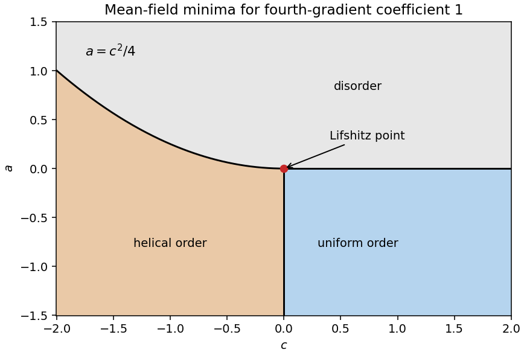

<h1 id="6/c/solution">Solution</h1>

↑ **Parent:** [C](../c.md)

Set $r=\phi_0$ and $A_k=a+ck^2+k^4$. The trial density is $A_kr^2+r^4/2$. At fixed $k$, its minimum is $r=0$ if $A_k\ge0$ and $r^2=-A_k$ otherwise, with density $-A_k^2/2$. Minimizing $A_k$ uses

$$
\frac{dA_k}{dk}=2k(c+2k^2)=0.
$$

For $c\ge0$, $k=0$ minimizes the quadratic coefficient. For $c<0$, the minima are at $k=\pm\sqrt{-c/2}$ and have $A_k=a-c^2/4$. Thus

$$
\boxed{
\begin{array}{c|c|c}
\text{ordered region}&k&\phi_0^2\\\hline
c\ge0,\ a<0&0&-a\\
c<0,\ a<c^2/4&\pm\sqrt{-c/2}&c^2/4-a
\end{array}}
$$

Everywhere else the minimum is $\phi=0$; at the transition boundary the ordered amplitude tends to zero. The zero-field minimum is respectively $-a^2/2$ or $-(a-c^2/4)^2/2$ in the two ordered regions. For $c<0$ the helical solution is lower than a uniform ordered extremum whenever the latter exists, and lower than the disordered state whenever its amplitude is nonzero. The assumed positive-amplitude ansatz must allow its zero-amplitude boundary to describe disorder.

**The phase $\delta$ remains arbitrary** because the functional has [global U(1) symmetry](../../../../../global-u-1-symmetry.md). At nonzero $k$, a [translation](../../../../../translation-geometry.md) shifts that phase; separate [translation](../../../../../translation-geometry.md) and phase operations retain a combined unbroken subgroup. The two signs of $k$ also select opposite handedness. The meeting point of the uniform, modulated and disordered mean-field regions is the [Lifshitz point](../../../../../lifshitz-point.md) $(a,c)=(0,0)$.

**[Figure 3](#6/c/image-uniform-helical-and-disordered-minima-of-the-specified-complex-landau-free-energy). Uniform, helical and disordered minima of the specified complex Landau free energy**.

## ↑ Ancestors (15)

1. [C](../c.md)
2. [6](../../6.md)
3. [Paper 1](../../../paper-1-split.md)
4. [2014](../../../split.md)
5. [Past exam of the theoretical physics I course of the University of Cambridge](../../../../split.md)
6. [Theoretical Physics I course of the University of Cambridge](../../../../../theoretical-physics-i-course-of-the-university-of-cambridge.md)
7. [Theoretical Physics course of the University of Cambridge](../../../../../theoretical-physics-course-of-the-university-of-cambridge.md)
8. [Physics course of the year 3 of the natural sciences course of the University of Cambridge](../../../../../physics-course-of-the-year-3-of-the-natural-sciences-course-of-the-university-of-cambridge.md)
9. [Year 3 of the natural sciences course of the University of Cambridge](../../../../../year-3-of-the-natural-sciences-course-of-the-university-of-cambridge.md)
10. [Year of the natural sciences course of the University of Cambridge](../../../../../year-of-the-natural-sciences-course-of-the-university-of-cambridge.md)
11. [Natural sciences course of the University of Cambridge](../../../../../natural-sciences-course-of-the-university-of-cambridge.md)
12. [Course of the University of Cambridge](../../../../../course-of-the-university-of-cambridge.md)
13. [University of Cambridge](../../../../../university-of-cambridge-split.md)
14. [List of universities](../../../../../list-of-universities.md)
15. [Codex Wiki](../../../../../split.md)
