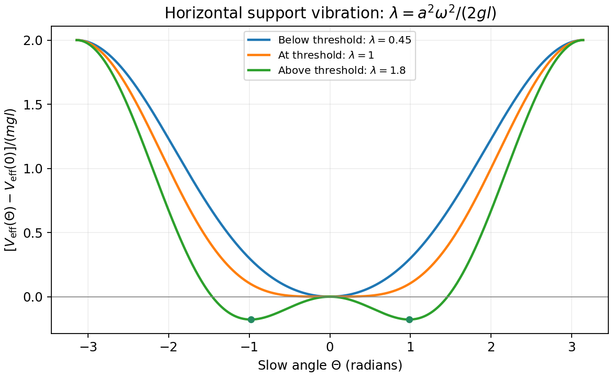

<h1 id="1/d/solution">Solution</h1>

↑ **Parent:** [D](../d.md)

For a fixed-pivot pendulum the angular inertia is $ml^2$, so $ml^2\ddot\Theta=-dV_{\rm eff}/d\Theta$. Integrating the averaged force gives, up to an arbitrary additive constant,

$$
\boxed{V_{\rm eff}(\Theta)=-mgl\cos\Theta+
\frac{ma^2\omega^2}{4}\cos^2\Theta.}
$$

Linearizing about $\Theta=0$ gives

$$
\ddot\Theta+\left(\frac gl-\frac{a^2\omega^2}{2l^2}\right)\Theta=0,
\qquad V_{\rm eff}''(0)=mgl-\frac{ma^2\omega^2}{2}.
$$

Hence the downward state becomes linearly unstable for

$$
\boxed{a>a_c=\frac{\sqrt{2gl}}{\omega}.}
$$

At $a=a_c$ its quadratic restoring term vanishes: the leading quartic coefficient is positive, so it is marginal at linear order, rather than already a local maximum. Above threshold the two stable tilted equilibria satisfy $\cos\Theta=2gl/(a^2\omega^2)$. Horizontal vibration therefore destabilizes the downward orientation and produces tilted minima; it does not stabilize the upward orientation in this model. Because $a_c/l=\sqrt2\sqrt{g/l}/\omega\ll1$, the threshold is compatible with the assumed small support excursion.

**[Figure 1](#1/d/image-original-averaged-pendulum-potentials-below-at-and-above-the-horizontal-vibration-instability-threshold). Original averaged pendulum potentials below, at and above the horizontal-vibration instability threshold**.

## ↑ Ancestors (15)

1. [D](../d.md)
2. [1](../../1.md)
3. [Paper 1](../../../paper-1-split.md)
4. [2015](../../../split.md)
5. [Past exam of the theoretical physics I course of the University of Cambridge](../../../../split.md)
6. [Theoretical Physics I course of the University of Cambridge](../../../../../theoretical-physics-i-course-of-the-university-of-cambridge.md)
7. [Theoretical Physics course of the University of Cambridge](../../../../../theoretical-physics-course-of-the-university-of-cambridge.md)
8. [Physics course of the year 3 of the natural sciences course of the University of Cambridge](../../../../../physics-course-of-the-year-3-of-the-natural-sciences-course-of-the-university-of-cambridge.md)
9. [Year 3 of the natural sciences course of the University of Cambridge](../../../../../year-3-of-the-natural-sciences-course-of-the-university-of-cambridge.md)
10. [Year of the natural sciences course of the University of Cambridge](../../../../../year-of-the-natural-sciences-course-of-the-university-of-cambridge.md)
11. [Natural sciences course of the University of Cambridge](../../../../../natural-sciences-course-of-the-university-of-cambridge.md)
12. [Course of the University of Cambridge](../../../../../course-of-the-university-of-cambridge.md)
13. [University of Cambridge](../../../../../university-of-cambridge-split.md)
14. [List of universities](../../../../../list-of-universities.md)
15. [Codex Wiki](../../../../../split.md)
