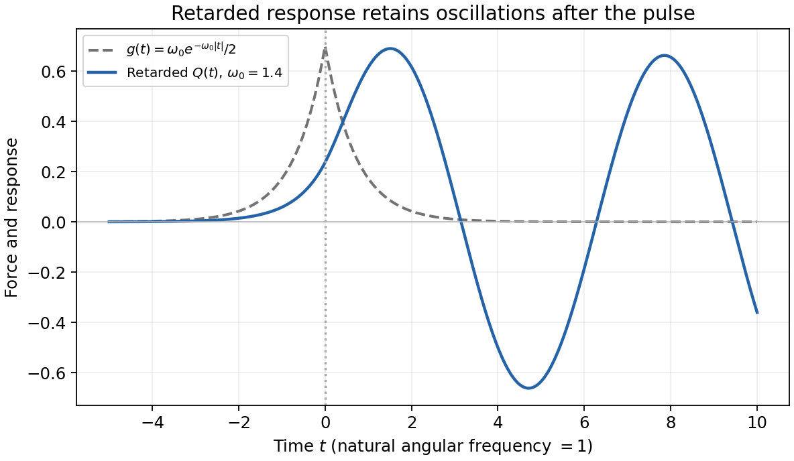

<h1 id="3/d/solution">Solution</h1>

↑ **Parent:** [D](../d.md)

The perturbed [Hamiltonian](../../../../../hamiltonian.md) is $H'=(Q^2+P^2)/2-g(t)Q$. [Hamilton's equations](../../../../../hamilton-s-equations.md) give $\dot Q=P$, $\dot P=-Q+g(t)$, hence

$$
\boxed{\ddot Q+Q=g(t).}
$$

In the paper's time units the natural frequency is one. The [retarded Green function](../../../../../retarded-green-function.md) is $G_R(t)=\Theta(t)\sin t$: it vanishes before the source, is continuous at zero and has a unit derivative jump there. With Fourier convention $e^{-i\omega t}$,

$$
\boxed{G_R(\omega)=\frac1{1-(\omega+i0^+)^2}.}
$$

Both real-frequency poles are displaced below the real axis. [Causality](../../../../../causality.md) therefore selects the convolution

$$
Q_R(t)=\int_{-\infty}^t\sin(t-t')\frac{\omega_0}{2}e^{-\omega_0|t'|}\,dt'.
$$

For $t<0$ the exponential rises as $e^{\omega_0t'}$ throughout the integral. For $t\ge0$, split the integral at $t'=0$. Evaluation yields

$$
\boxed{Q_R(t)=\frac{\omega_0}{2(1+\omega_0^2)}
\begin{cases}
e^{\omega_0 t},&t<0,\\
e^{-\omega_0t}+2\omega_0\sin t,&t\ge0.
\end{cases}}
$$

The response is nonzero before $t=0$ because the prescribed force is already nonzero then; this does not violate [causality](../../../../../causality.md). Both $Q$ and $\dot Q$ are continuous at zero. The force eventually decays, leaving the free oscillation $\omega_0^2\sin t/(1+\omega_0^2)$. A general solution adds $A\cos t+B\sin t$, but the retarded condition of no incoming free oscillation as $t\to-\infty$ fixes $A=B=0$.

The oscillator equation is well-defined on the full $(Q,P)$ plane. Interpreted through the positive-$p$ chart of part (c), it describes the original real variables only while $P>|Q|$, with $P=\dot Q$. The requested retarded oscillator solution is a continuation in the new variables; it is not a claim that this canonical chart remains valid at all times for every $\omega_0$.

**[Figure 2](#3/d/image-original-retarded-response-to-a-two-sided-exponential-force-the-pre-zero-response-follows-earlier-nonzero-forcing). Original retarded response to a two-sided exponential force; the pre-zero response follows earlier nonzero forcing**.

## ↑ Ancestors (15)

1. [D](../d.md)
2. [3](../../3.md)
3. [Paper 1](../../../paper-1-split.md)
4. [2015](../../../split.md)
5. [Past exam of the theoretical physics I course of the University of Cambridge](../../../../split.md)
6. [Theoretical Physics I course of the University of Cambridge](../../../../../theoretical-physics-i-course-of-the-university-of-cambridge.md)
7. [Theoretical Physics course of the University of Cambridge](../../../../../theoretical-physics-course-of-the-university-of-cambridge.md)
8. [Physics course of the year 3 of the natural sciences course of the University of Cambridge](../../../../../physics-course-of-the-year-3-of-the-natural-sciences-course-of-the-university-of-cambridge.md)
9. [Year 3 of the natural sciences course of the University of Cambridge](../../../../../year-3-of-the-natural-sciences-course-of-the-university-of-cambridge.md)
10. [Year of the natural sciences course of the University of Cambridge](../../../../../year-of-the-natural-sciences-course-of-the-university-of-cambridge.md)
11. [Natural sciences course of the University of Cambridge](../../../../../natural-sciences-course-of-the-university-of-cambridge.md)
12. [Course of the University of Cambridge](../../../../../course-of-the-university-of-cambridge.md)
13. [University of Cambridge](../../../../../university-of-cambridge-split.md)
14. [List of universities](../../../../../list-of-universities.md)
15. [Codex Wiki](../../../../../split.md)
