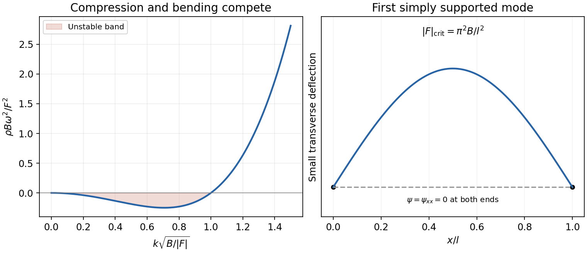

<h1 id="4/e/solution">Solution</h1>

↑ **Parent:** [E](../e.md)

With endpoints held at zero displacement but free to rotate, variation permits arbitrary endpoint $\delta\psi_x$ and gives the natural zero-moment condition $\psi_{xx}=0$ there. These are simply supported endpoints. The [normal modes](../../../../../normal-mode.md) are

$$
\psi_n(x,t)=A_n(t)\sin(n\pi x/l),\qquad k_n=n\pi/l.
$$

The first mode becomes unstable when $F+B(\pi/l)^2<0$, so

$$
\boxed{l>\pi\sqrt{\frac{B}{-F}}\quad(F<0).}
$$

Equivalently the compressive load exceeds $|F|_{\rm crit}=\pi^2B/l^2$. At equality the linear mode is neutral and nonlinear terms are needed to determine its post-buckling amplitude. The quadratic energy of $A\sin(\pi x/l)$ is $A^2l[F(\pi/l)^2+B(\pi/l)^4]/4$, giving the same sign test.

The endpoint displacement condition alone does not impose clamping. The quoted threshold uses the natural free-slope [boundary condition](../../../../../boundary-condition.md) of the stated variational problem. If rotations were also fixed, the admissible modes and threshold would change; one must not import a clamped-end formula into this result.

**[Figure 3](#4/e/image-original-bending-versus-compression-dispersion-and-the-first-simply-supported-buckling-mode). Original bending-versus-compression dispersion and the first simply supported buckling mode**.

## ↑ Ancestors (15)

1. [E](../e.md)
2. [4](../../4.md)
3. [Paper 1](../../../paper-1-split.md)
4. [2015](../../../split.md)
5. [Past exam of the theoretical physics I course of the University of Cambridge](../../../../split.md)
6. [Theoretical Physics I course of the University of Cambridge](../../../../../theoretical-physics-i-course-of-the-university-of-cambridge.md)
7. [Theoretical Physics course of the University of Cambridge](../../../../../theoretical-physics-course-of-the-university-of-cambridge.md)
8. [Physics course of the year 3 of the natural sciences course of the University of Cambridge](../../../../../physics-course-of-the-year-3-of-the-natural-sciences-course-of-the-university-of-cambridge.md)
9. [Year 3 of the natural sciences course of the University of Cambridge](../../../../../year-3-of-the-natural-sciences-course-of-the-university-of-cambridge.md)
10. [Year of the natural sciences course of the University of Cambridge](../../../../../year-of-the-natural-sciences-course-of-the-university-of-cambridge.md)
11. [Natural sciences course of the University of Cambridge](../../../../../natural-sciences-course-of-the-university-of-cambridge.md)
12. [Course of the University of Cambridge](../../../../../course-of-the-university-of-cambridge.md)
13. [University of Cambridge](../../../../../university-of-cambridge-split.md)
14. [List of universities](../../../../../list-of-universities.md)
15. [Codex Wiki](../../../../../split.md)
