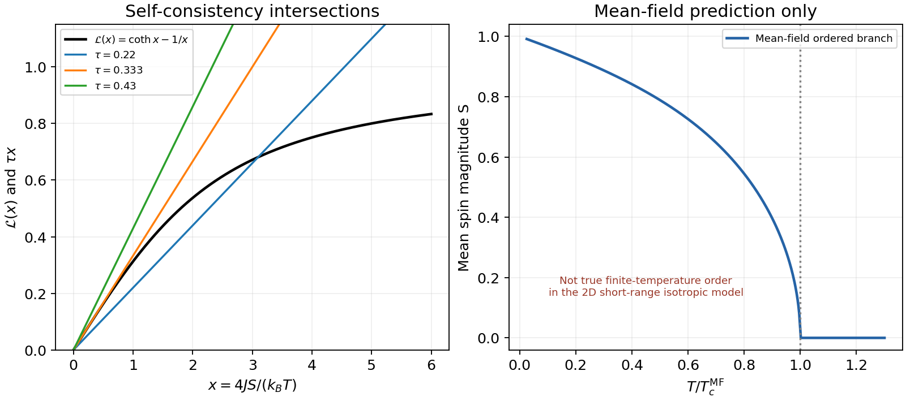

<h1 id="6/d/solution">Solution</h1>

↑ **Parent:** [D](../d.md)

Near zero the [Langevin function](../../../../../langevin-function.md) has expansion

$$
\mathcal L(x)=\frac x3-\frac{x^3}{45}+O(x^5).
$$

For positive $x$, $\mathcal L(x)$ rises toward one and its ratio $\mathcal L(x)/x$ decreases from $1/3$ to zero. Therefore a line $\tau x$ has only the zero intersection for $\tau\ge1/3$, and also a nonzero positive intersection for $0<\tau<1/3$. In a fixed signed component there is a corresponding negative solution; in the isotropic vector problem the nonzero solutions have all spin-space orientations.

The mean-field transition temperature is

$$
\boxed{k_BT_c^{\rm MF}=\frac{z_cJ}{3}=\frac{4J}{3}.}
$$

At the [critical temperature](../../../../../critical-temperature.md) the line is tangent at the origin. Just below it, $S\simeq\sqrt{(5/3)(1-T/T_c^{\rm MF})}$, the usual mean-field square-root onset. The ordered minimum is stable below this temperature while $S=0$ becomes unstable.

**This is a mean-field prediction, not a genuine finite-temperature ordering transition for the ideal two-dimensional short-range isotropic model.** Long-wavelength [spin](../../../../../spin.md) fluctuations invalidate the predicted nonzero thermodynamic [magnetization](../../../../../magnetization.md) at every $T>0$. The relevant obstruction is the [Mermin-Wagner theorem](../../../../../mermin-wagner-theorem.md) for continuous [spin](../../../../../spin.md) symmetry; anisotropy, long-range interactions or a finite sample change the assumptions. Its original paper establishes the absence of finite-temperature magnetic ordering for one- and two-dimensional finite-range isotropic [Heisenberg models](../../../../../heisenberg-model.md).[Physical Review Letters 17, 1133 (1966), abstract; physical limitation of finite-temperature mean-field order](../../../../../absence-of-ferromagnetism-or-antiferromagnetism-in-one-or-two-dimensional-isotropic-heisenberg-models-by-n-d-mermin-and-h-wagner.md)

**[Figure 4](#6/d/image-original-langevin-self-consistency-plot-and-the-mean-field-order-parameter-explicitly-distinguished-from-true-two-dimensional-isotropic-long-range-order). Original Langevin self-consistency plot and the mean-field order parameter, explicitly distinguished from true two-dimensional isotropic long-range order**.

## ↑ Ancestors (15)

1. [D](../d.md)
2. [6](../../6.md)
3. [Paper 1](../../../paper-1-split.md)
4. [2015](../../../split.md)
5. [Past exam of the theoretical physics I course of the University of Cambridge](../../../../split.md)
6. [Theoretical Physics I course of the University of Cambridge](../../../../../theoretical-physics-i-course-of-the-university-of-cambridge.md)
7. [Theoretical Physics course of the University of Cambridge](../../../../../theoretical-physics-course-of-the-university-of-cambridge.md)
8. [Physics course of the year 3 of the natural sciences course of the University of Cambridge](../../../../../physics-course-of-the-year-3-of-the-natural-sciences-course-of-the-university-of-cambridge.md)
9. [Year 3 of the natural sciences course of the University of Cambridge](../../../../../year-3-of-the-natural-sciences-course-of-the-university-of-cambridge.md)
10. [Year of the natural sciences course of the University of Cambridge](../../../../../year-of-the-natural-sciences-course-of-the-university-of-cambridge.md)
11. [Natural sciences course of the University of Cambridge](../../../../../natural-sciences-course-of-the-university-of-cambridge.md)
12. [Course of the University of Cambridge](../../../../../course-of-the-university-of-cambridge.md)
13. [University of Cambridge](../../../../../university-of-cambridge-split.md)
14. [List of universities](../../../../../list-of-universities.md)
15. [Codex Wiki](../../../../../split.md)
