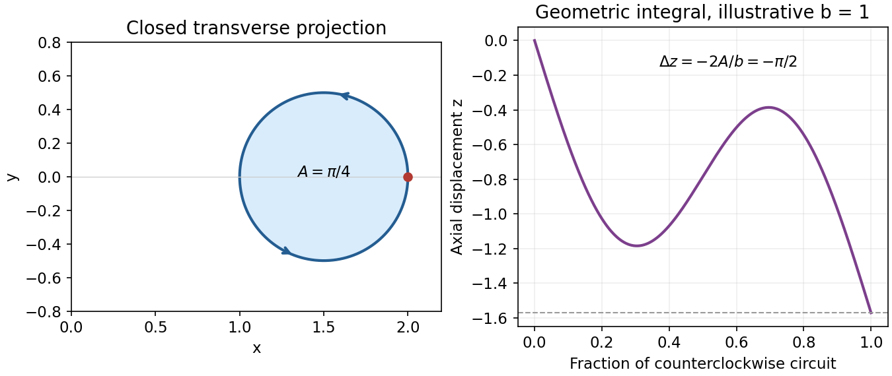
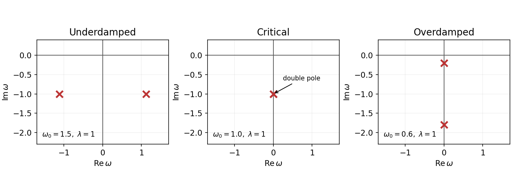
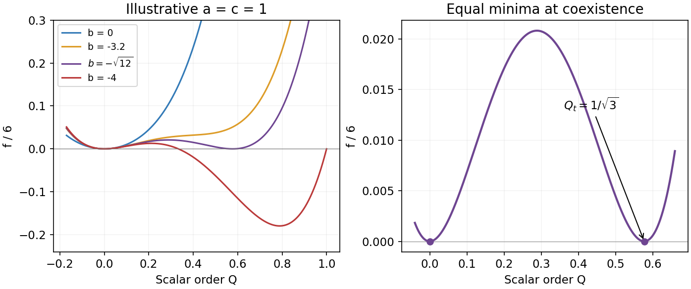

# Paper 1

↑ **Parent:** [2016](../2016.md)

Original source: [Cambridge FOI 2023/399 released PDF, physical pages 417–420](https://www.whatdotheyknow.com/request/natural_science_tripos_physics_e_2/response/2340776/attach/2/FOI%202023%20399%20Zahid%20materials.pdf?cookie_passthrough=1#page=417).

**Table of contents**

- [1](#1)
  - [a](#1/a)
    - [Solution](#1/a/solution)
  - [b](#1/b)
    - [Solution](#1/b/solution)
  - [c](#1/c)
    - [Solution](#1/c/solution)
  - [d](#1/d)
    - [Solution](#1/d/solution)
- [2](#2)
  - [a](#2/a)
    - [Solution](#2/a/solution)
  - [b](#2/b)
    - [Solution](#2/b/solution)
  - [c](#2/c)
    - [Solution](#2/c/solution)
  - [d](#2/d)
    - [Solution](#2/d/solution)
- [3](#3)
  - [a](#3/a)
    - [Solution](#3/a/solution)
  - [b](#3/b)
    - [Solution](#3/b/solution)
  - [c](#3/c)
    - [Solution](#3/c/solution)
  - [d](#3/d)
    - [Solution](#3/d/solution)
- [4](#4)
  - [a](#4/a)
    - [Solution](#4/a/solution)
  - [b](#4/b)
    - [Solution](#4/b/solution)
  - [c](#4/c)
    - [Solution](#4/c/solution)
  - [d](#4/d)
    - [Solution](#4/d/solution)
  - [e](#4/e)
    - [Solution](#4/e/solution)
  - [f](#4/f)
    - [Solution](#4/f/solution)

## 1

↑ **Parent:** [Paper 1](paper-1.md)

<h3 id="1/a">a</h3>

↑ **Parent:** [1](#1)

<h4 id="1/a/solution">Solution</h4>

↑ **Parent:** [A](#1/a)

Write the bead position in [Cartesian coordinates](../../linear-algebra.md#cartesian-coordinate-system) as $\mathbf x_B=(a\cos\theta_B,a\sin\theta_B,b\theta_B)$. Differentiation gives $|\dot{\mathbf x}_B|^2=(a^2+b^2)\dot\theta_B^2$, while the free particle has $|\dot{\mathbf x}|^2=\dot r^2+r^2\dot\theta^2+\dot z^2$. Thus the [kinetic energy](../../energy.md#kinetic-energy) is the sum of these squared [speeds](../../classical-mechanics.md#speed) weighted by half the respective [mass](../../classical-mechanics.md#mass). The squared [spring](../../elasticity-physics.md#spring) length is

$$
\ell^2=|\mathbf x-\mathbf x_B|^2=r^2+a^2-2ar\cos(\theta-\theta_B)+(z-b\theta_B)^2.
$$

A [spring](../../elasticity-physics.md#spring) obeying [Hooke's law](../../elasticity-physics.md#hooke-s-law) with zero natural length has [potential energy](../../energy.md#potential-energy) $k\ell^2/2$. Consequently **$L=T-k\ell^2/2$**, and deleting the additive constant $-ka^2/2$ gives

$$
L=\frac m2(\dot r^2+r^2\dot\theta^2+\dot z^2)+\frac{M(a^2+b^2)}2\dot\theta_B^2-\frac k2\left[r^2-2ar\cos(\theta-\theta_B)+(z-b\theta_B)^2\right].
$$

The [spring](../../elasticity-physics.md#spring) length is the straight separation of its endpoints, not distance measured along the [helix](../../topology.md#helix). The fixed frictionless constraint is already incorporated by using the [generalized coordinate](../../lagrangian-mechanics.md#generalized-coordinate) $\theta_B$; it supplies no extra [potential energy](../../energy.md#potential-energy).

<h3 id="1/b">b</h3>

↑ **Parent:** [1](#1)

<h4 id="1/b/solution">Solution</h4>

↑ **Parent:** [B](#1/b)

Set $\Delta=\theta-\theta_B$ and $u=z-b\theta_B$. Applying the [Euler-Lagrange equations](../../analysis.md#euler-lagrange-equation) separately to $r,\theta,z,\theta_B$ gives

$$
\boxed{\begin{aligned}
m(\ddot r-r\dot\theta^2)&=-k(r-a\cos\Delta),\\
\frac{d}{dt}(mr^2\dot\theta)&=-kar\sin\Delta,\\
m\ddot z&=-ku,\\
M(a^2+b^2)\ddot\theta_B&=k(ar\sin\Delta+bu).
\end{aligned}}
$$

For example, $\partial L/\partial\theta=-kar\sin\Delta$ whereas $\partial L/\partial\theta_B=kar\sin\Delta+kb u$; these signs also follow from equal and opposite [spring](../../elasticity-physics.md#spring) [forces](../../force.md) projected on the permitted bead motion. The angular particle equation can equivalently be written $m(r^2\ddot\theta+2r\dot r\dot\theta)=-kar\sin\Delta$. The factor $M(a^2+b^2)$ is the bead's inertia with respect to the helical coordinate, rather than its [moment of inertia](../../rigid-body-dynamics.md#moment-of-inertia) about the axis alone.

<h3 id="1/c">c</h3>

↑ **Parent:** [1](#1)

<h4 id="1/c/solution">Solution</h4>

↑ **Parent:** [C](#1/c)

The continuous transformation $\theta\mapsto\theta+\epsilon$, $\theta_B\mapsto\theta_B+\epsilon$, $z\mapsto z+b\epsilon$, $r\mapsto r$ moves both endpoints by the same screw motion and preserves the fixed [helix](../../topology.md#helix). Both $\Delta$ and $u$ are unchanged, so $\delta L=0$. [Noether theorem](../../calculus-of-variations.md#noether-theorem) therefore gives

$$
\boxed{\mathcal Q=p_\theta+p_{\theta_B}+bp_z=mr^2\dot\theta+M(a^2+b^2)\dot\theta_B+bm\dot z=\text{constant}.}
$$

This is the [Noether conserved quantity for a mechanical point symmetry](../../calculus-of-variations.md#noether-conserved-quantity-for-a-mechanical-point-symmetry) applied to [helical symmetry](../../physics.md#helical-symmetry). In physical Cartesian terms it equals **total $z$ [angular momentum](../../momentum.md#angular-momentum) plus $b$ times total $z$ [linear momentum](../../momentum.md)**: the bead contributes $Ma^2\dot\theta_B+b(Mb\dot\theta_B)$. Neither pure axial [translation](../../geometry-and-topology.md#translation-geometry) nor pure axial [rotation](../../riemannian-geometry.md#rotation-mathematics) preserves the fixed coil separately. Their conserved combination is a consequence of the [helical symmetry](../../physics.md#helical-symmetry), not two independently conserved momenta. Substitution of the four equations of motion verifies $\dot{\mathcal Q}=-kar\sin\Delta+k(ar\sin\Delta+bu)-bku=0$.[online chapter 2, §2.4.1, equations (2.76)–(2.79): continuous coordinate symmetry and its conserved momentum](../../physics-bibliography.md#classical-dynamics-by-david-tong)

<h3 id="1/d">d</h3>

↑ **Parent:** [1](#1)

<h4 id="1/d/solution">Solution</h4>

↑ **Parent:** [D](#1/d)

In the negligible bead-mass limit the bead contribution to $\mathcal Q$ vanishes. Since the particle starts at rest, $\mathcal Q=0$, and hence $r^2\dot\theta+b\dot z=0$. Assume $b\ne0$ and a regular massless limit. Integrating along the trajectory gives

$$
\Delta z=-\frac1b\int_0^T r^2\dot\theta\,dt=-\frac1b\oint_C(x\,dy-y\,dx),
$$

where $C$ is the closed projection onto the plane perpendicular to the coil axis. The given final $r$ and $\theta$ ensure that this projection closes. [Green's theorem](../../multivariable-calculus.md#green-theorem) identifies

$$
A=\frac12\oint_C(x\,dy-y\,dx)=\frac12\oint_C r^2\,d\theta,\qquad \boxed{\Delta z=-\frac{2A}{b}}.
$$

Thus **$A$ is the [signed area](../../differential-geometry.md#signed-area) enclosed by the transverse projection**, positive for counterclockwise traversal viewed from positive $z$. Self-intersecting projections contribute their winding-weighted areas; it is neither an unsigned area nor an area of a surface in three dimensions. For $b>0$, a positive [signed area](../../differential-geometry.md#signed-area) gives negative axial displacement. This is [signed-area displacement under a helical constraint](../../physics.md#signed-area-displacement-under-a-helical-constraint): returning to the same projected coordinates can leave a nonzero axial displacement.

**[Figure 1](#1/d/image-signed-transverse-area-and-the-associated-axial-displacement-for-an-illustrative-closed-projection). Signed transverse area and the associated axial displacement for an illustrative closed projection**.

The plotted loop illustrates the geometric integral only; it is not asserted to be a particular [spring](../../elasticity-physics.md#spring) trajectory.

## 2

↑ **Parent:** [Paper 1](paper-1.md)

<h3 id="2/a">a</h3>

↑ **Parent:** [2](#2)

<h4 id="2/a/solution">Solution</h4>

↑ **Parent:** [A](#2/a)

Use [natural units](../../mathematical-physics.md#natural-units) and the [Minkowski metric](../../special-relativity.md#minkowski-metric) $g_{\mu\nu}=\operatorname{diag}(1,-1,-1,-1)$, with $A^\mu=(\Phi,\mathbf A)$ and $A_\mu=(\Phi,-\mathbf A)$. Then $F_{0i}=E_i$, $F^{i0}=E_i$, and $F^{ij}=-\epsilon_{ijk}B_k$. The [electromagnetic field tensor](../../relativistic-electromagnetism.md#electromagnetic-field-tensor) is an [antisymmetric tensor](../../multilinear-algebra.md#antisymmetric-tensor), which gives gives

$$
\delta\mathcal L=-\tfrac12F^{\mu\nu}\delta F_{\mu\nu}=-F^{\mu\nu}\partial_\mu\delta A_\nu.
$$

[integration by parts](../../calculus.md#integration-by-parts) in the [action](../../lagrangian-mechanics.md#action), with the [variation](../../calculus-of-variations.md#variation) vanishing on its boundary, yields $\delta S=\int d^4x\,(\partial_\mu F^{\mu\nu})\delta A_\nu$. Independent [variations](../../calculus-of-variations.md#variation) of the four components therefore give **$\partial_\mu F^{\mu\nu}=0$**. The time component is $\nabla\cdot\mathbf E=0$; the spatial components are $\nabla\times\mathbf B-\partial_t\mathbf E=0$. These are the two source-free [Maxwell equations](../../maxwell-equations.md) obtained dynamically. The other two, $\nabla\cdot\mathbf B=0$ and $\partial_t\mathbf B+\nabla\times\mathbf E=0$, follow identically from $F=dA$, through the [Electromagnetic Bianchi identity](../../relativistic-electromagnetism.md#electromagnetic-bianchi-identity). They are not additional [Euler-Lagrange field equations](../../classical-field-theory.md#euler-lagrange-field-equation).[chapter 1, §§1.1 and 1.1.3: potential conventions and the Maxwell variation](../../physics-bibliography.md#quantum-field-theory-by-david-tong)

<h3 id="2/b">b</h3>

↑ **Parent:** [2](#2)

<h4 id="2/b/solution">Solution</h4>

↑ **Parent:** [B](#2/b)

In the same [Minkowski metric](../../special-relativity.md#minkowski-metric) and electromagnetic units, $T^{\mu\nu}=-F^\mu{}_{\lambda}F^{\nu\lambda}+\tfrac14g^{\mu\nu}F_{\alpha\beta}F^{\alpha\beta}$. Differentiating gives

$$
\partial_\mu T^{\mu\nu}=-(\partial_\mu F^\mu{}_{\lambda})F^{\nu\lambda}-F^\mu{}_{\lambda}\partial_\mu F^{\nu\lambda}+\frac14\partial^\nu(F_{\alpha\beta}F^{\alpha\beta}).
$$

To simplify the last two terms, contract $\partial_\mu F_{\nu\lambda}+\partial_\nu F_{\lambda\mu}+\partial_\lambda F_{\mu\nu}=0$ with $F^{\mu\lambda}$. Its first and third terms are equal, and its middle term is $-\tfrac12\partial_\nu(F_{\alpha\beta}F^{\alpha\beta})$. Raising $\nu$ therefore gives $F^\mu{}_{\lambda}\partial_\mu F^{\nu\lambda}=\tfrac14\partial^\nu(F_{\alpha\beta}F^{\alpha\beta})$. The cancellation leaves

$$
\partial_\mu T^{\mu\nu}=-F^{\nu\lambda}\partial_\mu F^\mu{}_{\lambda},\qquad \boxed{\partial_\mu T^{\mu\nu}=0\quad\text{in vacuum}.}
$$

This is the [electromagnetic stress-energy divergence identity](../../relativistic-electromagnetism.md#electromagnetic-stress-energy-divergence-identity) in rationalized units. As a sign check, $T^{00}=(E^2+B^2)/2$ is positive and $T^{0i}=(\mathbf E\times\mathbf B)_i$ is the [Poynting vector](../../electromagnetic-wave.md#poynting-vector). The integrated [four-momentum](../../special-relativity.md#four-momentum) $P^\nu=\int T^{0\nu}d^3x$ is conserved if the boundary flux vanishes. With matter [sources](../../perturbative-quantum-field-theory.md#source-quantum-field-theory), the [electromagnetic field](../../electromagnetism.md#electromagnetic-field) alone instead obeys $\partial_\mu T^{\mu\nu}=-F^{\nu\lambda}J_\lambda$: [energy](../../energy.md) and momentum transfer to matter restore conservation of the total [stress-energy tensor](../../stress-energy-tensor.md).

<h3 id="2/c">c</h3>

↑ **Parent:** [2](#2)

<h4 id="2/c/solution">Solution</h4>

↑ **Parent:** [C](#2/c)

Hold $\phi,\phi^*$ fixed while varying $A_\nu$. With the specified convention $D_\mu=\partial_\mu+iqA_\mu$, the two matter [variations](../../calculus-of-variations.md#variation) are $\delta(D_\mu\phi)=iq\phi\,\delta A_\mu$ and $\delta(D_\mu\phi)^*=-iq\phi^*\delta A_\mu$. Thus

$$
\delta\mathcal L_{\rm matter}=iq\left[\phi(D^\nu\phi)^*-\phi^*D^\nu\phi\right]\delta A_\nu=-J^\nu\delta A_\nu.
$$

Adding the Maxwell [variation](../../calculus-of-variations.md#variation) from part (a) gives $\delta S=\int d^4x\,[\partial_\mu F^{\mu\nu}-J^\nu]\delta A_\nu$. Consequently

$$
\boxed{\partial_\mu F^{\mu\nu}=J^\nu,\qquad J^\mu=iq\left[\phi^*D^\mu\phi-\phi(D^\mu\phi)^*\right].}
$$

Expanding the [gauge covariant derivatives](../../relativistic-quantum-field.md#gauge-covariant-derivative) supplies a useful convention check:

$$
J^\mu=iq(\phi^*\partial^\mu\phi-\phi\partial^\mu\phi^*)-2q^2A^\mu|\phi|^2.
$$

In particular, the last sign is negative for the specified plus sign in $D_\mu$. Reversing that convention requires consistently changing the phase transformation and current conventions as well. This current is the matter [source](../../perturbative-quantum-field-theory.md#source-quantum-field-theory) in [scalar electrodynamics](../../relativistic-quantum-field.md#scalar-electrodynamics); its $A$ dependence must not be dropped.

<h3 id="2/d">d</h3>

↑ **Parent:** [2](#2)

<h4 id="2/d/solution">Solution</h4>

↑ **Parent:** [D](#2/d)

Take the constant-parameter subgroup of the local transformation: $\delta\phi=-iq\epsilon\phi$, $\delta\phi^*=iq\epsilon\phi^*$, $\delta A_\mu=0$. The momenta conjugate to the [complex scalar field](../../scalar-field-theory.md#complex-scalar-field) [gradients](../../multivariable-calculus.md#gradient) are $\Pi_\phi^\mu=(D^\mu\phi)^*$ and $\Pi_{\phi^*}^\mu=D^\mu\phi$. [Noether theorem](../../calculus-of-variations.md#noether-theorem) gives

$$
j^\mu=\Pi_\phi^\mu\frac{\delta\phi}{\epsilon}+\Pi_{\phi^*}^\mu\frac{\delta\phi^*}{\epsilon}=iq[\phi^*D^\mu\phi-\phi(D^\mu\phi)^*]=J^\mu.
$$

The [scalar field](../../classical-field-theory.md#scalar-field) equations are $D_\mu D^\mu\phi+m^2\phi=0$ and their [complex conjugate](../../complex-analysis.md#complex-conjugate). Applying the [product rule](../../calculus.md#product-rule), the gauge-potential terms cancel to give

$$
\partial_\mu J^\mu=iq\left[\phi^*D_\mu D^\mu\phi-\phi(D_\mu D^\mu\phi)^*\right]=iq[-m^2|\phi|^2+m^2|\phi|^2]=\boxed{0}.
$$

This establishes conservation of the [Noether current of scalar electrodynamics](../../relativistic-quantum-field.md#noether-current-of-scalar-electrodynamics) [on shell](../../classical-field-theory.md#on-shell), and conservation of its integrated [electric charge](../../electric-charge.md) when there is no boundary flux. An arbitrary function $\alpha(x)$ describes [gauge redundancy](../../relativistic-quantum-field.md#gauge-redundancy); the associated [Noether second theorem](../../calculus-of-variations.md#noether-second-theorem) supplies an identity among [Euler-Lagrange field equations](../../classical-field-theory.md#euler-lagrange-field-equation), rather than a distinct physical charge for each function. Indeed its on-shell current can be written $j^\mu[\alpha]=\alpha J^\mu-F^{\mu\nu}\partial_\nu\alpha=-\partial_\nu(\alpha F^{\mu\nu})$. The [antisymmetric tensor](../../multilinear-algebra.md#antisymmetric-tensor) makes its [divergence](../../multivariable-calculus.md#divergence) vanish. Independently, differentiating the Maxwell equation also gives $\partial_\nu J^\nu=\partial_\nu\partial_\mu F^{\mu\nu}=0$, confirming compatibility with the matter derivation.[§1.3.4, internal phase symmetry; §6.1, gauge symmetry and its constant subgroup](../../physics-bibliography.md#quantum-field-theory-by-david-tong)

## 3

↑ **Parent:** [Paper 1](paper-1.md)

<h3 id="3/a">a</h3>

↑ **Parent:** [3](#3)

<h4 id="3/a/solution">Solution</h4>

↑ **Parent:** [A](#3/a)

Treat $\phi$ and $\phi^*$ as independent variables during [variation](../../calculus-of-variations.md#variation). With [Minkowski metric](../../special-relativity.md#minkowski-metric) $(+---)$, differentiation with respect to $\phi^*$ gives

$$
\frac{\partial\mathcal L}{\partial(\partial_\mu\phi^*)}=\partial^\mu\phi+ieA^\mu\phi,\qquad \frac{\partial\mathcal L}{\partial\phi^*}=-m^2\phi-ieA^\mu\partial_\mu\phi+f(t).
$$

The [Euler-Lagrange field equation](../../classical-field-theory.md#euler-lagrange-field-equation) is therefore $\Box\phi+2ieA^\mu\partial_\mu\phi+ie(\partial_\mu A^\mu)\phi+m^2\phi=f$. The static purely temporal potential has $\partial_\mu A^\mu=\partial_tV=0$, giving

$$
\boxed{(\partial_t^2-\nabla^2+2ieV(\mathbf r)\partial_t+m^2)\phi=f(t).}
$$

[variation](../../calculus-of-variations.md#variation) with respect to $\phi$ gives $(\Box-2ieA^\mu\partial_\mu+m^2)\phi^*=f(t)$. This is the [complex conjugate](../../complex-analysis.md#complex-conjugate) equation when the driving [force](../../force.md) is real, as is required for the supplied [lagrangian density](../../classical-field-theory.md#lagrangian-density) to be real. For a complex driving amplitude a real [source](../../perturbative-quantum-field-theory.md#source-quantum-field-theory) term would instead require conjugate coefficients. The interaction supplied here is linear in the external potential: adding the $e^2A_\mu A^\mu|\phi|^2$ term from full [minimal coupling](../../quantum-theory.md#minimal-coupling) would change the problem and its [equation of motion](../../classical-mechanics.md#equation-of-motion).

<h3 id="3/b">b</h3>

↑ **Parent:** [3](#3)

<h4 id="3/b/solution">Solution</h4>

↑ **Parent:** [B](#3/b)

Time independence of $V$ makes the [Green function](../../green-s-function.md) depend on $t,t'$ through $\tau=t-t'$. A spatially varying potential does not imply spatial [translation](../../geometry-and-topology.md#translation-geometry) invariance. Fix $\mathbf r'$ and set $\mathbf x=\mathbf r-\mathbf r'$; write the Fourier coefficient more fully as $G_{\mathbf r'}(\mathbf k;\omega)$. The [source](../../perturbative-quantum-field-theory.md#source-quantum-field-theory) position is an implicit parameter in the printed notation. Define

$$
V_{\mathbf r'}(\mathbf q)=\int d^3x\,V(\mathbf r'+\mathbf x)e^{-i\mathbf q\cdot\mathbf x}=e^{i\mathbf q\cdot\mathbf r'}\widetilde V(\mathbf q).
$$

The ordinary derivative terms transform into $(-\omega^2+k^2+m^2)G_{\mathbf r'}$. The product $V\partial_tG$ becomes a [convolution](../../fourier-analysis.md#convolution), and $2ie(-i\omega)=2e\omega$. More explicitly, insert both inverse spatial [Fourier transforms](../../fourier-transform.md) into $VG$: the integral over $\mathbf x$ enforces $\mathbf q+\mathbf k'=\mathbf k$. The transformed delta [source](../../perturbative-quantum-field-theory.md#source-quantum-field-theory) is one, leaving

$$
\boxed{(-\omega^2+k^2+m^2)G_{\mathbf r'}(\mathbf k;\omega)+2e\omega\int\frac{d^3k'}{(2\pi)^3}V_{\mathbf r'}(\mathbf k-\mathbf k')G_{\mathbf r'}(\mathbf k';\omega)=1.}
$$

This is a [source-position-dependent Fourier Green function](../../green-s-function.md#source-position-dependent-fourier-green-function). Dropping the explicit $\mathbf r'$ subscripts recovers the requested notation with exactly the potential transform defined in the source. No assumption of a homogeneous potential is needed. The factor $(2\pi)^{-3}$ and the source-position phase are necessary for the stated Fourier convention.

<h3 id="3/c">c</h3>

↑ **Parent:** [3](#3)

<h4 id="3/c/solution">Solution</h4>

↑ **Parent:** [C](#3/c)

The delta function in the specified [convolution](../../fourier-analysis.md#convolution) kernel collapses the $\mathbf k'$ integral to $-i\gamma G$. Set $\lambda=e\gamma$ and $\omega_0^2=k^2+m^2$. Then

$$
G(\mathbf k;\omega)=\frac1{-\omega^2-2i\lambda\omega+\omega_0^2},\qquad G(\mathbf k;\tau)=\int_{-\infty}^{\infty}\frac{d\omega}{2\pi}\frac{e^{-i\omega\tau}}{-\omega^2-2i\lambda\omega+\omega_0^2}.
$$

There is a change of assumptions here: the specified kernel is the transform of **$V=-i\gamma$**, which is not real. These later parts define a formal [analytic continuation](../../holomorphic-function.md#analytic-continuation) to an effective damped equation, $[\partial_\tau^2+2\lambda\partial_\tau+\omega_0^2]G=\delta(\tau)$; they cannot simultaneously describe the earlier real external potential. The following [pole](../../isolated-singularity.md#pole) analysis uses that continued operator.

Completing the square gives $D(\omega)=-(\omega+i\lambda)^2+(\omega_0^2-\lambda^2)$, so

$$
\boxed{\omega_\pm=-i\lambda\pm\sqrt{k^2+m^2-\lambda^2}.}
$$

For $e>0$, hence $\lambda>0$, the underdamped regime has two [poles](../../isolated-singularity.md#pole) at $\pm\Omega-i\lambda$, with $\Omega=\sqrt{k^2+m^2-\lambda^2}>0$. Both lie below the [real axis](../../complex-analysis.md#real-axis). In the overdamped regime they lie on the [imaginary axis](../../complex-analysis.md#imaginary-axis) at $-i(\lambda\mp\kappa)$, where $\kappa=\sqrt{\lambda^2-k^2-m^2}<\lambda$ for $k^2+m^2>0$; both are again below the [real axis](../../complex-analysis.md#real-axis). At equality they coalesce into a [double pole](../../isolated-singularity.md#double-pole) at $-i\lambda$. If $m<|\lambda|$, the crossover occurs at $k_c=\sqrt{\lambda^2-m^2}$; increasing $k$ moves the two imaginary [poles](../../isolated-singularity.md#pole) together and then apart horizontally. If $m>|\lambda|$, every $k$ is underdamped; if equal, only $k=0$ is critical.

**[Figure 2](#3/c/image-underdamped-critically-damped-and-overdamped-pole-positions-for-positive-damping). Underdamped, critically damped and overdamped pole positions for positive damping**.

The sign of $e$ is not specified: for $e<0$ all nonzero-frequency [poles](../../isolated-singularity.md#pole) are instead in the [upper half-plane](../../complex-analysis.md#upper-half-plane-complex-analysis), describing [antidamping](../../wave-equation.md#antidamping); for $e=0$ they lie on the [real axis](../../complex-analysis.md#real-axis) and a causal prescription is required. When $m=k=0$, one [pole](../../isolated-singularity.md#pole) is at zero even for nonzero $\lambda$ and a real-axis prescription is again needed. The figure uses illustrative $\lambda=1$, not supplied numerical data.

<h3 id="3/d">d</h3>

↑ **Parent:** [3](#3)

<h4 id="3/d/solution">Solution</h4>

↑ **Parent:** [D](#3/d)

Let $\tau=t-t'$ and $\Omega=\sqrt{k^2+m^2-\lambda^2}>0$. First take $\lambda=e\gamma>0$. Since $|e^{-i\omega\tau}|=e^{\tau\operatorname{Im}\omega}$, close the [contour](../../complex-analysis.md#complex-integration-contour) below for $\tau>0$, and above for $\tau<0$. On the chosen semicircle the exponential is bounded and the denominator grows as $R^2$, so the arc integral tends to zero. The upper [contour](../../complex-analysis.md#complex-integration-contour) encloses no [pole](../../isolated-singularity.md#pole), giving **$G=0$ for $t<t'$**. The lower [contour](../../complex-analysis.md#complex-integration-contour) is clockwise, hence the real-axis integral divided by $2\pi$ is $-i$ times the sum of [residues](../../analysis.md#residue). Since $D'(\omega_+)=-2\Omega$ and $D'(\omega_-)=2\Omega$, that sum is

$$
-\frac{e^{-i(\Omega-i\lambda)\tau}}{2\Omega}+\frac{e^{-i(-\Omega-i\lambda)\tau}}{2\Omega}=i e^{-\lambda\tau}\frac{\sin(\Omega\tau)}{\Omega}.
$$

Thus

$$
\boxed{G(\mathbf k;t,t')=H(t-t')\,e^{-\lambda(t-t')}\frac{\sin[\Omega(t-t')]}{\Omega}\quad(\lambda>0).}
$$

This is the [causal Green function of a damped oscillator](../../analysis.md#causal-green-function-of-a-damped-oscillator). Its value is continuous through $\tau=0$, and its derivative jumps from zero to one; integrating the [differential equation](../../differential-equation.md) through zero verifies the delta-source normalization and the [residue](../../analysis.md#residue) sign. The limits are $H(\tau)\tau e^{-\lambda\tau}$ at [critical damping](../../wave-equation.md#critical-damping) and $H(\tau)e^{-\lambda\tau}\sinh(\kappa\tau)/\kappa$ in the overdamped regime.

For completeness, if the unspecified charge has $e<0$, the same real-axis integral instead encloses upper [poles](../../isolated-singularity.md#pole) for $\tau<0$ and gives $-H(-\tau)e^{-\lambda\tau}\sin(\Omega\tau)/\Omega$, an advanced [Green function](../../green-s-function.md). A causal growing response would require an inverse-Laplace [contour](../../complex-analysis.md#complex-integration-contour) above those [poles](../../isolated-singularity.md#pole), not the stated real-axis Fourier integral. At $e=0$ the real-axis integral needs a [pole](../../isolated-singularity.md#pole) prescription; shifting both [poles](../../isolated-singularity.md#pole) below it gives the retarded zero-damping limit. These distinctions are necessary because $\gamma>0$ alone does not fix the sign of damping.

## 4

↑ **Parent:** [Paper 1](paper-1.md)

<h3 id="4/a">a</h3>

↑ **Parent:** [4](#4)

<h4 id="4/a/solution">Solution</h4>

↑ **Parent:** [A](#4/a)

For the isotropic zero-field [classical Heisenberg model](../../angular-momentum-operator.md#classical-heisenberg-model) of a [ferromagnet](../../electromagnetism.md#ferromagnet), the [analytic vector Landau expansion](../../critical-phenomenon.md#analytic-vector-landau-expansion) uses the Cartesian components of the [vector order parameter](../../critical-phenomenon.md#vector-order-parameter) near $\mathbf m=0$. [rotational symmetry](../../linear-algebra.md#rotational-symmetry) makes its scalar terms functions of $\mathbf m\cdot\mathbf m$. Global [spin inversion symmetry](../../spin-model.md#spin-inversion-symmetry) also requires $f(\mathbf m)=f(-\mathbf m)$. Through fourth order this gives

$$
\boxed{a=c=0,\qquad f=bm^2+dm^4,\qquad d>0.}
$$

A positive quartic coefficient stabilizes the unconstrained truncated [free energy](../../thermodynamic-potential.md#thermodynamic-free-energy). The disordered phase has $b>0$ and its minimum at $m=0$; the aligned phase has $b<0$ and a minimum at nonzero $m$. At the continuous transition $b=0$. The attractive alignment interaction supplies an energetic tendency toward negative quadratic curvature; orientational [entropy](../../entropy.md) favors the disordered phase at high [temperature](../../temperature.md), so the sign of $b$ is a free-energy question rather than a consequence of the pair [energy](../../energy.md) alone.

The analyticity assumption matters: the variable printed as $m$ is a nonnegative magnitude, so reversing $\mathbf m$ does not send that scalar to $-m$. Terms proportional to $|\mathbf m|$ or $|\mathbf m|^3$ would be rotationally invariant but nonanalytic at the [vector](../../vector-space.md#vector) origin. Standard analytic [Landau theory](../../critical-phenomenon.md#landau-theory) excludes them. Without that assumption, the stated pair [symmetry](../../physics.md#symmetry-physics) alone would not exclude odd powers of the magnitude.[§1.2, small-order-parameter expansion; §4.2, rotationally invariant vector free energy](../../physics-bibliography.md#statistical-field-theory-by-david-tong)

<h3 id="4/b">b</h3>

↑ **Parent:** [4](#4)

<h4 id="4/b/solution">Solution</h4>

↑ **Parent:** [B](#4/b)

Differentiation gives $f'(m)=2m(b+2dm^2)$. For $b>0$ the origin is the [global minimum](../../analysis.md#global-minimum); for $b<0$, $m=\sqrt{-b/(2d)}$ has $f''=-4b>0$ and $f=-b^2/(4d)<f(0)$. Therefore, close enough to the transition for the quartic expansion to apply,

$$
\boxed{m_{\rm eq}(T)=\begin{cases}\sqrt{(T_c-T)/(2dT_c)},&T<T_c,\\0,&T\geq T_c.\end{cases}}
$$

The [order parameter](../../critical-phenomenon.md#order-parameter) approaches zero continuously with [mean-field critical exponent](../../critical-phenomenon.md#mean-field-critical-exponent) $\beta=1/2$: **the transition is continuous**. In the aligned phase a particular direction is chosen. The vector-spin [rotation](../../riemannian-geometry.md#rotation-mathematics) [symmetry](../../physics.md#symmetry-physics) is spontaneously broken from $SO(3)$ to $SO(2)$, or from $O(3)$ to $O(2)$ including reflections. The manifold of [vector order parameter](../../critical-phenomenon.md#vector-order-parameter) directions is a [sphere](../../euclidean-geometry.md#sphere), so this is not just a two-state sign choice.[§4.2, $O(3)$ Heisenberg model and the continuous set of ordered directions](../../physics-bibliography.md#statistical-field-theory-by-david-tong)

**[Figure 3](#4/b/image-quartic-ferromagnetic-free-energy-and-the-continuous-equilibrium-magnetization-curve). Quartic ferromagnetic free energy and the continuous equilibrium magnetization curve**.

The plot uses illustrative $d=1/2$ and [temperature](../../temperature.md) measured in units of $T_c$. A unit-spin average must satisfy $m\leq1$; if the quartic model is used literally far below the transition, its constrained minimum is $\min\{1,\sqrt{(T_c-T)/(2dT_c)}\}$. In practice the near-transition expansion is not a controlled prediction of deep low-temperature saturation. Also, a finite zero-field [statistical ensemble](../../thermodynamics.md#statistical-ensemble) that averages all directions has $\langle\mathbf m\rangle=0$ even below $T_c$; the curve describes the magnitude in a selected ordered state, obtained by appropriate [boundary conditions](../../differential-equation.md#boundary-condition) or the [thermodynamic limit](../../statistical-physics.md#thermodynamic-limit) before removing a small [magnetic field](../../magnetic-field.md).

<h3 id="4/c">c</h3>

↑ **Parent:** [4](#4)

<h4 id="4/c/solution">Solution</h4>

↑ **Parent:** [C](#4/c)

The [independent head-tail reversal symmetry](../../critical-phenomenon.md#independent-head-tail-reversal-symmetry) means that the squared [dot product](../../inner-product.md#dot-product) interaction [energy](../../energy.md) is unchanged when any individual $\mathbf s_i$ is replaced by $-\mathbf s_i$. All configurations $\mathbf s_i=\sigma_i\mathbf n$, with $\sigma_i=\pm1$ independently, attain the aligned ground-state pair [energy](../../energy.md). There is consequently no energetic preference for either end of a molecular axis. Averaging over these equally weighted signs gives $\langle\mathbf s_i\rangle=0$ and **$\langle\mathbf m\rangle=0$ even in the nematically ordered phase**. The surviving order is the unoriented axis, represented by a [nematic director](../../critical-phenomenon.md#nematic-director) with $\mathbf n\sim-\mathbf n$. A second-moment tensor can detect this order while a polar [vector](../../vector-space.md#vector) cannot.[§4.3, printed pp.10–11, head-tail equivalence and the tensor order parameter](../../physics-bibliography.md#lectures-on-landau-theory-of-phase-transitions-by-peter-d-olmsted)

The word “always” needs the [statistical ensemble](../../thermodynamics.md#statistical-ensemble) or apolar interpretation: it is not an identity for each finite configuration. For example, choosing all $\sigma_i=+1$ is also a ground-state representative and gives $\mathbf m=\mathbf n$. In an unbiased sign [statistical ensemble](../../thermodynamics.md#statistical-ensemble) the typical residual polar [vector](../../vector-space.md#vector) has size of order $N^{-1/2}$, because $\langle|\mathbf m|^2\rangle=1/N$ for these independent ground-state signs. This does not make polar order an equilibrium [nematic order parameter](../../critical-phenomenon.md#nematic-order-parameter). The tensor below is unchanged by each sign flip and thus removes the arbitrary labeling of rod ends.

<h3 id="4/d">d</h3>

↑ **Parent:** [4](#4)

<h4 id="4/d/solution">Solution</h4>

↑ **Parent:** [D](#4/d)

Contract the two Cartesian indices and use the unit length of each molecular orientation:

$$
\operatorname{Tr}S=\sum_\alpha S_{\alpha\alpha}=\frac1N\sum_i\left(3\sum_{\alpha=x,y,z}s_{i\alpha}^2-\sum_{\alpha=x,y,z}\delta_{\alpha\alpha}\right)=\frac1N\sum_i(3-3)=\boxed{0}.
$$

This is exact for each configuration, with no [ensemble average](../../expected-value.md) assumption. The [nematic order parameter](../../critical-phenomenon.md#nematic-order-parameter) is also a real [symmetric second-rank tensor](../../multilinear-algebra.md#symmetric-second-rank-tensor). Under a common [rotation](../../riemannian-geometry.md#rotation-mathematics) it transforms as $S\mapsto RSR^{\mathsf T}$, so its powers give [rotational invariants of a symmetric traceless tensor](../../critical-phenomenon.md#rotational-invariant-of-a-symmetric-traceless-tensor) by the [cyclic property of the trace](../../linear-algebra.md#cyclic-property-of-the-trace). It is unchanged by independent sign flips of the molecular [vectors](../../vector-space.md#vector), explaining why it is adapted to nematic rather than polar order.

<h3 id="4/e">e</h3>

↑ **Parent:** [4](#4)

<h4 id="4/e/solution">Solution</h4>

↑ **Parent:** [E](#4/e)

Choose a basis whose first axis is $\mathbf n$. The tensor with [uniaxial nematic order](../../critical-phenomenon.md#uniaxial-nematic-order) then has [eigenvalues](../../linear-operator-theory.md#eigenvalue) $2Q,-Q,-Q$. Hence $\operatorname{Tr}S^2=6Q^2$, $\operatorname{Tr}S^3=6Q^3$ and $\operatorname{Tr}S^4=18Q^4$. Substitution gives

$$
\boxed{f(Q)=6aQ^2+6bQ^3+18cQ^4.}
$$

For $a,c>0$, $Q=0$ remains a [local minimum](../../analysis.md#local-minimum) with curvature $12a$. Its nonzero [stationary points](../../calculus-of-variations.md#stationary-point) satisfy $2a+3bQ+12cQ^2=0$, so

$$
Q_\pm=\frac{-3b\pm\sqrt{9b^2-96ac}}{24c}.
$$

They first appear at $b_s=-\sqrt{32ac/3}$ as a stationary inflection point; for more negative $b$, $Q_-$ is a [local maximum](../../analysis.md#local-maximum) and $Q_+$ a [local minimum](../../analysis.md#local-minimum). The latter is initially metastable, becomes degenerate with $Q=0$ at $b_t=-\sqrt{12ac}$, and then becomes the [global minimum](../../analysis.md#global-minimum) as $b$ decreases further. This is a [first-order transition in a cubic-quartic Landau potential](../../critical-phenomenon.md#first-order-transition-in-a-cubic-quartic-landau-potential): **the order changes discontinuously**. The [saddle-node bifurcation](../../bifurcation-theory.md#saddle-node-bifurcation) creating a [local minimum](../../analysis.md#local-minimum) is not the coexistence condition. The isotropic minimum never loses local stability in this fixed positive-$a$ scan.

**[Figure 4](#4/e/image-cubic-nematic-invariant-creates-a-metastable-minimum-followed-by-first-order-coexistence). Cubic nematic invariant creates a metastable minimum followed by first-order coexistence**.

The illustrative plots set $a=c=1$ and show $f/6$. A cubic invariant is permitted because head-tail reversal leaves $S$ unchanged; it does not implement $S\mapsto-S$. The [physical range of a uniaxial nematic order parameter](../../critical-phenomenon.md#physical-range-of-a-uniaxial-nematic-order-parameter) imposes $-1/2\leq Q\leq1$; the usual small-order-parameter Landau result assumes the displayed minimum lies in that interval. The unrestricted quartic graphs express the intended Landau model, with the effect of enforcing the bound stated in part (f).[§4.3, printed pp.11–13, tensor invariants and cubic-term-driven coexistence; coefficient normalization here is derived from this paper's definition of $S$](../../physics-bibliography.md#lectures-on-landau-theory-of-phase-transitions-by-peter-d-olmsted)

<h3 id="4/f">f</h3>

↑ **Parent:** [4](#4)

<h4 id="4/f/solution">Solution</h4>

↑ **Parent:** [F](#4/f)

At coexistence a nonzero $Q_t$ must be stationary and have the same [free energy](../../thermodynamic-potential.md#thermodynamic-free-energy) as $Q=0$. Dividing $f(Q_t)=0$ by $6Q_t^2$ and $f'(Q_t)=0$ by $6Q_t$ gives

$$
a+bQ_t+3cQ_t^2=0,\qquad 2a+3bQ_t+12cQ_t^2=0.
$$

Eliminating $a$ yields $Q_t=-b/(6c)$ and then $b^2=12ac$. The allowed nonpositive root therefore gives

$$
\boxed{b_t=-\sqrt{12ac}=-2\sqrt{3ac},\qquad Q_t=\sqrt{\frac{a}{3c}}.}
$$

As $b$ is decreased through $b_t$, the equilibrium scalar order jumps **from $0$ for $b>b_t$ to $Q_t$ just on the $b<b_t$ side**. At $b=b_t$ both values coexist; the stable aligned branch below it is $Q_+$ from part (e). As a global-minimum check, at coexistence

$$
f(Q)=18cQ^2(Q-Q_t)^2\geq0.
$$

There are two equal minima and a barrier at $Q_t/2$, of height $a^2/(8c)$. Comparing these minima, rather than finding only the stationary-point discriminant, determines the transition.

This is the unrestricted Landau answer, compatible with the [physical range of a uniaxial nematic order parameter](../../critical-phenomenon.md#physical-range-of-a-uniaxial-nematic-order-parameter) when $a\leq3c$ so that $Q_t\leq1$. If one instead enforces $Q\in[-1/2,1]$ for arbitrary positive coefficients, negative $Q$ cannot win for $b\leq0$, and [bounded quartic nematic coexistence](../../critical-phenomenon.md#bounded-quartic-nematic-coexistence) minimizes $a/Q+3cQ$ over $0<Q\leq1$. For $a>3c$ its minimum is at the boundary, giving **$b_t=-(a+3c)$ and a jump $0\to1$**. No coefficients were supplied to choose this boundary case; the near-transition Landau approximation normally uses the interior result.

## ↑ Ancestors (12)

1. [2016](../2016.md)
2. [Past exam of the theoretical physics I course of the University of Cambridge](../../past-exam-of-the-theoretical-physics-i-course-of-the-university-of-cambridge.md)
3. [Theoretical Physics I course of the University of Cambridge](../../university-of-cambridge.md#theoretical-physics-i-course-of-the-university-of-cambridge)
4. [Theoretical Physics course of the University of Cambridge](../../university-of-cambridge.md#theoretical-physics-course-of-the-university-of-cambridge)
5. [Physics course of the year 3 of the natural sciences course of the University of Cambridge](../../university-of-cambridge.md#physics-course-of-the-year-3-of-the-natural-sciences-course-of-the-university-of-cambridge)
6. [Year 3 of the natural sciences course of the University of Cambridge](../../university-of-cambridge.md#year-3-of-the-natural-sciences-course-of-the-university-of-cambridge)
7. [Year of the natural sciences course of the University of Cambridge](../../university-of-cambridge.md#year-of-the-natural-sciences-course-of-the-university-of-cambridge)
8. [Natural sciences course of the University of Cambridge](../../university-of-cambridge.md#natural-sciences-course-of-the-university-of-cambridge)
9. [Course of the University of Cambridge](../../university-of-cambridge.md#course-of-the-university-of-cambridge)
10. [University of Cambridge](../../university-of-cambridge.md)
11. [List of universities](../../README.md#list-of-universities)
12. [Codex Wiki](../../README.md)
