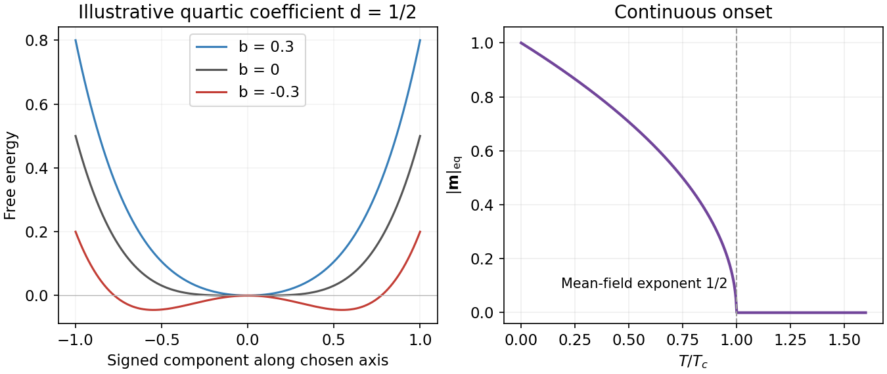

<h1 id="4/b/solution">Solution</h1>

↑ **Parent:** [B](../b.md)

Differentiation gives $f'(m)=2m(b+2dm^2)$. For $b>0$ the origin is the [global minimum](../../../../../global-minimum.md); for $b<0$, $m=\sqrt{-b/(2d)}$ has $f''=-4b>0$ and $f=-b^2/(4d)<f(0)$. Therefore, close enough to the transition for the quartic expansion to apply,

$$
\boxed{m_{\rm eq}(T)=\begin{cases}\sqrt{(T_c-T)/(2dT_c)},&T<T_c,\\0,&T\geq T_c.\end{cases}}
$$

The [order parameter](../../../../../order-parameter.md) approaches zero continuously with [mean-field critical exponent](../../../../../mean-field-critical-exponent.md) $\beta=1/2$: **the transition is continuous**. In the aligned phase a particular direction is chosen. The vector-spin [rotation](../../../../../rotation-mathematics.md) [symmetry](../../../../../symmetry-physics.md) is spontaneously broken from $SO(3)$ to $SO(2)$, or from $O(3)$ to $O(2)$ including reflections. The manifold of [vector order parameter](../../../../../vector-order-parameter.md) directions is a [sphere](../../../../../sphere.md), so this is not just a two-state sign choice.[§4.2, $O(3)$ Heisenberg model and the continuous set of ordered directions](../../../../../statistical-field-theory-by-david-tong.md)

**[Figure 3](#4/b/image-quartic-ferromagnetic-free-energy-and-the-continuous-equilibrium-magnetization-curve). Quartic ferromagnetic free energy and the continuous equilibrium magnetization curve**.

The plot uses illustrative $d=1/2$ and [temperature](../../../../../temperature-split.md) measured in units of $T_c$. A unit-spin average must satisfy $m\leq1$; if the quartic model is used literally far below the transition, its constrained minimum is $\min\{1,\sqrt{(T_c-T)/(2dT_c)}\}$. In practice the near-transition expansion is not a controlled prediction of deep low-temperature saturation. Also, a finite zero-field [statistical ensemble](../../../../../statistical-ensemble.md) that averages all directions has $\langle\mathbf m\rangle=0$ even below $T_c$; the curve describes the magnitude in a selected ordered state, obtained by appropriate [boundary conditions](../../../../../boundary-condition.md) or the [thermodynamic limit](../../../../../thermodynamic-limit.md) before removing a small [magnetic field](../../../../../magnetic-field-split.md).

## ↑ Ancestors (15)

1. [B](../b.md)
2. [4](../../4.md)
3. [Paper 1](../../../paper-1-split.md)
4. [2016](../../../split.md)
5. [Past exam of the theoretical physics I course of the University of Cambridge](../../../../split.md)
6. [Theoretical Physics I course of the University of Cambridge](../../../../../theoretical-physics-i-course-of-the-university-of-cambridge.md)
7. [Theoretical Physics course of the University of Cambridge](../../../../../theoretical-physics-course-of-the-university-of-cambridge.md)
8. [Physics course of the year 3 of the natural sciences course of the University of Cambridge](../../../../../physics-course-of-the-year-3-of-the-natural-sciences-course-of-the-university-of-cambridge.md)
9. [Year 3 of the natural sciences course of the University of Cambridge](../../../../../year-3-of-the-natural-sciences-course-of-the-university-of-cambridge.md)
10. [Year of the natural sciences course of the University of Cambridge](../../../../../year-of-the-natural-sciences-course-of-the-university-of-cambridge.md)
11. [Natural sciences course of the University of Cambridge](../../../../../natural-sciences-course-of-the-university-of-cambridge.md)
12. [Course of the University of Cambridge](../../../../../course-of-the-university-of-cambridge.md)
13. [University of Cambridge](../../../../../university-of-cambridge-split.md)
14. [List of universities](../../../../../list-of-universities.md)
15. [Codex Wiki](../../../../../split.md)
