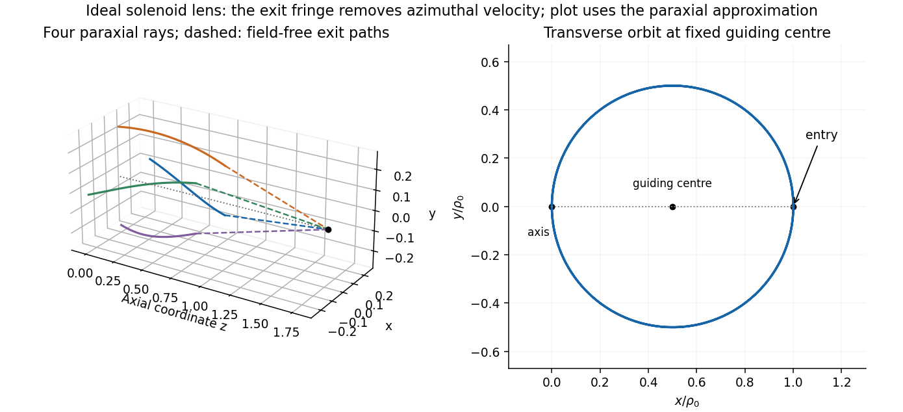

<h1 id="2/d/solution">Solution</h1>

↑ **Parent:** [D](../d.md)

Set $t=0$ just inside the entrance, $z=0$, $\rho=\rho_0$ and $\theta=\theta_0$. The stated continuity gives $\dot\rho(0)=0$. Until the first axis crossing,

$$
\boxed{\rho(t)=\rho_0\cos(\Omega t),\quad\theta(t)=\theta_0-\Omega t,\quad z(t)=wt},\qquad
w=\sqrt{v^2-\Omega^2\rho_0^2}.
$$

For the full orbit, including any crossings, use the transverse complex coordinate $u=x+iy$:

$$
\boxed{u(t)=\rho_0e^{i\theta_0}\cos(\Omega t)e^{-i\Omega t}
=\frac{\rho_0e^{i\theta_0}}2(1+e^{-2i\Omega t})},\qquad 0<t<l/w.
$$

This [helical solenoid trajectory with zero incident angular momentum](../../../../helical-solenoid-trajectory-with-zero-incident-angular-momentum.md) is a circle of radius $\rho_0/2$ about transverse guiding centre $u_0/2$, combined with uniform axial motion. Its cyclotron [angular frequency](../../../../angular-frequency.md) is $|qB|/(\gamma m)=2|\Omega|$, and its axial pitch per turn is $\pi w/|\Omega|$. The speed check is $|\dot u|^2+w^2=\Omega^2\rho_0^2+w^2=v^2$.

The physical radius is $|u|=\rho_0|\cos\Omega t|$. When the cosine changes sign, a nonnegative-radius coordinate adds $\pi$ to $\theta$; this is a coordinate change, not a discontinuous turn of the particle. For $q=0$ or $B=0$, the limit is simply $u=u_0$, $z=vt$.

**[Figure 1](#2/d/image-original-solenoid-lens-trajectories-transverse-circular-motion-helical-drift-and-paraxial-focusing-after-the-exit-fringe). Original solenoid-lens trajectories: transverse circular motion, helical drift and paraxial focusing after the exit fringe**.

## ↑ Ancestors (14)

1. [D](../d.md)
2. [2](../../2.md)
3. [2017](../../../2017-split.md)
4. [Past exam of the theoretical physics I course of the University of Cambridge](../../../split.md)
5. [Theoretical Physics I course of the University of Cambridge](../../../../theoretical-physics-i-course-of-the-university-of-cambridge.md)
6. [Theoretical Physics course of the University of Cambridge](../../../../theoretical-physics-course-of-the-university-of-cambridge.md)
7. [Physics course of the year 3 of the natural sciences course of the University of Cambridge](../../../../physics-course-of-the-year-3-of-the-natural-sciences-course-of-the-university-of-cambridge.md)
8. [Year 3 of the natural sciences course of the University of Cambridge](../../../../year-3-of-the-natural-sciences-course-of-the-university-of-cambridge.md)
9. [Year of the natural sciences course of the University of Cambridge](../../../../year-of-the-natural-sciences-course-of-the-university-of-cambridge.md)
10. [Natural sciences course of the University of Cambridge](../../../../natural-sciences-course-of-the-university-of-cambridge.md)
11. [Course of the University of Cambridge](../../../../course-of-the-university-of-cambridge.md)
12. [University of Cambridge](../../../../university-of-cambridge-split.md)
13. [List of universities](../../../../list-of-universities.md)
14. [Codex Wiki](../../../../split.md)
