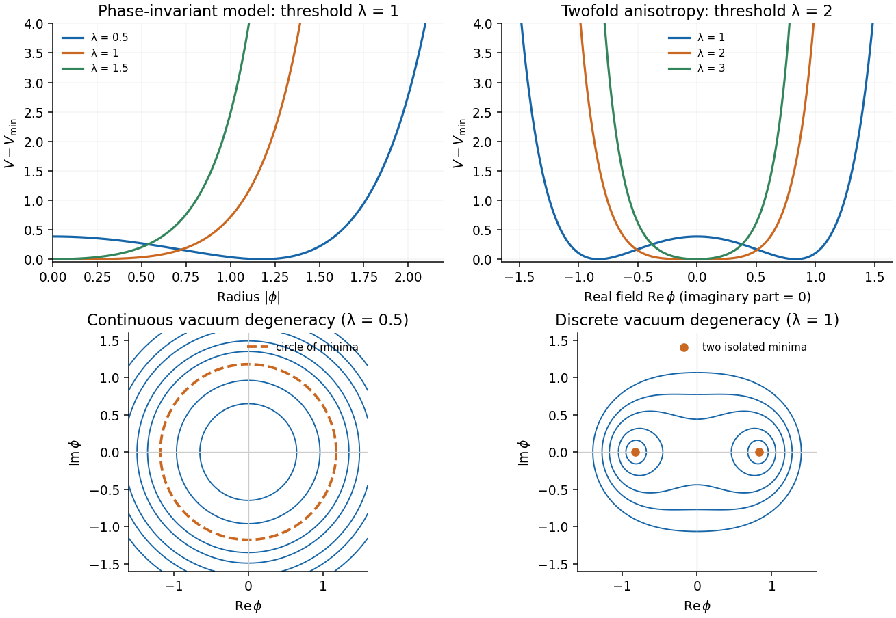

<h1 id="3/a/solution">Solution</h1>

↑ **Parent:** [A](../a.md)

Use metric signature $(+,-,-,-)$ and the model's rescaled units $c=\hbar=1$. Its exponential implicitly uses dimensionless rescaled field and coupling combinations; the numerical coefficients of the potential are those supplied. Treat $\phi$ and $\phi^*$ as independent variables in taking canonical derivatives:

$$
\pi_\phi=\dot\phi^*,\qquad\pi_{\phi^*}=\dot\phi.
$$

The [Hamiltonian density](../../../../hamiltonian-density.md) is

$$
\boxed{\mathcal H=|\dot\phi|^2+|\nabla\phi|^2+V(\phi)
=\pi_\phi\pi_{\phi^*}+|\nabla\phi|^2-|\phi|^2+e^{\lambda|\phi|^2}}.
$$

The kinetic and gradient terms are nonnegative, so a static homogeneous minimum is obtained by minimizing the potential. Put $s=|\phi|^2\geq0$. For $\lambda=0$, $V=1-s$ is unbounded below. For $\lambda<0$, the exponential decays while $-s$ tends to minus infinity. Thus **a stable vacuum requires $\boxed{\lambda>0}$**.

For positive $\lambda$,

$$
\frac{dV}{ds}=-1+\lambda e^{\lambda s},\qquad
\frac{d^2V}{ds^2}=\lambda^2e^{\lambda s}>0.
$$

The [exponential complex-scalar potential](../../../../exponential-complex-scalar-potential.md) consequently has

$$
\boxed{\begin{cases}
|\phi|^2=-\ln\lambda/\lambda,&0<\lambda<1,\\
\phi=0,&\lambda\geq1.
\end{cases}}
$$

For $0<\lambda<1$, the minima form a circle $\phi=ve^{i\theta}$, with $v^2=-\ln\lambda/\lambda$ and $V_{\min}=(1+\ln\lambda)/\lambda$. For $\lambda\geq1$ the minimum has $V_{\min}=1$. The [symmetry](../../../../symmetry-physics.md) remains global [phase](../../../../phase-waves.md) rotation in either [phase](../../../../phase-waves.md), but a chosen nonzero vacuum breaks it spontaneously. At $\lambda=1$ the origin is a unique minimum with vanishing quadratic curvature and a positive leading quartic term; this critical masslessness should not be confused with a Goldstone mode.

**[Figure 2](#3/a/image-original-radial-potentials-showing-the-continuous-and-explicitly-twofold-vacuum-structures-and-their-thresholds). Original radial potentials showing the continuous and explicitly twofold vacuum structures and their thresholds**.

## ↑ Ancestors (14)

1. [A](../a.md)
2. [3](../../3.md)
3. [2017](../../../2017-split.md)
4. [Past exam of the theoretical physics I course of the University of Cambridge](../../../split.md)
5. [Theoretical Physics I course of the University of Cambridge](../../../../theoretical-physics-i-course-of-the-university-of-cambridge.md)
6. [Theoretical Physics course of the University of Cambridge](../../../../theoretical-physics-course-of-the-university-of-cambridge.md)
7. [Physics course of the year 3 of the natural sciences course of the University of Cambridge](../../../../physics-course-of-the-year-3-of-the-natural-sciences-course-of-the-university-of-cambridge.md)
8. [Year 3 of the natural sciences course of the University of Cambridge](../../../../year-3-of-the-natural-sciences-course-of-the-university-of-cambridge.md)
9. [Year of the natural sciences course of the University of Cambridge](../../../../year-of-the-natural-sciences-course-of-the-university-of-cambridge.md)
10. [Natural sciences course of the University of Cambridge](../../../../natural-sciences-course-of-the-university-of-cambridge.md)
11. [Course of the University of Cambridge](../../../../course-of-the-university-of-cambridge.md)
12. [University of Cambridge](../../../../university-of-cambridge-split.md)
13. [List of universities](../../../../list-of-universities.md)
14. [Codex Wiki](../../../../split.md)
