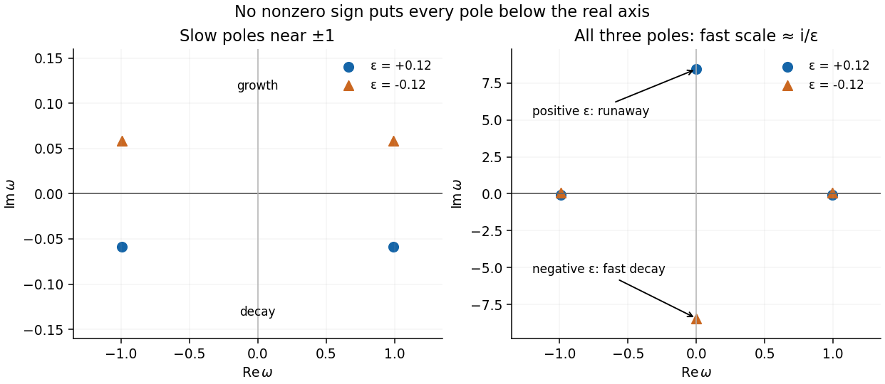

<h1 id="4/b/sign-of-radiation-damping-and-comparison-with-velocity-damping">Sign of radiation damping and comparison with velocity damping</h1>

↑ **Parent:** [Solution](solution.md)

The sign can be checked independently by multiplying the equation by $\dot x$. With $E=(\dot x^2+x^2)/2$,

$$
\frac{d}{dt}(E-\varepsilon\ddot x\dot x)
=f\dot x-\varepsilon\ddot x^2.
$$

For periodic motion the total-derivative near-field term averages to zero, so positive $\varepsilon$ gives a radiative [energy](../../../../energy-split.md) loss, consistent with the slow poles' damping. Negative $\varepsilon$ acts as [energy](../../../../energy-split.md) gain in this model.

For the comparison equation **as printed**, $\ddot x+x-\varepsilon\dot x=f$, the response denominator instead is $1-\omega^2+i\varepsilon\omega$, with exact poles

$$
\omega_\pm=\frac{i\varepsilon}{2}\pm\sqrt{1-\varepsilon^2/4}
=\pm1+\frac{i\varepsilon}{2}+O(\varepsilon^2).
$$

Thus ordinary positive damping in that sign convention requires $\boxed{\varepsilon<0}$, the opposite sign from slow radiation damping in the third-derivative equation. The word “damped” does not override the explicitly printed minus sign. With the usual equation $\ddot x+x+\gamma\dot x=f$, positive $\gamma$ gives the familiar lower-half-plane poles.

**[Figure 3](#4/b/image-exact-pole-locations-for-small-positive-and-negative-radiation-reaction-parameters-including-the-singular-fast-pole). Exact pole locations for small positive and negative radiation-reaction parameters, including the singular fast pole**.

## ↑ Ancestors (15)

1. [Solution](solution.md)
2. [B](../b.md)
3. [4](../../4.md)
4. [2017](../../../2017-split.md)
5. [Past exam of the theoretical physics I course of the University of Cambridge](../../../split.md)
6. [Theoretical Physics I course of the University of Cambridge](../../../../theoretical-physics-i-course-of-the-university-of-cambridge.md)
7. [Theoretical Physics course of the University of Cambridge](../../../../theoretical-physics-course-of-the-university-of-cambridge.md)
8. [Physics course of the year 3 of the natural sciences course of the University of Cambridge](../../../../physics-course-of-the-year-3-of-the-natural-sciences-course-of-the-university-of-cambridge.md)
9. [Year 3 of the natural sciences course of the University of Cambridge](../../../../year-3-of-the-natural-sciences-course-of-the-university-of-cambridge.md)
10. [Year of the natural sciences course of the University of Cambridge](../../../../year-of-the-natural-sciences-course-of-the-university-of-cambridge.md)
11. [Natural sciences course of the University of Cambridge](../../../../natural-sciences-course-of-the-university-of-cambridge.md)
12. [Course of the University of Cambridge](../../../../course-of-the-university-of-cambridge.md)
13. [University of Cambridge](../../../../university-of-cambridge-split.md)
14. [List of universities](../../../../list-of-universities.md)
15. [Codex Wiki](../../../../split.md)
