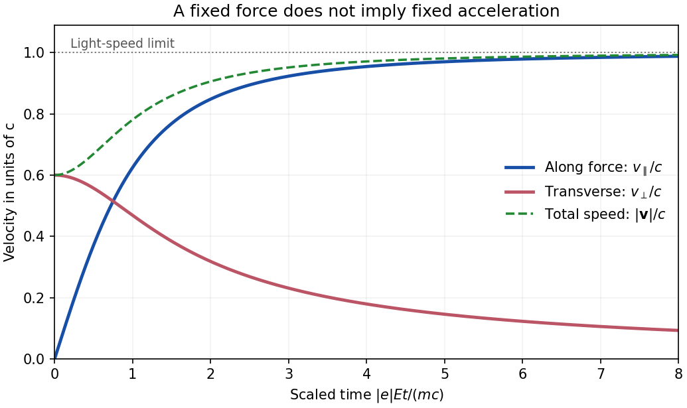

# 2018

↑ **Parent:** [Past exam of the theoretical physics I course of the University of Cambridge](../past-exam-of-the-theoretical-physics-i-course-of-the-university-of-cambridge.md)

[Original paper, released PDF pages 340–343](https://www.whatdotheyknow.com/request/natural_science_tripos_physics_e/response/2127325/attach/3/FOI%202022%20639%20Sullivan%20materials.pdf?cookie_passthrough=1#page=340)

**Table of contents**

- [1](#1)
  - [a](#1/a)
    - [Solution](#1/a/solution)
  - [b](#1/b)
    - [Solution](#1/b/solution)
  - [c](#1/c)
    - [Solution](#1/c/solution)
  - [d](#1/d)
    - [Solution](#1/d/solution)
  - [e](#1/e)
    - [Solution](#1/e/solution)
- [2](#2)
  - [a](#2/a)
    - [Solution](#2/a/solution)
  - [b](#2/b)
    - [Solution](#2/b/solution)
  - [c](#2/c)
    - [Solution](#2/c/solution)
- [3](#3)
  - [a](#3/a)
    - [Solution](#3/a/solution)
  - [b](#3/b)
    - [Solution](#3/b/solution)
  - [c](#3/c)
    - [Solution](#3/c/solution)
  - [d](#3/d)
    - [Solution](#3/d/solution)
- [4](#4)
  - [a](#4/a)
    - [Solution](#4/a/solution)
  - [b](#4/b)
    - [Solution](#4/b/solution)
  - [c](#4/c)
    - [Solution](#4/c/solution)
  - [d](#4/d)
    - [Solution](#4/d/solution)

## 1

↑ **Parent:** [2018](2018.md)

<h3 id="1/a">a</h3>

↑ **Parent:** [1](#1)

<h4 id="1/a/solution">Solution</h4>

↑ **Parent:** [A](#1/a)

Choose [Minkowski metric](../special-relativity.md#minkowski-metric) $(+,-,-,-)$, so $A_\mu=(\phi/c,-\mathbf A)$ and $d\tau=dt\sqrt{1-v^2/c^2}$. In laboratory time the [relativistic charged-particle action](../relativistic-electromagnetism.md#relativistic-charged-particle-action) has [Lagrangian](../calculus-of-variations.md#lagrangian)

$$
L=-mc^2\sqrt{1-v^2/c^2}-e\phi(\mathbf x,t)+e\mathbf A(\mathbf x,t)\cdot\mathbf v.
$$

Here $e$ denotes the signed particle charge in the action. The [canonical momentum](../hamiltonian-mechanics.md#canonical-momentum) and the position derivative are

$$
\frac{\partial L}{\partial v_i}=m\gamma v_i+eA_i,\qquad
\frac{\partial L}{\partial x_i}=-e\partial_i\phi+e v_j\partial_iA_j,
\qquad \gamma=(1-v^2/c^2)^{-1/2}.
$$

The [Euler-Lagrange equation](../analysis.md#euler-lagrange-equation) therefore gives

$$
\frac d{dt}(m\gamma v_i)=e\left[-\partial_i\phi-\partial_t A_i+v_j(\partial_iA_j-\partial_jA_i)\right].
$$

The last term is $(\mathbf v\times\mathbf B)_i$, and the first two terms form the [electric field](../electric-field.md). Thus the [relativistic Lorentz force](../electromagnetism.md#relativistic-lorentz-force) equation is

$$
\boxed{\frac d{dt}(m\gamma\mathbf v)=e(\mathbf E+\mathbf v\times\mathbf B).}
$$

Its power relation and acceleration form are

$$
\boxed{\frac d{dt}(\gamma mc^2)=e\mathbf E\cdot\mathbf v,\qquad
\dot{\mathbf v}=\frac e{m\gamma}\left[\mathbf E+\mathbf v\times\mathbf B-\frac{\mathbf v(\mathbf E\cdot\mathbf v)}{c^2}\right].}
$$

The power relation follows by taking the scalar product with $\mathbf v$ and using the [relativistic energy-momentum relation](../special-relativity.md#energy-momentum-relation). It also shows why the [magnetic field](../magnetic-field.md) alone cannot change the particle's energy.

<h3 id="1/b">b</h3>

↑ **Parent:** [1](#1)

<h4 id="1/b/solution">Solution</h4>

↑ **Parent:** [B](#1/b)

For a uniform constant [electric field](../electric-field.md) and zero [magnetic field](../magnetic-field.md), the [mechanical momentum](../momentum.md#mechanical-momentum) changes linearly even though the velocity does not:

$$
\mathbf p(t)=\mathbf p_0+e\mathbf E t,\qquad \mathbf p_0=m\gamma_0\mathbf v_0,\qquad
\gamma_0=(1-v_0^2/c^2)^{-1/2}.
$$

Invert $\mathbf p=m\gamma\mathbf v$ using $\gamma=\sqrt{1+p^2/(m^2c^2)}$. The result for arbitrary initial direction is

$$
\boxed{\mathbf v(t)=\frac{\gamma_0\mathbf v_0+(e\mathbf E/m)t}
{\sqrt{1+\left|\gamma_0\mathbf v_0+(e\mathbf E/m)t\right|^2/c^2}}.}
$$

Equivalently, $\mathbf v=c\mathbf p/\sqrt{m^2c^2+p^2}$. This gives $\mathbf v(0)=\mathbf v_0$ and guarantees $|\mathbf v|<c$ at every finite momentum. The transverse momentum stays constant, but its velocity component generally decreases because the [Lorentz factor](../special-relativity.md#lorentz-factor) increases. Thus an initial transverse velocity must not be treated as constant during the electric acceleration; this is the [relativistic motion in a constant electric field with transverse momentum](../special-relativity.md#relativistic-motion-in-a-constant-electric-field-with-transverse-momentum) effect.

**[Figure 1](#1/b/image-constant-electric-force-changes-momentum-linearly-while-speed-stays-below-light-speed). Constant electric force changes momentum linearly while speed stays below light speed**. Original example with initial velocity perpendicular to the electric force and magnitude $0.6c$. The longitudinal velocity tends to $c$, while the transverse velocity tends to zero. Time is scaled by $mc/(|e|E)$, and the positive longitudinal direction is chosen along the force.

<h3 id="1/c">c</h3>

↑ **Parent:** [1](#1)

<h4 id="1/c/solution">Solution</h4>

↑ **Parent:** [C](#1/c)

If $e\mathbf E\ne0$, then $\mathbf p(t)=e\mathbf E t+O(1)$, and the [relativistic energy-momentum relation](../special-relativity.md#energy-momentum-relation) gives

$$
\boxed{\lim_{t\to\infty}\mathbf v(t)=c\frac{e\mathbf E}{|e\mathbf E|}.}
$$

The particle approaches the [speed of light](../special-relativity.md#speed-of-light) in the direction of the electric force, independently of its initial velocity. For positive $e$ the limiting direction is along $\mathbf E$; for negative $e$ it is opposite. A massive particle never reaches that limiting speed in finite time. If the force is zero, the velocity remains $\mathbf v_0$ instead.

<h3 id="1/d">d</h3>

↑ **Parent:** [1](#1)

<h4 id="1/d/solution">Solution</h4>

↑ **Parent:** [D](#1/d)

With no [electric field](../electric-field.md), the power relation from part (a) gives

$$
\frac d{dt}(\gamma mc^2)=e\mathbf v\cdot(\mathbf v\times\mathbf B)=0.
$$

Consequently

$$
\boxed{\gamma(t)=\gamma_0,\qquad |\mathbf v(t)|=|\mathbf v_0|.}
$$

The magnetic part of the [relativistic Lorentz force](../electromagnetism.md#relativistic-lorentz-force) changes the direction of [mechanical momentum](../momentum.md#mechanical-momentum), but performs no work. This conclusion does not require the [magnetic field](../magnetic-field.md) to be spatially uniform: it follows from the local orthogonality of $\mathbf v$ and $\mathbf v\times\mathbf B$.

<h3 id="1/e">e</h3>

↑ **Parent:** [1](#1)

<h4 id="1/e/solution">Solution</h4>

↑ **Parent:** [E](#1/e)

Let $\mathbf b=\mathbf B/B$ for a nonzero constant [magnetic field](../magnetic-field.md). Since $\gamma$ is constant, the [relativistic Lorentz force](../electromagnetism.md#relativistic-lorentz-force) reduces to

$$
\dot{\mathbf v}=\frac e{m\gamma_0}\mathbf v\times\mathbf B.
$$

The projection along $\mathbf b$ is constant. In the perpendicular plane define the signed [cyclotron frequency](../quantum-theory.md#cyclotron-frequency) $\Omega=eB/(m\gamma_0)$; then

$$
\dot{\mathbf v}_\perp=\Omega\mathbf v_\perp\times\mathbf b,\qquad
\ddot{\mathbf v}_\perp=-\Omega^2\mathbf v_\perp.
$$

The explicit rotating velocity is

$$
\boxed{\mathbf v_\perp(t)=\mathbf v_{\perp0}\cos(\Omega t)
+(\mathbf v_{\perp0}\times\mathbf b)\sin(\Omega t),\qquad
T=\frac{2\pi\gamma_0m}{|e|B}.}
$$

This is the [relativistic cyclotron orbit](../relativistic-electromagnetism.md#relativistic-cyclotron-orbit) frequency in laboratory time, reduced from the nonrelativistic frequency by $1/\gamma_0$. With nonzero parallel velocity, the trajectory is a helix. If $\mathbf v_{\perp0}=0$, that perpendicular vector stays zero and has no nontrivial fundamental period; the displayed $T$ is the period of a nonzero transverse orbit.

## 2

↑ **Parent:** [2018](2018.md)

<h3 id="2/a">a</h3>

↑ **Parent:** [2](#2)

<h4 id="2/a/solution">Solution</h4>

↑ **Parent:** [A](#2/a)

Use the downward $y$ direction of the PDF diagram. The bob's Cartesian coordinates are

$$
x=s+\ell\sin\theta,\qquad y=\ell\cos\theta.
$$

Thus

$$
\dot x=\dot s+\ell\dot\theta\cos\theta,\qquad
\dot y=-\ell\dot\theta\sin\theta.
$$

The hinge and rod are massless, so only the bob contributes [kinetic energy](../energy.md#kinetic-energy):

$$
T=\frac m2(\dot x^2+\dot y^2)
=\frac m2\left(\dot s^2+2\ell\dot s\dot\theta\cos\theta+\ell^2\dot\theta^2\right).
$$

Because gravity points along positive $y$, its [gravitational potential energy](../energy.md#gravitational-energy) is $-mgy=-mg\ell\cos\theta$. The zero-rest-length [spring](../elasticity-physics.md#spring) has [elastic potential energy](../elasticity-physics.md#elastic-energy) $ks^2/2$. Put $s=\ell\eta$ and divide $T-V$ by the positive constant $m\ell^2$. The equivalent [Lagrangian](../calculus-of-variations.md#lagrangian) is

$$
\boxed{L=\frac12\dot\eta^2+\dot\eta\dot\theta\cos\theta+\frac12\dot\theta^2
+\frac g\ell\cos\theta-\frac k{2m}\eta^2.}
$$

Multiplying the [action](../lagrangian-mechanics.md#action) by a nonzero constant leaves its stationary paths unchanged. This derivation is a direct use of [kinetic energy from Cartesian position vectors](../lagrangian-mechanics.md#kinetic-energy-from-cartesian-position-vectors); no independent kinetic term should be assigned to the massless support.

<h3 id="2/b">b</h3>

↑ **Parent:** [2](#2)

<h4 id="2/b/solution">Solution</h4>

↑ **Parent:** [B](#2/b)

For the horizontal [generalized coordinate](../lagrangian-mechanics.md#generalized-coordinate) $\eta$,

$$
\frac{\partial L}{\partial\dot\eta}=\dot\eta+\dot\theta\cos\theta,\qquad
\frac{\partial L}{\partial\eta}=-\frac km\eta.
$$

The corresponding [Euler-Lagrange equation](../analysis.md#euler-lagrange-equation) is

$$
\ddot\eta+\ddot\theta\cos\theta-\dot\theta^2\sin\theta+\frac km\eta=0.
$$

For $\theta$, the terms proportional to $\dot\eta\dot\theta\sin\theta$ cancel between $d(\partial L/\partial\dot\theta)/dt$ and $\partial L/\partial\theta$. Hence the other exact equation is

$$
\ddot\theta+\ddot\eta\cos\theta+\frac g\ell\sin\theta=0.
$$

Keeping only terms linear in small coordinates and their derivatives gives

$$
\boxed{\ddot\theta+\ddot\eta+\omega_0^2\theta=0,\qquad
\ddot\theta+\ddot\eta+\omega_1^2\eta=0,\qquad
\omega_0=\sqrt{\frac g\ell},\quad\omega_1=\sqrt{\frac km}.}
$$

The equilibrium is $\theta=\eta=0$. These characteristic frequencies label gravitational and spring restoring scales; they are not two independent [normal mode](../wave-equation.md#normal-mode) frequencies of this massless-support system.

<h3 id="2/c">c</h3>

↑ **Parent:** [2](#2)

<h4 id="2/c/solution">Solution</h4>

↑ **Parent:** [C](#2/c)

Subtracting the two linearized equations eliminates their acceleration terms:

$$
\omega_0^2\theta=\omega_1^2\eta.
$$

For $g,k>0$, the assumed nontrivial [simple harmonic motion](../classical-mechanics.md#simple-harmonic-motion) therefore has

$$
\boxed{\eta(t)=\frac{\omega_0^2}{\omega_1^2}\theta_0\sin(\omega t)
=\frac{mg}{k\ell}\theta_0\sin(\omega t).}
$$

The support displacement and pendulum angle oscillate in phase. Inserting this relation into either [Euler-Lagrange equation](../analysis.md#euler-lagrange-equation) yields

$$
\omega^2\left(1+\frac{\omega_0^2}{\omega_1^2}\right)=\omega_0^2,
$$

so the one positive finite [angular frequency](../lagrangian-mechanics.md#angular-frequency) is

$$
\boxed{\omega=\frac{\omega_0\omega_1}{\sqrt{\omega_0^2+\omega_1^2}}
=\sqrt{\frac{gk}{mg+k\ell}},\qquad \frac1{\omega^2}=\frac\ell g+\frac mk.}
$$

The negative frequency describes the same real oscillation after a phase change. For a general phase, replace the sine in both coordinates by $A\cos(\omega t)+B\sin(\omega t)$.

There is no missing second finite branch. The quadratic [Lagrangian](../calculus-of-variations.md#lagrangian) is

$$
L_2=\frac12(\dot\eta+\dot\theta)^2-\frac12\omega_1^2\eta^2-\frac12\omega_0^2\theta^2,
$$

whose kinetic matrix is $\left(\begin{smallmatrix}1&1\\1&1\end{smallmatrix}\right)$ and has rank one. Its characteristic [determinant](../multilinear-algebra.md#determinant) is $\omega_0^2\omega_1^2-(\omega_0^2+\omega_1^2)\omega^2$, not a quadratic polynomial in $\omega^2$. This [singular kinetic matrix in small oscillations](../lagrangian-mechanics.md#singular-kinetic-matrix-in-small-oscillations) results from taking the support mass to be exactly zero. Adding a small support mass restores a second mode that runs to infinite frequency as that mass vanishes.

For a stiff spring,

$$
\boxed{k\to\infty:\qquad\eta\to0,\qquad\omega\to\sqrt{g/\ell}.}
$$

The hinge becomes fixed, recovering the [simple pendulum](../simple-pendulum.md) frequency, as expected for the [pendulum with a massless spring-mounted support](../lagrangian-mechanics.md#pendulum-with-a-massless-spring-mounted-support). At finite $k$, horizontal support motion makes the frequency smaller.

**[Figure 2](#2/c/image-a-massless-spring-mounted-support-lowers-the-pendulum-s-one-finite-frequency). A massless spring-mounted support lowers the pendulum's one finite frequency**. Original curve of $\omega/\omega_0=r/\sqrt{1+r^2}$ against $r=\omega_1/\omega_0$. The small-$r$ spring-controlled limit and the large-$r$ fixed-support limit are marked.

## 3

↑ **Parent:** [2018](2018.md)

<h3 id="3/a">a</h3>

↑ **Parent:** [3](#3)

<h4 id="3/a/solution">Solution</h4>

↑ **Parent:** [A](#3/a)

If $L'=L+dF(q,t)/dt$, the [action](../lagrangian-mechanics.md#action) changes by an endpoint term:

$$
S'[q]-S[q]=F(q(t_f),t_f)-F(q(t_i),t_i).
$$

In the [principle of stationary action](../lagrangian-mechanics.md#principle-of-stationary-action) with fixed endpoints, $\delta q(t_i)=\delta q(t_f)=0$ and the endpoint times are fixed. Therefore $\delta(S'-S)=0$, and the two actions give the same bulk [Euler-Lagrange equations](../analysis.md#euler-lagrange-equation).

For a [Lagrangian density](../classical-field-theory.md#lagrangian-density), adding $\partial_\mu K^\mu$ changes the [action](../lagrangian-mechanics.md#action) by $\int_{\partial\Omega}K^\mu n_\mu\,d\Sigma$, by the [divergence theorem](../multivariable-calculus.md#divergence-theorem). Its variation vanishes for compactly supported field variations, or when the appropriate boundary data are held fixed. These [total divergences in a variational principle](../multivariable-calculus.md#total-divergences-in-a-variational-principle) can therefore be discarded when deriving bulk equations under those conditions.

The qualification about boundaries matters: if $K^\mu$ depends on field derivatives, their variations on the boundary must also be controlled. A [total derivative](../calculus.md#total-derivative) can change the canonical momenta or the chosen representative of a [Noether current](../classical-field-theory.md#noether-current), even while leaving the bulk dynamics unchanged.

<h3 id="3/b">b</h3>

↑ **Parent:** [3](#3)

<h4 id="3/b/solution">Solution</h4>

↑ **Parent:** [B](#3/b)

Let $P^\mu=\partial\mathcal L/\partial(\partial_\mu h)$ and $Q^{\mu\nu}=\partial\mathcal L/\partial(\partial_\mu\partial_\nu h)$. Define the second coefficient with ordered repeated indices and $Q^{\mu\nu}=Q^{\nu\mu}$, so that

$$
\delta\mathcal L=\mathcal L_h\delta h+P^\mu\partial_\mu\delta h+Q^{\mu\nu}\partial_\mu\partial_\nu\delta h.
$$

This convention avoids double-counting a mixed derivative such as $h_{,12}=h_{,21}$. The first derivative term needs one [integration by parts](../calculus.md#integration-by-parts). The second derivative term needs two:

$$
\int_\Omega Q^{\mu\nu}\partial_\mu\partial_\nu\delta h
=\text{boundary terms}+\int_\Omega(\partial_\mu\partial_\nu Q^{\mu\nu})\delta h.
$$

Combining the terms gives

$$
\delta S=\int_\Omega\left[\mathcal L_h-\partial_\mu P^\mu+\partial_\mu\partial_\nu Q^{\mu\nu}\right]\delta h
+\int_{\partial\Omega}n_\mu\left[(P^\mu-\partial_\nu Q^{\mu\nu})\delta h+Q^{\mu\nu}\partial_\nu\delta h\right]d\Sigma.
$$

For compactly supported variations, or fixed $\delta h$ and its first derivatives at the boundary, the last integral vanishes. The [fundamental lemma of the calculus of variations](../calculus-of-variations.md#fundamental-lemma-of-the-calculus-of-variations) then yields the [Euler-Lagrange field equation with second derivatives](../classical-field-theory.md#euler-lagrange-field-equation-with-second-derivatives):

$$
\boxed{\frac{\partial\mathcal L}{\partial h}
-\partial_\mu\left[\frac{\partial\mathcal L}{\partial(\partial_\mu h)}\right]
+\partial_\mu\partial_\nu\left[\frac{\partial\mathcal L}{\partial(\partial_\mu\partial_\nu h)}\right]=0.}
$$

The plus sign of the final term comes from the two integrations by parts. In general this gives fourth-order equations, although the order in a particular coordinate depends on which second derivatives occur in the density.

<h3 id="3/c">c</h3>

↑ **Parent:** [3](#3)

<h4 id="3/c/solution">Solution</h4>

↑ **Parent:** [C](#3/c)

Put $R=h_t-\nu\nabla^2h$, where the [diffusion coefficient](../brownian-motion.md#diffusion-coefficient) $\nu$ is constant. Then

$$
\delta S=2\int R(\partial_t\delta h-\nu\nabla^2\delta h)\,d^2x\,dt.
$$

One temporal and two spatial [integrations by parts](../calculus.md#integration-by-parts) give

$$
\delta S=-2\int(\partial_tR+\nu\nabla^2R)\delta h\,d^2x\,dt,
$$

with compactly supported variations. Hence

$$
\boxed{(\partial_t+\nu\nabla^2)(\partial_t-\nu\nabla^2)h=0,
\qquad h_{tt}-\nu^2\nabla^4h=0.}
$$

Here $\nabla^4=(\nabla^2)^2$ is the [biharmonic operator](../multivariable-calculus.md#biharmonic-operator). The cross terms cancel because $\nu$ is constant and spatial and temporal derivatives commute. Equivalently, $P^0=2R$ and $Q^{ij}=-2\nu R\delta^{ij}$ in part (b), producing $-2\partial_tR-2\nu\nabla^2R=0$.

This [squared diffusion-residual action](../diffusion-equation.md#squared-diffusion-residual-action) does not have only the first-order [diffusion equation](../diffusion-equation.md) as its stationary equation. The zero-residual paths $h_t=\nu\nabla^2h$ have $S=0$ and are certainly solutions, but the variational equation is the higher-order one above. For a spatial [Fourier mode](../fourier-analysis.md#fourier-mode) with nonzero [wavevector](../elasticity-physics.md#wavevector) $\mathbf k$, it gives

$$
\ddot h_{\mathbf k}-\nu^2|\mathbf k|^4h_{\mathbf k}=0,\qquad
h_{\mathbf k}(t)=A_{\mathbf k}e^{-\nu|\mathbf k|^2t}+B_{\mathbf k}e^{+\nu|\mathbf k|^2t}.
$$

Boundary data or an additional physical selection principle are needed to retain only the decaying diffusion branch. The spatially uniform mode instead has $h_0(t)=A_0+B_0t$ in the stationary equation.

<h3 id="3/d">d</h3>

↑ **Parent:** [3](#3)

<h4 id="3/d/solution">Solution</h4>

↑ **Parent:** [D](#3/d)

With constant $\nu$, the bulk [action](../lagrangian-mechanics.md#action) is invariant under time translations, translations in the two spatial coordinates, and rotations or reflections within the substrate plane. The [Laplacian](../multivariable-calculus.md#laplacian) has no preferred direction, giving the planar $O(2)$ symmetry. It also has [scalar-field shift symmetry](../classical-field-theory.md#scalar-field-shift-symmetry) $h\mapsto h+a$, expressing the arbitrary origin of height, and the discrete symmetry $h\mapsto-h$ because its residual is squared.

There is an additional exact tilt symmetry $h\mapsto h+\mathbf b\cdot\mathbf x$: the added slope is time independent and has zero [Laplacian](../multivariable-calculus.md#laplacian). More generally, adding any function $f$ satisfying $f_t=\nu\nabla^2f$ leaves the residual unchanged. Such bulk transformations need not preserve prescribed boundary conditions or a restricted physical interpretation of the height.

In two spatial dimensions the [action](../lagrangian-mechanics.md#action) also has the anisotropic [scale invariance](../mathematics.md#scale-invariance)

$$
\boxed{\mathbf x\mapsto b\mathbf x,\qquad t\mapsto b^2t,\qquad h\mapsto h\quad(b>0).}
$$

The spacetime measure scales as $b^4$ and the squared residual as $b^{-4}$. The time and length scales are therefore related diffusively, rather than by a Lorentz transformation.

Ordinary [time reversal](../quantum-field-theory.md#t-symmetry) needs a boundary qualification. The identity

$$
(h_t-\nu\nabla^2h)^2=h_t^2+\nu^2(\nabla^2h)^2+\nu\partial_t|\nabla h|^2-2\nu\nabla\cdot(h_t\nabla h)
$$

shows that the density is time-reversal invariant up to a [total divergence](../multivariable-calculus.md#total-divergence). Thus the bulk stationary equation $h_{tt}-\nu^2\nabla^4h=0$ is invariant under $t\mapsto-t$, although the printed density is not pointwise unchanged. The [time reversal of the squared diffusion-residual action](../diffusion-equation.md#time-reversal-of-the-squared-diffusion-residual-action) exchanges the growing and decaying branches; the selected first-order [diffusion equation](../diffusion-equation.md) alone is not time-reversal invariant at fixed positive $\nu$.

## 4

↑ **Parent:** [2018](2018.md)

<h3 id="4/a">a</h3>

↑ **Parent:** [4](#4)

<h4 id="4/a/solution">Solution</h4>

↑ **Parent:** [A](#4/a)

The derivatives of the [Lagrangian density](../classical-field-theory.md#lagrangian-density) are $\mathcal L_\phi=0$, $\mathcal L_{\phi_t}=\phi_t$, and $\mathcal L_{\phi_x}=-\phi_x$. The [Euler-Lagrange field equation](../classical-field-theory.md#euler-lagrange-field-equation) is therefore

$$
\boxed{\phi_{tt}-\phi_{xx}=0.}
$$

This is the [one-dimensional wave equation](../wave-equation.md#one-dimensional-wave-equation) with [wave speed](../wave-equation.md#wave-speed) $c_s=\sqrt{\kappa/\rho}=1$. Both signs of propagation are allowed: $\phi(x,t)=F(x-t)+H(x+t)$ for sufficiently regular profiles.

<h3 id="4/b">b</h3>

↑ **Parent:** [4](#4)

<h4 id="4/b/solution">Solution</h4>

↑ **Parent:** [B](#4/b)

Use $x^\mu=(t,x)$ and [Minkowski metric](../special-relativity.md#minkowski-metric) $\eta^{\mu\nu}=\operatorname{diag}(1,-1)$, with the wave speed equal to one. Regarding $\phi$ as a [scalar field](../classical-field-theory.md#scalar-field), the symmetric [canonical stress-energy tensor](../classical-field-theory.md#canonical-stress-energy-tensor) is

$$
T^{\mu\nu}=\partial^\mu\phi\,\partial^\nu\phi-\eta^{\mu\nu}\mathcal L
=\begin{pmatrix}\mathcal E&p\\p&\mathcal E\end{pmatrix},\qquad
\mathcal E=\frac12(\phi_t^2+\phi_x^2),\quad p=-\phi_t\phi_x.
$$

It obeys $\partial_\mu T^{\mu\nu}=0$ on the [wave equation](../wave-equation.md). For a [scalar field](../classical-field-theory.md#scalar-field) the intrinsic spin current vanishes. The total orbital [Lorentz current](../classical-field-theory.md#lorentz-current) and its integrated angular-momentum tensor are

$$
\boxed{\mathcal J^{\lambda\mu\nu}=x^\mu T^{\lambda\nu}-x^\nu T^{\lambda\mu},\qquad
J^{\mu\nu}(t)=\int_{\mathbb R}\mathcal J^{0\mu\nu}\,dx.}
$$

Because there is only one spatial dimension, its only independent possibly nonzero component is

$$
\boxed{J^{01}=\int_{\mathbb R}(t p-x\mathcal E)\,dx=tP-\int_{\mathbb R}x\mathcal E\,dx,\qquad J^{10}=-J^{01},}
$$

where $P=\int p\,dx$. The corresponding flux is $\mathcal J^{101}=t\mathcal E-xp$. Symmetry and conservation of $T$ give

$$
\partial_\lambda\mathcal J^{\lambda\mu\nu}=T^{\mu\nu}-T^{\nu\mu}=0.
$$

Thus $J^{01}$ is conserved provided the boundary flux vanishes and the integrals exist. For example, localized wave packets on an infinite line have this property. One can also check directly that $d\int x\mathcal E\,dx/dt=P$, so the two terms in $J^{01}$ have cancelling derivatives.

The significance is the [boost charge of a one-dimensional scalar field](../classical-field-theory.md#boost-charge-of-a-one-dimensional-scalar-field). There is no independent spatial rotation or ordinary spatial angular-momentum component in one dimension. Instead, the action has the mathematical [Lorentz invariance](../special-relativity.md#lorentz-invariance) of a massless wave field with invariant speed $c_s=1$, and $J^{01}$ generates its boost. Its conservation says that the center of energy moves uniformly. This is a symmetry of the ideal wave-field model, rather than an assertion of fundamental vacuum Lorentz symmetry for a material rod. Fixed boundaries can break it, and a general solution with nonvanishing boundary flux need not conserve the integrated charge.

<h3 id="4/c">c</h3>

↑ **Parent:** [4](#4)

<h4 id="4/c/solution">Solution</h4>

↑ **Parent:** [C](#4/c)

With the PDF's inverse [Fourier transform](../fourier-transform.md) convention, the derivatives act as

$$
\partial_t\mapsto-i\omega,\qquad\partial_x\mapsto-ik,
$$

so its forced differential operator becomes $\omega^2-k^2+i\gamma\omega k^2$. Thus

$$
\boxed{\widehat G(k,\omega)=\frac1{\omega^2-k^2+i\gamma k^2\omega}.}
$$

For the physical impulse response choose the [retarded fundamental solution](../distribution-theory.md#retarded-fundamental-solution), vanishing before $t=0$. For $k\ne0$ and $\gamma>0$, its poles lie in the lower half-plane. The [retarded Fourier pole prescription](../distribution-theory.md#retarded-fourier-pole-prescription) $\omega\mapsto\omega+i0$ specifies the zero mode and the zero-damping limit as well; a Green function without a temporal or boundary prescription would otherwise permit homogeneous additions.

This is the [Kelvin-Voigt rod Green function](../rheology.md#kelvin-voigt-rod-green-function). Multiplying the homogeneous real-space equation by $-1$ gives

$$
\phi_{tt}-\phi_{xx}-\gamma\phi_{txx}=0.
$$

A spatial [Fourier mode](../fourier-analysis.md#fourier-mode) therefore satisfies $\ddot\phi_k+\gamma k^2\dot\phi_k+k^2\phi_k=0$: positive $\gamma$ really damps the motion. For sufficiently decaying fields its [energy](../energy.md) satisfies

$$
\frac d{dt}\frac12\int(\phi_t^2+\phi_x^2)\,dx=-\gamma\int\phi_{tx}^2\,dx\leq0.
$$

This checks the sign of the imaginary term in $\widehat G$ independently of the transform calculation.

<h3 id="4/d">d</h3>

↑ **Parent:** [4](#4)

<h4 id="4/d/solution">Solution</h4>

↑ **Parent:** [D](#4/d)

For $0<k^2<4/\gamma^2$, define

$$
a_k=\frac{\gamma k^2}{2},\qquad \Omega_k=\sqrt{k^2-\frac{\gamma^2k^4}{4}}>0.
$$

The simple poles are $\omega_\pm=\pm\Omega_k-ia_k$. In the inverse transform $\widetilde G(k,t)=\int e^{-i\omega t}\widehat G\,d\omega/(2\pi)$, close the contour below for $t>0$. Its clockwise orientation gives $-i$ times the sum of residues. That sum is

$$
\frac{e^{-i\omega_+t}-e^{-i\omega_-t}}{2\Omega_k}
=-i e^{-a_kt}\frac{\sin(\Omega_kt)}{\Omega_k}.
$$

For $t<0$, close above; there are no poles. The [residue theorem](../analysis.md#residue-theorem) therefore gives

$$
\boxed{\widetilde G_R(k,t)=-\Theta(t)e^{-\gamma k^2t/2}\frac{\sin(\Omega_kt)}{\Omega_k}.}
$$

Here $\Theta$ is the [Heaviside step function](../integral-transform.md#heaviside-step-function). At $k=0$ the continuous retarded limit is $-t\Theta(t)$. At critical damping, $\Omega_k\to0$ likewise replaces $\sin(\Omega_kt)/\Omega_k$ by $t$; beyond the stated oscillatory range an imaginary $\Omega_k$ converts it to a hyperbolic sine. These continuations retain decaying temporal exponents.

For each fixed $k$, taking $\gamma\to0^+$ gives

$$
\widetilde G_R(k,t)\longrightarrow-\Theta(t)\frac{\sin(|k|t)}{|k|}.
$$

For $t>0$, invert in space and set $s=kt$:

$$
G_R(x,t)=-\frac{\Theta(t)}{2\pi}\int_{-\infty}^{\infty}\frac{\sin(kt)}k e^{-ikx}\,dk
=-\frac{\Theta(t)}{2\pi}\int_{-\infty}^{\infty}\frac{\sin s}s e^{-isx/t}\,ds.
$$

The correctly normalized [sinc function](../fourier-transform.md#sinc-function) transform is

$$
\frac1\pi\int_{-\infty}^{\infty}\frac{\sin s}s e^{-isu}\,ds
=\begin{cases}1,&|u|<1,\\0,&|u|>1.\end{cases}
$$

For instance, $\sin s/s=\frac12\int_{-1}^{1}e^{isy}\,dy$, and [Fourier inversion](../fourier-analysis.md#fourier-inversion-theorem) immediately gives the factor $\pi$. The PDF's prefactor $\sqrt{2/\pi}$ is inconsistent with its top hat of unit height; it would give height $\sqrt{2\pi}$. Using the normalized identity yields

$$
\boxed{G_R(x,t)=-\frac12\Theta(t)\Theta(t-|x|)
=-\frac12\Theta(t-|x|),}
$$

as a [distribution](../distribution-theory.md#distribution-mathematical-analysis). The values assigned precisely at a wave front do not change that distribution. This is the negative of the standard [one-dimensional retarded wave Green function](../wave-equation.md#one-dimensional-retarded-wave-green-function), because the PDF's differential operator is $-\partial_t^2+\partial_x^2$.

The sign and initial data can be checked without any contour calculation. Integrating the spatial-Fourier equation through the impulse gives

$$
\widetilde G_R(k,0^+)=0,\qquad \partial_t\widetilde G_R(k,0^+)=-1.
$$

In real space these are $G_R(x,0^+)=0$ and $\partial_tG_R(x,0^+)=-\delta(x)$. In particular,

$$
\lim_{t\downarrow0}\int_{\mathbb R}\frac{G_R(x,t)}t f(x)\,dx=-f(0)
$$

for a smooth test function $f$, confirming the negative delta-function initial velocity. Before the impulse the displacement and velocity are zero. The disturbance fills the forward [causal cone for the constant-speed wave equation](../wave-equation.md#causal-cone-for-the-constant-speed-wave-equation), whose fronts move at unit speed, consistent with $\rho=\kappa=1$. The final question's printed $\rho=k$ is interpreted as $\rho=\kappa$, referring to the elastic constant, not to the Fourier wavevector. No initial conditions were otherwise specified, so the causal choice has been made explicitly.

**[Figure 3](#4/d/image-retarded-rod-response-damping-of-a-fourier-mode-and-the-undamped-causal-cone). Retarded rod response: damping of a Fourier mode and the undamped causal cone**. Original calculated Fourier-mode responses for $k=1$, and the zero-damping spacetime Green function for the operator $-\partial_t^2+\partial_x^2$. Its value is $-1/2$ inside the forward cone and zero outside; the negative sign enforces the stated positive delta-function source.

## ↑ Ancestors (11)

1. [Past exam of the theoretical physics I course of the University of Cambridge](../past-exam-of-the-theoretical-physics-i-course-of-the-university-of-cambridge.md)
2. [Theoretical Physics I course of the University of Cambridge](../university-of-cambridge.md#theoretical-physics-i-course-of-the-university-of-cambridge)
3. [Theoretical Physics course of the University of Cambridge](../university-of-cambridge.md#theoretical-physics-course-of-the-university-of-cambridge)
4. [Physics course of the year 3 of the natural sciences course of the University of Cambridge](../university-of-cambridge.md#physics-course-of-the-year-3-of-the-natural-sciences-course-of-the-university-of-cambridge)
5. [Year 3 of the natural sciences course of the University of Cambridge](../university-of-cambridge.md#year-3-of-the-natural-sciences-course-of-the-university-of-cambridge)
6. [Year of the natural sciences course of the University of Cambridge](../university-of-cambridge.md#year-of-the-natural-sciences-course-of-the-university-of-cambridge)
7. [Natural sciences course of the University of Cambridge](../university-of-cambridge.md#natural-sciences-course-of-the-university-of-cambridge)
8. [Course of the University of Cambridge](../university-of-cambridge.md#course-of-the-university-of-cambridge)
9. [University of Cambridge](../university-of-cambridge.md)
10. [List of universities](../README.md#list-of-universities)
11. [Codex Wiki](../README.md)
