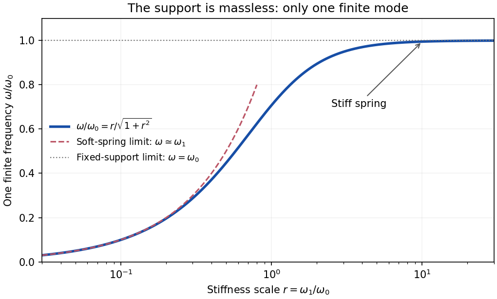

<h1 id="2/c/solution">Solution</h1>

↑ **Parent:** [C](../c.md)

Subtracting the two linearized equations eliminates their acceleration terms:

$$
\omega_0^2\theta=\omega_1^2\eta.
$$

For $g,k>0$, the assumed nontrivial [simple harmonic motion](../../../../simple-harmonic-motion.md) therefore has

$$
\boxed{\eta(t)=\frac{\omega_0^2}{\omega_1^2}\theta_0\sin(\omega t)
=\frac{mg}{k\ell}\theta_0\sin(\omega t).}
$$

The support displacement and pendulum angle oscillate in phase. Inserting this relation into either [Euler-Lagrange equation](../../../../euler-lagrange-equation.md) yields

$$
\omega^2\left(1+\frac{\omega_0^2}{\omega_1^2}\right)=\omega_0^2,
$$

so the one positive finite [angular frequency](../../../../angular-frequency.md) is

$$
\boxed{\omega=\frac{\omega_0\omega_1}{\sqrt{\omega_0^2+\omega_1^2}}
=\sqrt{\frac{gk}{mg+k\ell}},\qquad \frac1{\omega^2}=\frac\ell g+\frac mk.}
$$

The negative frequency describes the same real oscillation after a phase change. For a general phase, replace the sine in both coordinates by $A\cos(\omega t)+B\sin(\omega t)$.

There is no missing second finite branch. The quadratic [Lagrangian](../../../../lagrangian.md) is

$$
L_2=\frac12(\dot\eta+\dot\theta)^2-\frac12\omega_1^2\eta^2-\frac12\omega_0^2\theta^2,
$$

whose kinetic matrix is $\left(\begin{smallmatrix}1&1\\1&1\end{smallmatrix}\right)$ and has rank one. Its characteristic [determinant](../../../../determinant.md) is $\omega_0^2\omega_1^2-(\omega_0^2+\omega_1^2)\omega^2$, not a quadratic polynomial in $\omega^2$. This [singular kinetic matrix in small oscillations](../../../../singular-kinetic-matrix-in-small-oscillations.md) results from taking the support mass to be exactly zero. Adding a small support mass restores a second mode that runs to infinite frequency as that mass vanishes.

For a stiff spring,

$$
\boxed{k\to\infty:\qquad\eta\to0,\qquad\omega\to\sqrt{g/\ell}.}
$$

The hinge becomes fixed, recovering the [simple pendulum](../../../../simple-pendulum-split.md) frequency, as expected for the [pendulum with a massless spring-mounted support](../../../../pendulum-with-a-massless-spring-mounted-support.md). At finite $k$, horizontal support motion makes the frequency smaller.

**[Figure 2](#2/c/image-a-massless-spring-mounted-support-lowers-the-pendulum-s-one-finite-frequency). A massless spring-mounted support lowers the pendulum's one finite frequency**. Original curve of $\omega/\omega_0=r/\sqrt{1+r^2}$ against $r=\omega_1/\omega_0$. The small-$r$ spring-controlled limit and the large-$r$ fixed-support limit are marked.

## ↑ Ancestors (14)

1. [C](../c.md)
2. [2](../../2.md)
3. [2018](../../../2018-split.md)
4. [Past exam of the theoretical physics I course of the University of Cambridge](../../../split.md)
5. [Theoretical Physics I course of the University of Cambridge](../../../../theoretical-physics-i-course-of-the-university-of-cambridge.md)
6. [Theoretical Physics course of the University of Cambridge](../../../../theoretical-physics-course-of-the-university-of-cambridge.md)
7. [Physics course of the year 3 of the natural sciences course of the University of Cambridge](../../../../physics-course-of-the-year-3-of-the-natural-sciences-course-of-the-university-of-cambridge.md)
8. [Year 3 of the natural sciences course of the University of Cambridge](../../../../year-3-of-the-natural-sciences-course-of-the-university-of-cambridge.md)
9. [Year of the natural sciences course of the University of Cambridge](../../../../year-of-the-natural-sciences-course-of-the-university-of-cambridge.md)
10. [Natural sciences course of the University of Cambridge](../../../../natural-sciences-course-of-the-university-of-cambridge.md)
11. [Course of the University of Cambridge](../../../../course-of-the-university-of-cambridge.md)
12. [University of Cambridge](../../../../university-of-cambridge-split.md)
13. [List of universities](../../../../list-of-universities.md)
14. [Codex Wiki](../../../../split.md)
