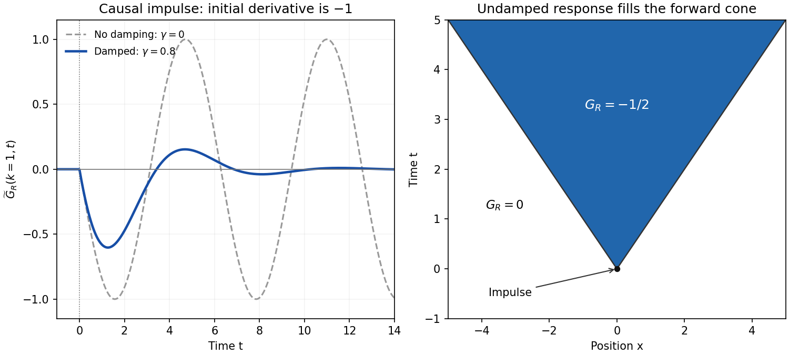

<h1 id="4/d/solution">Solution</h1>

↑ **Parent:** [D](../d.md)

For $0<k^2<4/\gamma^2$, define

$$
a_k=\frac{\gamma k^2}{2},\qquad \Omega_k=\sqrt{k^2-\frac{\gamma^2k^4}{4}}>0.
$$

The simple poles are $\omega_\pm=\pm\Omega_k-ia_k$. In the inverse transform $\widetilde G(k,t)=\int e^{-i\omega t}\widehat G\,d\omega/(2\pi)$, close the contour below for $t>0$. Its clockwise orientation gives $-i$ times the sum of residues. That sum is

$$
\frac{e^{-i\omega_+t}-e^{-i\omega_-t}}{2\Omega_k}
=-i e^{-a_kt}\frac{\sin(\Omega_kt)}{\Omega_k}.
$$

For $t<0$, close above; there are no poles. The [residue theorem](../../../../residue-theorem.md) therefore gives

$$
\boxed{\widetilde G_R(k,t)=-\Theta(t)e^{-\gamma k^2t/2}\frac{\sin(\Omega_kt)}{\Omega_k}.}
$$

Here $\Theta$ is the [Heaviside step function](../../../../heaviside-step-function.md). At $k=0$ the continuous retarded limit is $-t\Theta(t)$. At critical damping, $\Omega_k\to0$ likewise replaces $\sin(\Omega_kt)/\Omega_k$ by $t$; beyond the stated oscillatory range an imaginary $\Omega_k$ converts it to a hyperbolic sine. These continuations retain decaying temporal exponents.

For each fixed $k$, taking $\gamma\to0^+$ gives

$$
\widetilde G_R(k,t)\longrightarrow-\Theta(t)\frac{\sin(|k|t)}{|k|}.
$$

For $t>0$, invert in space and set $s=kt$:

$$
G_R(x,t)=-\frac{\Theta(t)}{2\pi}\int_{-\infty}^{\infty}\frac{\sin(kt)}k e^{-ikx}\,dk
=-\frac{\Theta(t)}{2\pi}\int_{-\infty}^{\infty}\frac{\sin s}s e^{-isx/t}\,ds.
$$

The correctly normalized [sinc function](../../../../sinc-function.md) transform is

$$
\frac1\pi\int_{-\infty}^{\infty}\frac{\sin s}s e^{-isu}\,ds
=\begin{cases}1,&|u|<1,\\0,&|u|>1.\end{cases}
$$

For instance, $\sin s/s=\frac12\int_{-1}^{1}e^{isy}\,dy$, and [Fourier inversion](../../../../fourier-inversion-theorem.md) immediately gives the factor $\pi$. The PDF's prefactor $\sqrt{2/\pi}$ is inconsistent with its top hat of unit height; it would give height $\sqrt{2\pi}$. Using the normalized identity yields

$$
\boxed{G_R(x,t)=-\frac12\Theta(t)\Theta(t-|x|)
=-\frac12\Theta(t-|x|),}
$$

as a [distribution](../../../../distribution-mathematical-analysis.md). The values assigned precisely at a wave front do not change that distribution. This is the negative of the standard [one-dimensional retarded wave Green function](../../../../one-dimensional-retarded-wave-green-function.md), because the PDF's differential operator is $-\partial_t^2+\partial_x^2$.

The sign and initial data can be checked without any contour calculation. Integrating the spatial-Fourier equation through the impulse gives

$$
\widetilde G_R(k,0^+)=0,\qquad \partial_t\widetilde G_R(k,0^+)=-1.
$$

In real space these are $G_R(x,0^+)=0$ and $\partial_tG_R(x,0^+)=-\delta(x)$. In particular,

$$
\lim_{t\downarrow0}\int_{\mathbb R}\frac{G_R(x,t)}t f(x)\,dx=-f(0)
$$

for a smooth test function $f$, confirming the negative delta-function initial velocity. Before the impulse the displacement and velocity are zero. The disturbance fills the forward [causal cone for the constant-speed wave equation](../../../../causal-cone-for-the-constant-speed-wave-equation.md), whose fronts move at unit speed, consistent with $\rho=\kappa=1$. The final question's printed $\rho=k$ is interpreted as $\rho=\kappa$, referring to the elastic constant, not to the Fourier wavevector. No initial conditions were otherwise specified, so the causal choice has been made explicitly.

**[Figure 3](#4/d/image-retarded-rod-response-damping-of-a-fourier-mode-and-the-undamped-causal-cone). Retarded rod response: damping of a Fourier mode and the undamped causal cone**. Original calculated Fourier-mode responses for $k=1$, and the zero-damping spacetime Green function for the operator $-\partial_t^2+\partial_x^2$. Its value is $-1/2$ inside the forward cone and zero outside; the negative sign enforces the stated positive delta-function source.

## ↑ Ancestors (14)

1. [D](../d.md)
2. [4](../../4.md)
3. [2018](../../../2018-split.md)
4. [Past exam of the theoretical physics I course of the University of Cambridge](../../../split.md)
5. [Theoretical Physics I course of the University of Cambridge](../../../../theoretical-physics-i-course-of-the-university-of-cambridge.md)
6. [Theoretical Physics course of the University of Cambridge](../../../../theoretical-physics-course-of-the-university-of-cambridge.md)
7. [Physics course of the year 3 of the natural sciences course of the University of Cambridge](../../../../physics-course-of-the-year-3-of-the-natural-sciences-course-of-the-university-of-cambridge.md)
8. [Year 3 of the natural sciences course of the University of Cambridge](../../../../year-3-of-the-natural-sciences-course-of-the-university-of-cambridge.md)
9. [Year of the natural sciences course of the University of Cambridge](../../../../year-of-the-natural-sciences-course-of-the-university-of-cambridge.md)
10. [Natural sciences course of the University of Cambridge](../../../../natural-sciences-course-of-the-university-of-cambridge.md)
11. [Course of the University of Cambridge](../../../../course-of-the-university-of-cambridge.md)
12. [University of Cambridge](../../../../university-of-cambridge-split.md)
13. [List of universities](../../../../list-of-universities.md)
14. [Codex Wiki](../../../../split.md)
