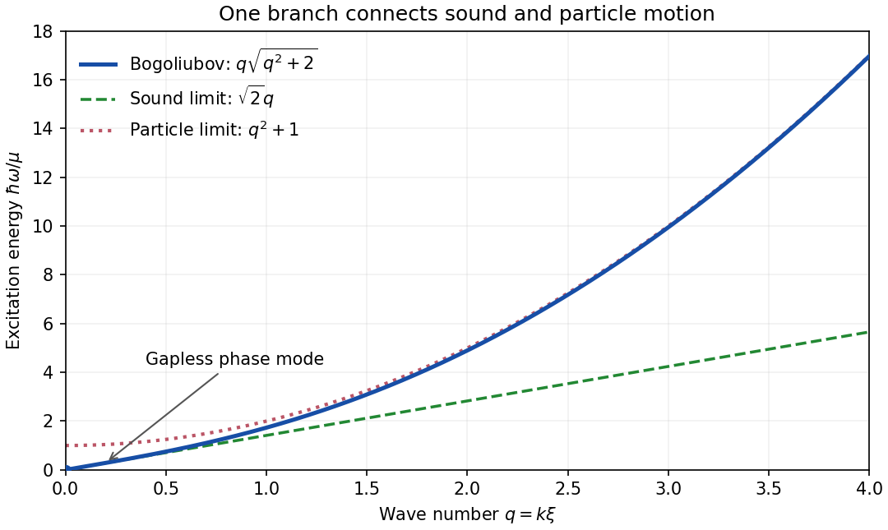

# 2019

↑ **Parent:** [Past exam of the theoretical physics I course of the University of Cambridge](../past-exam-of-the-theoretical-physics-i-course-of-the-university-of-cambridge.md)

[Original paper, released PDF pages 390–393](https://www.whatdotheyknow.com/request/natural_science_tripos_physics_e/response/2127325/attach/3/FOI%202022%20639%20Sullivan%20materials.pdf?cookie_passthrough=1#page=390)

**Table of contents**

- [1](#1)
  - [a](#1/a)
    - [Solution](#1/a/solution)
  - [b](#1/b)
    - [Solution](#1/b/solution)
  - [c](#1/c)
    - [Solution](#1/c/solution)
  - [d](#1/d)
    - [Solution](#1/d/solution)
  - [e](#1/e)
    - [Solution](#1/e/solution)
- [2](#2)
  - [Solution](#2/solution)
- [3](#3)
  - [a](#3/a)
    - [Solution](#3/a/solution)
  - [b](#3/b)
    - [Solution](#3/b/solution)
  - [c](#3/c)
    - [Solution](#3/c/solution)
  - [d](#3/d)
    - [Solution](#3/d/solution)
  - [e](#3/e)
    - [Solution](#3/e/solution)
- [4](#4)
  - [a](#4/a)
    - [Solution](#4/a/solution)
  - [b](#4/b)
    - [Solution](#4/b/solution)
  - [c](#4/c)
    - [Solution](#4/c/solution)
  - [d](#4/d)
    - [Solution](#4/d/solution)
  - [e](#4/e)
    - [Solution](#4/e/solution)

## 1

↑ **Parent:** [2019](2019.md)

<h3 id="1/a">a</h3>

↑ **Parent:** [1](#1)

<h4 id="1/a/solution">Solution</h4>

↑ **Parent:** [A](#1/a)

Use [Minkowski metric](../special-relativity.md#minkowski-metric) $g_{\mu\nu}=\operatorname{diag}(-1,1,1,1)$ and units with the [speed of light](../special-relativity.md#speed-of-light) equal to one. Thus $u^\mu u_\mu=-1$, and $h_{\mu\nu}=g_{\mu\nu}+u_\mu u_\nu$ is the [spatial projector of a timelike congruence](../geodesic-congruence.md#spatial-projector-of-a-timelike-congruence). Keep the medium velocity fixed when varying the [electromagnetic four-potential](../relativistic-electromagnetism.md#electromagnetic-four-potential). Since the [electromagnetic field tensor](../relativistic-electromagnetism.md#electromagnetic-field-tensor) is $F_{\mu\nu}=\partial_\mu A_\nu-\partial_\nu A_\mu$, its variation gives

$$
\delta_A S=\int d^4x\,\frac12(M^{\mu\nu}-F^{\mu\nu})(\partial_\mu\delta A_\nu-\partial_\nu\delta A_\mu)
=\int d^4x\,(M^{\mu\nu}-F^{\mu\nu})\partial_\mu\delta A_\nu.
$$

Both [tensors](../multilinear-algebra.md#tensor) are antisymmetric. [Integration by parts](../calculus.md#integration-by-parts), with variations vanishing at the boundary, therefore gives

$$
\delta_A S=\int d^4x\,\partial_\mu(F^{\mu\nu}-M^{\mu\nu})\delta A_\nu.
$$

The [Euler-Lagrange field equation](../classical-field-theory.md#euler-lagrange-field-equation) is $\partial_\mu(F^{\mu\nu}-M^{\mu\nu})=0$. Renaming the free index and using antisymmetry gives

$$
\boxed{\partial_\nu F^{\mu\nu}=\partial_\nu M^{\mu\nu}.}
$$

These are the inhomogeneous [Maxwell equations](../maxwell-equations.md) with the [bound charge and bound current](../electromagnetism.md#bound-charge-and-bound-current) encoded by the [polarization-magnetization tensor](../relativistic-electromagnetism.md#polarization-magnetization-tensor).

<h3 id="1/b">b</h3>

↑ **Parent:** [1](#1)

<h4 id="1/b/solution">Solution</h4>

↑ **Parent:** [B](#1/b)

There is a sign inconsistency in the original PDF: varying its action gives a plus sign for the spatially projected magnetic term, whereas its displayed target equation has a minus sign. The following [Lagrange multiplier for antisymmetry](../multilinear-algebra.md#lagrange-multiplier-for-antisymmetry) calculation derives the result of the action as printed.

Temporarily vary all sixteen entries $M^{\mu\nu}$ independently and add

$$
\mathcal L_{\lambda}=\frac12\lambda_{\mu\nu}(M^{\mu\nu}+M^{\nu\mu}),\qquad \lambda_{\mu\nu}=\lambda_{\nu\mu}.
$$

Variation of the symmetric [Lagrange multiplier](../mathematical-optimization.md#lagrange-multiplier) imposes $M^{\mu\nu}+M^{\nu\mu}=0$. Define

$$
w_\mu=u_\rho M^\rho{}_{\mu},\qquad C_{\mu\nu}=h_{\mu\rho}h_{\nu\sigma}M^{\rho\sigma}.
$$

On this constraint surface, $C_{\nu\mu}=-C_{\mu\nu}$. Differentiating the original contractions before imposing the constraint gives

$$
\left.\frac{\partial}{\partial M^{\mu\nu}}(u_\alpha u_\beta M^{\lambda\alpha}M^\beta{}_{\lambda})\right|_{M=-M^{\mathsf T}}
=u_\nu w_\mu-u_\mu w_\nu,
$$

and

$$
\left.\frac{\partial}{\partial M^{\mu\nu}}(h_{\alpha\rho}h_{\beta\sigma}M^{\alpha\beta}M^{\sigma\rho})\right|_{M=-M^{\mathsf T}}
=-2C_{\mu\nu}.
$$

In particular, the reversed order $\sigma\rho$ in the last factor of the action matters. The unrestricted [Euler-Lagrange field equation](../classical-field-theory.md#euler-lagrange-field-equation), evaluated on the antisymmetry constraint, is

$$
0=\frac12F_{\mu\nu}-\frac1{2\kappa}(u_\nu w_\mu-u_\mu w_\nu)+\frac1{2\chi}C_{\mu\nu}+\lambda_{\mu\nu}.
$$

Subtract its index-transposed equation to eliminate the symmetric multiplier:

$$
\boxed{0=F_{\mu\nu}-\frac1\kappa\left(u_\nu u_\rho M^\rho{}_{\mu}-u_\mu u_\rho M^\rho{}_{\nu}\right)+\frac1\chi h_{\mu\rho}h_{\nu\sigma}M^{\rho\sigma}.}
$$

A direct check is to restrict the [action](../lagrangian-mechanics.md#action) to a rest-frame magnetic component $M^{12}=m$, $M^{21}=-m$: its quadratic contribution is $+m^2/(2\chi)$, whose derivative has a positive sign. To obtain the PDF's target equation instead, one must reverse the sign of that quadratic term in the action, or replace its last $M^{\sigma\rho}$ by $M^{\rho\sigma}$. These are alternative repairs; changing conventions cannot make the printed action and printed equation agree.

<h3 id="1/c">c</h3>

↑ **Parent:** [1](#1)

<h4 id="1/c/solution">Solution</h4>

↑ **Parent:** [C](#1/c)

Choose $A^\mu=(\Phi,\mathbf A)$, so that $F_{i0}=E_i$ and $F_{ij}=\epsilon_{ijk}B_k$, with $\epsilon_{123}=1$. The definitions of the [polarization-magnetization tensor](../relativistic-electromagnetism.md#polarization-magnetization-tensor) imply $M^{0i}=-P_i$ and $M^{ij}=\epsilon_{ijk}M_k$. Separating temporal and spatial indices,

$$
\frac12M^{\mu\nu}F_{\mu\nu}=M^{i0}F_{i0}+\frac12M^{ij}F_{ij}
=\mathbf P\cdot\mathbf E+\frac12\epsilon_{ijk}\epsilon_{ij\ell}M_kB_\ell.
$$

The [Levi-Civita symbol](../multivariable-calculus.md#levi-civita-symbol) contraction equals $2\delta_{k\ell}$, giving

$$
\boxed{\mathcal L_{\rm int}=\mathbf P\cdot\mathbf E+\mathbf M\cdot\mathbf B.}
$$

Thus $\mathbf P$ is the [electric dipole moment](../electrostatics.md#electric-dipole-moment) per volume, or [electric polarization](../electromagnetism.md#polarization-density), and $\mathbf M$ is the [magnetic dipole moment](../electromagnetism.md#magnetic-dipole-moment) per volume, or [magnetization](../electromagnetism.md#magnetization). The signs are those of dipole interactions in a [Lagrangian](../calculus-of-variations.md#lagrangian); the associated fixed-dipole potential energies have the opposite signs. Consistently, the equation in part (a) has components

$$
\nabla\cdot(\mathbf E+\mathbf P)=0,\qquad
\nabla\times(\mathbf B-\mathbf M)=\partial_t(\mathbf E+\mathbf P),
$$

so $\rho_b=-\nabla\cdot\mathbf P$ and $\mathbf J_b=\partial_t\mathbf P+\nabla\times\mathbf M$ are the [bound charge and bound current](../electromagnetism.md#bound-charge-and-bound-current).

<h3 id="1/d">d</h3>

↑ **Parent:** [1](#1)

<h4 id="1/d/solution">Solution</h4>

↑ **Parent:** [D](#1/d)

In the rest frame $u^\mu=(1,0,0,0)$ and $h_{\mu\nu}=\operatorname{diag}(0,1,1,1)$. The two material contractions in the printed action become $-\mathbf P^2$ and $-2\mathbf M^2$. Consequently its material [Lagrangian density](../classical-field-theory.md#lagrangian-density) is

$$
\mathcal L_{\rm mat}=\mathbf P\cdot\mathbf E+\mathbf M\cdot\mathbf B+\frac{\mathbf P^2}{2\kappa}+\frac{\mathbf M^2}{2\chi}.
$$

The [Euler-Lagrange field equations](../classical-field-theory.md#euler-lagrange-field-equation) are algebraic, since no derivatives of the material variables occur. They give

$$
\boxed{\mathbf P=-\kappa\mathbf E,\qquad \mathbf M=-\chi\mathbf B\quad\text{for the printed action}.}
$$

These also follow from the $i0$ and $ij$ components of the corrected equation in part (b). If instead the intended starting point was the PDF's displayed equation in part (b), its predictions would be

$$
\boxed{\mathbf P=-\kappa\mathbf E,\qquad \mathbf M=+\chi\mathbf B\quad\text{for the printed target equation}.}
$$

The two magnetic answers express the documented sign error, rather than different choices of frame. Here the inverse coefficients in the action require nonzero $\kappa,\chi$; zero response is obtained as a limiting constitutive law.

<h3 id="1/e">e</h3>

↑ **Parent:** [1](#1)

<h4 id="1/e/solution">Solution</h4>

↑ **Parent:** [E](#1/e)

The constants specify isotropic, nondispersive [linear response](../statistical-physics.md#linear-response-theory): $\kappa$ controls [electric polarization](../electromagnetism.md#polarization-density), and $\chi$ controls [magnetization](../electromagnetism.md#magnetization). Their numerical relation to conventional [electric susceptibility](../permittivity.md#electric-susceptibility) and [magnetic susceptibility](../statistical-physics.md#magnetic-susceptibility) depends on the signs and field normalization in the action. In the rationalized units used here, the printed action gives the [constitutive relations](../maxwell-equations.md#constitutive-relations)

$$
\mathbf D=\mathbf E+\mathbf P=(1-\kappa)\mathbf E,\qquad
\mathbf H=\mathbf B-\mathbf M=(1+\chi)\mathbf B.
$$

Thus its relative [permittivity](../permittivity.md) and [magnetic permeability](../maxwell-equations.md#permeability-electromagnetism) are

$$
\boxed{\varepsilon_r=1-\kappa,\qquad \mu_r=\frac1{1+\chi},\qquad \chi_e=-\kappa,\qquad \chi_m=-\frac{\chi}{1+\chi}.}
$$

Here conventional $\chi_m$ is defined by $\mathbf M=\chi_m\mathbf H$, not by $\mathbf M=\chi_m\mathbf B$. With the alternative repaired action that yields the PDF's target equation, $\varepsilon_r$ is unchanged but $\mu_r=(1-\chi)^{-1}$ and $\chi_m=\chi/(1-\chi)$. In particular, a positive conventional [electric susceptibility](../permittivity.md#electric-susceptibility) corresponds to negative $\kappa$ in the printed conventions; the problem does not specify signs for these constants.

## 2

↑ **Parent:** [2019](2019.md)

<h3 id="2/solution">Solution</h3>

↑ **Parent:** [2](#2)

**Constraint and example.** A [holonomic constraint](../classical-mechanics.md#holonomic-constraint) can be written $f_\alpha(q_1,\ldots,q_n,t)=0$, with no irreducible dependence on [velocities](../classical-mechanics.md#velocity). A velocity relation is holonomic if it integrates to such an equation. For example, a particle constrained to a stationary circle satisfies $x^2+y^2=\ell^2$, reducing its two Cartesian [degrees of freedom](../classical-mechanics.md#degree-of-freedom) to one angle. A [nonholonomic constraint](../classical-mechanics.md#nonholonomic-constraint) cannot be integrated in this way.

**Kinematics and kinetic energy.** Set $d=R-r>0$. In the plane of the original diagram, choose the orbital angle $\theta$ positive counterclockwise from vertically downward. The marked radius of the inner cylinder then has absolute orientation $\alpha=\theta-\phi$ measured from the same downward direction. Its signed spin [angular velocity](../rigid-body-dynamics.md#angular-velocity) is $\Omega=\dot\theta-\dot\phi$, while

$$
\mathbf X_G=d(\sin\theta,-\cos\theta),\qquad |\dot{\mathbf X}_G|=d|\dot\theta|.
$$

The [moment of inertia of a uniform solid cylinder](../rigid-body-dynamics.md#moment-of-inertia-of-a-uniform-solid-cylinder) is $I=mr^2/2$. Applying the [kinetic energy decomposition about the center of mass](../energy.md#kinetic-energy-decomposition-about-the-center-of-mass) gives

$$
\boxed{T=\frac12md^2\dot\theta^2+\frac12I\Omega^2
=\frac m2(R-r)^2\dot\theta^2+\frac m4r^2(\dot\phi-\dot\theta)^2.}
$$

**No slip.** With tangential unit vector $\mathbf e_\theta=(\cos\theta,\sin\theta)$, the inner contact point has [velocity](../classical-mechanics.md#velocity) $(d\dot\theta+r\Omega)\mathbf e_\theta$. The fixed wall requires this to vanish. Hence

$$
d\dot\theta+r(\dot\theta-\dot\phi)=0,\qquad R\dot\theta-r\dot\phi=0.
$$

Because $r,R$ are constant, integration gives

$$
\boxed{r\phi-R\theta=0,\qquad \Omega=-\frac{R-r}{r}\dot\theta,}
$$

where the integration constant is zero with the marked-dot reference in the diagram and continuously unwrapped angles. This is a [holonomic constraint](../classical-mechanics.md#holonomic-constraint), even though it was first obtained from a condition on [velocities](../classical-mechanics.md#velocity).

**Oscillations.** The [gravitational potential energy](../energy.md#gravitational-energy) above the lowest position is $V=mgd(1-\cos\theta)$. Eliminating $\phi$ gives the reduced [Lagrangian](../calculus-of-variations.md#lagrangian)

$$
L=\frac34md^2\dot\theta^2-mgd(1-\cos\theta).
$$

The [Euler-Lagrange equation](../analysis.md#euler-lagrange-equation) becomes

$$
\frac32md^2\ddot\theta+mgd\sin\theta=0.
$$

Thus the bottom is a stable equilibrium, and for $|\theta|\ll1$ there is [simple harmonic motion](../classical-mechanics.md#simple-harmonic-motion), with

$$
\boxed{\omega_0=\sqrt{\frac{2g}{3(R-r)}},\qquad
f_0=\frac1{2\pi}\sqrt{\frac{2g}{3(R-r)}}.}
$$

The extra rotational [kinetic energy](../energy.md#kinetic-energy) reduces the frequency compared with a particle sliding without friction along the same circular path. The [small oscillations inside a circular cylinder](../rigid-body-dynamics.md#small-oscillations-inside-a-circular-cylinder) formula applies with inertia ratio $\gamma=1/2$.

**Friction and energy.** Let $F_t$ be the signed tangential contact force in the $\mathbf e_\theta$ direction. Applying [Newton's second law](../force.md#newton-s-second-law) to translation and the [torque](../momentum.md#torque) equation to rotation gives

$$
md\ddot\theta=-mg\sin\theta+F_t,\qquad
I\dot\Omega=rF_t.
$$

Using the [rolling without slipping](../rigid-body-dynamics.md#rolling-without-slipping) condition yields

$$
\boxed{F_t=\frac13mg\sin\theta.}
$$

Except at special instants, [static friction](../force.md#static-friction) is needed to produce the spin acceleration. There is no sliding at the contact point, whose instantaneous [velocity](../classical-mechanics.md#velocity) is zero; therefore this force does no total work. Its translational and rotational powers cancel: $F_td\dot\theta+F_tr\Omega=0$. The stationary [normal reaction](../force.md#normal-force) likewise does no work. With a rigid wall, adequate [static friction](../force.md#static-friction), and no rolling resistance, [conservation of energy](../mathematical-physics.md#conservation-of-energy) gives

$$
\boxed{E=\frac34md^2\dot\theta^2+mgd(1-\cos\theta)=\text{constant}.}
$$

**Angular momentum.** The cylinder's spin [angular momentum](../momentum.md#angular-momentum) $I\Omega$ is generally not conserved because the contact friction exerts a [torque](../momentum.md#torque) about its [center of mass](../classical-mechanics.md#center-of-mass). About the fixed outer-cylinder center $O$, the [angular momentum decomposition about the centre of mass](../classical-mechanics.md#angular-momentum-decomposition-about-the-centre-of-mass) gives

$$
L_O=md^2\dot\theta+I\Omega=md\left(d-\frac r2\right)\dot\theta.
$$

Gravity and friction exert the external [torque](../momentum.md#torque)

$$
\dot L_O=-mgd\sin\theta+RF_t
=mg\left(r-\frac{2R}{3}\right)\sin\theta.
$$

Thus **the rolling cylinder does not generally conserve angular momentum**, although it conserves mechanical [energy](../energy.md). There is a special geometric cancellation at $R=3r/2$: then $L_O$ and its torque vanish identically for this planar motion. Angular momentum of a larger isolated system including the wall and Earth is a separate conservation statement.

**Scope of the holonomic reduction.** The integrated constraint is exact at every angle for planar [rolling without slipping](../rigid-body-dynamics.md#rolling-without-slipping) with sustained contact; it is not restricted to [small oscillations](../lagrangian-mechanics.md#small-oscillation). Completing a full turn requires tracking angle winding rather than reducing each angle separately modulo $2\pi$. This global bookkeeping does not make the local velocity relation nonintegrable.

However, arbitrary initial conditions need not sustain this ideal rolling motion. The inward [normal reaction](../force.md#normal-force) and the required friction are

$$
N=m(g\cos\theta+d\dot\theta^2),\qquad |F_t|=\frac13mg|\sin\theta|.
$$

Contact requires $N\geq0$, and a finite coefficient $\mu_s$ of [static friction](../force.md#static-friction) requires $|F_t|\leq\mu_sN$. If either fails, the cylinder detaches or slips and the one-coordinate rolling [Lagrangian](../calculus-of-variations.md#lagrangian) no longer applies. Slipping contact allows $\theta$ and $\phi$ to be independent; detachment removes the fixed center-distance constraint. These changes alone do not establish a [nonholonomic constraint](../classical-mechanics.md#nonholonomic-constraint). Allowing general three-dimensional reorientation can introduce nonintegrable rolling constraints, but that motion is outside the diagram's two-angle planar model. Thus **the stated planar rolling constraint is holonomic throughout its regime of validity; it cannot be imposed on every physically possible motion**.

## 3

↑ **Parent:** [2019](2019.md)

<h3 id="3/a">a</h3>

↑ **Parent:** [3](#3)

<h4 id="3/a/solution">Solution</h4>

↑ **Parent:** [A](#3/a)

Under $\psi\mapsto e^{i\alpha}\psi$ with constant real $\alpha$, the field and its [complex conjugate](../complex-analysis.md#complex-conjugate) acquire opposite phases. These cancel in $|\psi|^2$, $|\psi|^4$, $\nabla\psi^*\cdot\nabla\psi$, and $\psi^*\dot\psi-\psi\dot\psi^*$. The [Lagrangian density](../classical-field-theory.md#lagrangian-density) therefore has the [particle-number phase symmetry](../quantum-ideal-gas-statistics.md#particle-number-phase-symmetry), a global [circle group](../lie-theory.md#circle-group) $U(1)$.

For a spacetime-dependent real $\alpha(\mathbf r,t)$,

$$
\dot\psi'=e^{i\alpha}(\dot\psi+i\dot\alpha\psi),\qquad
\nabla\psi'=e^{i\alpha}(\nabla\psi+i\psi\nabla\alpha).
$$

Writing $n=|\psi|^2$, the change in the [Lagrangian density](../classical-field-theory.md#lagrangian-density) is

$$
\Delta\mathcal L=-\hbar n\dot\alpha-\frac{\hbar^2}{2M}\left[
i(\psi\nabla\psi^*-\psi^*\nabla\psi)\cdot\nabla\alpha+n|\nabla\alpha|^2\right].
$$

This is not generally zero or a [boundary term](../calculus.md#boundary-term). Thus **the symmetry is global, with no arbitrary local phase symmetry**. A compensating [gauge field](../relativistic-quantum-field.md#gauge-field) and [gauge-covariant derivative of a charged scalar field](../classical-field-theory.md#gauge-covariant-derivative-of-a-charged-scalar-field) would be required to promote it to a local redundancy.

<h3 id="3/b">b</h3>

↑ **Parent:** [3](#3)

<h4 id="3/b/solution">Solution</h4>

↑ **Parent:** [B](#3/b)

Treat $\psi,\psi^*$ independently in the [Legendre transform in mechanics](../classical-mechanics.md#legendre-transform-in-mechanics). Their [canonical momenta](../hamiltonian-mechanics.md#canonical-momentum) are

$$
\pi_\psi=\frac{i\hbar}{2}\psi^*,\qquad \pi_{\psi^*}=-\frac{i\hbar}{2}\psi.
$$

The time-derivative terms cancel in $\pi_\psi\dot\psi+\pi_{\psi^*}\dot\psi^*-\mathcal L$, giving the [Hamiltonian density](../classical-field-theory.md#hamiltonian-density)

$$
\boxed{\mathcal H=\frac{\hbar^2}{2M}|\nabla\psi|^2-\mu|\psi|^2+\frac g2|\psi|^4.}
$$

The first-order time dependence makes the momenta constrained; this direct calculation still gives the canonical density. In physical terms this is the [grand-canonical Hamiltonian of a Bose field](../quantum-ideal-gas-statistics.md#grand-canonical-hamiltonian-of-a-bose-field), $K=H-\mu N$. The physical energy density is obtained by adding $\mu|\psi|^2$ back. A stationary field in this chemical-potential frame has the usual factor $e^{-i\mu t/\hbar}$ in the physical frame.

Complete the square:

$$
\mathcal H=\frac{\hbar^2}{2M}|\nabla\psi|^2+\frac g2\left(|\psi|^2-\frac\mu g\right)^2-\frac{\mu^2}{2g}.
$$

For uniform or periodic boundary conditions, or in the homogeneous bulk, both nonconstant terms are nonnegative and vanish simultaneously at

$$
\boxed{\psi_0=\sqrt{\frac\mu g}\,e^{i\theta_0},\qquad \mathcal H_{\min}=-\frac{\mu^2}{2g}.}
$$

The [ground states](../quantum-mechanics.md#ground-state) form a circle. A particular nonzero $\psi_0$ is changed by every nontrivial phase rotation, although the full family is invariant. Selecting one such [mean-field theory](../statistical-physics.md#mean-field-theory) state therefore exhibits [spontaneous symmetry breaking](../quantum-field-theory.md#spontaneous-symmetry-breaking) of $U(1)$. This describes phase selection in the thermodynamic limit; an exact finite-system particle-number [eigenstate](../energy-eigenvalue.md#eigenstate) need not itself have a nonzero field expectation.

<h3 id="3/c">c</h3>

↑ **Parent:** [3](#3)

<h4 id="3/c/solution">Solution</h4>

↑ **Parent:** [C](#3/c)

Choose the real representative $v=\psi_0=\sqrt{\mu/g}$. For $\psi=v+\chi$,

$$
|\psi|^2=v^2+v(\chi+\chi^*)+|\chi|^2,
$$

and the fourth power through quadratic order is

$$
|\psi|^4=v^4+2v^3(\chi+\chi^*)+2v^2|\chi|^2+v^2(\chi+\chi^*)^2+O(\chi^3).
$$

In $\mu|\psi|^2-g|\psi|^4/2$, the linear terms and the $|\chi|^2$ terms cancel because $gv^2=\mu$. The remaining potential contribution is $\mu^2/(2g)-\mu(\chi+\chi^*)^2/2$.

The time-derivative contribution is

$$
\frac{i\hbar}{2}(\psi^*\dot\psi-\psi\dot\psi^*)
=\frac{i\hbar v}{2}\partial_t(\chi-\chi^*)+\frac{i\hbar}{2}(\chi^*\dot\chi-\chi\dot\chi^*).
$$

Its first term is a [total derivative](../calculus.md#total-derivative) and contributes only a temporal [boundary term](../calculus.md#boundary-term) for fixed endpoint fields. Since $v$ is uniform, the gradient contribution is simply $-\hbar^2|\nabla\chi|^2/(2M)$. Dropping that boundary term and the constant, the [quadratic condensate fluctuation Lagrangian](../quantum-ideal-gas-statistics.md#quadratic-condensate-fluctuation-lagrangian) is

$$
\boxed{\mathcal L_2=\frac{i\hbar}{2}(\chi^*\dot\chi-\chi\dot\chi^*)-\frac{\hbar^2}{2M}\nabla\chi^*\cdot\nabla\chi-\frac\mu2(\chi+\chi^*)^2.}
$$

The omitted cubic and quartic interactions describe scattering between these small fluctuations; they do not enter the linear [normal mode](../wave-equation.md#normal-mode) calculation.

<h3 id="3/d">d</h3>

↑ **Parent:** [3](#3)

<h4 id="3/d/solution">Solution</h4>

↑ **Parent:** [D](#3/d)

For independent $\chi,\chi^*$, the derivatives needed in the $\chi^*$ [Euler-Lagrange field equation](../classical-field-theory.md#euler-lagrange-field-equation) are

$$
\frac{\partial\mathcal L_2}{\partial\chi^*}=\frac{i\hbar}{2}\dot\chi-\mu(\chi+\chi^*),\qquad
\frac{\partial\mathcal L_2}{\partial\dot\chi^*}=-\frac{i\hbar}{2}\chi,\qquad
\frac{\partial\mathcal L_2}{\partial(\nabla\chi^*)}=-\frac{\hbar^2}{2M}\nabla\chi.
$$

Consequently the two conjugate field equations are

$$
\boxed{i\hbar\dot\chi=-\frac{\hbar^2}{2M}\nabla^2\chi+\mu(\chi+\chi^*),\qquad
-i\hbar\dot\chi^*=-\frac{\hbar^2}{2M}\nabla^2\chi^*+\mu(\chi+\chi^*).}
$$

Write $\chi=\chi_1+i\chi_2$ with real components, and put $A=\hbar^2/(2M)$. Separating real and imaginary parts gives

$$
-\hbar\dot\chi_2=(-A\nabla^2+2\mu)\chi_1,\qquad
\hbar\dot\chi_1=-A\nabla^2\chi_2.
$$

For each real field take the real part of a complex [plane wave](../wave-function.md#plane-wave) amplitude, $\chi_j=\operatorname{Re}[q_j e^{i(\mathbf k\cdot\mathbf r-\omega t)}]$. With $\epsilon_k=\hbar^2|\mathbf k|^2/(2M)$ the two equations become

$$
i\hbar\omega q_2=(\epsilon_k+2\mu)q_1,\qquad
-i\hbar\omega q_1=\epsilon_k q_2.
$$

A nonzero [normal mode](../wave-equation.md#normal-mode) requires their [determinant](../multilinear-algebra.md#determinant) to vanish, so

$$
\hbar^2\omega^2=\epsilon_k(\epsilon_k+2\mu).
$$

The positive-frequency [Bogoliubov quasiparticle dispersion](../quantum-ideal-gas-statistics.md#bogoliubov-quasiparticle-dispersion) is therefore

$$
\boxed{\omega(\mathbf k)=\frac1\hbar\sqrt{\epsilon_k(\epsilon_k+2\mu)}
=\sqrt{\frac{|\mathbf k|^2}{2M}\left(\frac{\hbar^2|\mathbf k|^2}{2M}+2\mu\right)}.}
$$

There is also the negative-frequency conjugate solution, as required for real component fields. Since $\mu>0$, $\omega^2\geq0$, consistent with the stability of the chosen uniform [ground state](../quantum-mechanics.md#ground-state).

<h3 id="3/e">e</h3>

↑ **Parent:** [3](#3)

<h4 id="3/e/solution">Solution</h4>

↑ **Parent:** [E](#3/e)

At long wavelength,

$$
\boxed{\omega(k)=c_s k+O(k^3),\qquad c_s=\sqrt{\frac\mu M},\qquad \omega(0)=0.}
$$

This is the sound-like [Goldstone mode](../critical-phenomenon.md#goldstone-boson) of the broken global $U(1)$ [continuous symmetry](../physics.md#continuous-symmetry). A spatially uniform infinitesimal phase change is $\delta\psi=i\psi_0\delta\theta$, entirely in the $\chi_2$ direction, and costs no potential energy. Slow spatial variations acquire gradient energy and propagate as sound. Thus the [dispersion relation](../dispersion-relation.md) realizes [Goldstone's theorem](../quantum-field-theory.md#goldstone-theorem) through a gapless excitation; it is not a massive phase oscillation.

The amplitude and phase are canonically paired by the first-order time derivative in the [quadratic condensate fluctuation Lagrangian](../quantum-ideal-gas-statistics.md#quadratic-condensate-fluctuation-lagrangian). There is one positive-frequency branch, rather than an additional independent amplitude branch of a relativistic second-order-time theory. At high momentum,

$$
\hbar\omega=\epsilon_k+\mu+O(\mu^2/\epsilon_k),
$$

so the same branch becomes particle-like. The [healing length](../quantum-ideal-gas-statistics.md#healing-length) $\xi=\hbar/\sqrt{2M\mu}$ sets the crossover scale.

**[Figure 1](#3/e/image-gapless-bogoliubov-dispersion-and-its-sound-and-particle-limits). Gapless Bogoliubov dispersion and its sound and particle limits**. Original dimensionless curves with $q=k\xi$ and $E/\mu=\hbar\omega/\mu$. The exact curve is $q\sqrt{q^2+2}$, the sound asymptote is $\sqrt2q$, and the large-momentum asymptote is $q^2+1$.

## 4

↑ **Parent:** [2019](2019.md)

<h3 id="4/a">a</h3>

↑ **Parent:** [4](#4)

<h4 id="4/a/solution">Solution</h4>

↑ **Parent:** [A](#4/a)

A [Landau free energy](../critical-phenomenon.md#landau-free-energy) is a coarse-grained thermodynamic potential expressed as a function of a proposed macroscopic [order parameter](../critical-phenomenon.md#order-parameter). Its coefficients include microscopic and thermal effects already averaged over. At fixed external thermodynamic conditions, equilibrium selects its [global minimum](../analysis.md#global-minimum); other [local minima](../analysis.md#local-minimum) can represent [metastable](../critical-phenomenon.md#metastability) states. It is not the internal energy of a single microscopic magnetic configuration. Here the real scalar $m$ represents a selected component of [magnetization](../electromagnetism.md#magnetization): zero describes the disordered state, while nonzero values distinguish two oppositely ordered states.

Every power is even, so the internal [discrete symmetry](../physics.md#discrete-symmetry) is

$$
\boxed{m\longmapsto-m,\qquad \mathbb Z_2.}
$$

For a magnetic [order parameter](../critical-phenomenon.md#order-parameter), this represents reversal of the magnetization, as under [time reversal](../quantum-field-theory.md#t-symmetry) in zero applied [magnetic field](../magnetic-field.md). A nonzero field would generally add an odd term and break this symmetry explicitly. This scalar model has no continuous internal rotation symmetry; physical rotational symmetry of a vector magnet is not implied by treating one real component. The condition $c>0$ makes the polynomial bounded below at large $|m|$.

For the requested ordered phase on cooling, take the usual implicit assumption $a>0$, and write $r=a(T-T_c)$. If $a<0$ the temperature directions reverse; if $a=0$ this expansion has no temperature-driven transition. The source explicitly states only $c>0$.

<h3 id="4/b">b</h3>

↑ **Parent:** [4](#4)

<h4 id="4/b/solution">Solution</h4>

↑ **Parent:** [B](#4/b)

The stationary points of the [Landau free energy](../critical-phenomenon.md#landau-free-energy) obey

$$
f'(m)=2m(r+bm^2+cm^4)=0.
$$

For $b>0$, $r\geq0$ makes every term of $f$ nonnegative, so $m=0$ is the unique [global minimum](../analysis.md#global-minimum). For $r<0$, its curvature $f''(0)=2r$ is negative. Setting $x=m^2$ gives $cx^2+bx+r=0$, whose unique positive root is

$$
x_+=\frac{-b+\sqrt{b^2-4cr}}{2c}.
$$

At a nonzero stationary point,

$$
f''(m)=4x(b+2cx),\qquad f(m)=-\frac b2x^2-\frac{2c}{3}x^3.
$$

Thus both $m=\pm\sqrt{x_+}$ are stable and have lower [free energy](../thermodynamic-potential.md#thermodynamic-free-energy) than $m=0$. The [equilibrium magnetization](../critical-phenomenon.md#equilibrium-magnetization) is

$$
\boxed{m_{\rm eq}=\begin{cases}
0,&T\geq T_c,\\
\displaystyle\pm\left[\frac{-b+\sqrt{b^2+4ac(T_c-T)}}{2c}\right]^{1/2},&T<T_c.
\end{cases}}
$$

For fixed $b>0$ and $T\to T_c^-$, expand the square root:

$$
m_{\rm eq}^2=\frac{a(T_c-T)}b+O((T_c-T)^2).
$$

It tends continuously to zero. Hence the [continuous phase transition](../critical-phenomenon.md#continuous-phase-transition) has the [order-parameter critical exponent](../critical-phenomenon.md#order-parameter-critical-exponent)

$$
\boxed{|m_{\rm eq}|\sim\sqrt{\frac ab}(T_c-T)^{1/2},\qquad\beta=\frac12.}
$$

This is the [mean-field critical exponent](../critical-phenomenon.md#mean-field-critical-exponent); fluctuation corrections beyond [Landau theory](../critical-phenomenon.md#landau-theory) are not included.

<h3 id="4/c">c</h3>

↑ **Parent:** [4](#4)

<h4 id="4/c/solution">Solution</h4>

↑ **Parent:** [C](#4/c)

For $b<0$ at $T=T_c$, the quartic term lowers the [free energy](../thermodynamic-potential.md#thermodynamic-free-energy) near $m=0$, while the positive sextic term stabilizes it at larger $|m|$. The nonzero stationary points have

$$
\boxed{m^2=-\frac bc,\qquad f(m)=\frac{b^3}{6c^2}<0.}
$$

They are [global minima](../analysis.md#global-minimum). The stationary point $m=0$ has zero quadratic curvature but is a flat local maximum because its leading nonzero term is negative. Thus the system is already ordered at $T_c$, with a finite [magnetization](../electromagnetism.md#magnetization).

More explicitly, a continuous onset from $m=0$ could occur only where $f''(0)=2r$ vanishes, namely at $r=0$. But the global minima there are the finite values above. For sufficiently large positive $r$, only $m=0$ is stable. Therefore the equilibrium minimum must change at some positive $r$ by crossing between a zero and a finite nonzero [order parameter](../critical-phenomenon.md#order-parameter). This is a [first-order phase transition](../thermodynamic-potential.md#first-order-phase-transition). Its actual temperature lies above $T_c$ and is calculated next; $T_c$ itself is the disordered [spinodal point](../critical-phenomenon.md#spinodal-point), not the coexistence temperature.

**[Figure 2](#4/c/image-free-energy-coexistence-and-the-continuous-and-first-order-landau-transition-lines). Free-energy coexistence and the continuous and first-order Landau transition lines**. Original plots. The left panel uses $b=-1,c=1$ at $r=0$, at coexistence $r=3/16$, and above coexistence $r=0.24$. The right panel uses $a=c=1$ and shows the equilibrium phase boundaries in the $(T-T_c,b)$ plane. Dashed gray curves are spinodal limits, not additional equilibrium transitions.

<h3 id="4/d">d</h3>

↑ **Parent:** [4](#4)

<h4 id="4/d/solution">Solution</h4>

↑ **Parent:** [D](#4/d)

At [phase coexistence](../critical-phenomenon.md#phase-coexistence), the finite ordered [global minimum](../analysis.md#global-minimum) has the same [free energy](../thermodynamic-potential.md#thermodynamic-free-energy) as $m=0$. With $x=m^2>0$ and $f(0)=0$, stationarity and equal values give

$$
r+bx+cx^2=0,\qquad r+\frac b2x+\frac c3x^2=0.
$$

Subtracting eliminates $r$:

$$
\frac b2x+\frac{2c}{3}x^2=0,\qquad x_*=-\frac{3b}{4c}>0.
$$

Substitute back to get $r_*=3b^2/(16c)$, so

$$
\boxed{T_c^*=T_c+\frac{3b^2}{16ac},\qquad
m_{\rm jump}=\sqrt{-\frac{3b}{4c}}\quad(b<0).}
$$

The three degenerate equilibrium values at this temperature are $0$ and $\pm m_{\rm jump}$. A useful global check, avoiding confusion with a [spinodal point](../critical-phenomenon.md#spinodal-point), is the exact factorization

$$
\left.f(m)\right|_{r=r_*}=\frac c3m^2\left(m^2+\frac{3b}{4c}\right)^2\geq0.
$$

All three zeros are therefore [global minima](../analysis.md#global-minimum). Their curvatures are positive: $f''(0)=3b^2/(8c)$ and $f''(\pm m_{\rm jump})=3b^2/(2c)$.

The ordered local minimum first appears on cooling at $r=b^2/(4c)$, where the nonzero stationary roots merge. It becomes globally stable only at $r_*$; the disordered minimum remains [metastable](../critical-phenomenon.md#metastability) down to $r=0$. These different temperatures distinguish [phase coexistence](../critical-phenomenon.md#phase-coexistence) from loss of local stability.

<h3 id="4/e">e</h3>

↑ **Parent:** [4](#4)

<h4 id="4/e/solution">Solution</h4>

↑ **Parent:** [E](#4/e)

Let $\Delta T=T-T_c$, with $a,c>0$ fixed. The equilibrium [phase diagram](../thermodynamic-potential.md#phase-diagram) has boundaries

$$
\boxed{\begin{aligned}
\Delta T&=0,&&b>0&&\text{continuous},\\
\Delta T&=\frac{3b^2}{16ac},&&b<0&&\text{first order}.
\end{aligned}}
$$

For either branch, larger $\Delta T$ is disordered and smaller $\Delta T$ is ordered. Both signs of the ordered [magnetization](../electromagnetism.md#magnetization) are symmetry-related [global minima](../analysis.md#global-minimum) throughout the ordered region, rather than separate regions selected by temperature and $b$.

The branches meet at the [tricritical point](../critical-phenomenon.md#tricritical-point) $(\Delta T,b)=(0,0)$. Directly on $b=0$, minimizing $rm^2+cm^6/3$ gives

$$
\boxed{|m_{\rm eq}|=\left[\frac{a(T_c-T)}c\right]^{1/4}\quad(T<T_c),\qquad \beta_{\rm tri}=\frac14.}
$$

The transition there remains continuous, with a different [mean-field critical exponent](../critical-phenomenon.md#mean-field-critical-exponent). For $b<0$, the metastability boundaries are $\Delta T=0$ for the disordered state and $\Delta T=b^2/(4ac)$ for the ordered state. The [first-order phase transition](../thermodynamic-potential.md#first-order-phase-transition) curve lies strictly between them, as shown in the figure. These spinodal curves describe possible hysteretic continuation of local minima, not equilibrium phase boundaries.

## ↑ Ancestors (11)

1. [Past exam of the theoretical physics I course of the University of Cambridge](../past-exam-of-the-theoretical-physics-i-course-of-the-university-of-cambridge.md)
2. [Theoretical Physics I course of the University of Cambridge](../university-of-cambridge.md#theoretical-physics-i-course-of-the-university-of-cambridge)
3. [Theoretical Physics course of the University of Cambridge](../university-of-cambridge.md#theoretical-physics-course-of-the-university-of-cambridge)
4. [Physics course of the year 3 of the natural sciences course of the University of Cambridge](../university-of-cambridge.md#physics-course-of-the-year-3-of-the-natural-sciences-course-of-the-university-of-cambridge)
5. [Year 3 of the natural sciences course of the University of Cambridge](../university-of-cambridge.md#year-3-of-the-natural-sciences-course-of-the-university-of-cambridge)
6. [Year of the natural sciences course of the University of Cambridge](../university-of-cambridge.md#year-of-the-natural-sciences-course-of-the-university-of-cambridge)
7. [Natural sciences course of the University of Cambridge](../university-of-cambridge.md#natural-sciences-course-of-the-university-of-cambridge)
8. [Course of the University of Cambridge](../university-of-cambridge.md#course-of-the-university-of-cambridge)
9. [University of Cambridge](../university-of-cambridge.md)
10. [List of universities](../README.md#list-of-universities)
11. [Codex Wiki](../README.md)
